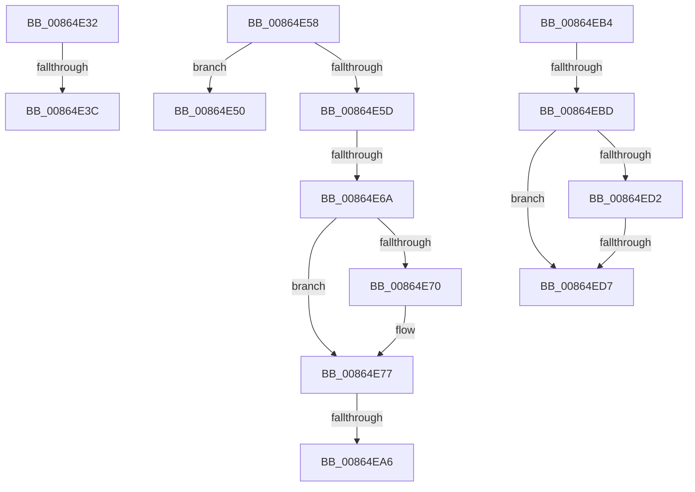

# sub_00864E32

- RVA: `0x00864E32`–`0x00864EDE` (길이 `172` bytes)
- VA: `0x0000000140864E32`
- 실행 섹션: `PAGE`
- PDB 이름 있음: `아니요`; PDB Function 태그: `아니요`
- unwind 정보 RVA: `0x0006BA38`
- 디코드: `43`개 명령, `172/172` bytes 표시
- 미해석 바이트: `0` (있으면 어셈블리에 `.byte`로 보존)

> 이 문서는 커널 이미지의 기계어와 PDB 기호를 분석해 생성했습니다. 4번과 5번은 함수 원형과 자료형을 바이너리 사용 방식에서 추정한 C 해석이며 원본 소스 복구 결과는 아닙니다.

## 1. Dependencies

- 직접 호출 지점: **4**; 고유 호출 대상: **3**
- 직접 호출자로 확인된 함수: **0**
- RIP 상대 이미지 참조: **0**

### Outgoing calls
- `0x00864E42` → [ExFreePoolWithTag](../../poolcode/B8/ExFreePoolWithTag_function_00B82870.md) (function, `0x00B82870`)
- `0x00864E72` → [ExFreePoolWithTag](../../poolcode/B8/ExFreePoolWithTag_function_00B82870.md) (function, `0x00B82870`)
- `0x00864EA6` → [ExpInterlockedPushEntrySList](../../text/6B/ExpInterlockedPushEntrySList_function_006BA5B0.md) (function, `0x006BA5B0`)
- `0x00864EC0` → [ObpLockObjectTypeExclusive](../9D/ObpLockObjectTypeExclusive_function_009DB5C4.md) (function, `0x009DB5C4`)

### Direct callers
- 이 함수 시작 RVA로 연결되는 직접 call은 확인되지 않았습니다. 간접 호출은 완전히 역산할 수 없습니다.

### Static image references
- 디코드된 RIP-relative 메모리 참조가 없습니다.

## 2. Other-region calls and transfers

- 다른 실행 섹션으로 향하는 call: **3**
  - `0x00864E42` → [ExFreePoolWithTag](../../poolcode/B8/ExFreePoolWithTag_function_00B82870.md) (`PAGE` → `POOLCODE`)
  - `0x00864E72` → [ExFreePoolWithTag](../../poolcode/B8/ExFreePoolWithTag_function_00B82870.md) (`PAGE` → `POOLCODE`)
  - `0x00864EA6` → [ExpInterlockedPushEntrySList](../../text/6B/ExpInterlockedPushEntrySList_function_006BA5B0.md) (`PAGE` → `.text`)
- call이 아닌 외부 분기/꼬리 이동: **8**
  - `0x00864E36` → [sub_00864C3A + 0x165](Unknown_function_00864C3A.md) (`tail-transfer`)
  - `0x00864E4B` → [sub_00864C3A + 0x165](Unknown_function_00864C3A.md) (`tail-transfer`)
  - `0x00864E53` → [sub_00864C3A + 0x15C](Unknown_function_00864C3A.md) (`tail-transfer`)
  - `0x00864E64` → [sub_00864EE6 + 0x13A](Unknown_function_00864EE6.md) (`tail-transfer`)
  - `0x00864EA0` → [sub_00864EE6 + 0xEE](Unknown_function_00864EE6.md) (`tail-transfer`)
  - `0x00864EAF` → [sub_00864C3A + 0x15C](Unknown_function_00864C3A.md) (`tail-transfer`)
  - `0x00864EB7` → [sub_00864C3A + 0x80](Unknown_function_00864C3A.md) (`tail-transfer`)
  - `0x00864ED5` → [sub_00864EE6 + 0x2A](Unknown_function_00864EE6.md) (`tail-transfer`)

## 3. Assembly (complete function range)

```asm
00864E32  F6 43 1B 40                     test byte ptr [rbx + 0x1b], 0x40
00864E36  0F 85 63 FF FF FF               jne 0x140864d9f
00864E3C  49 8B 0C 24                     mov rcx, qword ptr [r12]
00864E40  33 D2                           xor edx, edx
00864E42  E8 29 DA 31 00                  call 0x140b82870
00864E47  4D 89 3C 24                     mov qword ptr [r12], r15
00864E4B  E9 4F FF FF FF                  jmp 0x140864d9f
00864E50  45 33 FF                        xor r15d, r15d
00864E53  E9 3E FF FF FF                  jmp 0x140864d96
00864E58  48 85 D2                        test rdx, rdx
00864E5B  74 F3                           je 0x140864e50
00864E5D  48 8B 4A 20                     mov rcx, qword ptr [rdx + 0x20]
00864E61  48 85 C9                        test rcx, rcx
00864E64  0F 84 B6 01 00 00               je 0x140865020
00864E6A  80 7A 10 01                     cmp byte ptr [rdx + 0x10], 1
00864E6E  77 07                           ja 0x140864e77
00864E70  33 D2                           xor edx, edx
00864E72  E8 F9 D9 31 00                  call 0x140b82870
00864E77  48 8B 43 20                     mov rax, qword ptr [rbx + 0x20]
00864E7B  45 33 FF                        xor r15d, r15d
00864E7E  4C 89 78 20                     mov qword ptr [rax + 0x20], r15
00864E82  65 4C 8B 04 25 20 00 00 00      mov r8, qword ptr gs:[0x20]
00864E8B  48 8B 53 20                     mov rdx, qword ptr [rbx + 0x20]
00864E8F  49 8B 88 40 08 00 00            mov rcx, qword ptr [r8 + 0x840]
00864E96  FF 41 1C                        inc dword ptr [rcx + 0x1c]
00864E99  0F B7 41 10                     movzx eax, word ptr [rcx + 0x10]
00864E9D  66 39 01                        cmp word ptr [rcx], ax
00864EA0  0F 83 2E 01 00 00               jae 0x140864fd4
00864EA6  E8 05 57 E5 FF                  call 0x1406ba5b0
00864EAB  4C 89 7B 20                     mov qword ptr [rbx + 0x20], r15
00864EAF  E9 E2 FE FF FF                  jmp 0x140864d96
00864EB4  4D 39 36                        cmp qword ptr [r14], r14
00864EB7  0F 84 FD FD FF FF               je 0x140864cba
00864EBD  48 8B CD                        mov rcx, rbp
00864EC0  E8 FF 66 17 00                  call 0x1409db5c4
00864EC5  49 8B 0E                        mov rcx, qword ptr [r14]
00864EC8  49 8B 46 08                     mov rax, qword ptr [r14 + 8]
00864ECC  4C 39 71 08                     cmp qword ptr [rcx + 8], r14
00864ED0  75 05                           jne 0x140864ed7
00864ED2  4C 39 30                        cmp qword ptr [rax], r14
00864ED5  74 39                           je 0x140864f10
00864ED7  B9 03 00 00 00                  mov ecx, 3
00864EDC  CD 29                           int 0x29
```

## 4. C-style interpretation (structured pseudocode)

```c
__int64 __fastcall sub_00864E32(__int64 a1, int a2)
{
    __int64 result;

    a2 = 0;
    result = ExFreePoolWithTag(*(unsigned __int64 *)(v_r12), a2, a3, a4);
    *(unsigned __int64 *)(v_r12) = v_r15;
}
```

## 5. (Beta) C Style

```c
int64_t sub_00864E32(int64_t Arg1, int32_t Arg2)
{
    int64_t result;

    Arg2 = 0;
    result = ExFreePoolWithTag(*(uint64_t *)(local_r12), Arg2, a3, a4);
    *(uint64_t *)(local_r12) = local_r15;
}
```

## 6. Execution-region graph

[열기: 2D/3D 그래프와 함수 탐색 컨트롤 패널](../../../control-panel.html?section=page&rva=0x00864E32&view=graph)

- 2D 그래프는 위에서 아래로 흐르고, 3D 그래프는 빈 공간을 드래그해 회전합니다. Shift+드래그는 이동, 휠은 확대·축소, 함수 노드 선택은 대상 보고서 이동입니다.

### Static fallback


