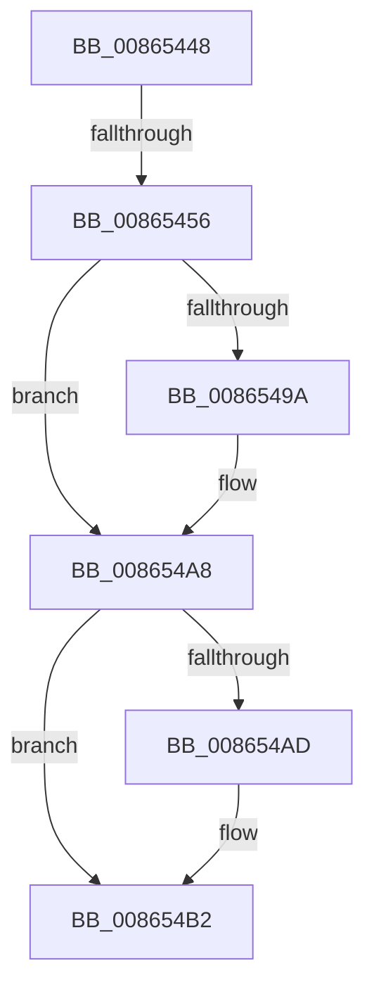

# sub_00865448

- RVA: `0x00865448`–`0x008654CA` (길이 `130` bytes)
- VA: `0x0000000140865448`
- 실행 섹션: `PAGE`
- PDB 이름 있음: `아니요`; PDB Function 태그: `아니요`
- unwind 정보 RVA: `0x0006BAB4`
- 디코드: `33`개 명령, `130/130` bytes 표시
- 미해석 바이트: `0` (있으면 어셈블리에 `.byte`로 보존)

> 이 문서는 커널 이미지의 기계어와 PDB 기호를 분석해 생성했습니다. 4번과 5번은 함수 원형과 자료형을 바이너리 사용 방식에서 추정한 C 해석이며 원본 소스 복구 결과는 아닙니다.

## 1. Dependencies

- 직접 호출 지점: **2**; 고유 호출 대상: **2**
- 직접 호출자로 확인된 함수: **0**
- RIP 상대 이미지 참조: **1**

### Outgoing calls
- `0x00865489` → [KeAbPreAcquire](../../text/21/KeAbPreAcquire_function_00210230.md) (function, `0x00210230`)
- `0x008654A3` → [ExfAcquirePushLockExclusiveEx](../../text/20/ExfAcquirePushLockExclusiveEx_function_0020FC90.md) (function, `0x0020FC90`)

### Direct callers
- 이 함수 시작 RVA로 연결되는 직접 call은 확인되지 않았습니다. 간접 호출은 완전히 역산할 수 없습니다.

### Static image references
- `0x0086546A` → RVA `0x00FD0EC0` (`CACHEALI`; read)

## 2. Other-region calls and transfers

- 다른 실행 섹션으로 향하는 call: **2**
  - `0x00865489` → [KeAbPreAcquire](../../text/21/KeAbPreAcquire_function_00210230.md) (`PAGE` → `.text`)
  - `0x008654A3` → [ExfAcquirePushLockExclusiveEx](../../text/20/ExfAcquirePushLockExclusiveEx_function_0020FC90.md) (`PAGE` → `.text`)
- call이 아닌 외부 분기/꼬리 이동: **2**
  - `0x00865450` → [sub_00865578](Unknown_function_00865578.md) (`tail-transfer`)
  - `0x008654C8` → [sub_00865538 + 0x7](Unknown_function_00865538.md) (`tail-transfer`)

## 3. Assembly (complete function range)

```asm
00865448  4C 89 7C 24 58                  mov qword ptr [rsp + 0x58], r15
0086544D  48 85 C9                        test rcx, rcx
00865450  0F 85 22 01 00 00               jne 0x140865578
00865456  8B 43 10                        mov eax, dword ptr [rbx + 0x10]
00865459  45 33 C0                        xor r8d, r8d
0086545C  65 4C 8B 24 25 88 01 00 00      mov r12, qword ptr gs:[0x188]
00865465  33 D2                           xor edx, edx
00865467  0F B6 E8                        movzx ebp, al
0086546A  48 8D 05 4F BA 76 00            lea rax, [rip + 0x76ba4f]
00865471  48 C1 E5 04                     shl rbp, 4
00865475  48 03 E8                        add rbp, rax
00865478  66 41 FF 8C 24 E4 01 00 00      dec word ptr [r12 + 0x1e4]
00865481  48 8B CD                        mov rcx, rbp
00865484  90                              nop
00865485  4C 8D 75 08                     lea r14, [rbp + 8]
00865489  E8 A2 AD 9A FF                  call 0x140210230
0086548E  F0 48 0F BA 6D 00 00            lock bts qword ptr [rbp], 0
00865495  4C 8B F8                        mov r15, rax
00865498  73 0E                           jae 0x1408654a8
0086549A  4C 8B C5                        mov r8, rbp
0086549D  48 8B D0                        mov rdx, rax
008654A0  48 8B CD                        mov rcx, rbp
008654A3  E8 E8 A7 9A FF                  call 0x14020fc90
008654A8  4D 85 FF                        test r15, r15
008654AB  74 05                           je 0x1408654b2
008654AD  41 C6 47 0A 01                  mov byte ptr [r15 + 0xa], 1
008654B2  F7 DE                           neg esi
008654B4  48 63 C6                        movsxd rax, esi
008654B7  F0 48 0F C1 43 08               lock xadd qword ptr [rbx + 8], rax
008654BD  4C 8B 7C 24 58                  mov r15, qword ptr [rsp + 0x58]
008654C2  48 2B C7                        sub rax, rdi
008654C5  48 85 C0                        test rax, rax
008654C8  7F 75                           jg 0x14086553f
```

## 4. C-style interpretation (structured pseudocode)

```c
__int64 __fastcall sub_00865448(__int64 a1, int a2, int a3, __int64 a4, __int64 a5, __int64 a6, __int64 a7, __int64 a8, __int64 a9, __int64 a10, __int64 a11)
{
    __int64 result;
    __int64 v_rbp;
    __int64 v_rsi;
    unsigned __int64 v_stack_p58;

    v_stack_p58 = v_r15;
    a3 = 0;
    a2 = 0;
    v_rbp = ((unsigned __int8)((unsigned int)(*(unsigned int *)(v_rbx + 16)))) << (4);
    v_rbp = (v_rbp) + (v_rip + 7780943);
    result = KeAbPreAcquire(v_rbp, a2, a3, a4);
    if (!(condition_is_above_or_equal)) {
        a3 = v_rbp;
        a2 = result;
        a1 = v_rbp;
        result = ExfAcquirePushLockExclusiveEx(a1, a2, a3, a4);
    }
    if (result != 0) {
        *(unsigned __int8 *)(result + 10) = 1;
    }
    v_rsi = (unsigned int)(-(v_rsi));
    result = ((int)((unsigned int)(v_rsi))) - (v_rdi);
}
```

## 5. (Beta) C Style

```c
int64_t sub_00865448(int64_t Arg1, int32_t Arg2, int32_t Arg3, int64_t Arg4, uint64_t Arg5, uint64_t Arg6, uint64_t Arg7, uint64_t Arg8, uint64_t Arg9, uint64_t Arg10, int64_t Arg11)
{
    int64_t result;
    int64_t local_rbp;
    int64_t local_rsi;
    uint64_t v_stack_p58;

    v_stack_p58 = local_r15;
    Arg3 = 0;
    Arg2 = 0;
    local_rbp = ((uint8_t)((uint32_t)(*(uint32_t *)(local_rbx + 0x10)))) << (4);
    local_rbp = (local_rbp) + (v_rip + 7780943);
    result = KeAbPreAcquire(local_rbp, Arg2, Arg3, Arg4);
    if (!(condition_is_above_or_equal)) {
        Arg3 = local_rbp;
        Arg2 = result;
        Arg1 = local_rbp;
        result = ExfAcquirePushLockExclusiveEx(Arg1, Arg2, Arg3, Arg4);
    }
    if (result != 0) {
        *(uint8_t *)(result + 0xA) = 1;
    }
    local_rsi = (uint32_t)(-(local_rsi));
    result = ((int32_t)((uint32_t)(local_rsi))) - (local_rdi);
}
```

## 6. Execution-region graph

[열기: 2D/3D 그래프와 함수 탐색 컨트롤 패널](../../../control-panel.html?section=page&rva=0x00865448&view=graph)

- 2D 그래프는 위에서 아래로 흐르고, 3D 그래프는 빈 공간을 드래그해 회전합니다. Shift+드래그는 이동, 휠은 확대·축소, 함수 노드 선택은 대상 보고서 이동입니다.

### Static fallback


