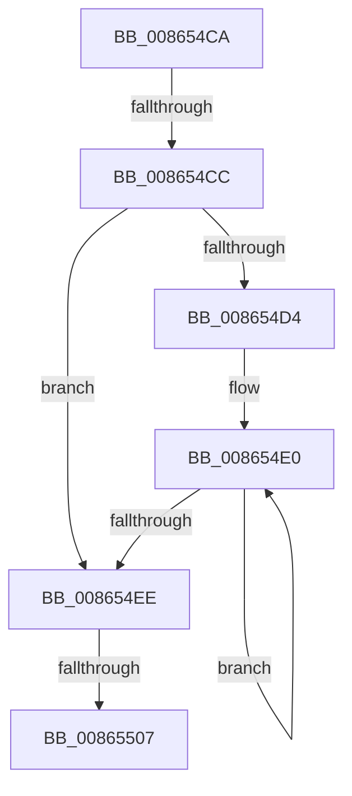

# sub_008654CA

- RVA: `0x008654CA`–`0x00865538` (길이 `110` bytes)
- VA: `0x00000001408654CA`
- 실행 섹션: `PAGE`
- PDB 이름 있음: `아니요`; PDB Function 태그: `아니요`
- unwind 정보 RVA: `0x0006BAC8`
- 디코드: `29`개 명령, `110/110` bytes 표시
- 미해석 바이트: `0` (있으면 어셈블리에 `.byte`로 보존)

> 이 문서는 커널 이미지의 기계어와 PDB 기호를 분석해 생성했습니다. 4번과 5번은 함수 원형과 자료형을 바이너리 사용 방식에서 추정한 C 해석이며 원본 소스 복구 결과는 아닙니다.

## 1. Dependencies

- 직접 호출 지점: **3**; 고유 호출 대상: **3**
- 직접 호출자로 확인된 함수: **0**
- RIP 상대 이미지 참조: **0**

### Outgoing calls
- `0x0086550A` → [KeAbPostRelease](../../text/2E/KeAbPostRelease_function_002E1600.md) (function, `0x002E1600`)
- `0x00865512` → [KeLeaveCriticalRegionThread](../../text/25/KeLeaveCriticalRegionThread_function_0025EFF0.md) (function, `0x0025EFF0`)
- `0x0086551F` → [ExFreePoolWithTag](../../poolcode/B8/ExFreePoolWithTag_function_00B82870.md) (function, `0x00B82870`)

### Direct callers
- 이 함수 시작 RVA로 연결되는 직접 call은 확인되지 않았습니다. 간접 호출은 완전히 역산할 수 없습니다.

### Static image references
- 디코드된 RIP-relative 메모리 참조가 없습니다.

## 2. Other-region calls and transfers

- 다른 실행 섹션으로 향하는 call: **3**
  - `0x0086550A` → [KeAbPostRelease](../../text/2E/KeAbPostRelease_function_002E1600.md) (`PAGE` → `.text`)
  - `0x00865512` → [KeLeaveCriticalRegionThread](../../text/25/KeLeaveCriticalRegionThread_function_0025EFF0.md) (`PAGE` → `.text`)
  - `0x0086551F` → [ExFreePoolWithTag](../../poolcode/B8/ExFreePoolWithTag_function_00B82870.md) (`PAGE` → `POOLCODE`)
- call이 아닌 외부 분기/꼬리 이동: **3**
  - `0x008654CA` → [sub_00865538](Unknown_function_00865538.md) (`tail-transfer`)
  - `0x00865505` → [sub_00865538 + 0x2C](Unknown_function_00865538.md) (`tail-transfer`)
  - `0x00865533` → [ObDeassignSecurity + 0x3E](ObDeassignSecurity_function_008653F0.md) (`tail-transfer`)

## 3. Assembly (complete function range)

```asm
008654CA  75 6C                           jne 0x140865538
008654CC  49 8B 0E                        mov rcx, qword ptr [r14]
008654CF  48 3B CB                        cmp rcx, rbx
008654D2  74 1A                           je 0x1408654ee
008654D4  0F 1F 40 00                     nop dword ptr [rax]
008654D8  0F 1F 84 00 00 00 00 00         nop dword ptr [rax + rax]
008654E0  48 8B 01                        mov rax, qword ptr [rcx]
008654E3  4C 8B F1                        mov r14, rcx
008654E6  48 8B C8                        mov rcx, rax
008654E9  48 3B C3                        cmp rax, rbx
008654EC  75 F2                           jne 0x1408654e0
008654EE  48 8B 03                        mov rax, qword ptr [rbx]
008654F1  49 89 06                        mov qword ptr [r14], rax
008654F4  48 C7 C0 FF FF FF FF            mov rax, 0xffffffffffffffff
008654FB  F0 48 0F C1 45 00               lock xadd qword ptr [rbp], rax
00865501  24 06                           and al, 6
00865503  3C 02                           cmp al, 2
00865505  74 5D                           je 0x140865564
00865507  48 8B CD                        mov rcx, rbp
0086550A  E8 F1 C0 A7 FF                  call 0x1402e1600
0086550F  49 8B CC                        mov rcx, r12
00865512  E8 D9 9A 9F FF                  call 0x14025eff0
00865517  BA 4F 62 53 63                  mov edx, 0x6353624f
0086551C  48 8B CB                        mov rcx, rbx
0086551F  E8 4C D3 31 00                  call 0x140b82870
00865524  4C 8B 64 24 48                  mov r12, qword ptr [rsp + 0x48]
00865529  48 8B 6C 24 40                  mov rbp, qword ptr [rsp + 0x40]
0086552E  4C 8B 74 24 50                  mov r14, qword ptr [rsp + 0x50]
00865533  E9 F6 FE FF FF                  jmp 0x14086542e
```

## 4. C-style interpretation (structured pseudocode)

```c
__int64 __fastcall sub_008654CA(__int64 a1, __int64 a2, __int64 a3, __int64 a4, __int64 a5, __int64 a6, __int64 a7, __int64 a8, __int64 a9, __int64 a10)
{
    __int64 result;

    if ((*(unsigned __int64 *)(v_r14)) == v_rbx) goto loc_008654EE;
loc_008654E0:
    if ((*(unsigned __int64 *)(*(unsigned __int64 *)(v_r14))) != v_rbx) goto loc_008654E0;
loc_008654EE:
    *(unsigned __int64 *)(*(unsigned __int64 *)(v_r14)) = *(unsigned __int64 *)(v_rbx);
    result = (unsigned __int8)((-1) & (6));
    result = KeAbPostRelease(v_rbp, a2, a3, a4);
    result = KeLeaveCriticalRegionThread(v_r12, a2, a3, a4);
    result = ExFreePoolWithTag(v_rbx, (unsigned int)(0x6353624FULL), a3, a4);
}
```

## 5. (Beta) C Style

```c
int64_t sub_008654CA(int64_t Arg1, int64_t Arg2, int64_t Arg3, int64_t Arg4, uint64_t Arg5, uint64_t Arg6, uint64_t Arg7, int64_t Arg8, int64_t Arg9, int64_t Arg10)
{
    int64_t result;

    if ((*(uint64_t *)(local_r14)) == local_rbx) goto loc_008654EE;
loc_008654E0:
    if ((*(uint64_t *)(*(uint64_t *)(local_r14))) != local_rbx) goto loc_008654E0;
loc_008654EE:
    *(uint64_t *)(*(uint64_t *)(local_r14)) = *(uint64_t *)(local_rbx);
    result = (uint8_t)((-1) & (6));
    result = KeAbPostRelease(local_rbp, Arg2, Arg3, Arg4);
    result = KeLeaveCriticalRegionThread(local_r12, Arg2, Arg3, Arg4);
    result = ExFreePoolWithTag(local_rbx, (uint32_t)(0x6353624FULL), Arg3, Arg4);
}
```

## 6. Execution-region graph

[열기: 2D/3D 그래프와 함수 탐색 컨트롤 패널](../../../control-panel.html?section=page&rva=0x008654CA&view=graph)

- 2D 그래프는 위에서 아래로 흐르고, 3D 그래프는 빈 공간을 드래그해 회전합니다. Shift+드래그는 이동, 휠은 확대·축소, 함수 노드 선택은 대상 보고서 이동입니다.

### Static fallback


