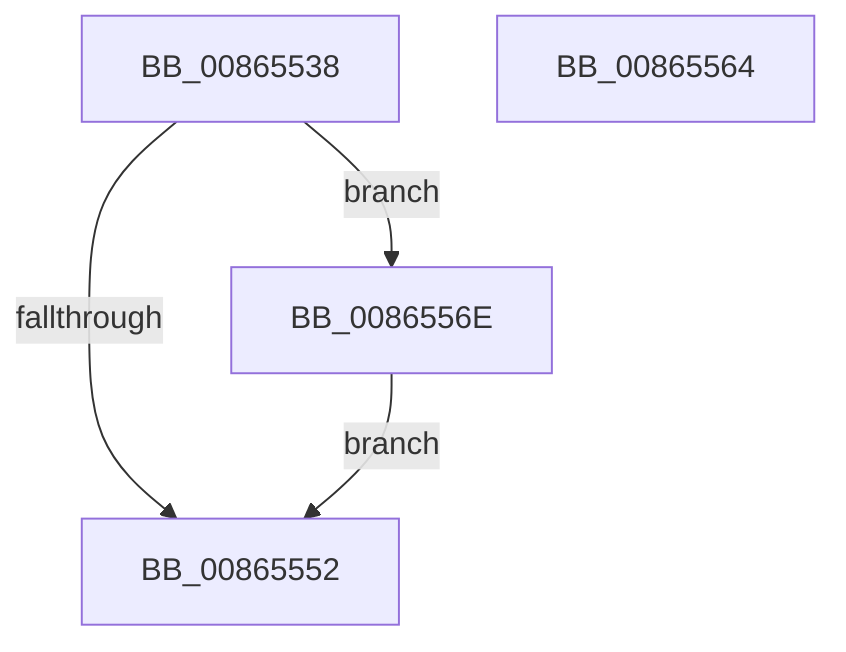

# sub_00865538

- RVA: `0x00865538`–`0x00865578` (길이 `64` bytes)
- VA: `0x0000000140865538`
- 실행 섹션: `PAGE`
- PDB 이름 있음: `아니요`; PDB Function 태그: `아니요`
- unwind 정보 RVA: `0x0006BAD8`
- 디코드: `18`개 명령, `64/64` bytes 표시
- 미해석 바이트: `0` (있으면 어셈블리에 `.byte`로 보존)

> 이 문서는 커널 이미지의 기계어와 PDB 기호를 분석해 생성했습니다. 4번과 5번은 함수 원형과 자료형을 바이너리 사용 방식에서 추정한 C 해석이며 원본 소스 복구 결과는 아닙니다.

## 1. Dependencies

- 직접 호출 지점: **4**; 고유 호출 대상: **3**
- 직접 호출자로 확인된 함수: **0**
- RIP 상대 이미지 참조: **0**

### Outgoing calls
- `0x00865555` → [KeAbPostRelease](../../text/2E/KeAbPostRelease_function_002E1600.md) (function, `0x002E1600`)
- `0x0086555D` → [KeLeaveCriticalRegionThread](../../text/25/KeLeaveCriticalRegionThread_function_0025EFF0.md) (function, `0x0025EFF0`)
- `0x00865567` → [ExfTryToWakePushLock](../../text/26/ExfTryToWakePushLock_function_00265DD0.md) (function, `0x00265DD0`)
- `0x00865571` → [ExfTryToWakePushLock](../../text/26/ExfTryToWakePushLock_function_00265DD0.md) (function, `0x00265DD0`)

### Direct callers
- 이 함수 시작 RVA로 연결되는 직접 call은 확인되지 않았습니다. 간접 호출은 완전히 역산할 수 없습니다.

### Static image references
- 디코드된 RIP-relative 메모리 참조가 없습니다.

## 2. Other-region calls and transfers

- 다른 실행 섹션으로 향하는 call: **4**
  - `0x00865555` → [KeAbPostRelease](../../text/2E/KeAbPostRelease_function_002E1600.md) (`PAGE` → `.text`)
  - `0x0086555D` → [KeLeaveCriticalRegionThread](../../text/25/KeLeaveCriticalRegionThread_function_0025EFF0.md) (`PAGE` → `.text`)
  - `0x00865567` → [ExfTryToWakePushLock](../../text/26/ExfTryToWakePushLock_function_00265DD0.md) (`PAGE` → `.text`)
  - `0x00865571` → [ExfTryToWakePushLock](../../text/26/ExfTryToWakePushLock_function_00265DD0.md) (`PAGE` → `.text`)
- call이 아닌 외부 분기/꼬리 이동: **2**
  - `0x00865562` → [sub_008654CA + 0x5A](Unknown_function_008654CA.md) (`tail-transfer`)
  - `0x0086556C` → [sub_008654CA + 0x3D](Unknown_function_008654CA.md) (`tail-transfer`)

## 3. Assembly (complete function range)

```asm
00865538  B9 0E 00 00 00                  mov ecx, 0xe
0086553D  CD 29                           int 0x29
0086553F  48 C7 C0 FF FF FF FF            mov rax, 0xffffffffffffffff
00865546  F0 48 0F C1 45 00               lock xadd qword ptr [rbp], rax
0086554C  24 06                           and al, 6
0086554E  3C 02                           cmp al, 2
00865550  74 1C                           je 0x14086556e
00865552  48 8B CD                        mov rcx, rbp
00865555  E8 A6 C0 A7 FF                  call 0x1402e1600
0086555A  49 8B CC                        mov rcx, r12
0086555D  E8 8E 9A 9F FF                  call 0x14025eff0
00865562  EB C0                           jmp 0x140865524
00865564  48 8B CD                        mov rcx, rbp
00865567  E8 64 08 A0 FF                  call 0x140265dd0
0086556C  EB 99                           jmp 0x140865507
0086556E  48 8B CD                        mov rcx, rbp
00865571  E8 5A 08 A0 FF                  call 0x140265dd0
00865576  EB DA                           jmp 0x140865552
```

## 4. C-style interpretation (structured pseudocode)

```c
__int64 __fastcall sub_00865538(void)
{
    __int64 result;

    result = (unsigned __int8)((-1) & (6));
    if (((unsigned __int8)(result)) == 2) goto loc_0086556E;
loc_00865552:
    result = KeAbPostRelease(v_rbp, a2, a3, a4);
    result = KeLeaveCriticalRegionThread(v_r12, a2, a3, a4);
loc_0086556E:
    result = ExfTryToWakePushLock(v_rbp, a2, a3, a4);
    goto loc_00865552;
}
```

## 5. (Beta) C Style

```c
void sub_00865538(void)
{
    int64_t result;

    result = (uint8_t)((-1) & (6));
    if (((uint8_t)(result)) == 2) goto loc_0086556E;
loc_00865552:
    result = KeAbPostRelease(local_rbp, a2, a3, a4);
    result = KeLeaveCriticalRegionThread(local_r12, a2, a3, a4);
loc_0086556E:
    result = ExfTryToWakePushLock(local_rbp, a2, a3, a4);
    goto loc_00865552;
}
```

## 6. Execution-region graph

[열기: 2D/3D 그래프와 함수 탐색 컨트롤 패널](../../../control-panel.html?section=page&rva=0x00865538&view=graph)

- 2D 그래프는 위에서 아래로 흐르고, 3D 그래프는 빈 공간을 드래그해 회전합니다. Shift+드래그는 이동, 휠은 확대·축소, 함수 노드 선택은 대상 보고서 이동입니다.

### Static fallback


