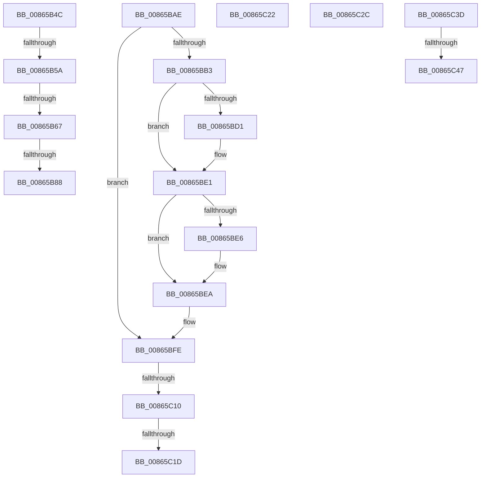

# sub_00865B4C

- RVA: `0x00865B4C`–`0x00865C54` (길이 `264` bytes)
- VA: `0x0000000140865B4C`
- 실행 섹션: `PAGE`
- PDB 이름 있음: `아니요`; PDB Function 태그: `아니요`
- unwind 정보 RVA: `0x0006BB58`
- 디코드: `63`개 명령, `264/264` bytes 표시
- 미해석 바이트: `0` (있으면 어셈블리에 `.byte`로 보존)

> 이 문서는 커널 이미지의 기계어와 PDB 기호를 분석해 생성했습니다. 4번과 5번은 함수 원형과 자료형을 바이너리 사용 방식에서 추정한 C 해석이며 원본 소스 복구 결과는 아닙니다.

## 1. Dependencies

- 직접 호출 지점: **8**; 고유 호출 대상: **8**
- 직접 호출자로 확인된 함수: **0**
- RIP 상대 이미지 참조: **1**

### Outgoing calls
- `0x00865B90` → [KeSetEvent](../../text/33/KeSetEvent_function_0033F310.md) (function, `0x0033F310`)
- `0x00865B9C` → [ObfDereferenceObject](../../text/2F/ObfDereferenceObject_function_002F9350.md) (function, `0x002F9350`)
- `0x00865BA4` → [CmpFreePostBlock](../84/CmpFreePostBlock_function_00848560.md) (function, `0x00848560`)
- `0x00865BC0` → [KeAbPreAcquire](../../text/21/KeAbPreAcquire_function_00210230.md) (function, `0x00210230`)
- `0x00865BDC` → [ExfAcquirePushLockExclusiveEx](../../text/20/ExfAcquirePushLockExclusiveEx_function_0020FC90.md) (function, `0x0020FC90`)
- `0x00865C22` → [CmSiFreeMemory](../../text/47/CmSiFreeMemory_function_00475D80.md) (function, `0x00475D80`)
- `0x00865C33` → [ExfReleasePushLock](../../text/26/ExfReleasePushLock_function_002638D0.md) (function, `0x002638D0`)
- `0x00865C4A` → [CmpWaitForLateUnloadWorker](../../text/45/CmpWaitForLateUnloadWorker_function_004573F8.md) (function, `0x004573F8`)

### Direct callers
- 이 함수 시작 RVA로 연결되는 직접 call은 확인되지 않았습니다. 간접 호출은 완전히 역산할 수 없습니다.

### Static image references
- `0x00865C2C` → RVA `0x00EF7BC8` (`.data`; read)

## 2. Other-region calls and transfers

- 다른 실행 섹션으로 향하는 call: **7**
  - `0x00865B90` → [KeSetEvent](../../text/33/KeSetEvent_function_0033F310.md) (`PAGE` → `.text`)
  - `0x00865B9C` → [ObfDereferenceObject](../../text/2F/ObfDereferenceObject_function_002F9350.md) (`PAGE` → `.text`)
  - `0x00865BC0` → [KeAbPreAcquire](../../text/21/KeAbPreAcquire_function_00210230.md) (`PAGE` → `.text`)
  - `0x00865BDC` → [ExfAcquirePushLockExclusiveEx](../../text/20/ExfAcquirePushLockExclusiveEx_function_0020FC90.md) (`PAGE` → `.text`)
  - `0x00865C22` → [CmSiFreeMemory](../../text/47/CmSiFreeMemory_function_00475D80.md) (`PAGE` → `.text`)
  - `0x00865C33` → [ExfReleasePushLock](../../text/26/ExfReleasePushLock_function_002638D0.md) (`PAGE` → `.text`)
  - `0x00865C4A` → [CmpWaitForLateUnloadWorker](../../text/45/CmpWaitForLateUnloadWorker_function_004573F8.md) (`PAGE` → `.text`)
- call이 아닌 외부 분기/꼬리 이동: **11**
  - `0x00865B54` → [sub_0086560A + 0x354](Unknown_function_0086560A.md) (`tail-transfer`)
  - `0x00865B61` → [sub_0086560A + 0x354](Unknown_function_0086560A.md) (`tail-transfer`)
  - `0x00865B82` → [sub_00865C6D + 0x6C](Unknown_function_00865C6D.md) (`tail-transfer`)
  - `0x00865BA9` → [sub_0086560A + 0x45D](Unknown_function_0086560A.md) (`tail-transfer`)
  - `0x00865C0A` → [sub_0086560A + 0x354](Unknown_function_0086560A.md) (`tail-transfer`)
  - `0x00865C17` → [sub_0086560A + 0x354](Unknown_function_0086560A.md) (`tail-transfer`)
  - `0x00865C1D` → [sub_0086560A + 0x35B](Unknown_function_0086560A.md) (`tail-transfer`)
  - `0x00865C27` → [sub_0086560A + 0x414](Unknown_function_0086560A.md) (`tail-transfer`)
  - `0x00865C38` → [sub_0086560A + 0x130](Unknown_function_0086560A.md) (`tail-transfer`)
  - `0x00865C41` → [sub_0086560A + 0x4E4](Unknown_function_0086560A.md) (`tail-transfer`)
  - `0x00865C4F` → [sub_0086560A + 0x4E4](Unknown_function_0086560A.md) (`tail-transfer`)

## 3. Assembly (complete function range)

```asm
00865B4C  48 8D 4D 97                     lea rcx, [rbp - 0x69]
00865B50  48 39 48 08                     cmp qword ptr [rax + 8], rcx
00865B54  0F 85 04 FE FF FF               jne 0x14086595e
00865B5A  48 8B 08                        mov rcx, qword ptr [rax]
00865B5D  48 39 41 08                     cmp qword ptr [rcx + 8], rax
00865B61  0F 85 F7 FD FF FF               jne 0x14086595e
00865B67  48 89 4D 97                     mov qword ptr [rbp - 0x69], rcx
00865B6B  48 8D 78 F0                     lea rdi, [rax - 0x10]
00865B6F  48 8D 55 97                     lea rdx, [rbp - 0x69]
00865B73  48 89 51 08                     mov qword ptr [rcx + 8], rdx
00865B77  8B 47 38                        mov eax, dword ptr [rdi + 0x38]
00865B7A  4C 8B 4F 40                     mov r9, qword ptr [rdi + 0x40]
00865B7E  66 83 F8 03                     cmp ax, 3
00865B82  0F 84 51 01 00 00               je 0x140865cd9
00865B88  49 8B 09                        mov rcx, qword ptr [r9]
00865B8B  45 33 C0                        xor r8d, r8d
00865B8E  33 D2                           xor edx, edx
00865B90  E8 7B 97 AD FF                  call 0x14033f310
00865B95  48 8B 4F 40                     mov rcx, qword ptr [rdi + 0x40]
00865B99  48 8B 09                        mov rcx, qword ptr [rcx]
00865B9C  E8 AF 37 A9 FF                  call 0x1402f9350
00865BA1  48 8B CF                        mov rcx, rdi
00865BA4  E8 B7 29 FE FF                  call 0x140848560
00865BA9  E9 B9 FE FF FF                  jmp 0x140865a67
00865BAE  45 84 C9                        test r9b, r9b
00865BB1  75 4B                           jne 0x140865bfe
00865BB3  4C 8B 6B 08                     mov r13, qword ptr [rbx + 8]
00865BB7  45 33 C0                        xor r8d, r8d
00865BBA  33 D2                           xor edx, edx
00865BBC  49 8D 4D 30                     lea rcx, [r13 + 0x30]
00865BC0  E8 6B A6 9A FF                  call 0x140210230
00865BC5  F0 49 0F BA 6D 30 00            lock bts qword ptr [r13 + 0x30], 0
00865BCC  48 8B F0                        mov rsi, rax
00865BCF  73 10                           jae 0x140865be1
00865BD1  4D 8D 45 30                     lea r8, [r13 + 0x30]
00865BD5  48 8B D0                        mov rdx, rax
00865BD8  49 8D 4D 30                     lea rcx, [r13 + 0x30]
00865BDC  E8 AF A0 9A FF                  call 0x14020fc90
00865BE1  48 85 F6                        test rsi, rsi
00865BE4  74 04                           je 0x140865bea
00865BE6  44 88 7E 0A                     mov byte ptr [rsi + 0xa], r15b
00865BEA  65 48 8B 04 25 88 01 00 00      mov rax, qword ptr gs:[0x188]
00865BF3  45 0F B6 CF                     movzx r9d, r15b
00865BF7  49 89 45 38                     mov qword ptr [r13 + 0x38], rax
00865BFB  45 33 ED                        xor r13d, r13d
00865BFE  48 8B 53 20                     mov rdx, qword ptr [rbx + 0x20]
00865C02  48 8D 43 20                     lea rax, [rbx + 0x20]
00865C06  48 39 42 08                     cmp qword ptr [rdx + 8], rax
00865C0A  0F 85 4E FD FF FF               jne 0x14086595e
00865C10  48 8B 48 08                     mov rcx, qword ptr [rax + 8]
00865C14  48 39 01                        cmp qword ptr [rcx], rax
00865C17  0F 85 41 FD FF FF               jne 0x14086595e
00865C1D  E9 43 FD FF FF                  jmp 0x140865965
00865C22  E8 59 01 C1 FF                  call 0x140475d80
00865C27  E9 F2 FD FF FF                  jmp 0x140865a1e
00865C2C  48 8D 0D 95 1F 69 00            lea rcx, [rip + 0x691f95]
00865C33  E8 98 DC 9F FF                  call 0x1402638d0
00865C38  E9 FD FA FF FF                  jmp 0x14086573a
00865C3D  80 7B EB 00                     cmp byte ptr [rbx - 0x15], 0
00865C41  0F 8D A7 FE FF FF               jge 0x140865aee
00865C47  48 8B CE                        mov rcx, rsi
00865C4A  E8 A9 17 BF FF                  call 0x1404573f8
00865C4F  E9 9A FE FF FF                  jmp 0x140865aee
```

## 4. C-style interpretation (structured pseudocode)

```c
__int64 __fastcall sub_00865B4C(__int64 a1, __int64 a2, int a3)
{
    __int64 result;

    *(unsigned __int64 *)(v_rbp - 105) = *(unsigned __int64 *)(result);
    *(unsigned __int64 *)(*(unsigned __int64 *)(result) + 8) = v_rbp - 105;
    a3 = 0;
    a2 = 0;
    result = KeSetEvent(*(unsigned __int64 *)(*(unsigned __int64 *)(result - 16 + 64)), a2, a3, *(unsigned __int64 *)(result - 16 + 64));
    result = ObfDereferenceObject(*(unsigned __int64 *)(*(unsigned __int64 *)(result - 16 + 64)), a2, a3, *(unsigned __int64 *)(result - 16 + 64));
    result = CmpFreePostBlock(result - 16, a2, a3, *(unsigned __int64 *)(result - 16 + 64));
}
```

## 5. (Beta) C Style

```c
int64_t sub_00865B4C(int64_t Arg1, int64_t Arg2, int32_t Arg3)
{
    int64_t result;

    *(uint64_t *)(local_rbp - 0x69) = *(uint64_t *)(result);
    *(uint64_t *)(*(uint64_t *)(result) + 0x8) = local_rbp - 105;
    Arg3 = 0;
    Arg2 = 0;
    result = KeSetEvent(*(uint64_t *)(*(uint64_t *)(result - 0x10 + 0x40)), Arg2, Arg3, *(uint64_t *)(result - 0x10 + 0x40));
    result = ObfDereferenceObject(*(uint64_t *)(*(uint64_t *)(result - 0x10 + 0x40)), Arg2, Arg3, *(uint64_t *)(result - 0x10 + 0x40));
    result = CmpFreePostBlock(result - 16, Arg2, Arg3, *(uint64_t *)(result - 0x10 + 0x40));
}
```

## 6. Execution-region graph

[열기: 2D/3D 그래프와 함수 탐색 컨트롤 패널](../../../control-panel.html?section=page&rva=0x00865B4C&view=graph)

- 2D 그래프는 위에서 아래로 흐르고, 3D 그래프는 빈 공간을 드래그해 회전합니다. Shift+드래그는 이동, 휠은 확대·축소, 함수 노드 선택은 대상 보고서 이동입니다.

### Static fallback


