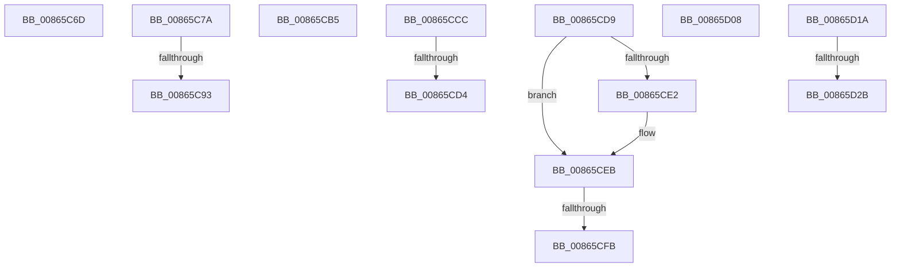

# sub_00865C6D

- RVA: `0x00865C6D`–`0x00865D3E` (길이 `209` bytes)
- VA: `0x0000000140865C6D`
- 실행 섹션: `PAGE`
- PDB 이름 있음: `아니요`; PDB Function 태그: `아니요`
- unwind 정보 RVA: `0x0006BB88`
- 디코드: `45`개 명령, `209/209` bytes 표시
- 미해석 바이트: `0` (있으면 어셈블리에 `.byte`로 보존)

> 이 문서는 커널 이미지의 기계어와 PDB 기호를 분석해 생성했습니다. 4번과 5번은 함수 원형과 자료형을 바이너리 사용 방식에서 추정한 C 해석이며 원본 소스 복구 결과는 아닙니다.

## 1. Dependencies

- 직접 호출 지점: **6**; 고유 호출 대상: **6**
- 직접 호출자로 확인된 함수: **0**
- RIP 상대 이미지 참조: **1**

### Outgoing calls
- `0x00865C70` → [CmUnlockHive](../85/CmUnlockHive_function_00851D6C.md) (function, `0x00851D6C`)
- `0x00865C81` → [CmpReferenceHive](../84/CmpReferenceHive_function_0084FCF0.md) (function, `0x0084FCF0`)
- `0x00865CE6` → [ExQueueWorkItem](../../text/2F/ExQueueWorkItem_function_002F9520.md) (function, `0x002F9520`)
- `0x00865CFE` → [CmpFreePostBlock](../84/CmpFreePostBlock_function_00848560.md) (function, `0x00848560`)
- `0x00865D0C` → [CmpLockKcbExclusive](CmpLockKcbExclusive_function_00861EB0.md) (function, `0x00861EB0`)
- `0x00865D34` → [ExfUnblockPushLock](../../text/2A/ExfUnblockPushLock_function_002A3FE0.md) (function, `0x002A3FE0`)

### Direct callers
- 이 함수 시작 RVA로 연결되는 직접 call은 확인되지 않았습니다. 간접 호출은 완전히 역산할 수 없습니다.

### Static image references
- `0x00865D1E` → RVA `0x00EF7BB8` (`.data`; read)

## 2. Other-region calls and transfers

- 다른 실행 섹션으로 향하는 call: **2**
  - `0x00865CE6` → [ExQueueWorkItem](../../text/2F/ExQueueWorkItem_function_002F9520.md) (`PAGE` → `.text`)
  - `0x00865D34` → [ExfUnblockPushLock](../../text/2A/ExfUnblockPushLock_function_002A3FE0.md) (`PAGE` → `.text`)
- call이 아닌 외부 분기/꼬리 이동: **11**
  - `0x00865C75` → [sub_0086560A + 0x286](Unknown_function_0086560A.md) (`tail-transfer`)
  - `0x00865C8D` → [sub_0086560A + 0x450](Unknown_function_0086560A.md) (`tail-transfer`)
  - `0x00865CB0` → [sub_0086560A + 0x450](Unknown_function_0086560A.md) (`tail-transfer`)
  - `0x00865CC7` → [sub_0086560A + 0xEC](Unknown_function_0086560A.md) (`tail-transfer`)
  - `0x00865CCE` → [sub_0086560A + 0x39F](Unknown_function_0086560A.md) (`tail-transfer`)
  - `0x00865CD4` → [sub_0086560A + 0x38E](Unknown_function_0086560A.md) (`tail-transfer`)
  - `0x00865CF5` → [sub_00865B4C + 0x3F](Unknown_function_00865B4C.md) (`tail-transfer`)
  - `0x00865D03` → [sub_0086560A + 0x45D](Unknown_function_0086560A.md) (`tail-transfer`)
  - `0x00865D15` → [sub_0086560A + 0x29C](Unknown_function_0086560A.md) (`tail-transfer`)
  - `0x00865D25` → [sub_0086560A + 0x153](Unknown_function_0086560A.md) (`tail-transfer`)
  - `0x00865D39` → [sub_0086560A + 0x153](Unknown_function_0086560A.md) (`tail-transfer`)

## 3. Assembly (complete function range)

```asm
00865C6D  48 8B CE                        mov rcx, rsi
00865C70  E8 F7 C0 FE FF                  call 0x140851d6c
00865C75  E9 16 FC FF FF                  jmp 0x140865890
00865C7A  49 8B 76 20                     mov rsi, qword ptr [r14 + 0x20]
00865C7E  48 8B CE                        mov rcx, rsi
00865C81  E8 6A A0 FE FF                  call 0x14084fcf0
00865C86  44 38 BE 80 0B 00 00            cmp byte ptr [rsi + 0xb80], r15b
00865C8D  0F 85 C7 FD FF FF               jne 0x140865a5a
00865C93  45 0F B6 E7                     movzx r12d, r15b
00865C97  F0 44 0F C1 BE 8C 10 00 00      lock xadd dword ptr [rsi + 0x108c], r15d
00865CA0  41 83 E7 7F                     and r15d, 0x7f
00865CA4  42 C7 84 BE 90 10 00 00 11 00 00 00  mov dword ptr [rsi + r15*4 + 0x1090], 0x11
00865CB0  E9 A5 FD FF FF                  jmp 0x140865a5a
00865CB5  48 89 48 08                     mov qword ptr [rax + 8], rcx
00865CB9  48 8D 55 87                     lea rdx, [rbp - 0x79]
00865CBD  48 89 10                        mov qword ptr [rax], rdx
00865CC0  48 89 01                        mov qword ptr [rcx], rax
00865CC3  48 89 45 8F                     mov qword ptr [rbp - 0x71], rax
00865CC7  E9 2A FA FF FF                  jmp 0x1408656f6
00865CCC  85 C0                           test eax, eax
00865CCE  0F 84 D5 FC FF FF               je 0x1408659a9
00865CD4  E9 BF FC FF FF                  jmp 0x140865998
00865CD9  49 8B 49 08                     mov rcx, qword ptr [r9 + 8]
00865CDD  48 85 C9                        test rcx, rcx
00865CE0  74 09                           je 0x140865ceb
00865CE2  41 8B 51 10                     mov edx, dword ptr [r9 + 0x10]
00865CE6  E8 35 38 A9 FF                  call 0x1402f9520
00865CEB  48 8B 47 40                     mov rax, qword ptr [rdi + 0x40]
00865CEF  48 8B 08                        mov rcx, qword ptr [rax]
00865CF2  48 85 C9                        test rcx, rcx
00865CF5  0F 85 90 FE FF FF               jne 0x140865b8b
00865CFB  48 8B CF                        mov rcx, rdi
00865CFE  E8 5D 28 FE FF                  call 0x140848560
00865D03  E9 5F FD FF FF                  jmp 0x140865a67
00865D08  48 8B 4B 08                     mov rcx, qword ptr [rbx + 8]
00865D0C  E8 9F C1 FF FF                  call 0x140861eb0
00865D11  45 0F B6 CF                     movzx r9d, r15b
00865D15  E9 8C FB FF FF                  jmp 0x1408658a6
00865D1A  F0 09 34 24                     lock or dword ptr [rsp], esi
00865D1E  48 39 35 93 1E 69 00            cmp qword ptr [rip + 0x691e93], rsi
00865D25  0F 84 32 FA FF FF               je 0x14086575d
00865D2B  33 D2                           xor edx, edx
00865D2D  48 8D 0D 84 1E 69 00            lea rcx, [rip + 0x691e84]
00865D34  E8 A7 E2 A3 FF                  call 0x1402a3fe0
00865D39  E9 1F FA FF FF                  jmp 0x14086575d
```

## 4. C-style interpretation (structured pseudocode)

```c
__int64 __fastcall sub_00865C6D(__int64 a1, __int64 a2, __int64 a3, __int64 a4)
{
    __int64 result;
    unsigned int v_stack_p0;

    result = CmUnlockHive(v_rsi, a2, a3, a4);
}
```

## 5. (Beta) C Style

```c
int64_t sub_00865C6D(int64_t Arg1, int64_t Arg2, int64_t Arg3, int64_t Arg4)
{
    int64_t result;
    uint32_t v_stack_p0;

    result = CmUnlockHive(local_rsi, Arg2, Arg3, Arg4);
}
```

## 6. Execution-region graph

[열기: 2D/3D 그래프와 함수 탐색 컨트롤 패널](../../../control-panel.html?section=page&rva=0x00865C6D&view=graph)

- 2D 그래프는 위에서 아래로 흐르고, 3D 그래프는 빈 공간을 드래그해 회전합니다. Shift+드래그는 이동, 휠은 확대·축소, 함수 노드 선택은 대상 보고서 이동입니다.

### Static fallback


