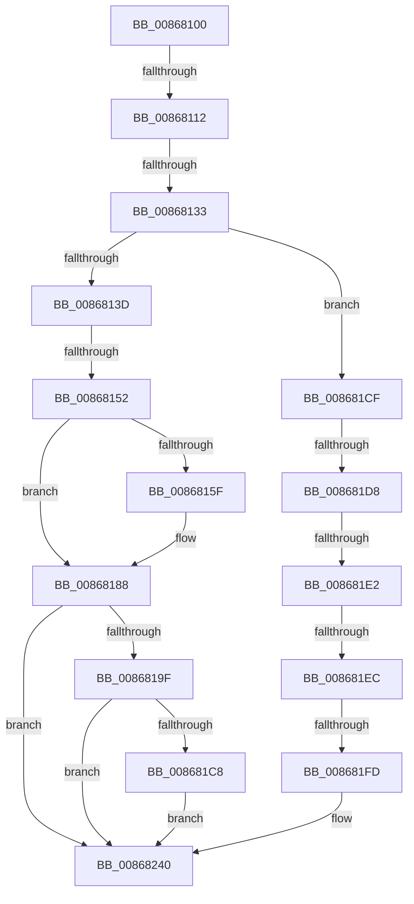

# sub_00868100

- RVA: `0x00868100`–`0x00868255` (길이 `341` bytes)
- VA: `0x0000000140868100`
- 실행 섹션: `PAGE`
- PDB 이름 있음: `아니요`; PDB Function 태그: `아니요`
- unwind 정보 RVA: `0x0006BD04`
- 디코드: `68`개 명령, `341/341` bytes 표시
- 미해석 바이트: `0` (있으면 어셈블리에 `.byte`로 보존)

> 이 문서는 커널 이미지의 기계어와 PDB 기호를 분석해 생성했습니다. 4번과 5번은 함수 원형과 자료형을 바이너리 사용 방식에서 추정한 C 해석이며 원본 소스 복구 결과는 아닙니다.

## 1. Dependencies

- 직접 호출 지점: **5**; 고유 호출 대상: **4**
- 직접 호출자로 확인된 함수: **0**
- RIP 상대 이미지 참조: **0**

### Outgoing calls
- `0x00868181` → [AlpcpReceiveMessage](../89/AlpcpReceiveMessage_function_00897ED0.md) (function, `0x00897ED0`)
- `0x008681B6` → [AlpcpSignal](../../text/39/AlpcpSignal_function_003955E0.md) (function, `0x003955E0`)
- `0x008681C8` → [ObfDereferenceObject](../../text/2F/ObfDereferenceObject_function_002F9350.md) (function, `0x002F9350`)
- `0x00868239` → [AlpcpProcessSynchronousRequest](../92/AlpcpProcessSynchronousRequest_function_00921FCC.md) (function, `0x00921FCC`)
- `0x00868243` → [ObfDereferenceObject](../../text/2F/ObfDereferenceObject_function_002F9350.md) (function, `0x002F9350`)

### Direct callers
- 이 함수 시작 RVA로 연결되는 직접 call은 확인되지 않았습니다. 간접 호출은 완전히 역산할 수 없습니다.

### Static image references
- 디코드된 RIP-relative 메모리 참조가 없습니다.

## 2. Other-region calls and transfers

- 다른 실행 섹션으로 향하는 call: **3**
  - `0x008681B6` → [AlpcpSignal](../../text/39/AlpcpSignal_function_003955E0.md) (`PAGE` → `.text`)
  - `0x008681C8` → [ObfDereferenceObject](../../text/2F/ObfDereferenceObject_function_002F9350.md) (`PAGE` → `.text`)
  - `0x00868243` → [ObfDereferenceObject](../../text/2F/ObfDereferenceObject_function_002F9350.md) (`PAGE` → `.text`)
- call이 아닌 외부 분기/꼬리 이동: **8**
  - `0x0086810C` → [sub_00868255 + 0x4C](Unknown_function_00868255.md) (`tail-transfer`)
  - `0x0086812D` → [sub_00868255 + 0x56](Unknown_function_00868255.md) (`tail-transfer`)
  - `0x0086814C` → [sub_00868255](Unknown_function_00868255.md) (`tail-transfer`)
  - `0x008681D2` → [sub_00868255 + 0x45](Unknown_function_00868255.md) (`tail-transfer`)
  - `0x008681DC` → [sub_00868255 + 0x45](Unknown_function_00868255.md) (`tail-transfer`)
  - `0x008681E6` → [sub_00868255 + 0x45](Unknown_function_00868255.md) (`tail-transfer`)
  - `0x008681F7` → [sub_00868255 + 0x94](Unknown_function_00868255.md) (`tail-transfer`)
  - `0x00868250` → [NtAlpcSendWaitReceivePort + 0x92](NtAlpcSendWaitReceivePort_function_00868040.md) (`tail-transfer`)

## 3. Assembly (complete function range)

```asm
00868100  48 89 AC 24 D0 00 00 00         mov qword ptr [rsp + 0xd0], rbp
00868108  0F BA E7 12                     bt edi, 0x12
0086810C  0F 83 8F 01 00 00               jae 0x1408682a1
00868112  48 8B 44 24 50                  mov rax, qword ptr [rsp + 0x50]
00868117  F0 0F C1 B0 94 01 00 00         lock xadd dword ptr [rax + 0x194], esi
0086811F  48 8B 6C 24 50                  mov rbp, qword ptr [rsp + 0x50]
00868124  FF C6                           inc esi
00868126  4C 39 AD 98 01 00 00            cmp qword ptr [rbp + 0x198], r13
0086812D  0F 85 78 01 00 00               jne 0x1408682ab
00868133  0F BA E7 11                     bt edi, 0x11
00868137  0F 82 92 00 00 00               jb 0x1408681cf
0086813D  48 89 6C 24 60                  mov qword ptr [rsp + 0x60], rbp
00868142  89 BC 24 90 00 00 00            mov dword ptr [rsp + 0x90], edi
00868149  4D 85 FF                        test r15, r15
0086814C  0F 85 03 01 00 00               jne 0x140868255
00868152  48 8B 94 24 F0 00 00 00         mov rdx, qword ptr [rsp + 0xf0]
0086815A  48 85 D2                        test rdx, rdx
0086815D  74 29                           je 0x140868188
0086815F  48 8B 84 24 08 01 00 00         mov rax, qword ptr [rsp + 0x108]
00868167  48 8D 4C 24 60                  lea rcx, [rsp + 0x60]
0086816C  4C 8B 8C 24 00 01 00 00         mov r9, qword ptr [rsp + 0x100]
00868174  4C 8B 84 24 F8 00 00 00         mov r8, qword ptr [rsp + 0xf8]
0086817C  48 89 44 24 20                  mov qword ptr [rsp + 0x20], rax
00868181  E8 4A FD 02 00                  call 0x140897ed0
00868186  8B D8                           mov ebx, eax
00868188  48 8D 84 24 90 00 00 00         lea rax, [rsp + 0x90]
00868190  0F BA 30 02                     btr dword ptr [rax], 2
00868194  0F 92 C0                        setb al
00868197  84 C0                           test al, al
00868199  0F 84 A1 00 00 00               je 0x140868240
0086819F  44 8B 84 24 90 00 00 00         mov r8d, dword ptr [rsp + 0x90]
008681A7  48 8D 4C 24 60                  lea rcx, [rsp + 0x60]
008681AC  41 C1 E8 16                     shr r8d, 0x16
008681B0  33 D2                           xor edx, edx
008681B2  41 80 E0 01                     and r8b, 1
008681B6  E8 25 D4 B2 FF                  call 0x1403955e0
008681BB  48 8B 8C 24 80 00 00 00         mov rcx, qword ptr [rsp + 0x80]
008681C3  48 85 C9                        test rcx, rcx
008681C6  74 78                           je 0x140868240
008681C8  E8 83 11 A9 FF                  call 0x1402f9350
008681CD  EB 71                           jmp 0x140868240
008681CF  4D 85 FF                        test r15, r15
008681D2  0F 84 C2 00 00 00               je 0x14086829a
008681D8  0F BA E7 10                     bt edi, 0x10
008681DC  0F 82 B8 00 00 00               jb 0x14086829a
008681E2  0F BA E7 18                     bt edi, 0x18
008681E6  0F 82 AE 00 00 00               jb 0x14086829a
008681EC  48 8B 8C 24 F0 00 00 00         mov rcx, qword ptr [rsp + 0xf0]
008681F4  48 85 C9                        test rcx, rcx
008681F7  0F 84 EC 00 00 00               je 0x1408682e9
008681FD  48 8B 84 24 08 01 00 00         mov rax, qword ptr [rsp + 0x108]
00868205  4D 8B CC                        mov r9, r12
00868208  44 88 74 24 40                  mov byte ptr [rsp + 0x40], r14b
0086820D  4D 8B C7                        mov r8, r15
00868210  48 89 44 24 38                  mov qword ptr [rsp + 0x38], rax
00868215  8B D7                           mov edx, edi
00868217  48 8B 84 24 00 01 00 00         mov rax, qword ptr [rsp + 0x100]
0086821F  48 89 44 24 30                  mov qword ptr [rsp + 0x30], rax
00868224  48 8B 84 24 F8 00 00 00         mov rax, qword ptr [rsp + 0xf8]
0086822C  48 89 44 24 28                  mov qword ptr [rsp + 0x28], rax
00868231  48 89 4C 24 20                  mov qword ptr [rsp + 0x20], rcx
00868236  48 8B CD                        mov rcx, rbp
00868239  E8 8E 9D 0B 00                  call 0x140921fcc
0086823E  8B D8                           mov ebx, eax
00868240  48 8B CD                        mov rcx, rbp
00868243  E8 08 11 A9 FF                  call 0x1402f9350
00868248  48 8B AC 24 D0 00 00 00         mov rbp, qword ptr [rsp + 0xd0]
00868250  E9 7D FE FF FF                  jmp 0x1408680d2
```

## 4. C-style interpretation (structured pseudocode)

```c
__int64 __fastcall sub_00868100(__int64 a1, __int64 a2, __int64 a3, __int64 a4, __int64 a5, __int64 a6, __int64 a7, __int64 a8, __int64 a9, __int64 a10, __int64 a11, __int64 a12, __int64 a13, __int64 a14, __int64 a15, __int64 a16, __int64 a17, unsigned int a18, __int64 a19, __int64 a20, __int64 a21, __int64 a22, __int64 a23, __int64 a24, __int64 a25, __int64 a26, __int64 a27, __int64 a28, __int64 a29, __int64 a30, __int64 a31, __int64 a32, __int64 a33)
{
    __int64 result;
    __int64 v_rbx;
    __int64 v_rsi;
    unsigned __int64 v_stack_p20;
    unsigned __int64 v_stack_p28;
    unsigned __int64 v_stack_p30;
    unsigned __int64 v_stack_p38;
    unsigned __int8 v_stack_p40;
    unsigned __int64 v_stack_p60;
    unsigned int v_stack_p90;
    unsigned __int64 v_stack_pD0;

    v_stack_pD0 = v_rbp;
    v_rsi = (unsigned int)((v_rsi) + 1);
    if ((*(unsigned __int64 *)(a10 + 408)) < v_r13) goto loc_008681CF;
    v_stack_p60 = a10;
    v_stack_p90 = (unsigned int)(v_rdi);
    result = a10;
    if (a30 != 0) {
        result = a33;
        a1 = a12;
        a4 = a32;
        a3 = a31;
        v_stack_p20 = result;
        result = AlpcpReceiveMessage(a1, a30, a3, a4);
        v_rbx = (unsigned int)(result);
    }
    result = (condition_is_below) ? 1 : 0;
    if ((unsigned __int8)(result) == 0) goto loc_00868240;
    a3 = (unsigned int)(((unsigned int)(a18)) >> (22));
    a2 = 0;
    a3 = (unsigned __int8)((a3) & (1));
    result = AlpcpSignal(a12, a2, a3, a4);
    if (a16 == 0) goto loc_00868240;
    result = ObfDereferenceObject(a16, a2, a3, a4);
    goto loc_00868240;
loc_008681CF:
    v_stack_p40 = (unsigned __int8)(v_r14);
    v_stack_p38 = a33;
    v_stack_p30 = a32;
    v_stack_p28 = a31;
    v_stack_p20 = a30;
    result = AlpcpProcessSynchronousRequest(a10, (unsigned int)((unsigned int)(v_rdi)), v_r15, v_r12);
loc_00868240:
    result = ObfDereferenceObject(a10, (unsigned int)((unsigned int)(v_rdi)), v_r15, v_r12);
}
```

## 5. (Beta) C Style

```c
int64_t sub_00868100(int64_t Arg1, int64_t Arg2, int64_t Arg3, int64_t Arg4, uint64_t Arg5, uint64_t Arg6, uint64_t Arg7, uint64_t Arg8, uint64_t Arg9, void *Arg10, uint64_t Arg11, int64_t Arg12, uint64_t Arg13, uint64_t Arg14, uint64_t Arg15, int64_t Arg16, uint64_t Arg17, uint32_t Arg18, uint64_t Arg19, uint64_t Arg20, uint64_t Arg21, uint64_t Arg22, uint64_t Arg23, uint64_t Arg24, uint64_t Arg25, int64_t Arg26, uint64_t Arg27, uint64_t Arg28, uint64_t Arg29, int64_t Arg30, int64_t Arg31, int64_t Arg32, int64_t Arg33)
{
    uint8_t *arg10 = (uint8_t *)Arg10;

    int64_t result;
    int64_t local_rbx;
    int64_t local_rsi;
    uint64_t v_stack_p20;
    uint64_t v_stack_p28;
    uint64_t v_stack_p30;
    uint64_t v_stack_p38;
    uint8_t v_stack_p40;
    uint64_t v_stack_p60;
    uint32_t v_stack_p90;
    uint64_t v_stack_pD0;

    v_stack_pD0 = local_rbp;
    local_rsi = (uint32_t)((local_rsi) + 1);
    if ((*(uint64_t *)(arg10 + 0x198)) < local_r13) goto loc_008681CF;
    v_stack_p60 = Arg10;
    v_stack_p90 = (uint32_t)(local_rdi);
    result = Arg10;
    if (Arg30 != 0) {
        result = Arg33;
        Arg1 = Arg12;
        Arg4 = Arg32;
        Arg3 = Arg31;
        v_stack_p20 = result;
        result = AlpcpReceiveMessage(Arg1, Arg30, Arg3, Arg4);
        local_rbx = (uint32_t)(result);
    }
    result = (condition_is_below) ? 1 : 0;
    if ((uint8_t)(result) == 0) goto loc_00868240;
    Arg3 = (uint32_t)(((uint32_t)(Arg18)) >> (22));
    Arg2 = 0;
    Arg3 = (uint8_t)((Arg3) & (1));
    result = AlpcpSignal(Arg12, Arg2, Arg3, Arg4);
    if (Arg16 == 0) goto loc_00868240;
    result = ObfDereferenceObject(Arg16, Arg2, Arg3, Arg4);
    goto loc_00868240;
loc_008681CF:
    v_stack_p40 = (uint8_t)(local_r14);
    v_stack_p38 = Arg33;
    v_stack_p30 = Arg32;
    v_stack_p28 = Arg31;
    v_stack_p20 = Arg30;
    result = AlpcpProcessSynchronousRequest(Arg10, (uint32_t)((uint32_t)(local_rdi)), local_r15, local_r12);
loc_00868240:
    result = ObfDereferenceObject(Arg10, (uint32_t)((uint32_t)(local_rdi)), local_r15, local_r12);
}
```

### 관측된 메모리 오프셋

구조체 형식이 확인되지 않은 접근은 인자 기준의 오프셋으로만 기록했습니다.

| 기준 인자 | 오프셋 표현 | 폭 (bit) | 접근 |
|---|---:|---:|---|
| `Arg10` | `+ 0x194` | `32` | `R/W` |
| `Arg10` | `+ 0x198` | `64` | `R` |

## 6. Execution-region graph

[열기: 2D/3D 그래프와 함수 탐색 컨트롤 패널](../../../control-panel.html?section=page&rva=0x00868100&view=graph)

- 2D 그래프는 위에서 아래로 흐르고, 3D 그래프는 빈 공간을 드래그해 회전합니다. Shift+드래그는 이동, 휠은 확대·축소, 함수 노드 선택은 대상 보고서 이동입니다.

### Static fallback


