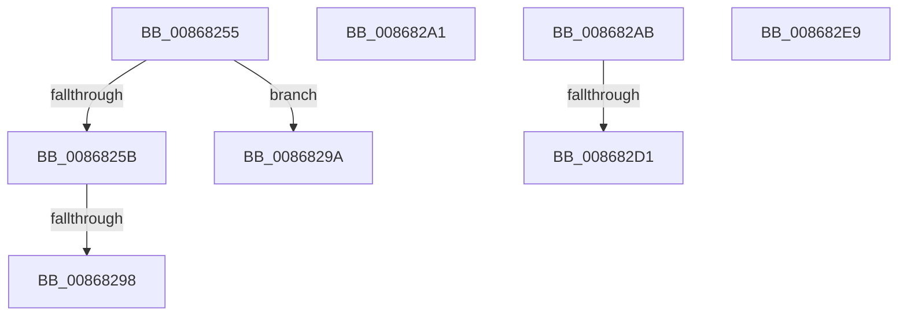

# sub_00868255

- RVA: `0x00868255`–`0x008682F3` (길이 `158` bytes)
- VA: `0x0000000140868255`
- 실행 섹션: `PAGE`
- PDB 이름 있음: `아니요`; PDB Function 태그: `아니요`
- unwind 정보 RVA: `0x0006BD18`
- 디코드: `36`개 명령, `158/158` bytes 표시
- 미해석 바이트: `0` (있으면 어셈블리에 `.byte`로 보존)

> 이 문서는 커널 이미지의 기계어와 PDB 기호를 분석해 생성했습니다. 4번과 5번은 함수 원형과 자료형을 바이너리 사용 방식에서 추정한 C 해석이며 원본 소스 복구 결과는 아닙니다.

## 1. Dependencies

- 직접 호출 지점: **3**; 고유 호출 대상: **3**
- 직접 호출자로 확인된 함수: **0**
- RIP 상대 이미지 참조: **0**

### Outgoing calls
- `0x00868289` → [AlpcpSendMessage](../88/AlpcpSendMessage_function_0088BD40.md) (function, `0x0088BD40`)
- `0x008682BA` → [KeAbPreAcquire](../../text/21/KeAbPreAcquire_function_00210230.md) (function, `0x00210230`)
- `0x008682DA` → [ExfAcquirePushLockExclusiveEx](../../text/20/ExfAcquirePushLockExclusiveEx_function_0020FC90.md) (function, `0x0020FC90`)

### Direct callers
- 이 함수 시작 RVA로 연결되는 직접 call은 확인되지 않았습니다. 간접 호출은 완전히 역산할 수 없습니다.

### Static image references
- 디코드된 RIP-relative 메모리 참조가 없습니다.

## 2. Other-region calls and transfers

- 다른 실행 섹션으로 향하는 call: **2**
  - `0x008682BA` → [KeAbPreAcquire](../../text/21/KeAbPreAcquire_function_00210230.md) (`PAGE` → `.text`)
  - `0x008682DA` → [ExfAcquirePushLockExclusiveEx](../../text/20/ExfAcquirePushLockExclusiveEx_function_0020FC90.md) (`PAGE` → `.text`)
- call이 아닌 외부 분기/꼬리 이동: **7**
  - `0x00868292` → [sub_00868100 + 0x52](Unknown_function_00868100.md) (`tail-transfer`)
  - `0x00868298` → [sub_00868100 + 0x140](Unknown_function_00868100.md) (`tail-transfer`)
  - `0x0086829F` → [sub_00868100 + 0x140](Unknown_function_00868100.md) (`tail-transfer`)
  - `0x008682A6` → [sub_00868100 + 0x33](Unknown_function_00868100.md) (`tail-transfer`)
  - `0x008682CB` → [sub_00B17686](../B1/Unknown_function_00B17686.md) (`tail-transfer`)
  - `0x008682E4` → [sub_00B17686](../B1/Unknown_function_00B17686.md) (`tail-transfer`)
  - `0x008682EE` → [sub_00868100 + 0x140](Unknown_function_00868100.md) (`tail-transfer`)

## 3. Assembly (complete function range)

```asm
00868255  0F BA E7 18                     bt edi, 0x18
00868259  72 3F                           jb 0x14086829a
0086825B  83 CF 04                        or edi, 4
0086825E  4C 89 AC 24 80 00 00 00         mov qword ptr [rsp + 0x80], r13
00868266  45 0F B6 CE                     movzx r9d, r14b
0086826A  89 BC 24 90 00 00 00            mov dword ptr [rsp + 0x90], edi
00868271  4D 8B C4                        mov r8, r12
00868274  4C 89 6C 24 78                  mov qword ptr [rsp + 0x78], r13
00868279  49 8B D7                        mov rdx, r15
0086827C  4C 89 AC 24 88 00 00 00         mov qword ptr [rsp + 0x88], r13
00868284  48 8D 4C 24 60                  lea rcx, [rsp + 0x60]
00868289  E8 B2 3A 02 00                  call 0x14088bd40
0086828E  8B D8                           mov ebx, eax
00868290  85 C0                           test eax, eax
00868292  0F 89 BA FE FF FF               jns 0x140868152
00868298  EB A6                           jmp 0x140868240
0086829A  BB F0 00 00 C0                  mov ebx, 0xc00000f0
0086829F  EB 9F                           jmp 0x140868240
008682A1  48 8B 6C 24 50                  mov rbp, qword ptr [rsp + 0x50]
008682A6  E9 88 FE FF FF                  jmp 0x140868133
008682AB  4C 8D AD 60 01 00 00            lea r13, [rbp + 0x160]
008682B2  45 33 C0                        xor r8d, r8d
008682B5  49 8B CD                        mov rcx, r13
008682B8  33 D2                           xor edx, edx
008682BA  E8 71 7F 9A FF                  call 0x140210230
008682BF  F0 49 0F BA 6D 00 00            lock bts qword ptr [r13], 0
008682C6  48 89 44 24 58                  mov qword ptr [rsp + 0x58], rax
008682CB  0F 83 B5 F3 2A 00               jae 0x140b17686
008682D1  4D 8B C5                        mov r8, r13
008682D4  48 8B D0                        mov rdx, rax
008682D7  49 8B CD                        mov rcx, r13
008682DA  E8 B1 79 9A FF                  call 0x14020fc90
008682DF  48 8B 44 24 58                  mov rax, qword ptr [rsp + 0x58]
008682E4  E9 9D F3 2A 00                  jmp 0x140b17686
008682E9  BB 05 07 00 C0                  mov ebx, 0xc0000705
008682EE  E9 4D FF FF FF                  jmp 0x140868240
```

## 4. C-style interpretation (structured pseudocode)

```c
__int64 __fastcall sub_00868255(__int64 a1, __int64 a2, __int64 a3, __int64 a4, __int64 a5, __int64 a6, __int64 a7, __int64 a8, __int64 a9, __int64 a10, __int64 a11, __int64 a12)
{
    __int64 result;
    __int64 v_rdi;
    unsigned __int64 v_stack_p50;
    unsigned __int64 v_stack_p58;
    unsigned __int64 v_stack_p78;
    unsigned __int64 v_stack_p80;
    unsigned __int64 v_stack_p88;
    unsigned int v_stack_p90;

    if (condition_is_below) goto loc_0086829A;
    v_rdi = (unsigned int)((v_rdi) | (4));
    v_stack_p80 = v_r13;
    v_stack_p90 = (unsigned int)(v_rdi);
    v_stack_p78 = v_r13;
    v_stack_p88 = v_r13;
    result = AlpcpSendMessage(a12, v_r15, v_r12, (unsigned __int8)(v_r14));
loc_0086829A:
}
```

## 5. (Beta) C Style

```c
int64_t sub_00868255(int64_t Arg1, int64_t Arg2, int64_t Arg3, int64_t Arg4, uint64_t Arg5, uint64_t Arg6, uint64_t Arg7, uint64_t Arg8, uint64_t Arg9, uint64_t Arg10, uint64_t Arg11, int64_t Arg12)
{
    int64_t result;
    int64_t local_rdi;
    uint64_t v_stack_p50;
    uint64_t v_stack_p58;
    uint64_t v_stack_p78;
    uint64_t v_stack_p80;
    uint64_t v_stack_p88;
    uint32_t v_stack_p90;

    if (condition_is_below) goto loc_0086829A;
    local_rdi = (uint32_t)((local_rdi) | (4));
    v_stack_p80 = local_r13;
    v_stack_p90 = (uint32_t)(local_rdi);
    v_stack_p78 = local_r13;
    v_stack_p88 = local_r13;
    result = AlpcpSendMessage(Arg12, local_r15, local_r12, (uint8_t)(local_r14));
loc_0086829A:
}
```

## 6. Execution-region graph

[열기: 2D/3D 그래프와 함수 탐색 컨트롤 패널](../../../control-panel.html?section=page&rva=0x00868255&view=graph)

- 2D 그래프는 위에서 아래로 흐르고, 3D 그래프는 빈 공간을 드래그해 회전합니다. Shift+드래그는 이동, 휠은 확대·축소, 함수 노드 선택은 대상 보고서 이동입니다.

### Static fallback


