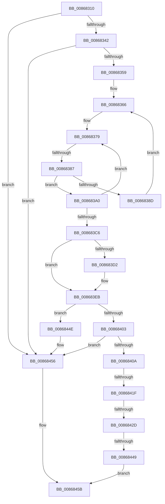

# sub_00868310

- RVA: `0x00868310`–`0x0086847A` (길이 `362` bytes)
- VA: `0x0000000140868310`
- 실행 섹션: `PAGE`
- PDB 이름 있음: `아니요`; PDB Function 태그: `아니요`
- unwind 정보 RVA: `0x0006BD4C`
- 디코드: `90`개 명령, `362/362` bytes 표시
- 미해석 바이트: `0` (있으면 어셈블리에 `.byte`로 보존)

> 이 문서는 커널 이미지의 기계어와 PDB 기호를 분석해 생성했습니다. 4번과 5번은 함수 원형과 자료형을 바이너리 사용 방식에서 추정한 C 해석이며 원본 소스 복구 결과는 아닙니다.

## 1. Dependencies

- 직접 호출 지점: **7**; 고유 호출 대상: **7**
- 직접 호출자로 확인된 함수: **0**
- RIP 상대 이미지 참조: **2**

### Outgoing calls
- `0x00868348` → [ExpLookupHandleTableEntry](ExpLookupHandleTableEntry_function_00869DB0.md) (function, `0x00869DB0`)
- `0x00868393` → [ExpBlockOnLockedHandleEntry](ExpBlockOnLockedHandleEntry_function_00868838.md) (function, `0x00868838`)
- `0x008683F0` → [ExGetHandlePointer](../../text/43/ExGetHandlePointer_function_00430C90.md) (function, `0x00430C90`)
- `0x0086840D` → [IoThreadToProcess](../../text/44/IoThreadToProcess_function_00448540.md) (function, `0x00448540`)
- `0x0086842D` → [PsGetCurrentServerSilo](../../text/22/PsGetCurrentServerSilo_function_00225710.md) (function, `0x00225710`)
- `0x0086843C` → [PsIsProcessInSilo](../../text/41/PsIsProcessInSilo_function_004185E0.md) (function, `0x004185E0`)
- `0x00868451` → [ObfDereferenceObject](../../text/2F/ObfDereferenceObject_function_002F9350.md) (function, `0x002F9350`)

### Direct callers
- 이 함수 시작 RVA로 연결되는 직접 call은 확인되지 않았습니다. 간접 호출은 완전히 역산할 수 없습니다.

### Static image references
- `0x00868327` → RVA `0x00FC6CA8` (`ALMOSTRO`; read)
- `0x00868412` → RVA `0x00FC6B70` (`ALMOSTRO`; read)

## 2. Other-region calls and transfers

- 다른 실행 섹션으로 향하는 call: **5**
  - `0x008683F0` → [ExGetHandlePointer](../../text/43/ExGetHandlePointer_function_00430C90.md) (`PAGE` → `.text`)
  - `0x0086840D` → [IoThreadToProcess](../../text/44/IoThreadToProcess_function_00448540.md) (`PAGE` → `.text`)
  - `0x0086842D` → [PsGetCurrentServerSilo](../../text/22/PsGetCurrentServerSilo_function_00225710.md) (`PAGE` → `.text`)
  - `0x0086843C` → [PsIsProcessInSilo](../../text/41/PsIsProcessInSilo_function_004185E0.md) (`PAGE` → `.text`)
  - `0x00868451` → [ObfDereferenceObject](../../text/2F/ObfDereferenceObject_function_002F9350.md) (`PAGE` → `.text`)
- call이 아닌 외부 분기/꼬리 이동: **5**
  - `0x00868381` → [sub_00868496](Unknown_function_00868496.md) (`tail-transfer`)
  - `0x00868419` → [sub_00868496 + 0xAE](Unknown_function_00868496.md) (`tail-transfer`)
  - `0x00868427` → [sub_00868496 + 0xF7](Unknown_function_00868496.md) (`tail-transfer`)
  - `0x00868443` → [sub_00868496 + 0xAE](Unknown_function_00868496.md) (`tail-transfer`)
  - `0x00868478` → [sub_0086847A + 0x12](Unknown_function_0086847A.md) (`tail-transfer`)

## 3. Assembly (complete function range)

```asm
00868310  48 89 5C 24 60                  mov qword ptr [rsp + 0x60], rbx
00868315  48 89 7C 24 68                  mov qword ptr [rsp + 0x68], rdi
0086831A  4C 89 74 24 70                  mov qword ptr [rsp + 0x70], r14
0086831F  66 FF 8E E6 01 00 00            dec word ptr [rsi + 0x1e6]
00868326  90                              nop
00868327  48 8B 05 7A E9 75 00            mov rax, qword ptr [rip + 0x75e97a]
0086832E  4C 89 7C 24 40                  mov qword ptr [rsp + 0x40], r15
00868333  4C 8B FA                        mov r15, rdx
00868336  F7 C1 FC 03 00 00               test ecx, 0x3fc
0086833C  0F 84 14 01 00 00               je 0x140868456
00868342  48 8B D1                        mov rdx, rcx
00868345  48 8B C8                        mov rcx, rax
00868348  E8 63 1A 00 00                  call 0x140869db0
0086834D  48 8B F8                        mov rdi, rax
00868350  48 85 C0                        test rax, rax
00868353  0F 84 FD 00 00 00               je 0x140868456
00868359  48 8B 2D 48 E9 75 00            mov rbp, qword ptr [rip + 0x75e948]
00868360  0F 0D 08                        prefetchw byte ptr [rax]
00868363  48 8B 00                        mov rax, qword ptr [rax]
00868366  48 8B 4F 08                     mov rcx, qword ptr [rdi + 8]
0086836A  48 89 44 24 20                  mov qword ptr [rsp + 0x20], rax
0086836F  4C 8B 44 24 20                  mov r8, qword ptr [rsp + 0x20]
00868374  48 89 4C 24 28                  mov qword ptr [rsp + 0x28], rcx
00868379  90                              nop
0086837A  49 F7 C0 FE FF 01 00            test r8, 0x1fffe
00868381  0F 84 0F 01 00 00               je 0x140868496
00868387  41 F6 C0 01                     test r8b, 1
0086838B  75 13                           jne 0x1408683a0
0086838D  48 8B D7                        mov rdx, rdi
00868390  48 8B CD                        mov rcx, rbp
00868393  E8 A0 04 00 00                  call 0x140868838
00868398  0F 0D 0F                        prefetchw byte ptr [rdi]
0086839B  48 8B 07                        mov rax, qword ptr [rdi]
0086839E  EB C6                           jmp 0x140868366
008683A0  49 8D 58 FE                     lea rbx, [r8 - 2]
008683A4  49 8B C0                        mov rax, r8
008683A7  48 8B D1                        mov rdx, rcx
008683AA  F0 48 0F C7 0F                  lock cmpxchg16b xmmword ptr [rdi]
008683AF  4C 8B C0                        mov r8, rax
008683B2  48 89 44 24 20                  mov qword ptr [rsp + 0x20], rax
008683B7  0F 94 C0                        sete al
008683BA  48 89 54 24 28                  mov qword ptr [rsp + 0x28], rdx
008683BF  48 8B CA                        mov rcx, rdx
008683C2  84 C0                           test al, al
008683C4  74 B3                           je 0x140868379
008683C6  49 8B C8                        mov rcx, r8
008683C9  48 D1 E9                        shr rcx, 1
008683CC  66 83 F9 10                     cmp cx, 0x10
008683D0  75 19                           jne 0x1408683eb
008683D2  48 8D 41 FF                     lea rax, [rcx - 1]
008683D6  49 81 E0 01 00 FE FF            and r8, 0xfffffffffffe0001
008683DD  0F B7 C8                        movzx ecx, ax
008683E0  48 03 C9                        add rcx, rcx
008683E3  49 0B C8                        or rcx, r8
008683E6  48 89 4C 24 20                  mov qword ptr [rsp + 0x20], rcx
008683EB  48 8D 4C 24 20                  lea rcx, [rsp + 0x20]
008683F0  E8 9B 88 BC FF                  call 0x140430c90
008683F5  48 8B D8                        mov rbx, rax
008683F8  0F B6 08                        movzx ecx, byte ptr [rax]
008683FB  80 E1 7F                        and cl, 0x7f
008683FE  80 F9 06                        cmp cl, 6
00868401  75 4B                           jne 0x14086844e
00868403  33 ED                           xor ebp, ebp
00868405  48 85 DB                        test rbx, rbx
00868408  74 4C                           je 0x140868456
0086840A  48 8B CB                        mov rcx, rbx
0086840D  E8 2E 01 BE FF                  call 0x140448540
00868412  48 3B 05 57 E7 75 00            cmp rax, qword ptr [rip + 0x75e757]
00868419  0F 84 25 01 00 00               je 0x140868544
0086841F  8B 83 A0 05 00 00               mov eax, dword ptr [rbx + 0x5a0]
00868425  A8 02                           test al, 2
00868427  0F 84 60 01 00 00               je 0x14086858d
0086842D  E8 DE D2 9B FF                  call 0x140225710
00868432  48 8B 8B 20 02 00 00            mov rcx, qword ptr [rbx + 0x220]
00868439  48 8B D0                        mov rdx, rax
0086843C  E8 9F 01 BB FF                  call 0x1404185e0
00868441  84 C0                           test al, al
00868443  0F 84 FB 00 00 00               je 0x140868544
00868449  49 89 1F                        mov qword ptr [r15], rbx
0086844C  EB 0D                           jmp 0x14086845b
0086844E  48 8B C8                        mov rcx, rax
00868451  E8 FA 0E A9 FF                  call 0x1402f9350
00868456  BD 0B 00 00 C0                  mov ebp, 0xc000000b
0086845B  4C 8B 7C 24 40                  mov r15, qword ptr [rsp + 0x40]
00868460  90                              nop
00868461  66 83 86 E6 01 00 00 01         add word ptr [rsi + 0x1e6], 1
00868469  4C 8B 74 24 70                  mov r14, qword ptr [rsp + 0x70]
0086846E  48 8B 7C 24 68                  mov rdi, qword ptr [rsp + 0x68]
00868473  48 8B 5C 24 60                  mov rbx, qword ptr [rsp + 0x60]
00868478  75 12                           jne 0x14086848c
```

## 4. C-style interpretation (structured pseudocode)

```c
__int64 __fastcall sub_00868310(__int64 a1, __int64 a2, __int64 a3, __int64 a4, __int64 a5, __int64 a6, __int64 a7, __int64 a8, __int64 a9, __int64 a10, __int64 a11, __int64 a12, __int64 a13, __int64 a14)
{
    __int64 result;
    __int64 v_rbp;
    unsigned __int64 v_stack_p20;
    unsigned __int64 v_stack_p28;
    unsigned __int64 v_stack_p40;
    unsigned __int64 v_stack_p60;
    unsigned __int64 v_stack_p68;
    unsigned __int64 v_stack_p70;

    v_stack_p60 = v_rbx;
    v_stack_p68 = v_rdi;
    v_stack_p70 = v_r14;
    v_stack_p40 = v_r15;
    if ((((unsigned int)(a1)) & (0x3FCULL)) == 0) goto loc_00868456;
    result = ExpLookupHandleTableEntry(*(unsigned __int64 *)(v_rip + 7727482), a1, a3, a4);
    if (result == 0) goto loc_00868456;
loc_00868366:
    v_stack_p20 = *(unsigned __int64 *)(result);
    v_stack_p28 = *(unsigned __int64 *)(result + 8);
loc_00868379:
    if ((((unsigned __int8)(v_stack_p20)) & (1)) != 0) goto loc_008683A0;
    result = ExpBlockOnLockedHandleEntry(*(unsigned __int64 *)(v_rip + 7727432), result, v_stack_p20, a4);
    goto loc_00868366;
loc_008683A0:
    v_stack_p20 = v_stack_p20;
    result = ((((unsigned __int8)(v_stack_p20)) & (1)) == 0) ? 1 : 0;
    v_stack_p28 = *(unsigned __int64 *)(v_rip + 7727432);
    if ((unsigned __int8)(result) == 0) goto loc_00868379;
    a1 = (v_stack_p20) >> (1);
    if (((unsigned __int16)(a1)) == 16) {
        result = a1 - 1;
        a3 = (v_stack_p20) & (0xFFFFFFFFFFFE0001ULL);
        a1 = (unsigned __int16)(result);
        a1 = (a1) + (a1);
        a1 = (a1) | (a3);
        v_stack_p20 = a1;
    }
    result = ExGetHandlePointer(v_stack_p20, *(unsigned __int64 *)(v_rip + 7727432), a3, a4);
    a1 = (unsigned __int8)((*(unsigned __int8 *)(result)) & (127));
    if (((unsigned __int8)(a1)) != 6) goto loc_0086844E;
    v_rbp = 0;
    if (result == 0) goto loc_00868456;
    result = IoThreadToProcess(result, *(unsigned __int64 *)(v_rip + 7727432), a3, a4);
    result = PsGetCurrentServerSilo(result, *(unsigned __int64 *)(v_rip + 7727432), a3, a4);
    result = PsIsProcessInSilo(*(unsigned __int64 *)(result + 544), result, a3, a4);
    *(unsigned __int64 *)(a2) = result;
    goto loc_0086845B;
loc_0086844E:
    result = ObfDereferenceObject(result, result, a3, a4);
loc_00868456:
loc_0086845B:
}
```

## 5. (Beta) C Style

```c
int64_t sub_00868310(int64_t Arg1, void *Arg2, int64_t Arg3, int64_t Arg4, uint64_t Arg5, uint64_t Arg6, uint64_t Arg7, int64_t Arg8, uint64_t Arg9, uint64_t Arg10, uint64_t Arg11, int64_t Arg12, int64_t Arg13, int64_t Arg14)
{
    uint8_t *arg2 = (uint8_t *)Arg2;

    int64_t result;
    int64_t local_rbp;
    uint64_t v_stack_p20;
    uint64_t v_stack_p28;
    uint64_t v_stack_p40;
    uint64_t v_stack_p60;
    uint64_t v_stack_p68;
    uint64_t v_stack_p70;

    v_stack_p60 = local_rbx;
    v_stack_p68 = local_rdi;
    v_stack_p70 = local_r14;
    v_stack_p40 = local_r15;
    if ((((uint32_t)(Arg1)) & (0x3FCULL)) == 0) goto loc_00868456;
    result = ExpLookupHandleTableEntry(*(uint64_t *)(v_rip + 0x75E97A), Arg1, Arg3, Arg4);
    if (result == 0) goto loc_00868456;
loc_00868366:
    v_stack_p20 = *(uint64_t *)(result);
    v_stack_p28 = *(uint64_t *)(result + 0x8);
loc_00868379:
    if ((((uint8_t)(v_stack_p20)) & (1)) != 0) goto loc_008683A0;
    result = ExpBlockOnLockedHandleEntry(*(uint64_t *)(v_rip + 0x75E948), result, v_stack_p20, Arg4);
    goto loc_00868366;
loc_008683A0:
    v_stack_p20 = v_stack_p20;
    result = ((((uint8_t)(v_stack_p20)) & (1)) == 0) ? 1 : 0;
    v_stack_p28 = *(uint64_t *)(v_rip + 0x75E948);
    if ((uint8_t)(result) == 0) goto loc_00868379;
    Arg1 = (v_stack_p20) >> (1);
    if (((uint16_t)(Arg1)) == 16) {
        result = Arg1 - 1;
        Arg3 = (v_stack_p20) & (0xFFFFFFFFFFFE0001ULL);
        Arg1 = (uint16_t)(result);
        Arg1 = (Arg1) + (Arg1);
        Arg1 = (Arg1) | (Arg3);
        v_stack_p20 = Arg1;
    }
    result = ExGetHandlePointer(v_stack_p20, *(uint64_t *)(v_rip + 0x75E948), Arg3, Arg4);
    Arg1 = (uint8_t)((*(uint8_t *)(result)) & (127));
    if (((uint8_t)(Arg1)) != 6) goto loc_0086844E;
    local_rbp = 0;
    if (result == 0) goto loc_00868456;
    result = IoThreadToProcess(result, *(uint64_t *)(v_rip + 0x75E948), Arg3, Arg4);
    result = PsGetCurrentServerSilo(result, *(uint64_t *)(v_rip + 0x75E948), Arg3, Arg4);
    result = PsIsProcessInSilo(*(uint64_t *)(result + 0x220), result, Arg3, Arg4);
    *(uint64_t *)(arg2) = result;
    goto loc_0086845B;
loc_0086844E:
    result = ObfDereferenceObject(result, result, Arg3, Arg4);
loc_00868456:
loc_0086845B:
}
```

### 관측된 메모리 오프셋

구조체 형식이 확인되지 않은 접근은 인자 기준의 오프셋으로만 기록했습니다.

| 기준 인자 | 오프셋 표현 | 폭 (bit) | 접근 |
|---|---:|---:|---|
| `Arg2` | `+ 0x0` | `64` | `W` |

## 6. Execution-region graph

[열기: 2D/3D 그래프와 함수 탐색 컨트롤 패널](../../../control-panel.html?section=page&rva=0x00868310&view=graph)

- 2D 그래프는 위에서 아래로 흐르고, 3D 그래프는 빈 공간을 드래그해 회전합니다. Shift+드래그는 이동, 휠은 확대·축소, 함수 노드 선택은 대상 보고서 이동입니다.

### Static fallback


