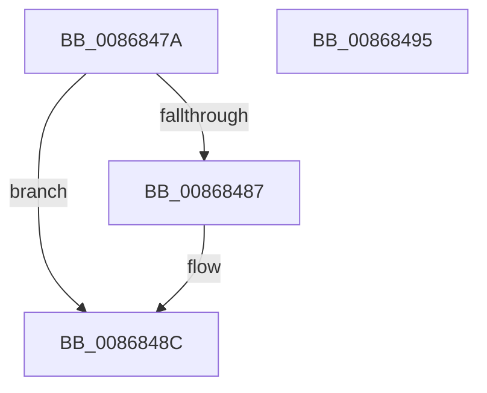

# sub_0086847A

- RVA: `0x0086847A`–`0x00868496` (길이 `28` bytes)
- VA: `0x000000014086847A`
- 실행 섹션: `PAGE`
- PDB 이름 있음: `아니요`; PDB Function 태그: `아니요`
- unwind 정보 RVA: `0x0006BD6C`
- 디코드: `11`개 명령, `28/28` bytes 표시
- 미해석 바이트: `0` (있으면 어셈블리에 `.byte`로 보존)

> 이 문서는 커널 이미지의 기계어와 PDB 기호를 분석해 생성했습니다. 4번과 5번은 함수 원형과 자료형을 바이너리 사용 방식에서 추정한 C 해석이며 원본 소스 복구 결과는 아닙니다.

## 1. Dependencies

- 직접 호출 지점: **1**; 고유 호출 대상: **1**
- 직접 호출자로 확인된 함수: **0**
- RIP 상대 이미지 참조: **0**

### Outgoing calls
- `0x00868487` → [KiCheckForKernelApcDelivery](../../text/2E/KiCheckForKernelApcDelivery_function_002E2C80.md) (function, `0x002E2C80`)

### Direct callers
- 이 함수 시작 RVA로 연결되는 직접 call은 확인되지 않았습니다. 간접 호출은 완전히 역산할 수 없습니다.

### Static image references
- 디코드된 RIP-relative 메모리 참조가 없습니다.

## 2. Other-region calls and transfers

- 다른 실행 섹션으로 향하는 call: **1**
  - `0x00868487` → [KiCheckForKernelApcDelivery](../../text/2E/KiCheckForKernelApcDelivery_function_002E2C80.md) (`PAGE` → `.text`)
- 별도 외부 분기/꼬리 이동을 확인하지 못했습니다.

## 3. Assembly (complete function range)

```asm
0086847A  48 8D 8E 98 00 00 00            lea rcx, [rsi + 0x98]
00868481  90                              nop
00868482  48 39 09                        cmp qword ptr [rcx], rcx
00868485  74 05                           je 0x14086848c
00868487  E8 F4 A7 A7 FF                  call 0x1402e2c80
0086848C  8B C5                           mov eax, ebp
0086848E  48 83 C4 48                     add rsp, 0x48
00868492  5E                              pop rsi
00868493  5D                              pop rbp
00868494  C3                              ret
00868495  CC                              int3
```

## 4. C-style interpretation (structured pseudocode)

```c
__int64 __fastcall sub_0086847A(void)
{
    __int64 result;
    __int64 v_rsp;

    if ((*(unsigned __int64 *)(v_rsi + 152)) != (v_rsi + 152)) {
        result = KiCheckForKernelApcDelivery(v_rsi + 152, a2, a3, a4);
    }
    v_rsp = (v_rsp) + (72);
    return (unsigned int)((unsigned int)(v_rbp));
}
```

## 5. (Beta) C Style

```c
void sub_0086847A(void)
{
    int64_t result;
    int64_t local_rsp;

    if ((*(uint64_t *)(local_rsi + 0x98)) != (local_rsi + 152)) {
        result = KiCheckForKernelApcDelivery(local_rsi + 152, a2, a3, a4);
    }
    local_rsp = (local_rsp) + (72);
    return (uint32_t)((uint32_t)(local_rbp));
}
```

## 6. Execution-region graph

[열기: 2D/3D 그래프와 함수 탐색 컨트롤 패널](../../../control-panel.html?section=page&rva=0x0086847A&view=graph)

- 2D 그래프는 위에서 아래로 흐르고, 3D 그래프는 빈 공간을 드래그해 회전합니다. Shift+드래그는 이동, 휠은 확대·축소, 함수 노드 선택은 대상 보고서 이동입니다.

### Static fallback


