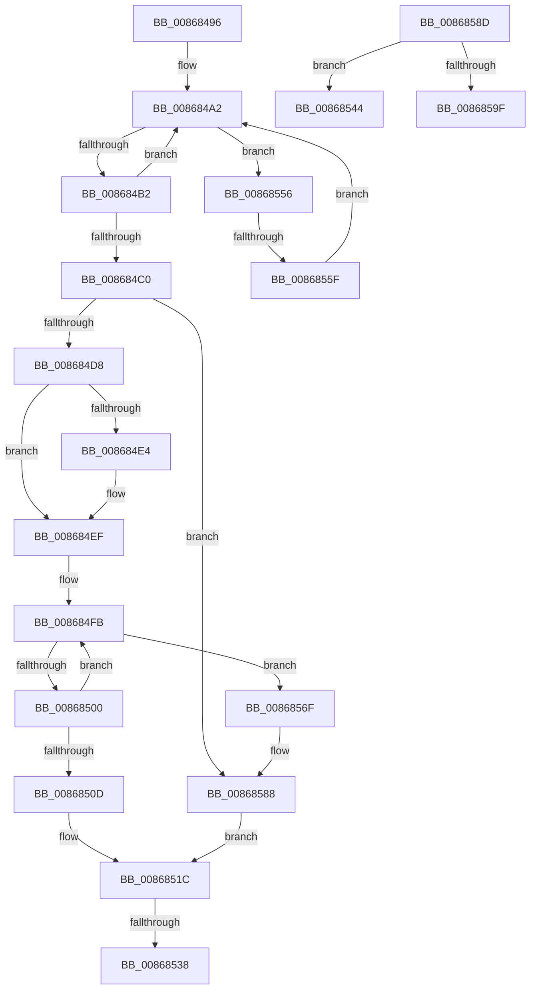

# sub_00868496

- RVA: `0x00868496`–`0x008685A4` (길이 `270` bytes)
- VA: `0x0000000140868496`
- 실행 섹션: `PAGE`
- PDB 이름 있음: `아니요`; PDB Function 태그: `아니요`
- unwind 정보 RVA: `0x0006BD80`
- 디코드: `70`개 명령, `270/270` bytes 표시
- 미해석 바이트: `0` (있으면 어셈블리에 `.byte`로 보존)

> 이 문서는 커널 이미지의 기계어와 PDB 기호를 분석해 생성했습니다. 4번과 5번은 함수 원형과 자료형을 바이너리 사용 방식에서 추정한 C 해석이며 원본 소스 복구 결과는 아닙니다.

## 1. Dependencies

- 직접 호출 지점: **7**; 고유 호출 대상: **7**
- 직접 호출자로 확인된 함수: **0**
- RIP 상대 이미지 참조: **1**

### Outgoing calls
- `0x008684C3` → [ExGetHandlePointer](../../text/43/ExGetHandlePointer_function_00430C90.md) (function, `0x00430C90`)
- `0x008684E7` → [ExSlowReplenishHandleTableEntry](../../text/44/ExSlowReplenishHandleTableEntry_function_0044BEF0.md) (function, `0x0044BEF0`)
- `0x00868517` → [ObpTraceObjectReferenceIfActive](../../text/21/ObpTraceObjectReferenceIfActive_function_00210780.md) (function, `0x00210780`)
- `0x0086853A` → [ExfUnblockPushLock](../../text/2A/ExfUnblockPushLock_function_002A3FE0.md) (function, `0x002A3FE0`)
- `0x0086854C` → [ObfDereferenceObject](../../text/2F/ObfDereferenceObject_function_002F9350.md) (function, `0x002F9350`)
- `0x00868565` → [ExpBlockOnLockedHandleEntry](ExpBlockOnLockedHandleEntry_function_00868838.md) (function, `0x00868838`)
- `0x00868590` → [PspLockUnlockThreadSecurityExclusiveUnsafe](../../text/4E/PspLockUnlockThreadSecurityExclusiveUnsafe_function_004E96AC.md) (function, `0x004E96AC`)

### Direct callers
- 이 함수 시작 RVA로 연결되는 직접 call은 확인되지 않았습니다. 간접 호출은 완전히 역산할 수 없습니다.

### Static image references
- `0x00868496` → RVA `0x00FC6CA8` (`ALMOSTRO`; read)

## 2. Other-region calls and transfers

- 다른 실행 섹션으로 향하는 call: **6**
  - `0x008684C3` → [ExGetHandlePointer](../../text/43/ExGetHandlePointer_function_00430C90.md) (`PAGE` → `.text`)
  - `0x008684E7` → [ExSlowReplenishHandleTableEntry](../../text/44/ExSlowReplenishHandleTableEntry_function_0044BEF0.md) (`PAGE` → `.text`)
  - `0x00868517` → [ObpTraceObjectReferenceIfActive](../../text/21/ObpTraceObjectReferenceIfActive_function_00210780.md) (`PAGE` → `.text`)
  - `0x0086853A` → [ExfUnblockPushLock](../../text/2A/ExfUnblockPushLock_function_002A3FE0.md) (`PAGE` → `.text`)
  - `0x0086854C` → [ObfDereferenceObject](../../text/2F/ObfDereferenceObject_function_002F9350.md) (`PAGE` → `.text`)
  - `0x00868590` → [PspLockUnlockThreadSecurityExclusiveUnsafe](../../text/4E/PspLockUnlockThreadSecurityExclusiveUnsafe_function_004E96AC.md) (`PAGE` → `.text`)
- call이 아닌 외부 분기/꼬리 이동: **5**
  - `0x00868532` → [sub_00868310 + 0xF5](Unknown_function_00868310.md) (`tail-transfer`)
  - `0x0086853F` → [sub_00868310 + 0xF5](Unknown_function_00868310.md) (`tail-transfer`)
  - `0x00868551` → [sub_00868310 + 0x14B](Unknown_function_00868310.md) (`tail-transfer`)
  - `0x00868559` → [sub_00868310 + 0x146](Unknown_function_00868310.md) (`tail-transfer`)
  - `0x0086859F` → [sub_00868310 + 0x11D](Unknown_function_00868310.md) (`tail-transfer`)

## 3. Assembly (complete function range)

```asm
00868496  48 8B 1D 0B E8 75 00            mov rbx, qword ptr [rip + 0x75e80b]
0086849D  33 ED                           xor ebp, ebp
0086849F  44 8B F5                        mov r14d, ebp
008684A2  0F 0D 0F                        prefetchw byte ptr [rdi]
008684A5  4C 8B 07                        mov r8, qword ptr [rdi]
008684A8  41 F6 C0 01                     test r8b, 1
008684AC  0F 84 A4 00 00 00               je 0x140868556
008684B2  49 8D 48 FF                     lea rcx, [r8 - 1]
008684B6  49 8B C0                        mov rax, r8
008684B9  F0 48 0F B1 0F                  lock cmpxchg qword ptr [rdi], rcx
008684BE  75 E2                           jne 0x1408684a2
008684C0  48 8B CF                        mov rcx, rdi
008684C3  E8 C8 87 BC FF                  call 0x140430c90
008684C8  48 8B D8                        mov rbx, rax
008684CB  0F B6 00                        movzx eax, byte ptr [rax]
008684CE  24 7F                           and al, 0x7f
008684D0  3C 06                           cmp al, 6
008684D2  0F 85 B0 00 00 00               jne 0x140868588
008684D8  8B 83 A0 05 00 00               mov eax, dword ptr [rbx + 0x5a0]
008684DE  24 03                           and al, 3
008684E0  3C 02                           cmp al, 2
008684E2  75 0B                           jne 0x1408684ef
008684E4  48 8B CF                        mov rcx, rdi
008684E7  E8 04 3A BE FF                  call 0x14044bef0
008684EC  44 8B F0                        mov r14d, eax
008684EF  41 8D 56 01                     lea edx, [r14 + 1]
008684F3  0F 0D 4B D0                     prefetchw byte ptr [rbx - 0x30]
008684F7  48 8B 43 D0                     mov rax, qword ptr [rbx - 0x30]
008684FB  48 85 C0                        test rax, rax
008684FE  74 6F                           je 0x14086856f
00868500  8B CA                           mov ecx, edx
00868502  48 03 C8                        add rcx, rax
00868505  F0 48 0F B1 4B D0               lock cmpxchg qword ptr [rbx - 0x30], rcx
0086850B  75 EE                           jne 0x1408684fb
0086850D  41 B8 44 66 6C 74               mov r8d, 0x746c6644
00868513  48 8D 4B D0                     lea rcx, [rbx - 0x30]
00868517  E8 64 82 9A FF                  call 0x140210780
0086851C  48 8B 0D 85 E7 75 00            mov rcx, qword ptr [rip + 0x75e785]
00868523  F0 48 FF 07                     lock inc qword ptr [rdi]
00868527  48 83 C1 30                     add rcx, 0x30
0086852B  F0 09 2C 24                     lock or dword ptr [rsp], ebp
0086852F  48 39 29                        cmp qword ptr [rcx], rbp
00868532  0F 84 CD FE FF FF               je 0x140868405
00868538  33 D2                           xor edx, edx
0086853A  E8 A1 BA A3 FF                  call 0x1402a3fe0
0086853F  E9 C1 FE FF FF                  jmp 0x140868405
00868544  BD 0B 00 00 C0                  mov ebp, 0xc000000b
00868549  48 8B CB                        mov rcx, rbx
0086854C  E8 FF 0D A9 FF                  call 0x1402f9350
00868551  E9 05 FF FF FF                  jmp 0x14086845b
00868556  4D 85 C0                        test r8, r8
00868559  0F 84 F7 FE FF FF               je 0x140868456
0086855F  48 8B D7                        mov rdx, rdi
00868562  48 8B CB                        mov rcx, rbx
00868565  E8 CE 02 00 00                  call 0x140868838
0086856A  E9 33 FF FF FF                  jmp 0x1408684a2
0086856F  48 8B 07                        mov rax, qword ptr [rdi]
00868572  0F 57 C0                        xorps xmm0, xmm0
00868575  48 25 01 00 FE FF               and rax, 0xfffffffffffe0001
0086857B  0F 11 44 24 30                  movups xmmword ptr [rsp + 0x30], xmm0
00868580  48 89 44 24 30                  mov qword ptr [rsp + 0x30], rax
00868585  48 89 07                        mov qword ptr [rdi], rax
00868588  48 8B DD                        mov rbx, rbp
0086858B  EB 8F                           jmp 0x14086851c
0086858D  48 8B CB                        mov rcx, rbx
00868590  E8 17 11 C8 FF                  call 0x1404e96ac
00868595  8B 83 A0 05 00 00               mov eax, dword ptr [rbx + 0x5a0]
0086859B  A8 02                           test al, 2
0086859D  74 A5                           je 0x140868544
0086859F  E9 89 FE FF FF                  jmp 0x14086842d
```

## 4. C-style interpretation (structured pseudocode)

```c
__int64 __fastcall sub_00868496(__int64 a1, __int64 a2, __int64 a3, __int64 a4, __int64 a5, __int64 a6)
{
    __int64 result;
    __int64 v_r14;
    __int64 v_rbp;
    unsigned int v_stack_p0;
    unsigned __int64 v_stack_p30;

    v_rbp = 0;
loc_008684A2:
    if ((((unsigned __int8)(*(unsigned __int64 *)(v_rdi))) & (1)) == 0) goto loc_00868556;
    if ((((unsigned __int8)(*(unsigned __int64 *)(v_rdi))) & (1)) != 0) goto loc_008684A2;
    result = ExGetHandlePointer(v_rdi, a2, *(unsigned __int64 *)(v_rdi), a4);
    result = (unsigned __int8)((*(unsigned __int8 *)(result)) & (127));
    if (((unsigned __int8)(result)) != 6) goto loc_00868588;
    result = (unsigned __int8)(((unsigned int)(*(unsigned int *)(result + 1440))) & (3));
    v_r14 = 0;
    if (((unsigned __int8)(result)) == 2) {
        a1 = v_rdi;
        result = ExSlowReplenishHandleTableEntry(a1, a2, *(unsigned __int64 *)(v_rdi), a4);
        v_r14 = (unsigned int)(result);
    }
loc_008684FB:
    if (*(unsigned __int64 *)(result - 48) == 0) goto loc_0086856F;
    a1 = ((unsigned int)((unsigned int)(v_r14 + 1))) + (*(unsigned __int64 *)(result - 48));
    if (condition_is_not_equal) goto loc_008684FB;
    result = ObpTraceObjectReferenceIfActive(result - 48, v_r14 + 1, (unsigned int)(0x746C6644ULL), a4);
loc_0086851C:
    a1 = (*(unsigned __int64 *)(v_rip + 7726981)) + (48);
    a2 = 0;
    result = ExfUnblockPushLock(a1, a2, (unsigned int)(0x746C6644ULL), a4);
loc_00868556:
    result = ExpBlockOnLockedHandleEntry(result, v_rdi, (unsigned int)(0x746C6644ULL), a4);
    goto loc_008684A2;
loc_0086856F:
    result = (*(unsigned __int64 *)(v_rdi)) & (0xFFFFFFFFFFFE0001ULL);
    a6 = v_xmm0;
    v_stack_p30 = result;
    *(unsigned __int64 *)(v_rdi) = result;
loc_00868588:
    goto loc_0086851C;
}
```

## 5. (Beta) C Style

```c
int64_t sub_00868496(int64_t Arg1, int64_t Arg2, int64_t Arg3, int64_t Arg4, uint64_t Arg5, int64_t Arg6)
{
    int64_t result;
    int64_t local_r14;
    int64_t local_rbp;
    uint32_t v_stack_p0;
    uint64_t v_stack_p30;

    local_rbp = 0;
loc_008684A2:
    if ((((uint8_t)(*(uint64_t *)(local_rdi))) & (1)) == 0) goto loc_00868556;
    if ((((uint8_t)(*(uint64_t *)(local_rdi))) & (1)) != 0) goto loc_008684A2;
    result = ExGetHandlePointer(local_rdi, Arg2, *(uint64_t *)(local_rdi), Arg4);
    result = (uint8_t)((*(uint8_t *)(result)) & (127));
    if (((uint8_t)(result)) != 6) goto loc_00868588;
    result = (uint8_t)(((uint32_t)(*(uint32_t *)(result + 0x5A0))) & (3));
    local_r14 = 0;
    if (((uint8_t)(result)) == 2) {
        Arg1 = local_rdi;
        result = ExSlowReplenishHandleTableEntry(Arg1, Arg2, *(uint64_t *)(local_rdi), Arg4);
        local_r14 = (uint32_t)(result);
    }
loc_008684FB:
    if (*(uint64_t *)(result - 0x30) == 0) goto loc_0086856F;
    Arg1 = ((uint32_t)((uint32_t)(local_r14 + 1))) + (*(uint64_t *)(result - 0x30));
    if (condition_is_not_equal) goto loc_008684FB;
    result = ObpTraceObjectReferenceIfActive(result - 48, local_r14 + 1, (uint32_t)(0x746C6644ULL), Arg4);
loc_0086851C:
    Arg1 = (*(uint64_t *)(v_rip + 0x75E785)) + (48);
    Arg2 = 0;
    result = ExfUnblockPushLock(Arg1, Arg2, (uint32_t)(0x746C6644ULL), Arg4);
loc_00868556:
    result = ExpBlockOnLockedHandleEntry(result, local_rdi, (uint32_t)(0x746C6644ULL), Arg4);
    goto loc_008684A2;
loc_0086856F:
    result = (*(uint64_t *)(local_rdi)) & (0xFFFFFFFFFFFE0001ULL);
    Arg6 = v_xmm0;
    v_stack_p30 = result;
    *(uint64_t *)(local_rdi) = result;
loc_00868588:
    goto loc_0086851C;
}
```

## 6. Execution-region graph

[열기: 2D/3D 그래프와 함수 탐색 컨트롤 패널](../../../control-panel.html?section=page&rva=0x00868496&view=graph)

- 2D 그래프는 위에서 아래로 흐르고, 3D 그래프는 빈 공간을 드래그해 회전합니다. Shift+드래그는 이동, 휠은 확대·축소, 함수 노드 선택은 대상 보고서 이동입니다.

### Static fallback


