# sub_0086AD2F

- RVA: `0x0086AD2F`–`0x0086AE9A` (길이 `363` bytes)
- VA: `0x000000014086AD2F`
- 실행 섹션: `PAGE`
- PDB 이름 있음: `아니요`; PDB Function 태그: `아니요`
- unwind 정보 RVA: `0x0006BF14`
- 디코드: `92`개 명령, `363/363` bytes 표시
- 미해석 바이트: `0` (있으면 어셈블리에 `.byte`로 보존)

> 이 문서는 커널 이미지의 기계어와 PDB 기호를 분석해 생성했습니다. 4번과 5번은 함수 원형과 자료형을 바이너리 사용 방식에서 추정한 C 해석이며 원본 소스 복구 결과는 아닙니다.

## 1. Dependencies

- 직접 호출 지점: **4**; 고유 호출 대상: **4**
- 직접 호출자로 확인된 함수: **0**
- RIP 상대 이미지 참조: **1**

### Outgoing calls
- `0x0086ADA3` → [KeAbPreAcquire](../../text/21/KeAbPreAcquire_function_00210230.md) (function, `0x00210230`)
- `0x0086ADBC` → [ExfAcquirePushLockExclusiveEx](../../text/20/ExfAcquirePushLockExclusiveEx_function_0020FC90.md) (function, `0x0020FC90`)
- `0x0086AE08` → [KeAbPostRelease](../../text/2E/KeAbPostRelease_function_002E1600.md) (function, `0x002E1600`)
- `0x0086AE68` → [ExpUpdateDebugInfo](ExpUpdateDebugInfo_function_0086B174.md) (function, `0x0086B174`)

### Direct callers
- 이 함수 시작 RVA로 연결되는 직접 call은 확인되지 않았습니다. 간접 호출은 완전히 역산할 수 없습니다.

### Static image references
- `0x0086AD5B` → RVA `0x00FD9B18` (`PAGEDATA`; read)

## 2. Other-region calls and transfers

- 다른 실행 섹션으로 향하는 call: **3**
  - `0x0086ADA3` → [KeAbPreAcquire](../../text/21/KeAbPreAcquire_function_00210230.md) (`PAGE` → `.text`)
  - `0x0086ADBC` → [ExfAcquirePushLockExclusiveEx](../../text/20/ExfAcquirePushLockExclusiveEx_function_0020FC90.md) (`PAGE` → `.text`)
  - `0x0086AE08` → [KeAbPostRelease](../../text/2E/KeAbPostRelease_function_002E1600.md) (`PAGE` → `.text`)
- call이 아닌 외부 분기/꼬리 이동: **7**
  - `0x0086AD4D` → [sub_0086AEAF + 0x191](Unknown_function_0086AEAF.md) (`tail-transfer`)
  - `0x0086AD7F` → [sub_0086B0A5 + 0x1E](Unknown_function_0086B0A5.md) (`tail-transfer`)
  - `0x0086AD95` → [sub_0086AEAF + 0x6A](Unknown_function_0086AEAF.md) (`tail-transfer`)
  - `0x0086ADFF` → [sub_0086AEAF + 0x1D8](Unknown_function_0086AEAF.md) (`tail-transfer`)
  - `0x0086AE10` → [sub_0086AEAF + 0x6A](Unknown_function_0086AEAF.md) (`tail-transfer`)
  - `0x0086AE45` → [sub_0086AEAF](Unknown_function_0086AEAF.md) (`tail-transfer`)
  - `0x0086AE4B` → [sub_0086AEAF](Unknown_function_0086AEAF.md) (`tail-transfer`)

## 3. Assembly (complete function range)

```asm
0086AD2F  48 89 AC 24 88 00 00 00         mov qword ptr [rsp + 0x88], rbp
0086AD37  48 89 74 24 48                  mov qword ptr [rsp + 0x48], rsi
0086AD3C  4C 89 64 24 40                  mov qword ptr [rsp + 0x40], r12
0086AD41  4C 89 6C 24 38                  mov qword ptr [rsp + 0x38], r13
0086AD46  4C 89 7C 24 30                  mov qword ptr [rsp + 0x30], r15
0086AD4B  A8 01                           test al, 1
0086AD4D  0F 85 ED 02 00 00               jne 0x14086b040
0086AD53  65 8B 04 25 A4 01 00 00         mov eax, dword ptr gs:[0x1a4]
0086AD5B  44 8B 25 B6 ED 76 00            mov r12d, dword ptr [rip + 0x76edb6]
0086AD62  48 C7 C7 FF FF FF FF            mov rdi, 0xffffffffffffffff
0086AD69  89 84 24 80 00 00 00            mov dword ptr [rsp + 0x80], eax
0086AD70  41 8B 0E                        mov ecx, dword ptr [r14]
0086AD73  33 ED                           xor ebp, ebp
0086AD75  89 4C 24 70                     mov dword ptr [rsp + 0x70], ecx
0086AD79  44 8B E8                        mov r13d, eax
0086AD7C  41 3B EC                        cmp ebp, r12d
0086AD7F  0F 83 3E 03 00 00               jae 0x14086b0c3
0086AD85  8B F0                           mov esi, eax
0086AD87  48 FF C6                        inc rsi
0086AD8A  48 C1 E6 06                     shl rsi, 6
0086AD8E  49 03 F6                        add rsi, r14
0086AD91  48 39 5E 08                     cmp qword ptr [rsi + 8], rbx
0086AD95  0F 84 7E 01 00 00               je 0x14086af19
0086AD9B  45 33 C0                        xor r8d, r8d
0086AD9E  33 D2                           xor edx, edx
0086ADA0  48 8B CE                        mov rcx, rsi
0086ADA3  E8 88 54 9A FF                  call 0x140210230
0086ADA8  F0 48 0F BA 2E 00               lock bts qword ptr [rsi], 0
0086ADAE  4C 8B F8                        mov r15, rax
0086ADB1  73 0E                           jae 0x14086adc1
0086ADB3  4C 8B C6                        mov r8, rsi
0086ADB6  48 8B D0                        mov rdx, rax
0086ADB9  48 8B CE                        mov rcx, rsi
0086ADBC  E8 CF 4E 9A FF                  call 0x14020fc90
0086ADC1  4D 85 FF                        test r15, r15
0086ADC4  74 05                           je 0x14086adcb
0086ADC6  41 C6 47 0A 01                  mov byte ptr [r15 + 0xa], 1
0086ADCB  4C 8B 7E 08                     mov r15, qword ptr [rsi + 8]
0086ADCF  4D 85 FF                        test r15, r15
0086ADD2  74 1F                           je 0x14086adf3
0086ADD4  49 8B 47 08                     mov rax, qword ptr [r15 + 8]
0086ADD8  48 89 46 08                     mov qword ptr [rsi + 8], rax
0086ADDC  48 85 C0                        test rax, rax
0086ADDF  75 04                           jne 0x14086ade5
0086ADE1  48 89 5E 10                     mov qword ptr [rsi + 0x10], rbx
0086ADE5  FF 46 18                        inc dword ptr [rsi + 0x18]
0086ADE8  8B 46 18                        mov eax, dword ptr [rsi + 0x18]
0086ADEB  3B 46 1C                        cmp eax, dword ptr [rsi + 0x1c]
0086ADEE  7E 03                           jle 0x14086adf3
0086ADF0  89 46 1C                        mov dword ptr [rsi + 0x1c], eax
0086ADF3  48 8B C7                        mov rax, rdi
0086ADF6  F0 48 0F C1 06                  lock xadd qword ptr [rsi], rax
0086ADFB  24 06                           and al, 6
0086ADFD  3C 02                           cmp al, 2
0086ADFF  0F 84 82 02 00 00               je 0x14086b087
0086AE05  48 8B CE                        mov rcx, rsi
0086AE08  E8 F3 67 A7 FF                  call 0x1402e1600
0086AE0D  4D 85 FF                        test r15, r15
0086AE10  0F 84 03 01 00 00               je 0x14086af19
0086AE16  48 8B B4 24 90 00 00 00         mov rsi, qword ptr [rsp + 0x90]
0086AE1E  49 8B C7                        mov rax, r15
0086AE21  48 25 00 F0 FF FF               and rax, 0xfffffffffffff000
0086AE27  49 8B CF                        mov rcx, r15
0086AE2A  48 2B C8                        sub rcx, rax
0086AE2D  48 C1 F9 04                     sar rcx, 4
0086AE31  48 8B 40 08                     mov rax, qword ptr [rax + 8]
0086AE35  48 8D 1C 88                     lea rbx, [rax + rcx*4]
0086AE39  48 85 F6                        test rsi, rsi
0086AE3C  74 0F                           je 0x14086ae4d
0086AE3E  83 3E 00                        cmp dword ptr [rsi], 0
0086AE41  8B C3                           mov eax, ebx
0086AE43  8B CB                           mov ecx, ebx
0086AE45  75 68                           jne 0x14086aeaf
0086AE47  83 7E 04 00                     cmp dword ptr [rsi + 4], 0
0086AE4B  75 62                           jne 0x14086aeaf
0086AE4D  49 83 7E 60 00                  cmp qword ptr [r14 + 0x60], 0
0086AE52  48 8B 7C 24 78                  mov rdi, qword ptr [rsp + 0x78]
0086AE57  74 14                           je 0x14086ae6d
0086AE59  41 B9 01 00 00 00               mov r9d, 1
0086AE5F  4C 8B C3                        mov r8, rbx
0086AE62  48 8B D7                        mov rdx, rdi
0086AE65  49 8B CE                        mov rcx, r14
0086AE68  E8 07 03 00 00                  call 0x14086b174
0086AE6D  48 8B 54 24 28                  mov rdx, qword ptr [rsp + 0x28]
0086AE72  49 89 57 08                     mov qword ptr [r15 + 8], rdx
0086AE76  48 8B 54 24 20                  mov rdx, qword ptr [rsp + 0x20]
0086AE7B  49 89 17                        mov qword ptr [r15], rdx
0086AE7E  4C 8B 6C 24 38                  mov r13, qword ptr [rsp + 0x38]
0086AE83  4C 8B 64 24 40                  mov r12, qword ptr [rsp + 0x40]
0086AE88  48 8B 74 24 48                  mov rsi, qword ptr [rsp + 0x48]
0086AE8D  48 8B AC 24 88 00 00 00         mov rbp, qword ptr [rsp + 0x88]
0086AE95  4C 8B 7C 24 30                  mov r15, qword ptr [rsp + 0x30]
```

## 4. C-style interpretation (structured pseudocode)

```c
__int64 __fastcall sub_0086AD2F(__int64 a1, int a2, int a3, __int64 a4, __int64 a5, __int64 a6, __int64 a7, __int64 a8, __int64 a9, __int64 a10, __int64 a11, __int64 a12, __int64 a13, __int64 a14, __int64 a15, __int64 a16, __int64 a17, __int64 a18)
{
    __int64 result;
    __int64 v_rbp;
    __int64 v_rsi;
    unsigned __int64 v_stack_p20;
    unsigned __int64 v_stack_p30;
    unsigned __int64 v_stack_p38;
    unsigned __int64 v_stack_p40;
    unsigned __int64 v_stack_p48;
    unsigned int v_stack_p70;
    unsigned int v_stack_p80;
    unsigned __int64 v_stack_p88;

    v_stack_p88 = v_rbp;
    v_stack_p48 = v_rsi;
    v_stack_p40 = v_r12;
    v_stack_p38 = v_r13;
    v_stack_p30 = v_r15;
    v_stack_p80 = (unsigned int)((unsigned int)(*(unsigned int *)(gs_base + (0 + 420))));
    v_rbp = 0;
    v_stack_p70 = (unsigned int)((unsigned int)(*(unsigned int *)(v_r14)));
    v_rsi = ((unsigned int)((unsigned int)((unsigned int)(*(unsigned int *)(gs_base + (0 + 420)))))) + 1;
    v_rsi = (v_rsi) << (6);
    v_rsi = (v_rsi) + (v_r14);
    a3 = 0;
    a2 = 0;
    result = KeAbPreAcquire(v_rsi, a2, a3, a4);
    if (!(condition_is_above_or_equal)) {
        a3 = v_rsi;
        a2 = result;
        a1 = v_rsi;
        result = ExfAcquirePushLockExclusiveEx(a1, a2, a3, a4);
    }
    if (result != 0) {
        *(unsigned __int8 *)(result + 10) = 1;
    }
    if (*(unsigned __int64 *)(v_rsi + 8) == 0) goto loc_0086ADF3;
    *(unsigned __int64 *)(v_rsi + 8) = *(unsigned __int64 *)(*(unsigned __int64 *)(v_rsi + 8) + 8);
    if (*(unsigned __int64 *)(*(unsigned __int64 *)(v_rsi + 8) + 8) == 0) {
        *(unsigned __int64 *)(v_rsi + 16) = v_rbx;
    }
    if (((unsigned int)((unsigned int)(*(unsigned int *)(v_rsi + 24)))) >= = (*(unsigned int *)(v_rsi + 28))) {
        *(unsigned int *)(v_rsi + 28) = (unsigned int)((unsigned int)(*(unsigned int *)(v_rsi + 24)));
    }
    result = (unsigned __int8)((-1) & (6));
    result = KeAbPostRelease(v_rsi, a2, a3, a4);
    result = (*(unsigned __int64 *)(v_rsi + 8)) & (0xFFFFFFFFFFFFF000ULL);
    a1 = (*(unsigned __int64 *)(v_rsi + 8)) - (result);
    a1 = (a1) >> (4);
    if (a18 == 0) goto loc_0086AE4D;
loc_0086AE4D:
    result = (unsigned int)((unsigned int)(*(unsigned __int64 *)(result + 8) + a1 * 4));
    if ((*(unsigned __int64 *)(v_r14 + 96)) != 0) {
        a4 = 1;
        a3 = *(unsigned __int64 *)(result + 8) + a1 * 4;
        a2 = a15;
        a1 = v_r14;
        result = ExpUpdateDebugInfo(a1, a2, a3, a4);
    }
    *(unsigned __int64 *)(*(unsigned __int64 *)(v_rsi + 8) + 8) = a5;
    *(unsigned __int64 *)(*(unsigned __int64 *)(v_rsi + 8)) = v_stack_p20;
    return result;
}
```

## 5. (Beta) C Style

```c
int64_t sub_0086AD2F(int64_t Arg1, int32_t Arg2, int32_t Arg3, int64_t Arg4, int64_t Arg5, int64_t Arg6, int64_t Arg7, int64_t Arg8, int64_t Arg9, uint64_t Arg10, uint64_t Arg11, uint64_t Arg12, uint64_t Arg13, uint64_t Arg14, int64_t Arg15, uint64_t Arg16, int64_t Arg17, int64_t Arg18)
{
    int64_t result;
    int64_t local_rbp;
    int64_t local_rsi;
    uint64_t v_stack_p20;
    uint64_t v_stack_p30;
    uint64_t v_stack_p38;
    uint64_t v_stack_p40;
    uint64_t v_stack_p48;
    uint32_t v_stack_p70;
    uint32_t v_stack_p80;
    uint64_t v_stack_p88;

    v_stack_p88 = local_rbp;
    v_stack_p48 = local_rsi;
    v_stack_p40 = local_r12;
    v_stack_p38 = local_r13;
    v_stack_p30 = local_r15;
    v_stack_p80 = (uint32_t)((uint32_t)(*(uint32_t *)(gs_base + (0 + 0x1A4))));
    local_rbp = 0;
    v_stack_p70 = (uint32_t)((uint32_t)(*(uint32_t *)(local_r14)));
    local_rsi = ((uint32_t)((uint32_t)((uint32_t)(*(uint32_t *)(gs_base + (0 + 0x1A4)))))) + 1;
    local_rsi = (local_rsi) << (6);
    local_rsi = (local_rsi) + (local_r14);
    Arg3 = 0;
    Arg2 = 0;
    result = KeAbPreAcquire(local_rsi, Arg2, Arg3, Arg4);
    if (!(condition_is_above_or_equal)) {
        Arg3 = local_rsi;
        Arg2 = result;
        Arg1 = local_rsi;
        result = ExfAcquirePushLockExclusiveEx(Arg1, Arg2, Arg3, Arg4);
    }
    if (result != 0) {
        *(uint8_t *)(result + 0xA) = 1;
    }
    if (*(uint64_t *)(local_rsi + 0x8) == 0) goto loc_0086ADF3;
    *(uint64_t *)(local_rsi + 0x8) = *(uint64_t *)(*(uint64_t *)(local_rsi + 0x8) + 0x8);
    if (*(uint64_t *)(*(uint64_t *)(local_rsi + 0x8) + 0x8) == 0) {
        *(uint64_t *)(local_rsi + 0x10) = local_rbx;
    }
    if (((uint32_t)((uint32_t)(*(uint32_t *)(local_rsi + 0x18)))) >= = (*(uint32_t *)(local_rsi + 0x1C))) {
        *(uint32_t *)(local_rsi + 0x1C) = (uint32_t)((uint32_t)(*(uint32_t *)(local_rsi + 0x18)));
    }
    result = (uint8_t)((-1) & (6));
    result = KeAbPostRelease(local_rsi, Arg2, Arg3, Arg4);
    result = (*(uint64_t *)(local_rsi + 0x8)) & (0xFFFFFFFFFFFFF000ULL);
    Arg1 = (*(uint64_t *)(local_rsi + 0x8)) - (result);
    Arg1 = (Arg1) >> (4);
    if (Arg18 == 0) goto loc_0086AE4D;
loc_0086AE4D:
    result = (uint32_t)((uint32_t)(*(uint64_t *)(result + 0x8) + Arg1 * 4));
    if ((*(uint64_t *)(local_r14 + 0x60)) != 0) {
        Arg4 = 1;
        Arg3 = *(uint64_t *)(result + 0x8) + Arg1 * 4;
        Arg2 = Arg15;
        Arg1 = local_r14;
        result = ExpUpdateDebugInfo(Arg1, Arg2, Arg3, Arg4);
    }
    *(uint64_t *)(*(uint64_t *)(local_rsi + 0x8) + 0x8) = Arg5;
    *(uint64_t *)(*(uint64_t *)(local_rsi + 0x8)) = v_stack_p20;
    return result;
}
```

## 6. Execution-region graph

[열기: 2D/3D 그래프와 함수 탐색 컨트롤 패널](../../../control-panel.html?section=page&rva=0x0086AD2F&view=graph)

- 2D 그래프는 위에서 아래로 흐르고, 3D 그래프는 빈 공간을 드래그해 회전합니다. Shift+드래그는 이동, 휠은 확대·축소, 함수 노드 선택은 대상 보고서 이동입니다.

### Static fallback

```mermaid
flowchart TD
  bb_0086AD2F[BB_0086AD2F]
  bb_0086AD53[BB_0086AD53]
  bb_0086AD85[BB_0086AD85]
  bb_0086AD9B[BB_0086AD9B]
  bb_0086ADB3[BB_0086ADB3]
  bb_0086ADC1[BB_0086ADC1]
  bb_0086ADC6[BB_0086ADC6]
  bb_0086ADCB[BB_0086ADCB]
  bb_0086ADD4[BB_0086ADD4]
  bb_0086ADE1[BB_0086ADE1]
  bb_0086ADE5[BB_0086ADE5]
  bb_0086ADF0[BB_0086ADF0]
  bb_0086ADF3[BB_0086ADF3]
  bb_0086AE05[BB_0086AE05]
  bb_0086AE16[BB_0086AE16]
  bb_0086AE3E[BB_0086AE3E]
  bb_0086AE47[BB_0086AE47]
  bb_0086AE4D[BB_0086AE4D]
  bb_0086AE59[BB_0086AE59]
  bb_0086AE6D[BB_0086AE6D]
  bb_0086AD2F -->|fallthrough| bb_0086AD53
  bb_0086AD53 -->|fallthrough| bb_0086AD85
  bb_0086AD85 -->|fallthrough| bb_0086AD9B
  bb_0086AD9B -->|branch| bb_0086ADC1
  bb_0086AD9B -->|fallthrough| bb_0086ADB3
  bb_0086ADB3 -->|flow| bb_0086ADC1
  bb_0086ADC1 -->|branch| bb_0086ADCB
  bb_0086ADC1 -->|fallthrough| bb_0086ADC6
  bb_0086ADC6 -->|flow| bb_0086ADCB
  bb_0086ADCB -->|branch| bb_0086ADF3
  bb_0086ADCB -->|fallthrough| bb_0086ADD4
  bb_0086ADD4 -->|branch| bb_0086ADE5
  bb_0086ADD4 -->|fallthrough| bb_0086ADE1
  bb_0086ADE1 -->|flow| bb_0086ADE5
  bb_0086ADE5 -->|branch| bb_0086ADF3
  bb_0086ADE5 -->|fallthrough| bb_0086ADF0
  bb_0086ADF0 -->|flow| bb_0086ADF3
  bb_0086ADF3 -->|fallthrough| bb_0086AE05
  bb_0086AE05 -->|fallthrough| bb_0086AE16
  bb_0086AE16 -->|branch| bb_0086AE4D
  bb_0086AE16 -->|fallthrough| bb_0086AE3E
  bb_0086AE3E -->|fallthrough| bb_0086AE47
  bb_0086AE47 -->|fallthrough| bb_0086AE4D
  bb_0086AE4D -->|branch| bb_0086AE6D
  bb_0086AE4D -->|fallthrough| bb_0086AE59
  bb_0086AE59 -->|flow| bb_0086AE6D
```


