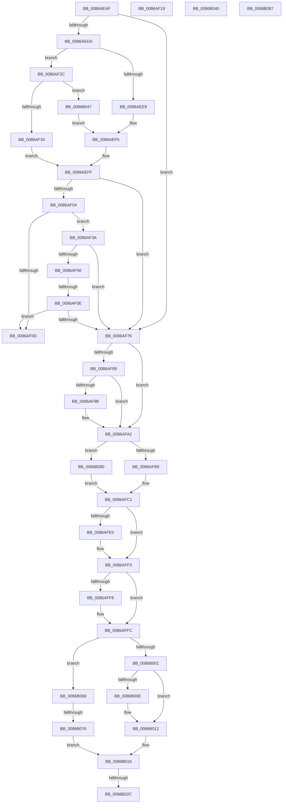

# sub_0086AEAF

- RVA: `0x0086AEAF`–`0x0086B094` (길이 `485` bytes)
- VA: `0x000000014086AEAF`
- 실행 섹션: `PAGE`
- PDB 이름 있음: `아니요`; PDB Function 태그: `아니요`
- unwind 정보 RVA: `0x0006BF4C`
- 디코드: `126`개 명령, `485/485` bytes 표시
- 미해석 바이트: `0` (있으면 어셈블리에 `.byte`로 보존)

> 이 문서는 커널 이미지의 기계어와 PDB 기호를 분석해 생성했습니다. 4번과 5번은 함수 원형과 자료형을 바이너리 사용 방식에서 추정한 C 해석이며 원본 소스 복구 결과는 아닙니다.

## 1. Dependencies

- 직접 호출 지점: **7**; 고유 호출 대상: **7**
- 직접 호출자로 확인된 함수: **0**
- RIP 상대 이미지 참조: **0**

### Outgoing calls
- `0x0086AF43` → [ExpAllocateTablePagedPool](../94/ExpAllocateTablePagedPool_function_0094D634.md) (function, `0x0094D634`)
- `0x0086AF68` → [ExpFreeTablePagedPool](ExpFreeTablePagedPool_function_0086B410.md) (function, `0x0086B410`)
- `0x0086AF91` → [ExpGetHandleExtraInfo](ExpGetHandleExtraInfo_function_0086B454.md) (function, `0x0086B454`)
- `0x0086AFD5` → [KeAbPreAcquire](../../text/21/KeAbPreAcquire_function_00210230.md) (function, `0x00210230`)
- `0x0086AFEE` → [ExfAcquirePushLockExclusiveEx](../../text/20/ExfAcquirePushLockExclusiveEx_function_0020FC90.md) (function, `0x0020FC90`)
- `0x0086B02F` → [KeAbPostRelease](../../text/2E/KeAbPostRelease_function_002E1600.md) (function, `0x002E1600`)
- `0x0086B08A` → [ExfTryToWakePushLock](../../text/26/ExfTryToWakePushLock_function_00265DD0.md) (function, `0x00265DD0`)

### Direct callers
- 이 함수 시작 RVA로 연결되는 직접 call은 확인되지 않았습니다. 간접 호출은 완전히 역산할 수 없습니다.

### Static image references
- 디코드된 RIP-relative 메모리 참조가 없습니다.

## 2. Other-region calls and transfers

- 다른 실행 섹션으로 향하는 call: **4**
  - `0x0086AFD5` → [KeAbPreAcquire](../../text/21/KeAbPreAcquire_function_00210230.md) (`PAGE` → `.text`)
  - `0x0086AFEE` → [ExfAcquirePushLockExclusiveEx](../../text/20/ExfAcquirePushLockExclusiveEx_function_0020FC90.md) (`PAGE` → `.text`)
  - `0x0086B02F` → [KeAbPostRelease](../../text/2E/KeAbPostRelease_function_002E1600.md) (`PAGE` → `.text`)
  - `0x0086B08A` → [ExfTryToWakePushLock](../../text/26/ExfTryToWakePushLock_function_00265DD0.md) (`PAGE` → `.text`)
- call이 아닌 외부 분기/꼬리 이동: **8**
  - `0x0086AF14` → [sub_0086AD2F + 0x11E](Unknown_function_0086AD2F.md) (`tail-transfer`)
  - `0x0086AF27` → [sub_0086AD2F + 0x4A](Unknown_function_0086AD2F.md) (`tail-transfer`)
  - `0x0086AF58` → [sub_0086B0A5](Unknown_function_0086B0A5.md) (`tail-transfer`)
  - `0x0086B026` → [sub_0086B0A5 + 0x11](Unknown_function_0086B0A5.md) (`tail-transfer`)
  - `0x0086B03B` → [sub_0086AD2F + 0x14F](Unknown_function_0086AD2F.md) (`tail-transfer`)
  - `0x0086B042` → [sub_0086AD2F + 0x2C](Unknown_function_0086AD2F.md) (`tail-transfer`)
  - `0x0086B070` → [sub_0086B0A5 + 0xAB](Unknown_function_0086B0A5.md) (`tail-transfer`)
  - `0x0086B08F` → [sub_0086AD2F + 0xD6](Unknown_function_0086AD2F.md) (`tail-transfer`)

## 3. Assembly (complete function range)

```asm
0086AEAF  C1 E8 02                        shr eax, 2
0086AEB2  81 E1 03 FC FF FF               and ecx, 0xfffffc03
0086AEB8  48 89 5C 24 70                  mov qword ptr [rsp + 0x70], rbx
0086AEBD  89 4C 24 70                     mov dword ptr [rsp + 0x70], ecx
0086AEC1  48 8B 54 24 70                  mov rdx, qword ptr [rsp + 0x70]
0086AEC6  44 0F B6 E0                     movzx r12d, al
0086AECA  48 83 E2 FC                     and rdx, 0xfffffffffffffffc
0086AECE  41 8B 06                        mov eax, dword ptr [r14]
0086AED1  48 3B D0                        cmp rdx, rax
0086AED4  0F 83 9C 00 00 00               jae 0x14086af76
0086AEDA  4D 8B 46 08                     mov r8, qword ptr [r14 + 8]
0086AEDE  41 8B C0                        mov eax, r8d
0086AEE1  83 E0 03                        and eax, 3
0086AEE4  83 F8 01                        cmp eax, 1
0086AEE7  75 43                           jne 0x14086af2c
0086AEE9  48 8B C2                        mov rax, rdx
0086AEEC  48 C1 E8 0A                     shr rax, 0xa
0086AEF0  49 8B 44 C0 FF                  mov rax, qword ptr [r8 + rax*8 - 1]
0086AEF5  81 E2 FF 03 00 00               and edx, 0x3ff
0086AEFB  48 8D 2C 90                     lea rbp, [rax + rdx*4]
0086AEFF  48 85 ED                        test rbp, rbp
0086AF02  74 72                           je 0x14086af76
0086AF04  48 8B 55 00                     mov rdx, qword ptr [rbp]
0086AF08  48 85 D2                        test rdx, rdx
0086AF0B  74 2D                           je 0x14086af3a
0086AF0D  48 8B 06                        mov rax, qword ptr [rsi]
0086AF10  4A 89 04 E2                     mov qword ptr [rdx + r12*8], rax
0086AF14  E9 34 FF FF FF                  jmp 0x14086ae4d
0086AF19  41 FF C5                        inc r13d
0086AF1C  33 C0                           xor eax, eax
0086AF1E  FF C5                           inc ebp
0086AF20  45 3B EC                        cmp r13d, r12d
0086AF23  41 0F 45 C5                     cmovne eax, r13d
0086AF27  E9 4D FE FF FF                  jmp 0x14086ad79
0086AF2C  85 C0                           test eax, eax
0086AF2E  0F 85 13 01 00 00               jne 0x14086b047
0086AF34  49 8D 2C 90                     lea rbp, [r8 + rdx*4]
0086AF38  EB C5                           jmp 0x14086aeff
0086AF3A  49 8B 4E 10                     mov rcx, qword ptr [r14 + 0x10]
0086AF3E  BA 00 08 00 00                  mov edx, 0x800
0086AF43  E8 EC 26 0E 00                  call 0x14094d634
0086AF48  48 8B D0                        mov rdx, rax
0086AF4B  48 85 C0                        test rax, rax
0086AF4E  74 26                           je 0x14086af76
0086AF50  33 C0                           xor eax, eax
0086AF52  F0 48 0F B1 55 00               lock cmpxchg qword ptr [rbp], rdx
0086AF58  0F 84 47 01 00 00               je 0x14086b0a5
0086AF5E  49 8B 4E 10                     mov rcx, qword ptr [r14 + 0x10]
0086AF62  41 B8 00 08 00 00               mov r8d, 0x800
0086AF68  E8 A3 04 00 00                  call 0x14086b410
0086AF6D  48 8B 55 00                     mov rdx, qword ptr [rbp]
0086AF71  48 85 D2                        test rdx, rdx
0086AF74  75 97                           jne 0x14086af0d
0086AF76  48 89 5C 24 70                  mov qword ptr [rsp + 0x70], rbx
0086AF7B  83 E3 FC                        and ebx, 0xfffffffc
0086AF7E  41 83 7E 04 00                  cmp dword ptr [r14 + 4], 0
0086AF83  89 5C 24 70                     mov dword ptr [rsp + 0x70], ebx
0086AF87  74 19                           je 0x14086afa2
0086AF89  48 8B 54 24 70                  mov rdx, qword ptr [rsp + 0x70]
0086AF8E  49 8B CE                        mov rcx, r14
0086AF91  E8 BE 04 00 00                  call 0x14086b454
0086AF96  48 85 C0                        test rax, rax
0086AF99  74 07                           je 0x14086afa2
0086AF9B  48 C7 00 00 00 00 00            mov qword ptr [rax], 0
0086AFA2  49 C7 47 08 00 00 00 00         mov qword ptr [r15 + 8], 0
0086AFAA  41 0F B6 76 2C                  movzx esi, byte ptr [r14 + 0x2c]
0086AFAF  40 80 E6 01                     and sil, 1
0086AFB3  0F 85 C7 00 00 00               jne 0x14086b080
0086AFB9  65 8B 04 25 A4 01 00 00         mov eax, dword ptr gs:[0x1a4]
0086AFC1  8B D8                           mov ebx, eax
0086AFC3  45 33 C0                        xor r8d, r8d
0086AFC6  48 FF C3                        inc rbx
0086AFC9  33 D2                           xor edx, edx
0086AFCB  48 C1 E3 06                     shl rbx, 6
0086AFCF  49 03 DE                        add rbx, r14
0086AFD2  48 8B CB                        mov rcx, rbx
0086AFD5  E8 56 52 9A FF                  call 0x140210230
0086AFDA  F0 48 0F BA 2B 00               lock bts qword ptr [rbx], 0
0086AFE0  48 8B E8                        mov rbp, rax
0086AFE3  73 0E                           jae 0x14086aff3
0086AFE5  4C 8B C3                        mov r8, rbx
0086AFE8  48 8B D0                        mov rdx, rax
0086AFEB  48 8B CB                        mov rcx, rbx
0086AFEE  E8 9D 4C 9A FF                  call 0x14020fc90
0086AFF3  48 85 ED                        test rbp, rbp
0086AFF6  74 04                           je 0x14086affc
0086AFF8  C6 45 0A 01                     mov byte ptr [rbp + 0xa], 1
0086AFFC  40 84 F6                        test sil, sil
0086AFFF  75 68                           jne 0x14086b069
0086B001  48 8B 43 08                     mov rax, qword ptr [rbx + 8]
0086B005  49 89 47 08                     mov qword ptr [r15 + 8], rax
0086B009  48 85 C0                        test rax, rax
0086B00C  75 04                           jne 0x14086b012
0086B00E  4C 89 7B 10                     mov qword ptr [rbx + 0x10], r15
0086B012  4C 89 7B 08                     mov qword ptr [rbx + 8], r15
0086B016  FF 4B 18                        dec dword ptr [rbx + 0x18]
0086B019  F0 48 0F C1 3B                  lock xadd qword ptr [rbx], rdi
0086B01E  40 80 E7 06                     and dil, 6
0086B022  40 80 FF 02                     cmp dil, 2
0086B026  0F 84 8A 00 00 00               je 0x14086b0b6
0086B02C  48 8B CB                        mov rcx, rbx
0086B02F  E8 CC 65 A7 FF                  call 0x1402e1600
0086B034  33 DB                           xor ebx, ebx
0086B036  48 8B 7C 24 78                  mov rdi, qword ptr [rsp + 0x78]
0086B03B  E9 3E FE FF FF                  jmp 0x14086ae7e
0086B040  33 C0                           xor eax, eax
0086B042  E9 14 FD FF FF                  jmp 0x14086ad5b
0086B047  48 8B CA                        mov rcx, rdx
0086B04A  48 C1 E9 0A                     shr rcx, 0xa
0086B04E  48 8B C1                        mov rax, rcx
0086B051  48 C1 E8 09                     shr rax, 9
0086B055  81 E1 FF 01 00 00               and ecx, 0x1ff
0086B05B  49 8B 44 C0 FE                  mov rax, qword ptr [r8 + rax*8 - 2]
0086B060  48 8B 04 C8                     mov rax, qword ptr [rax + rcx*8]
0086B064  E9 8C FE FF FF                  jmp 0x14086aef5
0086B069  48 8B 43 10                     mov rax, qword ptr [rbx + 0x10]
0086B06D  48 85 C0                        test rax, rax
0086B070  0F 84 DA 00 00 00               je 0x14086b150
0086B076  4C 89 78 08                     mov qword ptr [rax + 8], r15
0086B07A  4C 89 7B 10                     mov qword ptr [rbx + 0x10], r15
0086B07E  EB 96                           jmp 0x14086b016
0086B080  33 C0                           xor eax, eax
0086B082  E9 3A FF FF FF                  jmp 0x14086afc1
0086B087  48 8B CE                        mov rcx, rsi
0086B08A  E8 41 AD 9F FF                  call 0x140265dd0
0086B08F  E9 71 FD FF FF                  jmp 0x14086ae05
```

## 4. C-style interpretation (structured pseudocode)

```c
__int64 __fastcall sub_0086AEAF(int a1, __int64 a2, __int64 a3, __int64 a4, __int64 a5, __int64 a6, __int64 a7, __int64 a8, __int64 a9, __int64 a10, __int64 a11, __int64 a12, __int64 a13, __int64 a14, __int64 a15)
{
    __int64 result;
    __int64 v_rbx;
    __int64 v_rdi;
    __int64 v_rsi;
    unsigned __int64 v_stack_p70;

    result = (unsigned int)((result) >> (2));
    a1 = (unsigned int)((a1) & (0xFFFFFC03ULL));
    v_stack_p70 = v_rbx;
    v_stack_p70 = a1;
    a2 = (a14) & (-4);
    if (a2 >= ((unsigned int)(*(unsigned int *)(v_r14)))) goto loc_0086AF76;
    result = (unsigned int)(((unsigned int)((unsigned int)(*(unsigned __int64 *)(v_r14 + 8)))) & (3));
    if (((unsigned int)(result)) != 1) goto loc_0086AF2C;
    result = (a2) >> (10);
loc_0086AEF5:
    a2 = (unsigned int)((a2) & (0x3FFULL));
loc_0086AEFF:
    if (*(unsigned __int64 *)(*(unsigned __int64 *)(v_r14 + 8) + result * 8 - 1) + a2 * 4 == 0) goto loc_0086AF76;
    if (*(unsigned __int64 *)(*(unsigned __int64 *)(*(unsigned __int64 *)(v_r14 + 8) + result * 8 - 1) + a2 * 4) == 0) goto loc_0086AF3A;
loc_0086AF0D:
    *(unsigned __int64 *)(*(unsigned __int64 *)(*(unsigned __int64 *)(*(unsigned __int64 *)(v_r14 + 8) + result * 8 - 1) + a2 * 4) + (unsigned __int8)(result) * 8) = *(unsigned __int64 *)(v_rsi);
loc_0086AF2C:
    if ((unsigned int)(*(unsigned __int64 *)(v_rsi)) != 0) goto loc_0086B047;
    goto loc_0086AEFF;
loc_0086AF3A:
    result = ExpAllocateTablePagedPool(*(unsigned __int64 *)(v_r14 + 16), (unsigned int)(0x800ULL), *(unsigned __int64 *)(v_r14 + 8), a4);
    if (result == 0) goto loc_0086AF76;
    result = 0;
    result = ExpFreeTablePagedPool(*(unsigned __int64 *)(v_r14 + 16), result, (unsigned int)(0x800ULL), a4);
    if (*(unsigned __int64 *)(*(unsigned __int64 *)(v_r14 + 8) + *(unsigned __int64 *)(*(unsigned __int64 *)(*(unsigned __int64 *)(v_r14 + 8) + result * 8 - 1) + a2 * 4) * 4) != 0) goto loc_0086AF0D;
loc_0086AF76:
    v_stack_p70 = v_rbx;
    v_rbx = (unsigned int)((v_rbx) & (0xFFFFFFFCULL));
    v_stack_p70 = (unsigned int)(v_rbx);
    if ((*(unsigned int *)(v_r14 + 4)) == 0) goto loc_0086AFA2;
    result = ExpGetHandleExtraInfo(v_r14, a14, (unsigned int)(0x800ULL), a4);
    if (result != 0) {
        *(unsigned __int64 *)(result) = 0;
    }
    *(unsigned __int64 *)(v_r15 + 8) = 0;
    v_rsi = (unsigned __int8)((*(unsigned __int8 *)(v_r14 + 44)) & (1));
    if (condition_is_not_equal) goto loc_0086B080;
loc_0086AFC1:
    a3 = 0;
    v_rbx = ((unsigned int)((unsigned int)((unsigned int)(*(unsigned int *)(gs_base + (0 + 420)))))) + 1;
    a2 = 0;
    v_rbx = (v_rbx) << (6);
    v_rbx = (v_rbx) + (v_r14);
    result = KeAbPreAcquire(v_rbx, a2, a3, a4);
    if (!(condition_is_above_or_equal)) {
        a3 = v_rbx;
        a2 = result;
        a1 = v_rbx;
        result = ExfAcquirePushLockExclusiveEx(a1, a2, a3, a4);
    }
    if (result != 0) {
        *(unsigned __int8 *)(result + 10) = 1;
    }
    if ((unsigned __int8)(v_rsi) != 0) goto loc_0086B069;
    *(unsigned __int64 *)(v_r15 + 8) = *(unsigned __int64 *)(v_rbx + 8);
    if (*(unsigned __int64 *)(v_rbx + 8) == 0) {
        *(unsigned __int64 *)(v_rbx + 16) = v_r15;
    }
    *(unsigned __int64 *)(v_rbx + 8) = v_r15;
loc_0086B016:
    v_rdi = (unsigned __int8)((v_rdi) & (6));
    result = KeAbPostRelease(v_rbx, a2, a3, a4);
    v_rbx = 0;
loc_0086B047:
    a1 = (a2) >> (10);
    result = (a1) >> (9);
    a1 = (unsigned int)((a1) & (511));
    goto loc_0086AEF5;
loc_0086B069:
    *(unsigned __int64 *)(*(unsigned __int64 *)(v_rbx + 16) + 8) = v_r15;
    *(unsigned __int64 *)(v_rbx + 16) = v_r15;
    goto loc_0086B016;
loc_0086B080:
    result = 0;
    goto loc_0086AFC1;
}
```

## 5. (Beta) C Style

```c
int64_t sub_0086AEAF(int32_t Arg1, int64_t Arg2, int64_t Arg3, int64_t Arg4, uint64_t Arg5, uint64_t Arg6, uint64_t Arg7, uint64_t Arg8, uint64_t Arg9, uint64_t Arg10, uint64_t Arg11, uint64_t Arg12, uint64_t Arg13, int64_t Arg14, int64_t Arg15)
{
    int64_t result;
    int64_t local_rbx;
    int64_t local_rdi;
    int64_t local_rsi;
    uint64_t v_stack_p70;

    result = (uint32_t)((result) >> (2));
    Arg1 = (uint32_t)((Arg1) & (0xFFFFFC03ULL));
    v_stack_p70 = local_rbx;
    v_stack_p70 = Arg1;
    Arg2 = (Arg14) & (-4);
    if (Arg2 >= ((uint32_t)(*(uint32_t *)(local_r14)))) goto loc_0086AF76;
    result = (uint32_t)(((uint32_t)((uint32_t)(*(uint64_t *)(local_r14 + 0x8)))) & (3));
    if (((uint32_t)(result)) != 1) goto loc_0086AF2C;
    result = (Arg2) >> (10);
loc_0086AEF5:
    Arg2 = (uint32_t)((Arg2) & (0x3FFULL));
loc_0086AEFF:
    if (*(uint64_t *)(*(uint64_t *)(local_r14 + 0x8) + result * 8 - 0x1) + Arg2 * 4 == 0) goto loc_0086AF76;
    if (*(uint64_t *)(*(uint64_t *)(*(uint64_t *)(local_r14 + 0x8) + result * 8 - 0x1) + Arg2 * 4) == 0) goto loc_0086AF3A;
loc_0086AF0D:
    *(uint64_t *)(*(uint64_t *)(*(uint64_t *)(*(uint64_t *)(local_r14 + 0x8) + result * 8 - 0x1) + Arg2 * 4) + (uint8_t)(result) * 8) = *(uint64_t *)(local_rsi);
loc_0086AF2C:
    if ((uint32_t)(*(uint64_t *)(local_rsi)) != 0) goto loc_0086B047;
    goto loc_0086AEFF;
loc_0086AF3A:
    result = ExpAllocateTablePagedPool(*(uint64_t *)(local_r14 + 0x10), (uint32_t)(0x800ULL), *(uint64_t *)(local_r14 + 0x8), Arg4);
    if (result == 0) goto loc_0086AF76;
    result = 0;
    result = ExpFreeTablePagedPool(*(uint64_t *)(local_r14 + 0x10), result, (uint32_t)(0x800ULL), Arg4);
    if (*(uint64_t *)(*(uint64_t *)(local_r14 + 0x8) + *(uint64_t *)(*(uint64_t *)(*(uint64_t *)(local_r14 + 0x8) + result * 8 - 0x1) + Arg2 * 4) * 4) != 0) goto loc_0086AF0D;
loc_0086AF76:
    v_stack_p70 = local_rbx;
    local_rbx = (uint32_t)((local_rbx) & (0xFFFFFFFCULL));
    v_stack_p70 = (uint32_t)(local_rbx);
    if ((*(uint32_t *)(local_r14 + 0x4)) == 0) goto loc_0086AFA2;
    result = ExpGetHandleExtraInfo(local_r14, Arg14, (uint32_t)(0x800ULL), Arg4);
    if (result != 0) {
        *(uint64_t *)(result) = 0;
    }
    *(uint64_t *)(local_r15 + 0x8) = 0;
    local_rsi = (uint8_t)((*(uint8_t *)(local_r14 + 0x2C)) & (1));
    if (condition_is_not_equal) goto loc_0086B080;
loc_0086AFC1:
    Arg3 = 0;
    local_rbx = ((uint32_t)((uint32_t)((uint32_t)(*(uint32_t *)(gs_base + (0 + 0x1A4)))))) + 1;
    Arg2 = 0;
    local_rbx = (local_rbx) << (6);
    local_rbx = (local_rbx) + (local_r14);
    result = KeAbPreAcquire(local_rbx, Arg2, Arg3, Arg4);
    if (!(condition_is_above_or_equal)) {
        Arg3 = local_rbx;
        Arg2 = result;
        Arg1 = local_rbx;
        result = ExfAcquirePushLockExclusiveEx(Arg1, Arg2, Arg3, Arg4);
    }
    if (result != 0) {
        *(uint8_t *)(result + 0xA) = 1;
    }
    if ((uint8_t)(local_rsi) != 0) goto loc_0086B069;
    *(uint64_t *)(local_r15 + 0x8) = *(uint64_t *)(local_rbx + 0x8);
    if (*(uint64_t *)(local_rbx + 0x8) == 0) {
        *(uint64_t *)(local_rbx + 0x10) = local_r15;
    }
    *(uint64_t *)(local_rbx + 0x8) = local_r15;
loc_0086B016:
    local_rdi = (uint8_t)((local_rdi) & (6));
    result = KeAbPostRelease(local_rbx, Arg2, Arg3, Arg4);
    local_rbx = 0;
loc_0086B047:
    Arg1 = (Arg2) >> (10);
    result = (Arg1) >> (9);
    Arg1 = (uint32_t)((Arg1) & (511));
    goto loc_0086AEF5;
loc_0086B069:
    *(uint64_t *)(*(uint64_t *)(local_rbx + 0x10) + 0x8) = local_r15;
    *(uint64_t *)(local_rbx + 0x10) = local_r15;
    goto loc_0086B016;
loc_0086B080:
    result = 0;
    goto loc_0086AFC1;
}
```

## 6. Execution-region graph

[열기: 2D/3D 그래프와 함수 탐색 컨트롤 패널](../../../control-panel.html?section=page&rva=0x0086AEAF&view=graph)

- 2D 그래프는 위에서 아래로 흐르고, 3D 그래프는 빈 공간을 드래그해 회전합니다. Shift+드래그는 이동, 휠은 확대·축소, 함수 노드 선택은 대상 보고서 이동입니다.

### Static fallback


