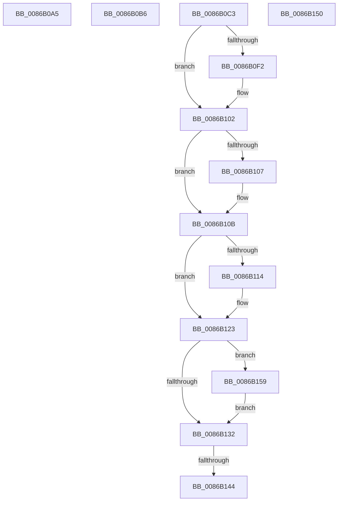

# sub_0086B0A5

- RVA: `0x0086B0A5`–`0x0086B164` (길이 `191` bytes)
- VA: `0x000000014086B0A5`
- 실행 섹션: `PAGE`
- PDB 이름 있음: `아니요`; PDB Function 태그: `아니요`
- unwind 정보 RVA: `0x0006BF80`
- 디코드: `49`개 명령, `191/191` bytes 표시
- 미해석 바이트: `0` (있으면 어셈블리에 `.byte`로 보존)

> 이 문서는 커널 이미지의 기계어와 PDB 기호를 분석해 생성했습니다. 4번과 5번은 함수 원형과 자료형을 바이너리 사용 방식에서 추정한 C 해석이며 원본 소스 복구 결과는 아닙니다.

## 1. Dependencies

- 직접 호출 지점: **6**; 고유 호출 대상: **5**
- 직접 호출자로 확인된 함수: **0**
- RIP 상대 이미지 참조: **0**

### Outgoing calls
- `0x0086B0B9` → [ExfTryToWakePushLock](../../text/26/ExfTryToWakePushLock_function_00265DD0.md) (function, `0x00265DD0`)
- `0x0086B0E1` → [KeAbPreAcquire](../../text/21/KeAbPreAcquire_function_00210230.md) (function, `0x00210230`)
- `0x0086B0FD` → [ExfAcquirePushLockExclusiveEx](../../text/20/ExfAcquirePushLockExclusiveEx_function_0020FC90.md) (function, `0x0020FC90`)
- `0x0086B11A` → [ExpAllocateHandleTableEntrySlow](../94/ExpAllocateHandleTableEntrySlow_function_0094D2FC.md) (function, `0x0094D2FC`)
- `0x0086B136` → [KeAbPostRelease](../../text/2E/KeAbPostRelease_function_002E1600.md) (function, `0x002E1600`)
- `0x0086B15D` → [ExfTryToWakePushLock](../../text/26/ExfTryToWakePushLock_function_00265DD0.md) (function, `0x00265DD0`)

### Direct callers
- 이 함수 시작 RVA로 연결되는 직접 call은 확인되지 않았습니다. 간접 호출은 완전히 역산할 수 없습니다.

### Static image references
- 디코드된 RIP-relative 메모리 참조가 없습니다.

## 2. Other-region calls and transfers

- 다른 실행 섹션으로 향하는 call: **5**
  - `0x0086B0B9` → [ExfTryToWakePushLock](../../text/26/ExfTryToWakePushLock_function_00265DD0.md) (`PAGE` → `.text`)
  - `0x0086B0E1` → [KeAbPreAcquire](../../text/21/KeAbPreAcquire_function_00210230.md) (`PAGE` → `.text`)
  - `0x0086B0FD` → [ExfAcquirePushLockExclusiveEx](../../text/20/ExfAcquirePushLockExclusiveEx_function_0020FC90.md) (`PAGE` → `.text`)
  - `0x0086B136` → [KeAbPostRelease](../../text/2E/KeAbPostRelease_function_002E1600.md) (`PAGE` → `.text`)
  - `0x0086B15D` → [ExfTryToWakePushLock](../../text/26/ExfTryToWakePushLock_function_00265DD0.md) (`PAGE` → `.text`)
- call이 아닌 외부 분기/꼬리 이동: **5**
  - `0x0086B0B1` → [sub_0086AD2F + 0x11E](Unknown_function_0086AD2F.md) (`tail-transfer`)
  - `0x0086B0BE` → [sub_0086AEAF + 0x17D](Unknown_function_0086AEAF.md) (`tail-transfer`)
  - `0x0086B13E` → [sub_0086AEAF + 0x187](Unknown_function_0086AEAF.md) (`tail-transfer`)
  - `0x0086B14B` → [sub_0086AD2F + 0x41](Unknown_function_0086AD2F.md) (`tail-transfer`)
  - `0x0086B154` → [sub_0086AEAF + 0x1CB](Unknown_function_0086AEAF.md) (`tail-transfer`)

## 3. Assembly (complete function range)

```asm
0086B0A5  F0 41 FF 46 04                  lock inc dword ptr [r14 + 4]
0086B0AA  48 8B 06                        mov rax, qword ptr [rsi]
0086B0AD  4A 89 04 E2                     mov qword ptr [rdx + r12*8], rax
0086B0B1  E9 97 FD FF FF                  jmp 0x14086ae4d
0086B0B6  48 8B CB                        mov rcx, rbx
0086B0B9  E8 12 AD 9F FF                  call 0x140265dd0
0086B0BE  E9 69 FF FF FF                  jmp 0x14086b02c
0086B0C3  44 8B BC 24 80 00 00 00         mov r15d, dword ptr [rsp + 0x80]
0086B0CB  49 8D 4E 38                     lea rcx, [r14 + 0x38]
0086B0CF  49 FF C7                        inc r15
0086B0D2  45 33 C0                        xor r8d, r8d
0086B0D5  49 C1 E7 06                     shl r15, 6
0086B0D9  33 D2                           xor edx, edx
0086B0DB  4D 03 FE                        add r15, r14
0086B0DE  41 B5 01                        mov r13b, 1
0086B0E1  E8 4A 51 9A FF                  call 0x140210230
0086B0E6  F0 49 0F BA 6E 38 00            lock bts qword ptr [r14 + 0x38], 0
0086B0ED  48 8B E8                        mov rbp, rax
0086B0F0  73 10                           jae 0x14086b102
0086B0F2  4D 8D 46 38                     lea r8, [r14 + 0x38]
0086B0F6  48 8B D0                        mov rdx, rax
0086B0F9  49 8D 4E 38                     lea rcx, [r14 + 0x38]
0086B0FD  E8 8E 4B 9A FF                  call 0x14020fc90
0086B102  48 85 ED                        test rbp, rbp
0086B105  74 04                           je 0x14086b10b
0086B107  44 88 6D 0A                     mov byte ptr [rbp + 0xa], r13b
0086B10B  8B 44 24 70                     mov eax, dword ptr [rsp + 0x70]
0086B10F  41 3B 06                        cmp eax, dword ptr [r14]
0086B112  75 0F                           jne 0x14086b123
0086B114  49 8B D7                        mov rdx, r15
0086B117  49 8B CE                        mov rcx, r14
0086B11A  E8 DD 21 0E 00                  call 0x14094d2fc
0086B11F  44 0F B6 E8                     movzx r13d, al
0086B123  48 8B C7                        mov rax, rdi
0086B126  F0 49 0F C1 46 38               lock xadd qword ptr [r14 + 0x38], rax
0086B12C  24 06                           and al, 6
0086B12E  3C 02                           cmp al, 2
0086B130  74 27                           je 0x14086b159
0086B132  49 8D 4E 38                     lea rcx, [r14 + 0x38]
0086B136  E8 C5 64 A7 FF                  call 0x1402e1600
0086B13B  45 84 ED                        test r13b, r13b
0086B13E  0F 84 F2 FE FF FF               je 0x14086b036
0086B144  8B 84 24 80 00 00 00            mov eax, dword ptr [rsp + 0x80]
0086B14B  E9 20 FC FF FF                  jmp 0x14086ad70
0086B150  4C 89 7B 08                     mov qword ptr [rbx + 8], r15
0086B154  E9 21 FF FF FF                  jmp 0x14086b07a
0086B159  49 8D 4E 38                     lea rcx, [r14 + 0x38]
0086B15D  E8 6E AC 9F FF                  call 0x140265dd0
0086B162  EB CE                           jmp 0x14086b132
```

## 4. C-style interpretation (structured pseudocode)

```c
__int64 __fastcall sub_0086B0A5(__int64 a1, __int64 a2, int a3)
{
    unsigned int v_stack_p70;
    unsigned int v_stack_p80;

    *(unsigned __int64 *)(a2 + v_r12 * 8) = *(unsigned __int64 *)(v_rsi);
}
```

## 5. (Beta) C Style

```c
int64_t sub_0086B0A5(int64_t Arg1, void *Arg2, int32_t Arg3)
{
    uint8_t *arg2 = (uint8_t *)Arg2;

    uint32_t v_stack_p70;
    uint32_t v_stack_p80;

    *(uint64_t *)(arg2 + local_r12 * 8) = *(uint64_t *)(local_rsi);
}
```

### 관측된 메모리 오프셋

구조체 형식이 확인되지 않은 접근은 인자 기준의 오프셋으로만 기록했습니다.

| 기준 인자 | 오프셋 표현 | 폭 (bit) | 접근 |
|---|---:|---:|---|
| `Arg2` | `+ 0x0 + r12*8` | `64` | `W` |

## 6. Execution-region graph

[열기: 2D/3D 그래프와 함수 탐색 컨트롤 패널](../../../control-panel.html?section=page&rva=0x0086B0A5&view=graph)

- 2D 그래프는 위에서 아래로 흐르고, 3D 그래프는 빈 공간을 드래그해 회전합니다. Shift+드래그는 이동, 휠은 확대·축소, 함수 노드 선택은 대상 보고서 이동입니다.

### Static fallback


