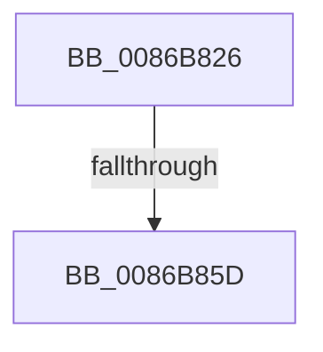

# sub_0086B826

- RVA: `0x0086B826`–`0x0086B88B` (길이 `101` bytes)
- VA: `0x000000014086B826`
- 실행 섹션: `PAGE`
- PDB 이름 있음: `아니요`; PDB Function 태그: `아니요`
- unwind 정보 RVA: `0x0006C020`
- 디코드: `22`개 명령, `101/101` bytes 표시
- 미해석 바이트: `0` (있으면 어셈블리에 `.byte`로 보존)

> 이 문서는 커널 이미지의 기계어와 PDB 기호를 분석해 생성했습니다. 4번과 5번은 함수 원형과 자료형을 바이너리 사용 방식에서 추정한 C 해석이며 원본 소스 복구 결과는 아닙니다.

## 1. Dependencies

- 직접 호출 지점: **1**; 고유 호출 대상: **1**
- 직접 호출자로 확인된 함수: **0**
- RIP 상대 이미지 참조: **1**

### Outgoing calls
- `0x0086B86A` → [PsReferencePrimaryTokenWithTag](../../text/20/PsReferencePrimaryTokenWithTag_function_0020FF80.md) (function, `0x0020FF80`)

### Direct callers
- 이 함수 시작 RVA로 연결되는 직접 call은 확인되지 않았습니다. 간접 호출은 완전히 역산할 수 없습니다.

### Static image references
- `0x0086B882` → RVA `0x00FD8010` (`PAGEDATA`; read)

## 2. Other-region calls and transfers

- 다른 실행 섹션으로 향하는 call: **1**
  - `0x0086B86A` → [PsReferencePrimaryTokenWithTag](../../text/20/PsReferencePrimaryTokenWithTag_function_0020FF80.md) (`PAGE` → `.text`)
- call이 아닌 외부 분기/꼬리 이동: **2**
  - `0x0086B85B` → [sub_0086B892](Unknown_function_0086B892.md) (`tail-transfer`)
  - `0x0086B889` → [sub_0086B8F2](Unknown_function_0086B8F2.md) (`tail-transfer`)

## 3. Assembly (complete function range)

```asm
0086B826  48 89 6C 24 30                  mov qword ptr [rsp + 0x30], rbp
0086B82B  48 8B D9                        mov rbx, rcx
0086B82E  48 89 74 24 38                  mov qword ptr [rsp + 0x38], rsi
0086B833  48 89 7C 24 40                  mov qword ptr [rsp + 0x40], rdi
0086B838  65 48 8B 3C 25 88 01 00 00      mov rdi, qword ptr gs:[0x188]
0086B841  48 8B B7 B8 00 00 00            mov rsi, qword ptr [rdi + 0xb8]
0086B848  48 8B 86 D0 01 00 00            mov rax, qword ptr [rsi + 0x1d0]
0086B84F  48 89 41 18                     mov qword ptr [rcx + 0x18], rax
0086B853  8B 87 A0 05 00 00               mov eax, dword ptr [rdi + 0x5a0]
0086B859  A8 08                           test al, 8
0086B85B  75 35                           jne 0x14086b892
0086B85D  33 ED                           xor ebp, ebp
0086B85F  BA 53 65 53 75                  mov edx, 0x75536553
0086B864  48 89 2B                        mov qword ptr [rbx], rbp
0086B867  48 8B CE                        mov rcx, rsi
0086B86A  E8 11 47 9A FF                  call 0x14020ff80
0086B86F  48 8B 7C 24 40                  mov rdi, qword ptr [rsp + 0x40]
0086B874  48 8B 74 24 38                  mov rsi, qword ptr [rsp + 0x38]
0086B879  48 8B 6C 24 30                  mov rbp, qword ptr [rsp + 0x30]
0086B87E  48 89 43 10                     mov qword ptr [rbx + 0x10], rax
0086B882  83 3D 87 C7 76 00 00            cmp dword ptr [rip + 0x76c787], 0
0086B889  75 67                           jne 0x14086b8f2
```

## 4. C-style interpretation (structured pseudocode)

```c
__int64 __fastcall sub_0086B826(__int64 a1, __int64 a2, __int64 a3, __int64 a4, __int64 a5, __int64 a6, __int64 a7, __int64 a8)
{
    __int64 result;
    __int64 v_rbp;
    unsigned __int64 v_stack_p30;
    unsigned __int64 v_stack_p38;
    unsigned __int64 v_stack_p40;

    v_stack_p30 = v_rbp;
    v_stack_p38 = v_rsi;
    v_stack_p40 = v_rdi;
    *(unsigned __int64 *)(a1 + 24) = *(unsigned __int64 *)(*(unsigned __int64 *)(*(unsigned __int64 *)(gs_base + (0 + 392)) + 184) + 464);
    v_rbp = 0;
    *(unsigned __int64 *)(a1) = 0;
    result = PsReferencePrimaryTokenWithTag(*(unsigned __int64 *)(*(unsigned __int64 *)(gs_base + (0 + 392)) + 184), (unsigned int)(0x75536553ULL), a3, a4);
    *(unsigned __int64 *)(a1 + 16) = result;
}
```

## 5. (Beta) C Style

```c
int64_t sub_0086B826(void *Arg1, int64_t Arg2, int64_t Arg3, int64_t Arg4, uint64_t Arg5, int64_t Arg6, int64_t Arg7, int64_t Arg8)
{
    uint8_t *arg1 = (uint8_t *)Arg1;

    int64_t result;
    int64_t local_rbp;
    uint64_t v_stack_p30;
    uint64_t v_stack_p38;
    uint64_t v_stack_p40;

    v_stack_p30 = local_rbp;
    v_stack_p38 = local_rsi;
    v_stack_p40 = local_rdi;
    *(uint64_t *)(arg1 + 0x18) = *(uint64_t *)(*(uint64_t *)(*(uint64_t *)(gs_base + (0 + 0x188)) + 0xB8) + 0x1D0);
    local_rbp = 0;
    *(uint64_t *)(arg1) = 0;
    result = PsReferencePrimaryTokenWithTag(*(uint64_t *)(*(uint64_t *)(gs_base + (0 + 0x188)) + 0xB8), (uint32_t)(0x75536553ULL), Arg3, Arg4);
    *(uint64_t *)(arg1 + 0x10) = result;
}
```

### 관측된 메모리 오프셋

구조체 형식이 확인되지 않은 접근은 인자 기준의 오프셋으로만 기록했습니다.

| 기준 인자 | 오프셋 표현 | 폭 (bit) | 접근 |
|---|---:|---:|---|
| `Arg1` | `+ 0x0` | `64` | `W` |
| `Arg1` | `+ 0x10` | `64` | `W` |
| `Arg1` | `+ 0x18` | `64` | `W` |

## 6. Execution-region graph

[열기: 2D/3D 그래프와 함수 탐색 컨트롤 패널](../../../control-panel.html?section=page&rva=0x0086B826&view=graph)

- 2D 그래프는 위에서 아래로 흐르고, 3D 그래프는 빈 공간을 드래그해 회전합니다. Shift+드래그는 이동, 휠은 확대·축소, 함수 노드 선택은 대상 보고서 이동입니다.

### Static fallback


