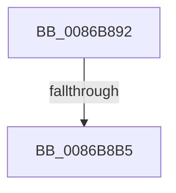

# sub_0086B892

- RVA: `0x0086B892`–`0x0086B8EE` (길이 `92` bytes)
- VA: `0x000000014086B892`
- 실행 섹션: `PAGE`
- PDB 이름 있음: `아니요`; PDB Function 태그: `아니요`
- unwind 정보 RVA: `0x0006C050`
- 디코드: `21`개 명령, `92/92` bytes 표시
- 미해석 바이트: `0` (있으면 어셈블리에 `.byte`로 보존)

> 이 문서는 커널 이미지의 기계어와 PDB 기호를 분석해 생성했습니다. 4번과 5번은 함수 원형과 자료형을 바이너리 사용 방식에서 추정한 C 해석이며 원본 소스 복구 결과는 아닙니다.

## 1. Dependencies

- 직접 호출 지점: **3**; 고유 호출 대상: **3**
- 직접 호출자로 확인된 함수: **0**
- RIP 상대 이미지 참조: **0**

### Outgoing calls
- `0x0086B8A6` → [PspLockThreadSecurityShared](../../text/3C/PspLockThreadSecurityShared_function_003C4720.md) (function, `0x003C4720`)
- `0x0086B8C8` → [ObfReferenceObjectWithTag](../../text/21/ObfReferenceObjectWithTag_function_00210710.md) (function, `0x00210710`)
- `0x0086B8DF` → [PspUnlockThreadSecurityShared](../../text/3C/PspUnlockThreadSecurityShared_function_003C2E40.md) (function, `0x003C2E40`)

### Direct callers
- 이 함수 시작 RVA로 연결되는 직접 call은 확인되지 않았습니다. 간접 호출은 완전히 역산할 수 없습니다.

### Static image references
- 디코드된 RIP-relative 메모리 참조가 없습니다.

## 2. Other-region calls and transfers

- 다른 실행 섹션으로 향하는 call: **3**
  - `0x0086B8A6` → [PspLockThreadSecurityShared](../../text/3C/PspLockThreadSecurityShared_function_003C4720.md) (`PAGE` → `.text`)
  - `0x0086B8C8` → [ObfReferenceObjectWithTag](../../text/21/ObfReferenceObjectWithTag_function_00210710.md) (`PAGE` → `.text`)
  - `0x0086B8DF` → [PspUnlockThreadSecurityShared](../../text/3C/PspUnlockThreadSecurityShared_function_003C2E40.md) (`PAGE` → `.text`)
- call이 아닌 외부 분기/꼬리 이동: **2**
  - `0x0086B8B3` → [sub_0086B8EE](Unknown_function_0086B8EE.md) (`tail-transfer`)
  - `0x0086B8E9` → [sub_0086B826 + 0x39](Unknown_function_0086B826.md) (`tail-transfer`)

## 3. Assembly (complete function range)

```asm
0086B892  4C 89 74 24 48                  mov qword ptr [rsp + 0x48], r14
0086B897  48 8B CF                        mov rcx, rdi
0086B89A  65 4C 8B 34 25 88 01 00 00      mov r14, qword ptr gs:[0x188]
0086B8A3  49 8B D6                        mov rdx, r14
0086B8A6  E8 75 8E B5 FF                  call 0x1403c4720
0086B8AB  8B 87 A0 05 00 00               mov eax, dword ptr [rdi + 0x5a0]
0086B8B1  A8 08                           test al, 8
0086B8B3  74 39                           je 0x14086b8ee
0086B8B5  48 8B AF 38 05 00 00            mov rbp, qword ptr [rdi + 0x538]
0086B8BC  BA 53 65 53 75                  mov edx, 0x75536553
0086B8C1  48 83 E5 F8                     and rbp, 0xfffffffffffffff8
0086B8C5  48 8B CD                        mov rcx, rbp
0086B8C8  E8 43 4E 9A FF                  call 0x140210710
0086B8CD  8B 87 38 05 00 00               mov eax, dword ptr [rdi + 0x538]
0086B8D3  83 E0 03                        and eax, 3
0086B8D6  89 43 08                        mov dword ptr [rbx + 8], eax
0086B8D9  49 8B D6                        mov rdx, r14
0086B8DC  48 8B CF                        mov rcx, rdi
0086B8DF  E8 5C 75 B5 FF                  call 0x1403c2e40
0086B8E4  4C 8B 74 24 48                  mov r14, qword ptr [rsp + 0x48]
0086B8E9  E9 71 FF FF FF                  jmp 0x14086b85f
```

## 4. C-style interpretation (structured pseudocode)

```c
__int64 __fastcall sub_0086B892(__int64 a1, __int64 a2, __int64 a3, __int64 a4, __int64 a5, __int64 a6, __int64 a7, __int64 a8, __int64 a9)
{
    __int64 result;
    __int64 v_rbp;
    unsigned __int64 v_stack_p48;

    v_stack_p48 = v_r14;
    result = PspLockThreadSecurityShared(v_rdi, *(unsigned __int64 *)(gs_base + (0 + 392)), a3, a4);
    v_rbp = (*(unsigned __int64 *)(v_rdi + 1336)) & (-8);
    result = ObfReferenceObjectWithTag(v_rbp, (unsigned int)(0x75536553ULL), a3, a4);
    result = (unsigned int)(((unsigned int)(*(unsigned int *)(v_rdi + 1336))) & (3));
    *(unsigned int *)(v_rbx + 8) = (unsigned int)(result);
    result = PspUnlockThreadSecurityShared(v_rdi, *(unsigned __int64 *)(gs_base + (0 + 392)), a3, a4);
}
```

## 5. (Beta) C Style

```c
int64_t sub_0086B892(int64_t Arg1, int64_t Arg2, int64_t Arg3, int64_t Arg4, uint64_t Arg5, uint64_t Arg6, uint64_t Arg7, uint64_t Arg8, int64_t Arg9)
{
    int64_t result;
    int64_t local_rbp;
    uint64_t v_stack_p48;

    v_stack_p48 = local_r14;
    result = PspLockThreadSecurityShared(local_rdi, *(uint64_t *)(gs_base + (0 + 0x188)), Arg3, Arg4);
    local_rbp = (*(uint64_t *)(local_rdi + 0x538)) & (-8);
    result = ObfReferenceObjectWithTag(local_rbp, (uint32_t)(0x75536553ULL), Arg3, Arg4);
    result = (uint32_t)(((uint32_t)(*(uint32_t *)(local_rdi + 0x538))) & (3));
    *(uint32_t *)(local_rbx + 0x8) = (uint32_t)(result);
    result = PspUnlockThreadSecurityShared(local_rdi, *(uint64_t *)(gs_base + (0 + 0x188)), Arg3, Arg4);
}
```

## 6. Execution-region graph

[열기: 2D/3D 그래프와 함수 탐색 컨트롤 패널](../../../control-panel.html?section=page&rva=0x0086B892&view=graph)

- 2D 그래프는 위에서 아래로 흐르고, 3D 그래프는 빈 공간을 드래그해 회전합니다. Shift+드래그는 이동, 휠은 확대·축소, 함수 노드 선택은 대상 보고서 이동입니다.

### Static fallback


