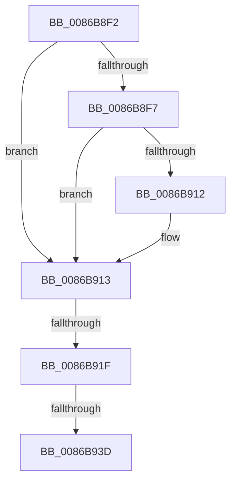

# sub_0086B8F2

- RVA: `0x0086B8F2`–`0x0086B943` (길이 `81` bytes)
- VA: `0x000000014086B8F2`
- 실행 섹션: `PAGE`
- PDB 이름 있음: `아니요`; PDB Function 태그: `아니요`
- unwind 정보 RVA: `0x0006C090`
- 디코드: `18`개 명령, `81/81` bytes 표시
- 미해석 바이트: `0` (있으면 어셈블리에 `.byte`로 보존)

> 이 문서는 커널 이미지의 기계어와 PDB 기호를 분석해 생성했습니다. 4번과 5번은 함수 원형과 자료형을 바이너리 사용 방식에서 추정한 C 해석이며 원본 소스 복구 결과는 아닙니다.

## 1. Dependencies

- 직접 호출 지점: **0**; 고유 호출 대상: **0**
- 직접 호출자로 확인된 함수: **0**
- RIP 상대 이미지 참조: **1**

### Outgoing calls
- 직접 디코드된 call 명령이 없습니다.

### Direct callers
- 이 함수 시작 RVA로 연결되는 직접 call은 확인되지 않았습니다. 간접 호출은 완전히 역산할 수 없습니다.

### Static image references
- `0x0086B905` → RVA `0x00E67B90` (`.data`; read)

## 2. Other-region calls and transfers

- 다른 실행 섹션으로 향하는 call: **0**
- call이 아닌 외부 분기/꼬리 이동: **3**
  - `0x0086B919` → [sub_0086B88B](Unknown_function_0086B88B.md) (`tail-transfer`)
  - `0x0086B937` → [sub_0086B88B](Unknown_function_0086B88B.md) (`tail-transfer`)
  - `0x0086B93E` → [sub_0086B88B](Unknown_function_0086B88B.md) (`tail-transfer`)

## 3. Assembly (complete function range)

```asm
0086B8F2  48 85 C0                        test rax, rax
0086B8F5  74 1C                           je 0x14086b913
0086B8F7  48 8B 80 78 04 00 00            mov rax, qword ptr [rax + 0x478]
0086B8FE  F0 FF 80 1C 01 00 00            lock inc dword ptr [rax + 0x11c]
0086B905  48 8B 05 84 C2 5F 00            mov rax, qword ptr [rip + 0x5fc284]
0086B90C  48 39 43 10                     cmp qword ptr [rbx + 0x10], rax
0086B910  75 01                           jne 0x14086b913
0086B912  CC                              int3
0086B913  48 8B 03                        mov rax, qword ptr [rbx]
0086B916  48 85 C0                        test rax, rax
0086B919  0F 84 6C FF FF FF               je 0x14086b88b
0086B91F  48 8B 80 78 04 00 00            mov rax, qword ptr [rax + 0x478]
0086B926  F0 FF 80 1C 01 00 00            lock inc dword ptr [rax + 0x11c]
0086B92D  48 8B 05 5C C2 5F 00            mov rax, qword ptr [rip + 0x5fc25c]
0086B934  48 39 03                        cmp qword ptr [rbx], rax
0086B937  0F 85 4E FF FF FF               jne 0x14086b88b
0086B93D  CC                              int3
0086B93E  E9 48 FF FF FF                  jmp 0x14086b88b
```

## 4. C-style interpretation (structured pseudocode)

```c
__int64 __fastcall sub_0086B8F2(void)
{
    if (result == 0) goto loc_0086B913;
    if ((*(unsigned __int64 *)(v_rbx + 16)) == (*(unsigned __int64 *)(v_rip + 6275716))) {
    }
}
```

## 5. (Beta) C Style

```c
void sub_0086B8F2(void)
{
    if (result == 0) goto loc_0086B913;
    if ((*(uint64_t *)(local_rbx + 0x10)) == (*(uint64_t *)(v_rip + 0x5FC284))) {
    }
}
```

## 6. Execution-region graph

[열기: 2D/3D 그래프와 함수 탐색 컨트롤 패널](../../../control-panel.html?section=page&rva=0x0086B8F2&view=graph)

- 2D 그래프는 위에서 아래로 흐르고, 3D 그래프는 빈 공간을 드래그해 회전합니다. Shift+드래그는 이동, 휠은 확대·축소, 함수 노드 선택은 대상 보고서 이동입니다.

### Static fallback


