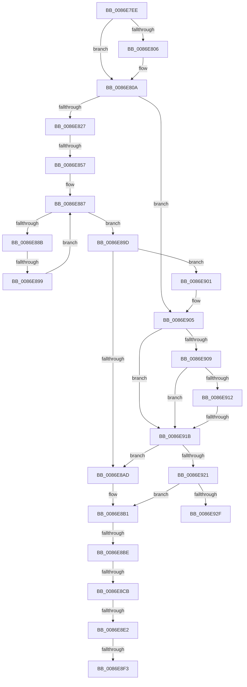

# sub_0086E7EE

- RVA: `0x0086E7EE`–`0x0086E94F` (길이 `353` bytes)
- VA: `0x000000014086E7EE`
- 실행 섹션: `PAGE`
- PDB 이름 있음: `아니요`; PDB Function 태그: `아니요`
- unwind 정보 RVA: `0x0006C124`
- 디코드: `85`개 명령, `353/353` bytes 표시
- 미해석 바이트: `0` (있으면 어셈블리에 `.byte`로 보존)

> 이 문서는 커널 이미지의 기계어와 PDB 기호를 분석해 생성했습니다. 4번과 5번은 함수 원형과 자료형을 바이너리 사용 방식에서 추정한 C 해석이며 원본 소스 복구 결과는 아닙니다.

## 1. Dependencies

- 직접 호출 지점: **2**; 고유 호출 대상: **2**
- 직접 호출자로 확인된 함수: **0**
- RIP 상대 이미지 참조: **0**

### Outgoing calls
- `0x0086E84A` → [SepAdtAuditObjectAccessWithContext](SepAdtAuditObjectAccessWithContext_function_0086EEF0.md) (function, `0x0086EEF0`)
- `0x0086E8D2` → [SepQueryNameString](../8F/SepQueryNameString_function_008F5DE8.md) (function, `0x008F5DE8`)

### Direct callers
- 이 함수 시작 RVA로 연결되는 직접 call은 확인되지 않았습니다. 간접 호출은 완전히 역산할 수 없습니다.

### Static image references
- 디코드된 RIP-relative 메모리 참조가 없습니다.

## 2. Other-region calls and transfers

- 다른 실행 섹션으로 향하는 call: **0**
- call이 아닌 외부 분기/꼬리 이동: **8**
  - `0x0086E851` → [sub_0086E95E](Unknown_function_0086E95E.md) (`tail-transfer`)
  - `0x0086E893` → [sub_0086E95E + 0x1AD](Unknown_function_0086E95E.md) (`tail-transfer`)
  - `0x0086E8B8` → [sub_0086E95E + 0x1C4](Unknown_function_0086E95E.md) (`tail-transfer`)
  - `0x0086E8C5` → [sub_0086E95E + 0x413](Unknown_function_0086E95E.md) (`tail-transfer`)
  - `0x0086E8DC` → [sub_0086E95E + 0x40A](Unknown_function_0086E95E.md) (`tail-transfer`)
  - `0x0086E8ED` → [sub_0086E95E + 0x1D2](Unknown_function_0086E95E.md) (`tail-transfer`)
  - `0x0086E8FC` → [sub_0086E95E + 0x1D2](Unknown_function_0086E95E.md) (`tail-transfer`)
  - `0x0086E915` → [sub_0086E95E + 0x148](Unknown_function_0086E95E.md) (`tail-transfer`)

## 3. Assembly (complete function range)

```asm
0086E7EE  49 89 73 D0                     mov qword ptr [r11 - 0x30], rsi
0086E7F2  48 8D 47 20                     lea rax, [rdi + 0x20]
0086E7F6  48 8B 30                        mov rsi, qword ptr [rax]
0086E7F9  4D 89 63 C8                     mov qword ptr [r11 - 0x38], r12
0086E7FD  4C 8B 67 48                     mov r12, qword ptr [rdi + 0x48]
0086E801  48 85 F6                        test rsi, rsi
0086E804  75 04                           jne 0x14086e80a
0086E806  48 8B 77 30                     mov rsi, qword ptr [rdi + 0x30]
0086E80A  48 89 9C 24 F0 00 00 00         mov qword ptr [rsp + 0xf0], rbx
0086E812  0F B6 5D 67                     movzx ebx, byte ptr [rbp + 0x67]
0086E816  4C 89 BC 24 D8 00 00 00         mov qword ptr [rsp + 0xd8], r15
0086E81E  4D 85 F6                        test r14, r14
0086E821  0F 84 DE 00 00 00               je 0x14086e905
0086E827  48 8D 55 BB                     lea rdx, [rbp - 0x45]
0086E82B  84 DB                           test bl, bl
0086E82D  48 89 54 24 30                  mov qword ptr [rsp + 0x30], rdx
0086E832  44 0F B6 C3                     movzx r8d, bl
0086E836  48 8B D1                        mov rdx, rcx
0086E839  C6 44 24 28 01                  mov byte ptr [rsp + 0x28], 1
0086E83E  49 8B CA                        mov rcx, r10
0086E841  48 89 44 24 20                  mov qword ptr [rsp + 0x20], rax
0086E846  41 0F 94 C1                     sete r9b
0086E84A  E8 A1 06 00 00                  call 0x14086eef0
0086E84F  84 C0                           test al, al
0086E851  0F 85 07 01 00 00               jne 0x14086e95e
0086E857  48 8B 57 48                     mov rdx, qword ptr [rdi + 0x48]
0086E85B  84 DB                           test bl, bl
0086E85D  0F 94 C0                        sete al
0086E860  F7 47 18 00 00 00 02            test dword ptr [rdi + 0x18], 0x2000000
0086E867  44 0F B6 C0                     movzx r8d, al
0086E86B  B8 01 00 00 00                  mov eax, 1
0086E870  44 0F 45 C0                     cmovne r8d, eax
0086E874  45 33 D2                        xor r10d, r10d
0086E877  F7 47 18 00 00 00 02            test dword ptr [rdi + 0x18], 0x2000000
0086E87E  0F B6 C3                        movzx eax, bl
0086E881  44 0F 44 D0                     cmove r10d, eax
0086E885  32 C0                           xor al, al
0086E887  3C 20                           cmp al, 0x20
0086E889  73 12                           jae 0x14086e89d
0086E88B  0F B6 C8                        movzx ecx, al
0086E88E  44 39 6C 8A 58                  cmp dword ptr [rdx + rcx*4 + 0x58], r13d
0086E893  0F 8C 72 02 00 00               jl 0x14086eb0b
0086E899  FE C0                           inc al
0086E89B  EB EA                           jmp 0x14086e887
0086E89D  32 C0                           xor al, al
0086E89F  41 88 84 24 D8 00 00 00         mov byte ptr [r12 + 0xd8], al
0086E8A7  44 38 6D B7                     cmp byte ptr [rbp - 0x49], r13b
0086E8AB  74 54                           je 0x14086e901
0086E8AD  C6 47 09 01                     mov byte ptr [rdi + 9], 1
0086E8B1  4C 8B 7D 47                     mov r15, qword ptr [rbp + 0x47]
0086E8B5  4D 85 FF                        test r15, r15
0086E8B8  0F 85 64 02 00 00               jne 0x14086eb22
0086E8BE  48 8B 75 3F                     mov rsi, qword ptr [rbp + 0x3f]
0086E8C2  48 85 F6                        test rsi, rsi
0086E8C5  0F 84 A6 04 00 00               je 0x14086ed71
0086E8CB  48 8D 55 CF                     lea rdx, [rbp - 0x31]
0086E8CF  48 8B CE                        mov rcx, rsi
0086E8D2  E8 11 75 08 00                  call 0x1408f5de8
0086E8D7  44 8B E8                        mov r13d, eax
0086E8DA  85 C0                           test eax, eax
0086E8DC  0F 88 86 04 00 00               js 0x14086ed68
0086E8E2  48 8B 4D CF                     mov rcx, qword ptr [rbp - 0x31]
0086E8E6  4C 8B 7D C7                     mov r15, qword ptr [rbp - 0x39]
0086E8EA  48 85 C9                        test rcx, rcx
0086E8ED  0F 84 3D 02 00 00               je 0x14086eb30
0086E8F3  66 44 39 79 02                  cmp word ptr [rcx + 2], r15w
0086E8F8  4C 0F 45 F9                     cmovne r15, rcx
0086E8FC  E9 2F 02 00 00                  jmp 0x14086eb30
0086E901  48 8D 47 20                     lea rax, [rdi + 0x20]
0086E905  84 DB                           test bl, bl
0086E907  74 12                           je 0x14086e91b
0086E909  49 8B 0C 24                     mov rcx, qword ptr [r12]
0086E90D  48 85 C9                        test rcx, rcx
0086E910  74 09                           je 0x14086e91b
0086E912  44 39 29                        cmp dword ptr [rcx], r13d
0086E915  0F 87 8B 01 00 00               ja 0x14086eaa6
0086E91B  44 38 6D B8                     cmp byte ptr [rbp - 0x48], r13b
0086E91F  75 8C                           jne 0x14086e8ad
0086E921  44 88 6F 09                     mov byte ptr [rdi + 9], r13b
0086E925  45 38 AC 24 D8 00 00 00         cmp byte ptr [r12 + 0xd8], r13b
0086E92D  75 82                           jne 0x14086e8b1
0086E92F  48 8B 9C 24 F0 00 00 00         mov rbx, qword ptr [rsp + 0xf0]
0086E937  4C 8B BC 24 D8 00 00 00         mov r15, qword ptr [rsp + 0xd8]
0086E93F  48 8B B4 24 E8 00 00 00         mov rsi, qword ptr [rsp + 0xe8]
0086E947  4C 8B A4 24 E0 00 00 00         mov r12, qword ptr [rsp + 0xe0]
```

## 4. C-style interpretation (structured pseudocode)

```c
__int64 __fastcall sub_0086E7EE(__int64 a1, __int64 a2, __int64 a3, __int64 a4, __int64 a5, __int64 a6, __int64 a7, __int64 a8, __int64 a9, __int64 a10, __int64 a11, __int64 a12, __int64 a13, __int64 a14, __int64 a15, __int64 a16, __int64 a17, __int64 a18, __int64 a19, __int64 a20, __int64 a21, __int64 a22, __int64 a23, __int64 a24, __int64 a25, __int64 a26, __int64 a27, __int64 a28, __int64 a29, __int64 a30)
{
    __int64 result;
    __int64 v_r10;
    __int64 v_r15;
    __int64 v_rsi;
    unsigned __int64 v_stack_p20;
    unsigned __int8 v_stack_p28;
    unsigned __int64 v_stack_p30;
    unsigned __int64 v_stack_pD8;
    unsigned __int64 v_stack_pF0;

    *(unsigned __int64 *)(v_r11 - 48) = v_rsi;
    *(unsigned __int64 *)(v_r11 - 56) = v_r12;
    v_rsi = *(unsigned __int64 *)(v_rdi + 32);
    if (*(unsigned __int64 *)(v_rdi + 32) == 0) {
        v_rsi = *(unsigned __int64 *)(v_rdi + 48);
    }
    v_stack_pF0 = v_rbx;
    v_stack_pD8 = v_r15;
    if (v_r14 == 0) goto loc_0086E905;
    v_stack_p30 = v_rbp - 69;
    v_stack_p28 = 1;
    v_stack_p20 = v_rdi + 32;
    a4 = ((unsigned __int8)(*(unsigned __int8 *)(v_rbp + 103)) == 0) ? 1 : 0;
    result = SepAdtAuditObjectAccessWithContext(v_r10, a1, (unsigned __int8)(*(unsigned __int8 *)(v_rbp + 103)), a4);
    result = ((unsigned __int8)(*(unsigned __int8 *)(v_rbp + 103)) == 0) ? 1 : 0;
    a3 = (unsigned __int8)(result);
    if (((*(unsigned int *)(v_rdi + 24)) & (0x2000000ULL)) != 0) { a3 = 1; }
    v_r10 = 0;
    if (((*(unsigned int *)(v_rdi + 24)) & (0x2000000ULL)) == 0) { v_r10 = (unsigned int)((unsigned __int8)(*(unsigned __int8 *)(v_rbp + 103))); }
    result = 0;
loc_0086E887:
    if (0 >= 32) goto loc_0086E89D;
    result = (unsigned __int8)((result) + 1);
    goto loc_0086E887;
loc_0086E89D:
    result = 0;
    *(unsigned __int8 *)(*(unsigned __int64 *)(v_rdi + 72) + 216) = 0;
    if ((*(unsigned __int8 *)(v_rbp - 73)) == ((unsigned __int8)(v_r13))) goto loc_0086E901;
loc_0086E8AD:
    *(unsigned __int8 *)(v_rdi + 9) = 1;
loc_0086E8B1:
    result = SepQueryNameString(*(unsigned __int64 *)(v_rbp + 63), v_rbp - 49, a3, a4);
    v_r15 = *(unsigned __int64 *)(v_rbp - 57);
    if ((*(unsigned __int16 *)(*(unsigned __int64 *)(v_rbp - 49) + 2)) != ((unsigned __int16)(*(unsigned __int64 *)(v_rbp - 57)))) { v_r15 = *(unsigned __int64 *)(v_rbp - 49); }
loc_0086E901:
loc_0086E905:
    if ((unsigned __int8)(*(unsigned __int8 *)(v_rbp + 103)) == 0) goto loc_0086E91B;
    if (*(unsigned __int64 *)(*(unsigned __int64 *)(v_rdi + 72)) == 0) goto loc_0086E91B;
loc_0086E91B:
    if ((*(unsigned __int8 *)(v_rbp - 72)) != ((unsigned __int8)((unsigned int)((unsigned int)(result))))) goto loc_0086E8AD;
    *(unsigned __int8 *)(v_rdi + 9) = (unsigned __int8)((unsigned int)((unsigned int)(result)));
    if ((*(unsigned __int8 *)(*(unsigned __int64 *)(v_rdi + 72) + 216)) != ((unsigned __int8)((unsigned int)((unsigned int)(result))))) goto loc_0086E8B1;
    return v_rdi + 32;
}
```

## 5. (Beta) C Style

```c
int64_t sub_0086E7EE(int64_t Arg1, int64_t Arg2, int64_t Arg3, int64_t Arg4, uint64_t Arg5, uint64_t Arg6, uint64_t Arg7, uint64_t Arg8, uint64_t Arg9, uint64_t Arg10, uint64_t Arg11, uint64_t Arg12, uint64_t Arg13, uint64_t Arg14, uint64_t Arg15, uint64_t Arg16, uint64_t Arg17, uint64_t Arg18, uint64_t Arg19, uint64_t Arg20, uint64_t Arg21, uint64_t Arg22, uint64_t Arg23, uint64_t Arg24, uint64_t Arg25, uint64_t Arg26, int64_t Arg27, int64_t Arg28, int64_t Arg29, int64_t Arg30)
{
    int64_t result;
    int64_t local_r10;
    int64_t local_r15;
    int64_t local_rsi;
    uint64_t v_stack_p20;
    uint8_t v_stack_p28;
    uint64_t v_stack_p30;
    uint64_t v_stack_pD8;
    uint64_t v_stack_pF0;

    *(uint64_t *)(local_r11 - 0x30) = local_rsi;
    *(uint64_t *)(local_r11 - 0x38) = local_r12;
    local_rsi = *(uint64_t *)(local_rdi + 0x20);
    if (*(uint64_t *)(local_rdi + 0x20) == 0) {
        local_rsi = *(uint64_t *)(local_rdi + 0x30);
    }
    v_stack_pF0 = local_rbx;
    v_stack_pD8 = local_r15;
    if (local_r14 == 0) goto loc_0086E905;
    v_stack_p30 = local_rbp - 69;
    v_stack_p28 = 1;
    v_stack_p20 = local_rdi + 32;
    Arg4 = ((uint8_t)(*(uint8_t *)(local_rbp + 0x67)) == 0) ? 1 : 0;
    result = SepAdtAuditObjectAccessWithContext(local_r10, Arg1, (uint8_t)(*(uint8_t *)(local_rbp + 0x67)), Arg4);
    result = ((uint8_t)(*(uint8_t *)(local_rbp + 0x67)) == 0) ? 1 : 0;
    Arg3 = (uint8_t)(result);
    if (((*(uint32_t *)(local_rdi + 0x18)) & (0x2000000ULL)) != 0) { Arg3 = 1; }
    local_r10 = 0;
    if (((*(uint32_t *)(local_rdi + 0x18)) & (0x2000000ULL)) == 0) { local_r10 = (uint32_t)((uint8_t)(*(uint8_t *)(local_rbp + 0x67))); }
    result = 0;
loc_0086E887:
    if (0 >= 32) goto loc_0086E89D;
    result = (uint8_t)((result) + 1);
    goto loc_0086E887;
loc_0086E89D:
    result = 0;
    *(uint8_t *)(*(uint64_t *)(local_rdi + 0x48) + 0xD8) = 0;
    if ((*(uint8_t *)(local_rbp - 0x49)) == ((uint8_t)(local_r13))) goto loc_0086E901;
loc_0086E8AD:
    *(uint8_t *)(local_rdi + 0x9) = 1;
loc_0086E8B1:
    result = SepQueryNameString(*(uint64_t *)(local_rbp + 0x3F), local_rbp - 49, Arg3, Arg4);
    local_r15 = *(uint64_t *)(local_rbp - 0x39);
    if ((*(uint16_t *)(*(uint64_t *)(local_rbp - 0x31) + 0x2)) != ((uint16_t)(*(uint64_t *)(local_rbp - 0x39)))) { local_r15 = *(uint64_t *)(local_rbp - 0x31); }
loc_0086E901:
loc_0086E905:
    if ((uint8_t)(*(uint8_t *)(local_rbp + 0x67)) == 0) goto loc_0086E91B;
    if (*(uint64_t *)(*(uint64_t *)(local_rdi + 0x48)) == 0) goto loc_0086E91B;
loc_0086E91B:
    if ((*(uint8_t *)(local_rbp - 0x48)) != ((uint8_t)((uint32_t)((uint32_t)(result))))) goto loc_0086E8AD;
    *(uint8_t *)(local_rdi + 0x9) = (uint8_t)((uint32_t)((uint32_t)(result)));
    if ((*(uint8_t *)(*(uint64_t *)(local_rdi + 0x48) + 0xD8)) != ((uint8_t)((uint32_t)((uint32_t)(result))))) goto loc_0086E8B1;
    return local_rdi + 32;
}
```

## 6. Execution-region graph

[열기: 2D/3D 그래프와 함수 탐색 컨트롤 패널](../../../control-panel.html?section=page&rva=0x0086E7EE&view=graph)

- 2D 그래프는 위에서 아래로 흐르고, 3D 그래프는 빈 공간을 드래그해 회전합니다. Shift+드래그는 이동, 휠은 확대·축소, 함수 노드 선택은 대상 보고서 이동입니다.

### Static fallback


