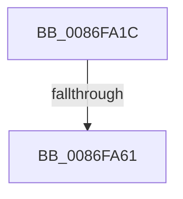

# sub_0086FA1C

- RVA: `0x0086FA1C`–`0x0086FA65` (길이 `73` bytes)
- VA: `0x000000014086FA1C`
- 실행 섹션: `PAGE`
- PDB 이름 있음: `아니요`; PDB Function 태그: `아니요`
- unwind 정보 RVA: `0x0006C1D8`
- 디코드: `19`개 명령, `73/73` bytes 표시
- 미해석 바이트: `0` (있으면 어셈블리에 `.byte`로 보존)

> 이 문서는 커널 이미지의 기계어와 PDB 기호를 분석해 생성했습니다. 4번과 5번은 함수 원형과 자료형을 바이너리 사용 방식에서 추정한 C 해석이며 원본 소스 복구 결과는 아닙니다.

## 1. Dependencies

- 직접 호출 지점: **1**; 고유 호출 대상: **1**
- 직접 호출자로 확인된 함수: **0**
- RIP 상대 이미지 참조: **0**

### Outgoing calls
- `0x0086FA54` → [CmpIsKeyDeletedForKeyBody](../../pagecmrc/BC/CmpIsKeyDeletedForKeyBody_function_00BC9480.md) (function, `0x00BC9480`)

### Direct callers
- 이 함수 시작 RVA로 연결되는 직접 call은 확인되지 않았습니다. 간접 호출은 완전히 역산할 수 없습니다.

### Static image references
- 디코드된 RIP-relative 메모리 참조가 없습니다.

## 2. Other-region calls and transfers

- 다른 실행 섹션으로 향하는 call: **1**
  - `0x0086FA54` → [CmpIsKeyDeletedForKeyBody](../../pagecmrc/BC/CmpIsKeyDeletedForKeyBody_function_00BC9480.md) (`PAGE` → `PAGECMRC`)
- call이 아닌 외부 분기/꼬리 이동: **1**
  - `0x0086FA5B` → [sub_0086FDB4](Unknown_function_0086FDB4.md) (`tail-transfer`)

## 3. Assembly (complete function range)

```asm
0086FA1C  48 89 58 18                     mov qword ptr [rax + 0x18], rbx
0086FA20  0F 57 C0                        xorps xmm0, xmm0
0086FA23  4C 89 60 E0                     mov qword ptr [rax - 0x20], r12
0086FA27  49 8B D8                        mov rbx, r8
0086FA2A  4C 89 68 D8                     mov qword ptr [rax - 0x28], r13
0086FA2E  4C 8B E2                        mov r12, rdx
0086FA31  4C 89 70 D0                     mov qword ptr [rax - 0x30], r14
0086FA35  45 33 ED                        xor r13d, r13d
0086FA38  B8 FF FF FF FF                  mov eax, 0xffffffff
0086FA3D  44 89 6D E3                     mov dword ptr [rbp - 0x1d], r13d
0086FA41  0F 11 45 F7                     movups xmmword ptr [rbp - 9], xmm0
0086FA45  66 89 45 F9                     mov word ptr [rbp - 7], ax
0086FA49  4C 8B F1                        mov r14, rcx
0086FA4C  4C 89 6D E7                     mov qword ptr [rbp - 0x19], r13
0086FA50  0F 11 45 07                     movups xmmword ptr [rbp + 7], xmm0
0086FA54  E8 27 9A 35 00                  call 0x140bc9480
0086FA59  84 C0                           test al, al
0086FA5B  0F 85 53 03 00 00               jne 0x14086fdb4
0086FA61  49 8B 76 08                     mov rsi, qword ptr [r14 + 8]
```

## 4. C-style interpretation (structured pseudocode)

```c
__int64 __fastcall sub_0086FA1C(__int64 a1, __int64 a2, __int64 a3)
{
    __int64 result;
    __int64 v_r13;

    *(unsigned __int64 *)(result + 24) = v_rbx;
    *(unsigned __int64 *)(result - 32) = v_r12;
    *(unsigned __int64 *)(result - 40) = v_r13;
    *(unsigned __int64 *)(result - 48) = v_r14;
    v_r13 = 0;
    *(unsigned int *)(v_rbp - 29) = 0;
    *(unsigned __int64 *)(v_rbp - 9) = v_xmm0;
    *(unsigned __int16 *)(v_rbp - 7) = (unsigned __int16)((unsigned int)(0xFFFFFFFFULL));
    *(unsigned __int64 *)(v_rbp - 25) = 0;
    *(unsigned __int64 *)(v_rbp + 7) = v_xmm0;
    result = CmpIsKeyDeletedForKeyBody(a1, a2, a3, a4);
    return result;
}
```

## 5. (Beta) C Style

```c
int64_t sub_0086FA1C(void *Arg1, int64_t Arg2, int64_t Arg3)
{
    uint8_t *arg1 = (uint8_t *)Arg1;

    int64_t result;
    int64_t local_r13;

    *(uint64_t *)(result + 0x18) = local_rbx;
    *(uint64_t *)(result - 0x20) = local_r12;
    *(uint64_t *)(result - 0x28) = local_r13;
    *(uint64_t *)(result - 0x30) = local_r14;
    local_r13 = 0;
    *(uint32_t *)(local_rbp - 0x1D) = 0;
    *(uint64_t *)(local_rbp - 0x9) = v_xmm0;
    *(uint16_t *)(local_rbp - 0x7) = (uint16_t)((uint32_t)(0xFFFFFFFFULL));
    *(uint64_t *)(local_rbp - 0x19) = 0;
    *(uint64_t *)(local_rbp + 0x7) = v_xmm0;
    result = CmpIsKeyDeletedForKeyBody(Arg1, Arg2, Arg3, a4);
    return result;
}
```

### 관측된 메모리 오프셋

구조체 형식이 확인되지 않은 접근은 인자 기준의 오프셋으로만 기록했습니다.

| 기준 인자 | 오프셋 표현 | 폭 (bit) | 접근 |
|---|---:|---:|---|
| `Arg1` | `+ 0x8` | `64` | `R` |

## 6. Execution-region graph

[열기: 2D/3D 그래프와 함수 탐색 컨트롤 패널](../../../control-panel.html?section=page&rva=0x0086FA1C&view=graph)

- 2D 그래프는 위에서 아래로 흐르고, 3D 그래프는 빈 공간을 드래그해 회전합니다. Shift+드래그는 이동, 휠은 확대·축소, 함수 노드 선택은 대상 보고서 이동입니다.

### Static fallback


