# sub_0086FA65

- RVA: `0x0086FA65`–`0x0086FCFA` (길이 `661` bytes)
- VA: `0x000000014086FA65`
- 실행 섹션: `PAGE`
- PDB 이름 있음: `아니요`; PDB Function 태그: `아니요`
- unwind 정보 RVA: `0x0006C1F8`
- 디코드: `158`개 명령, `661/661` bytes 표시
- 미해석 바이트: `0` (있으면 어셈블리에 `.byte`로 보존)

> 이 문서는 커널 이미지의 기계어와 PDB 기호를 분석해 생성했습니다. 4번과 5번은 함수 원형과 자료형을 바이너리 사용 방식에서 추정한 C 해석이며 원본 소스 복구 결과는 아닙니다.

## 1. Dependencies

- 직접 호출 지점: **10**; 고유 호출 대상: **7**
- 직접 호출자로 확인된 함수: **0**
- RIP 상대 이미지 참조: **1**

### Outgoing calls
- `0x0086FB4D` → [ExAcquireResourceSharedLite](../../text/21/ExAcquireResourceSharedLite_function_00211BC0.md) (function, `0x00211BC0`)
- `0x0086FB74` → [ExAcquireResourceSharedLite](../../text/21/ExAcquireResourceSharedLite_function_00211BC0.md) (function, `0x00211BC0`)
- `0x0086FBCC` → [SeAccessCheck](../../text/3A/SeAccessCheck_function_003A6BC0.md) (function, `0x003A6BC0`)
- `0x0086FC22` → [memcpy](../../text/6C/memcpy_function_006C6840.md) (function, `0x006C6840`)
- `0x0086FC30` → [CmSiFreeMemory](../../text/47/CmSiFreeMemory_function_00475D80.md) (function, `0x00475D80`)
- `0x0086FCA0` → [SeOpenObjectAuditAlarmWithTransaction](SeOpenObjectAuditAlarmWithTransaction_function_0086E790.md) (function, `0x0086E790`)
- `0x0086FCB7` → [ExReleaseResourceLite](../../text/25/ExReleaseResourceLite_function_0025FA10.md) (function, `0x0025FA10`)
- `0x0086FCC5` → [KeLeaveCriticalRegionThread](../../text/25/KeLeaveCriticalRegionThread_function_0025EFF0.md) (function, `0x0025EFF0`)
- `0x0086FCD7` → [ExReleaseResourceLite](../../text/25/ExReleaseResourceLite_function_0025FA10.md) (function, `0x0025FA10`)
- `0x0086FCE5` → [KeLeaveCriticalRegionThread](../../text/25/KeLeaveCriticalRegionThread_function_0025EFF0.md) (function, `0x0025EFF0`)

### Direct callers
- 이 함수 시작 RVA로 연결되는 직접 call은 확인되지 않았습니다. 간접 호출은 완전히 역산할 수 없습니다.

### Static image references
- `0x0086FBA7` → RVA `0x00FC6AC0` (`ALMOSTRO`; read)

## 2. Other-region calls and transfers

- 다른 실행 섹션으로 향하는 call: **9**
  - `0x0086FB4D` → [ExAcquireResourceSharedLite](../../text/21/ExAcquireResourceSharedLite_function_00211BC0.md) (`PAGE` → `.text`)
  - `0x0086FB74` → [ExAcquireResourceSharedLite](../../text/21/ExAcquireResourceSharedLite_function_00211BC0.md) (`PAGE` → `.text`)
  - `0x0086FBCC` → [SeAccessCheck](../../text/3A/SeAccessCheck_function_003A6BC0.md) (`PAGE` → `.text`)
  - `0x0086FC22` → [memcpy](../../text/6C/memcpy_function_006C6840.md) (`PAGE` → `.text`)
  - `0x0086FC30` → [CmSiFreeMemory](../../text/47/CmSiFreeMemory_function_00475D80.md) (`PAGE` → `.text`)
  - `0x0086FCB7` → [ExReleaseResourceLite](../../text/25/ExReleaseResourceLite_function_0025FA10.md) (`PAGE` → `.text`)
  - `0x0086FCC5` → [KeLeaveCriticalRegionThread](../../text/25/KeLeaveCriticalRegionThread_function_0025EFF0.md) (`PAGE` → `.text`)
  - `0x0086FCD7` → [ExReleaseResourceLite](../../text/25/ExReleaseResourceLite_function_0025FA10.md) (`PAGE` → `.text`)
  - `0x0086FCE5` → [KeLeaveCriticalRegionThread](../../text/25/KeLeaveCriticalRegionThread_function_0025EFF0.md) (`PAGE` → `.text`)
- call이 아닌 외부 분기/꼬리 이동: **10**
  - `0x0086FA86` → [sub_0086FDC3 + 0x3C](Unknown_function_0086FDC3.md) (`tail-transfer`)
  - `0x0086FAA0` → [sub_0086FDC3](Unknown_function_0086FDC3.md) (`tail-transfer`)
  - `0x0086FACA` → [sub_0086FD40 + 0x42](Unknown_function_0086FD40.md) (`tail-transfer`)
  - `0x0086FAE6` → [sub_0086FD40 + 0x3A](Unknown_function_0086FD40.md) (`tail-transfer`)
  - `0x0086FAF6` → [sub_0086FD40 + 0x8](Unknown_function_0086FD40.md) (`tail-transfer`)
  - `0x0086FB24` → [sub_0086FDC3 + 0x6D](Unknown_function_0086FDC3.md) (`tail-transfer`)
  - `0x0086FBF2` → [sub_0086FDC3 + 0xE1](Unknown_function_0086FDC3.md) (`tail-transfer`)
  - `0x0086FBFB` → [sub_0086FD40](Unknown_function_0086FD40.md) (`tail-transfer`)
  - `0x0086FC04` → [sub_0086FD40 + 0x63](Unknown_function_0086FD40.md) (`tail-transfer`)
  - `0x0086FC5F` → [sub_0086FD40 + 0x4C](Unknown_function_0086FD40.md) (`tail-transfer`)

## 3. Assembly (complete function range)

```asm
0086FA65  48 89 BC 24 B0 00 00 00         mov qword ptr [rsp + 0xb0], rdi
0086FA6D  4C 89 BC 24 90 00 00 00         mov qword ptr [rsp + 0x90], r15
0086FA75  45 8B FD                        mov r15d, r13d
0086FA78  0F BF 7E 42                     movsx edi, word ptr [rsi + 0x42]
0086FA7C  83 FF 02                        cmp edi, 2
0086FA7F  7C 0B                           jl 0x14086fa8c
0086FA81  8B C7                           mov eax, edi
0086FA83  83 E8 01                        sub eax, 1
0086FA86  0F 85 73 03 00 00               jne 0x14086fdff
0086FA8C  48 0F BF 46 42                  movsx rax, word ptr [rsi + 0x42]
0086FA91  66 89 7D F7                     mov word ptr [rbp - 9], di
0086FA95  4C 89 7D 0F                     mov qword ptr [rbp + 0xf], r15
0086FA99  66 89 45 F9                     mov word ptr [rbp - 7], ax
0086FA9D  66 85 C0                        test ax, ax
0086FAA0  0F 85 1D 03 00 00               jne 0x14086fdc3
0086FAA6  48 89 74 C5 FF                  mov qword ptr [rbp + rax*8 - 1], rsi
0086FAAB  4C 8B 7D 0F                     mov r15, qword ptr [rbp + 0xf]
0086FAAF  0F B7 75 F9                     movzx esi, word ptr [rbp - 7]
0086FAB3  41 8B C5                        mov eax, r13d
0086FAB6  89 45 DF                        mov dword ptr [rbp - 0x21], eax
0086FAB9  66 85 F6                        test si, si
0086FABC  78 5B                           js 0x14086fb19
0086FABE  41 BE FF FF FF FF               mov r14d, 0xffffffff
0086FAC4  0F B7 F6                        movzx esi, si
0086FAC7  83 FE 02                        cmp esi, 2
0086FACA  0F 83 B2 02 00 00               jae 0x14086fd82
0086FAD0  48 8B 7C F5 FF                  mov rdi, qword ptr [rbp + rsi*8 - 1]
0086FAD5  66 83 7F 42 00                  cmp word ptr [rdi + 0x42], 0
0086FADA  74 06                           je 0x14086fae2
0086FADC  80 7F 41 01                     cmp byte ptr [rdi + 0x41], 1
0086FAE0  74 33                           je 0x14086fb15
0086FAE2  83 7F 28 FF                     cmp dword ptr [rdi + 0x28], -1
0086FAE6  0F 84 8E 02 00 00               je 0x14086fd7a
0086FAEC  48 8B 97 F0 00 00 00            mov rdx, qword ptr [rdi + 0xf0]
0086FAF3  48 85 D2                        test rdx, rdx
0086FAF6  0F 85 4C 02 00 00               jne 0x14086fd48
0086FAFC  66 83 7F 42 00                  cmp word ptr [rdi + 0x42], 0
0086FB01  4C 8B EF                        mov r13, rdi
0086FB04  74 06                           je 0x14086fb0c
0086FB06  80 7F 41 00                     cmp byte ptr [rdi + 0x41], 0
0086FB0A  75 09                           jne 0x14086fb15
0086FB0C  41 0F B7 C6                     movzx eax, r14w
0086FB10  66 03 F0                        add si, ax
0086FB13  79 AF                           jns 0x14086fac4
0086FB15  4C 8B 75 5F                     mov r14, qword ptr [rbp + 0x5f]
0086FB19  4C 8B 45 67                     mov r8, qword ptr [rbp + 0x67]
0086FB1D  4D 8B 65 58                     mov r12, qword ptr [r13 + 0x58]
0086FB21  4D 85 C0                        test r8, r8
0086FB24  0F 85 06 03 00 00               jne 0x14086fe30
0086FB2A  65 48 8B 04 25 88 01 00 00      mov rax, qword ptr gs:[0x188]
0086FB33  49 83 C4 20                     add r12, 0x20
0086FB37  B2 01                           mov dl, 1
0086FB39  4C 89 65 EF                     mov qword ptr [rbp - 0x11], r12
0086FB3D  66 FF 88 E4 01 00 00            dec word ptr [rax + 0x1e4]
0086FB44  90                              nop
0086FB45  48 8B 4B 30                     mov rcx, qword ptr [rbx + 0x30]
0086FB49  48 8B 49 30                     mov rcx, qword ptr [rcx + 0x30]
0086FB4D  E8 6E 20 9A FF                  call 0x140211bc0
0086FB52  48 83 7B 20 00                  cmp qword ptr [rbx + 0x20], 0
0086FB57  74 20                           je 0x14086fb79
0086FB59  65 48 8B 04 25 88 01 00 00      mov rax, qword ptr gs:[0x188]
0086FB62  B2 01                           mov dl, 1
0086FB64  66 FF 88 E4 01 00 00            dec word ptr [rax + 0x1e4]
0086FB6B  90                              nop
0086FB6C  48 8B 4B 20                     mov rcx, qword ptr [rbx + 0x20]
0086FB70  48 8B 49 30                     mov rcx, qword ptr [rcx + 0x30]
0086FB74  E8 47 20 9A FF                  call 0x140211bc0
0086FB79  44 0F B6 6D 77                  movzx r13d, byte ptr [rbp + 0x77]
0086FB7E  48 8D 4D DF                     lea rcx, [rbp - 0x21]
0086FB82  44 8B 4B 10                     mov r9d, dword ptr [rbx + 0x10]
0086FB86  48 8D 53 20                     lea rdx, [rbx + 0x20]
0086FB8A  48 89 4C 24 48                  mov qword ptr [rsp + 0x48], rcx
0086FB8F  33 C0                           xor eax, eax
0086FB91  89 45 E3                        mov dword ptr [rbp - 0x1d], eax
0086FB94  48 8D 4D E3                     lea rcx, [rbp - 0x1d]
0086FB98  48 89 4C 24 40                  mov qword ptr [rsp + 0x40], rcx
0086FB9D  41 B0 01                        mov r8b, 1
0086FBA0  48 89 45 E7                     mov qword ptr [rbp - 0x19], rax
0086FBA4  49 8B CC                        mov rcx, r12
0086FBA7  48 8B 05 12 6F 75 00            mov rax, qword ptr [rip + 0x756f12]
0086FBAE  48 83 C0 4C                     add rax, 0x4c
0086FBB2  44 88 6C 24 38                  mov byte ptr [rsp + 0x38], r13b
0086FBB7  48 89 44 24 30                  mov qword ptr [rsp + 0x30], rax
0086FBBC  48 8D 45 E7                     lea rax, [rbp - 0x19]
0086FBC0  48 89 44 24 28                  mov qword ptr [rsp + 0x28], rax
0086FBC5  8B 43 14                        mov eax, dword ptr [rbx + 0x14]
0086FBC8  89 44 24 20                     mov dword ptr [rsp + 0x20], eax
0086FBCC  E8 EF 6F B3 FF                  call 0x1403a6bc0
0086FBD1  4C 8B 7D E7                     mov r15, qword ptr [rbp - 0x19]
0086FBD5  0F B6 F0                        movzx esi, al
0086FBD8  4D 85 FF                        test r15, r15
0086FBDB  74 61                           je 0x14086fc3e
0086FBDD  4C 8B 6B 48                     mov r13, qword ptr [rbx + 0x48]
0086FBE1  41 8B 17                        mov edx, dword ptr [r15]
0086FBE4  49 8B 7D 00                     mov rdi, qword ptr [r13]
0086FBE8  44 8B 07                        mov r8d, dword ptr [rdi]
0086FBEB  42 8D 0C 02                     lea ecx, [rdx + r8]
0086FBEF  83 F9 03                        cmp ecx, 3
0086FBF2  0F 87 AC 02 00 00               ja 0x14086fea4
0086FBF8  48 85 FF                        test rdi, rdi
0086FBFB  0F 84 3F 01 00 00               je 0x14086fd40
0086FC01  45 85 C0                        test r8d, r8d
0086FC04  0F 85 99 01 00 00               jne 0x14086fda3
0086FC0A  41 BC 08 00 00 00               mov r12d, 8
0086FC10  44 8D 04 52                     lea r8d, [rdx + rdx*2]
0086FC14  41 8B CC                        mov ecx, r12d
0086FC17  41 C1 E0 02                     shl r8d, 2
0086FC1B  49 8D 57 08                     lea rdx, [r15 + 8]
0086FC1F  48 03 CF                        add rcx, rdi
0086FC22  E8 19 6C E5 FF                  call 0x1406c6840
0086FC27  41 8B 07                        mov eax, dword ptr [r15]
0086FC2A  01 07                           add dword ptr [rdi], eax
0086FC2C  48 8B 4D E7                     mov rcx, qword ptr [rbp - 0x19]
0086FC30  E8 4B 61 C0 FF                  call 0x140475d80
0086FC35  4C 8B 65 EF                     mov r12, qword ptr [rbp - 0x11]
0086FC39  44 0F B6 6D 77                  movzx r13d, byte ptr [rbp + 0x77]
0086FC3E  40 84 F6                        test sil, sil
0086FC41  74 0F                           je 0x14086fc52
0086FC43  8B 45 E3                        mov eax, dword ptr [rbp - 0x1d]
0086FC46  09 43 14                        or dword ptr [rbx + 0x14], eax
0086FC49  0F BA E8 19                     bts eax, 0x19
0086FC4D  F7 D0                           not eax
0086FC4F  21 43 10                        and dword ptr [rbx + 0x10], eax
0086FC52  66 41 83 4E 30 02               or word ptr [r14 + 0x30], 2
0086FC58  48 8B 55 67                     mov rdx, qword ptr [rbp + 0x67]
0086FC5C  48 85 D2                        test rdx, rdx
0086FC5F  0F 85 27 01 00 00               jne 0x14086fd8c
0086FC65  45 84 ED                        test r13b, r13b
0086FC68  74 3B                           je 0x14086fca5
0086FC6A  48 8D 43 0A                     lea rax, [rbx + 0xa]
0086FC6E  48 89 44 24 48                  mov qword ptr [rsp + 0x48], rax
0086FC73  48 89 54 24 40                  mov qword ptr [rsp + 0x40], rdx
0086FC78  48 8B 0D 41 6E 75 00            mov rcx, qword ptr [rip + 0x756e41]
0086FC7F  4D 8B CC                        mov r9, r12
0086FC82  44 88 6C 24 38                  mov byte ptr [rsp + 0x38], r13b
0086FC87  48 83 C1 10                     add rcx, 0x10
0086FC8B  40 88 74 24 30                  mov byte ptr [rsp + 0x30], sil
0086FC90  45 33 C0                        xor r8d, r8d
0086FC93  C6 44 24 28 00                  mov byte ptr [rsp + 0x28], 0
0086FC98  49 8B D6                        mov rdx, r14
0086FC9B  48 89 5C 24 20                  mov qword ptr [rsp + 0x20], rbx
0086FCA0  E8 EB EA FF FF                  call 0x14086e790
0086FCA5  B8 FD FF 00 00                  mov eax, 0xfffd
0086FCAA  66 41 21 46 30                  and word ptr [r14 + 0x30], ax
0086FCAF  48 8B 4B 30                     mov rcx, qword ptr [rbx + 0x30]
0086FCB3  48 8B 49 30                     mov rcx, qword ptr [rcx + 0x30]
0086FCB7  E8 54 FD 9E FF                  call 0x14025fa10
0086FCBC  65 48 8B 0C 25 88 01 00 00      mov rcx, qword ptr gs:[0x188]
0086FCC5  E8 26 F3 9E FF                  call 0x14025eff0
0086FCCA  48 8B 4B 20                     mov rcx, qword ptr [rbx + 0x20]
0086FCCE  48 85 C9                        test rcx, rcx
0086FCD1  74 17                           je 0x14086fcea
0086FCD3  48 8B 49 30                     mov rcx, qword ptr [rcx + 0x30]
0086FCD7  E8 34 FD 9E FF                  call 0x14025fa10
0086FCDC  65 48 8B 0C 25 88 01 00 00      mov rcx, qword ptr gs:[0x188]
0086FCE5  E8 06 F3 9E FF                  call 0x14025eff0
0086FCEA  48 8B BC 24 B0 00 00 00         mov rdi, qword ptr [rsp + 0xb0]
0086FCF2  4C 8B BC 24 90 00 00 00         mov r15, qword ptr [rsp + 0x90]
```

## 4. C-style interpretation (structured pseudocode)

```c
__int64 __fastcall sub_0086FA65(__int64 a1, __int64 a2, __int64 a3, __int64 a4, __int64 a5, __int64 a6, __int64 a7, __int64 a8, __int64 a9, __int64 a10, __int64 a11, __int64 a12, __int64 a13, __int64 a14, __int64 a15, __int64 a16, __int64 a17, __int64 a18, __int64 a19, __int64 a20, __int64 a21, __int64 a22)
{
    __int64 result;
    __int64 v_r12;
    __int64 v_rsi;
    unsigned int v_stack_p20;
    unsigned __int64 v_stack_p28;
    unsigned __int64 v_stack_p30;
    unsigned __int8 v_stack_p38;
    unsigned __int64 v_stack_p40;
    unsigned __int64 v_stack_p48;
    unsigned __int64 v_stack_p90;
    unsigned __int64 v_stack_pB0;

    v_stack_pB0 = v_rdi;
    v_stack_p90 = v_r15;
    if (((unsigned int)((__int16)(*(unsigned __int16 *)(v_rsi + 66)))) < 2) goto loc_0086FA8C;
    result = (unsigned int)(((unsigned int)((unsigned int)((__int16)(*(unsigned __int16 *)(v_rsi + 66))))) - (1));
loc_0086FA8C:
    *(unsigned __int16 *)(v_rbp - 9) = (unsigned __int16)((__int16)(*(unsigned __int16 *)(v_rsi + 66)));
    *(unsigned __int64 *)(v_rbp + 15) = (unsigned int)((unsigned int)(v_r13));
    *(unsigned __int16 *)(v_rbp - 7) = (unsigned __int16)((__int16)(*(unsigned __int16 *)(v_rsi + 66)));
    *(unsigned __int64 *)(v_rbp + (__int16)(*(unsigned __int16 *)(v_rsi + 66)) * 8 - 1) = v_rsi;
    *(unsigned int *)(v_rbp - 33) = (unsigned int)((unsigned int)((unsigned int)(v_r13)));
    if (sign_flag) goto loc_0086FB19;
loc_0086FAC4:
    if ((*(unsigned __int16 *)(*(unsigned __int64 *)(v_rbp + (unsigned __int16)(*(unsigned __int16 *)(v_rbp - 7)) * 8 - 1) + 66)) == 0) goto loc_0086FAE2;
    if ((*(unsigned __int8 *)(*(unsigned __int64 *)(v_rbp + (unsigned __int16)(*(unsigned __int16 *)(v_rbp - 7)) * 8 - 1) + 65)) == 1) goto loc_0086FB15;
loc_0086FAE2:
    if ((*(unsigned __int16 *)(*(unsigned __int64 *)(v_rbp + (unsigned __int16)(*(unsigned __int16 *)(v_rbp - 7)) * 8 - 1) + 66)) == 0) goto loc_0086FB0C;
    if ((*(unsigned __int8 *)(*(unsigned __int64 *)(v_rbp + (unsigned __int16)(*(unsigned __int16 *)(v_rbp - 7)) * 8 - 1) + 65)) != 0) goto loc_0086FB15;
loc_0086FB0C:
    v_rsi = (unsigned __int16)(((unsigned __int16)(*(unsigned __int16 *)(v_rbp - 7))) + ((unsigned __int16)((unsigned __int16)((unsigned int)(0xFFFFFFFFULL)))));
    if (!sign_flag) goto loc_0086FAC4;
loc_0086FB15:
loc_0086FB19:
    v_r12 = (*(unsigned __int64 *)(*(unsigned __int64 *)(v_rbp + (unsigned __int16)(*(unsigned __int16 *)(v_rbp - 7)) * 8 - 1) + 88)) + (32);
    *(unsigned __int64 *)(v_rbp - 17) = v_r12;
    result = ExAcquireResourceSharedLite(*(unsigned __int64 *)(*(unsigned __int64 *)(v_rbx + 48) + 48), 1, *(unsigned __int64 *)(v_rbp + 103), a4);
    if ((*(unsigned __int64 *)(v_rbx + 32)) != 0) {
        result = *(unsigned __int64 *)(gs_base + (0 + 392));
        a2 = 1;
        a1 = *(unsigned __int64 *)(v_rbx + 32);
        a1 = *(unsigned __int64 *)(a1 + 48);
        result = ExAcquireResourceSharedLite(a1, a2, *(unsigned __int64 *)(v_rbp + 103), a4);
    }
    v_stack_p48 = v_rbp - 33;
    result = 0;
    *(unsigned int *)(v_rbp - 29) = 0;
    v_stack_p40 = v_rbp - 29;
    *(unsigned __int64 *)(v_rbp - 25) = 0;
    result = (*(unsigned __int64 *)(v_rip + 7696146)) + (76);
    v_stack_p38 = (unsigned __int8)(*(unsigned __int8 *)(v_rbp + 119));
    v_stack_p30 = result;
    v_stack_p28 = v_rbp - 25;
    v_stack_p20 = (unsigned int)((unsigned int)(*(unsigned int *)(v_rbx + 20)));
    result = SeAccessCheck(v_r12, v_rbx + 32, 1, (unsigned int)(*(unsigned int *)(v_rbx + 16)));
    if (*(unsigned __int64 *)(v_rbp - 25) == 0) goto loc_0086FC3E;
    a3 = (unsigned int)(((unsigned int)(*(unsigned int *)(*(unsigned __int64 *)(v_rbp - 25))) + (unsigned int)(*(unsigned int *)(*(unsigned __int64 *)(v_rbp - 25))) * 2) << (2));
    a1 = (8) + (*(unsigned __int64 *)(*(unsigned __int64 *)(v_rbx + 72)));
    result = memcpy(a1, *(unsigned __int64 *)(v_rbp - 25) + 8, a3, (unsigned int)(*(unsigned int *)(v_rbx + 16)));
    result = CmSiFreeMemory(*(unsigned __int64 *)(v_rbp - 25), *(unsigned __int64 *)(v_rbp - 25) + 8, a3, (unsigned int)(*(unsigned int *)(v_rbx + 16)));
loc_0086FC3E:
    if ((unsigned __int8)((unsigned __int8)(result)) != 0) {
        result = *(unsigned int *)(v_rbp - 29);
        result = (unsigned int)(~(result));
    }
    if ((unsigned __int8)(*(unsigned __int8 *)(v_rbp + 119)) != 0) {
        result = v_rbx + 10;
        v_stack_p48 = result;
        v_stack_p40 = *(unsigned __int64 *)(v_rbp + 103);
        a1 = *(unsigned __int64 *)(v_rip + 7695937);
        a4 = *(unsigned __int64 *)(v_rbp - 17);
        v_stack_p38 = (unsigned __int8)(*(unsigned __int8 *)(v_rbp + 119));
        a1 = (a1) + (16);
        v_stack_p30 = (unsigned __int8)((unsigned __int8)(result));
        a3 = 0;
        v_stack_p28 = 0;
        a2 = *(unsigned __int64 *)(v_rbp + 95);
        v_stack_p20 = v_rbx;
        result = SeOpenObjectAuditAlarmWithTransaction(a1, a2, a3, a4);
    }
    result = ExReleaseResourceLite(*(unsigned __int64 *)(*(unsigned __int64 *)(v_rbx + 48) + 48), a2, a3, a4);
    result = KeLeaveCriticalRegionThread(*(unsigned __int64 *)(gs_base + (0 + 392)), a2, a3, a4);
    if (*(unsigned __int64 *)(v_rbx + 32) != 0) {
        a1 = *(unsigned __int64 *)(*(unsigned __int64 *)(v_rbx + 32) + 48);
        result = ExReleaseResourceLite(a1, a2, a3, a4);
        a1 = *(unsigned __int64 *)(gs_base + (0 + 392));
        result = KeLeaveCriticalRegionThread(a1, a2, a3, a4);
    }
    return result;
}
```

## 5. (Beta) C Style

```c
int64_t sub_0086FA65(int64_t Arg1, int64_t Arg2, int64_t Arg3, int64_t Arg4, uint64_t Arg5, uint64_t Arg6, uint64_t Arg7, uint64_t Arg8, uint64_t Arg9, uint64_t Arg10, uint64_t Arg11, uint64_t Arg12, uint64_t Arg13, uint64_t Arg14, uint64_t Arg15, uint64_t Arg16, uint64_t Arg17, int64_t Arg18, uint64_t Arg19, uint64_t Arg20, uint64_t Arg21, int64_t Arg22)
{
    int64_t result;
    int64_t local_r12;
    int64_t local_rsi;
    uint32_t v_stack_p20;
    uint64_t v_stack_p28;
    uint64_t v_stack_p30;
    uint8_t v_stack_p38;
    uint64_t v_stack_p40;
    uint64_t v_stack_p48;
    uint64_t v_stack_p90;
    uint64_t v_stack_pB0;

    v_stack_pB0 = local_rdi;
    v_stack_p90 = local_r15;
    if (((uint32_t)((int16_t)(*(uint16_t *)(local_rsi + 0x42)))) < 2) goto loc_0086FA8C;
    result = (uint32_t)(((uint32_t)((uint32_t)((int16_t)(*(uint16_t *)(local_rsi + 0x42))))) - (1));
loc_0086FA8C:
    *(uint16_t *)(local_rbp - 0x9) = (uint16_t)((int16_t)(*(uint16_t *)(local_rsi + 0x42)));
    *(uint64_t *)(local_rbp + 0xF) = (uint32_t)((uint32_t)(local_r13));
    *(uint16_t *)(local_rbp - 0x7) = (uint16_t)((int16_t)(*(uint16_t *)(local_rsi + 0x42)));
    *(uint64_t *)(local_rbp + (int16_t)(*(uint16_t *)(local_rsi + 0x42)) * 8 - 0x1) = local_rsi;
    *(uint32_t *)(local_rbp - 0x21) = (uint32_t)((uint32_t)((uint32_t)(local_r13)));
    if (sign_flag) goto loc_0086FB19;
loc_0086FAC4:
    if ((*(uint16_t *)(*(uint64_t *)(local_rbp + (uint16_t)(*(uint16_t *)(local_rbp - 0x7)) * 8 - 0x1) + 0x42)) == 0) goto loc_0086FAE2;
    if ((*(uint8_t *)(*(uint64_t *)(local_rbp + (uint16_t)(*(uint16_t *)(local_rbp - 0x7)) * 8 - 0x1) + 0x41)) == 1) goto loc_0086FB15;
loc_0086FAE2:
    if ((*(uint16_t *)(*(uint64_t *)(local_rbp + (uint16_t)(*(uint16_t *)(local_rbp - 0x7)) * 8 - 0x1) + 0x42)) == 0) goto loc_0086FB0C;
    if ((*(uint8_t *)(*(uint64_t *)(local_rbp + (uint16_t)(*(uint16_t *)(local_rbp - 0x7)) * 8 - 0x1) + 0x41)) != 0) goto loc_0086FB15;
loc_0086FB0C:
    local_rsi = (uint16_t)(((uint16_t)(*(uint16_t *)(local_rbp - 0x7))) + ((uint16_t)((uint16_t)((uint32_t)(0xFFFFFFFFULL)))));
    if (!sign_flag) goto loc_0086FAC4;
loc_0086FB15:
loc_0086FB19:
    local_r12 = (*(uint64_t *)(*(uint64_t *)(local_rbp + (uint16_t)(*(uint16_t *)(local_rbp - 0x7)) * 8 - 0x1) + 0x58)) + (32);
    *(uint64_t *)(local_rbp - 0x11) = local_r12;
    result = ExAcquireResourceSharedLite(*(uint64_t *)(*(uint64_t *)(local_rbx + 0x30) + 0x30), 1, *(uint64_t *)(local_rbp + 0x67), Arg4);
    if ((*(uint64_t *)(local_rbx + 0x20)) != 0) {
        result = *(uint64_t *)(gs_base + (0 + 0x188));
        Arg2 = 1;
        Arg1 = *(uint64_t *)(local_rbx + 0x20);
        Arg1 = *(uint64_t *)(Arg1 + 0x30);
        result = ExAcquireResourceSharedLite(Arg1, Arg2, *(uint64_t *)(local_rbp + 0x67), Arg4);
    }
    v_stack_p48 = local_rbp - 33;
    result = 0;
    *(uint32_t *)(local_rbp - 0x1D) = 0;
    v_stack_p40 = local_rbp - 29;
    *(uint64_t *)(local_rbp - 0x19) = 0;
    result = (*(uint64_t *)(v_rip + 0x756F12)) + (76);
    v_stack_p38 = (uint8_t)(*(uint8_t *)(local_rbp + 0x77));
    v_stack_p30 = result;
    v_stack_p28 = local_rbp - 25;
    v_stack_p20 = (uint32_t)((uint32_t)(*(uint32_t *)(local_rbx + 0x14)));
    result = SeAccessCheck(local_r12, local_rbx + 32, 1, (uint32_t)(*(uint32_t *)(local_rbx + 0x10)));
    if (*(uint64_t *)(local_rbp - 0x19) == 0) goto loc_0086FC3E;
    Arg3 = (uint32_t)(((uint32_t)(*(uint32_t *)(*(uint64_t *)(local_rbp - 0x19))) + (uint32_t)(*(uint32_t *)(*(uint64_t *)(local_rbp - 0x19))) * 2) << (2));
    Arg1 = (8) + (*(uint64_t *)(*(uint64_t *)(local_rbx + 0x48)));
    result = memcpy(Arg1, *(uint64_t *)(local_rbp - 0x19) + 8, Arg3, (uint32_t)(*(uint32_t *)(local_rbx + 0x10)));
    result = CmSiFreeMemory(*(uint64_t *)(local_rbp - 0x19), *(uint64_t *)(local_rbp - 0x19) + 8, Arg3, (uint32_t)(*(uint32_t *)(local_rbx + 0x10)));
loc_0086FC3E:
    if ((uint8_t)((uint8_t)(result)) != 0) {
        result = *(uint32_t *)(local_rbp - 0x1D);
        result = (uint32_t)(~(result));
    }
    if ((uint8_t)(*(uint8_t *)(local_rbp + 0x77)) != 0) {
        result = local_rbx + 10;
        v_stack_p48 = result;
        v_stack_p40 = *(uint64_t *)(local_rbp + 0x67);
        Arg1 = *(uint64_t *)(v_rip + 0x756E41);
        Arg4 = *(uint64_t *)(local_rbp - 0x11);
        v_stack_p38 = (uint8_t)(*(uint8_t *)(local_rbp + 0x77));
        Arg1 = (Arg1) + (16);
        v_stack_p30 = (uint8_t)((uint8_t)(result));
        Arg3 = 0;
        v_stack_p28 = 0;
        Arg2 = *(uint64_t *)(local_rbp + 0x5F);
        v_stack_p20 = local_rbx;
        result = SeOpenObjectAuditAlarmWithTransaction(Arg1, Arg2, Arg3, Arg4);
    }
    result = ExReleaseResourceLite(*(uint64_t *)(*(uint64_t *)(local_rbx + 0x30) + 0x30), Arg2, Arg3, Arg4);
    result = KeLeaveCriticalRegionThread(*(uint64_t *)(gs_base + (0 + 0x188)), Arg2, Arg3, Arg4);
    if (*(uint64_t *)(local_rbx + 0x20) != 0) {
        Arg1 = *(uint64_t *)(*(uint64_t *)(local_rbx + 0x20) + 0x30);
        result = ExReleaseResourceLite(Arg1, Arg2, Arg3, Arg4);
        Arg1 = *(uint64_t *)(gs_base + (0 + 0x188));
        result = KeLeaveCriticalRegionThread(Arg1, Arg2, Arg3, Arg4);
    }
    return result;
}
```

## 6. Execution-region graph

[열기: 2D/3D 그래프와 함수 탐색 컨트롤 패널](../../../control-panel.html?section=page&rva=0x0086FA65&view=graph)

- 2D 그래프는 위에서 아래로 흐르고, 3D 그래프는 빈 공간을 드래그해 회전합니다. Shift+드래그는 이동, 휠은 확대·축소, 함수 노드 선택은 대상 보고서 이동입니다.

### Static fallback

```mermaid
flowchart TD
  bb_0086FA65[BB_0086FA65]
  bb_0086FA81[BB_0086FA81]
  bb_0086FA8C[BB_0086FA8C]
  bb_0086FAA6[BB_0086FAA6]
  bb_0086FABE[BB_0086FABE]
  bb_0086FAC4[BB_0086FAC4]
  bb_0086FAD0[BB_0086FAD0]
  bb_0086FADC[BB_0086FADC]
  bb_0086FAE2[BB_0086FAE2]
  bb_0086FAEC[BB_0086FAEC]
  bb_0086FAFC[BB_0086FAFC]
  bb_0086FB06[BB_0086FB06]
  bb_0086FB0C[BB_0086FB0C]
  bb_0086FB15[BB_0086FB15]
  bb_0086FB19[BB_0086FB19]
  bb_0086FB2A[BB_0086FB2A]
  bb_0086FB59[BB_0086FB59]
  bb_0086FB79[BB_0086FB79]
  bb_0086FBDD[BB_0086FBDD]
  bb_0086FBF8[BB_0086FBF8]
  bb_0086FC01[BB_0086FC01]
  bb_0086FC0A[BB_0086FC0A]
  bb_0086FC3E[BB_0086FC3E]
  bb_0086FC43[BB_0086FC43]
  bb_0086FC52[BB_0086FC52]
  bb_0086FC65[BB_0086FC65]
  bb_0086FC6A[BB_0086FC6A]
  bb_0086FCA5[BB_0086FCA5]
  bb_0086FCD3[BB_0086FCD3]
  bb_0086FCEA[BB_0086FCEA]
  bb_0086FA65 -->|branch| bb_0086FA8C
  bb_0086FA65 -->|fallthrough| bb_0086FA81
  bb_0086FA81 -->|fallthrough| bb_0086FA8C
  bb_0086FA8C -->|fallthrough| bb_0086FAA6
  bb_0086FAA6 -->|branch| bb_0086FB19
  bb_0086FAA6 -->|fallthrough| bb_0086FABE
  bb_0086FABE -->|flow| bb_0086FAC4
  bb_0086FAC4 -->|fallthrough| bb_0086FAD0
  bb_0086FAD0 -->|branch| bb_0086FAE2
  bb_0086FAD0 -->|fallthrough| bb_0086FADC
  bb_0086FADC -->|branch| bb_0086FB15
  bb_0086FADC -->|fallthrough| bb_0086FAE2
  bb_0086FAE2 -->|fallthrough| bb_0086FAEC
  bb_0086FAEC -->|fallthrough| bb_0086FAFC
  bb_0086FAFC -->|branch| bb_0086FB0C
  bb_0086FAFC -->|fallthrough| bb_0086FB06
  bb_0086FB06 -->|branch| bb_0086FB15
  bb_0086FB06 -->|fallthrough| bb_0086FB0C
  bb_0086FB0C -->|branch| bb_0086FAC4
  bb_0086FB0C -->|fallthrough| bb_0086FB15
  bb_0086FB15 -->|flow| bb_0086FB19
  bb_0086FB19 -->|fallthrough| bb_0086FB2A
  bb_0086FB2A -->|branch| bb_0086FB79
  bb_0086FB2A -->|fallthrough| bb_0086FB59
  bb_0086FB59 -->|flow| bb_0086FB79
  bb_0086FB79 -->|branch| bb_0086FC3E
  bb_0086FB79 -->|fallthrough| bb_0086FBDD
  bb_0086FBDD -->|fallthrough| bb_0086FBF8
  bb_0086FBF8 -->|fallthrough| bb_0086FC01
  bb_0086FC01 -->|fallthrough| bb_0086FC0A
  bb_0086FC0A -->|flow| bb_0086FC3E
  bb_0086FC3E -->|branch| bb_0086FC52
  bb_0086FC3E -->|fallthrough| bb_0086FC43
  bb_0086FC43 -->|flow| bb_0086FC52
  bb_0086FC52 -->|fallthrough| bb_0086FC65
  bb_0086FC65 -->|branch| bb_0086FCA5
  bb_0086FC65 -->|fallthrough| bb_0086FC6A
  bb_0086FC6A -->|flow| bb_0086FCA5
  bb_0086FCA5 -->|branch| bb_0086FCEA
  bb_0086FCA5 -->|fallthrough| bb_0086FCD3
  bb_0086FCD3 -->|flow| bb_0086FCEA
```


