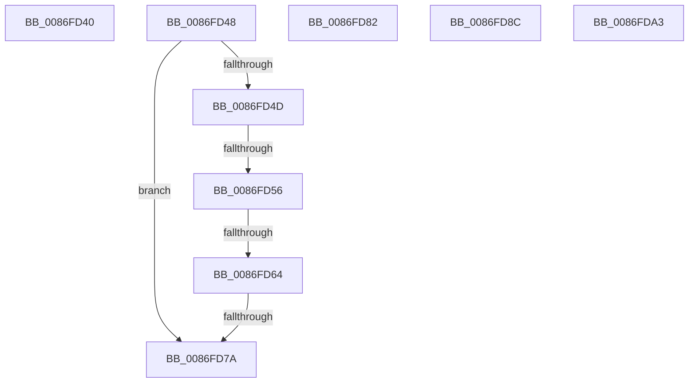

# sub_0086FD40

- RVA: `0x0086FD40`–`0x0086FDB4` (길이 `116` bytes)
- VA: `0x000000014086FD40`
- 실행 섹션: `PAGE`
- PDB 이름 있음: `아니요`; PDB Function 태그: `아니요`
- unwind 정보 RVA: `0x0006C234`
- 디코드: `26`개 명령, `116/116` bytes 표시
- 미해석 바이트: `0` (있으면 어셈블리에 `.byte`로 보존)

> 이 문서는 커널 이미지의 기계어와 PDB 기호를 분석해 생성했습니다. 4번과 5번은 함수 원형과 자료형을 바이너리 사용 방식에서 추정한 C 해석이며 원본 소스 복구 결과는 아닙니다.

## 1. Dependencies

- 직접 호출 지점: **1**; 고유 호출 대상: **1**
- 직접 호출자로 확인된 함수: **0**
- RIP 상대 이미지 참조: **0**

### Outgoing calls
- `0x0086FD6D` → [CmpTransUowIsEqual](../70/CmpTransUowIsEqual_function_007049CC.md) (function, `0x007049CC`)

### Direct callers
- 이 함수 시작 RVA로 연결되는 직접 call은 확인되지 않았습니다. 간접 호출은 완전히 역산할 수 없습니다.

### Static image references
- 디코드된 RIP-relative 메모리 참조가 없습니다.

## 2. Other-region calls and transfers

- 다른 실행 섹션으로 향하는 call: **0**
- call이 아닌 외부 분기/꼬리 이동: **8**
  - `0x0086FD43` → [sub_0086FA65 + 0x1AB](Unknown_function_0086FA65.md) (`tail-transfer`)
  - `0x0086FD50` → [sub_0086FA65 + 0x97](Unknown_function_0086FA65.md) (`tail-transfer`)
  - `0x0086FD5E` → [sub_0086FDC3 + 0x1A3](Unknown_function_0086FDC3.md) (`tail-transfer`)
  - `0x0086FD74` → [sub_0086FA65 + 0x97](Unknown_function_0086FA65.md) (`tail-transfer`)
  - `0x0086FD7D` → [sub_0086FA65 + 0xAB](Unknown_function_0086FA65.md) (`tail-transfer`)
  - `0x0086FD87` → [sub_0086FA65 + 0x70](Unknown_function_0086FA65.md) (`tail-transfer`)
  - `0x0086FD9E` → [sub_0086FA65 + 0x213](Unknown_function_0086FA65.md) (`tail-transfer`)
  - `0x0086FDAF` → [sub_0086FA65 + 0x1AB](Unknown_function_0086FA65.md) (`tail-transfer`)

## 3. Assembly (complete function range)

```asm
0086FD40  45 33 E4                        xor r12d, r12d
0086FD43  E9 C8 FE FF FF                  jmp 0x14086fc10
0086FD48  4D 85 E4                        test r12, r12
0086FD4B  74 2D                           je 0x14086fd7a
0086FD4D  4C 3B E2                        cmp r12, rdx
0086FD50  0F 84 A6 FD FF FF               je 0x14086fafc
0086FD56  49 8B 4C 24 38                  mov rcx, qword ptr [r12 + 0x38]
0086FD5B  48 85 C9                        test rcx, rcx
0086FD5E  0F 85 02 02 00 00               jne 0x14086ff66
0086FD64  48 83 C2 58                     add rdx, 0x58
0086FD68  49 8D 4C 24 58                  lea rcx, [r12 + 0x58]
0086FD6D  E8 5A 4C E9 FF                  call 0x1407049cc
0086FD72  84 C0                           test al, al
0086FD74  0F 85 82 FD FF FF               jne 0x14086fafc
0086FD7A  41 8B C6                        mov eax, r14d
0086FD7D  E9 8E FD FF FF                  jmp 0x14086fb10
0086FD82  49 8B 7C F7 F0                  mov rdi, qword ptr [r15 + rsi*8 - 0x10]
0086FD87  E9 49 FD FF FF                  jmp 0x14086fad5
0086FD8C  48 8D 43 0A                     lea rax, [rbx + 0xa]
0086FD90  48 83 C2 58                     add rdx, 0x58
0086FD94  48 89 44 24 48                  mov qword ptr [rsp + 0x48], rax
0086FD99  48 89 54 24 40                  mov qword ptr [rsp + 0x40], rdx
0086FD9E  E9 D5 FE FF FF                  jmp 0x14086fc78
0086FDA3  43 8D 04 40                     lea eax, [r8 + r8*2]
0086FDA7  44 8D 24 85 08 00 00 00         lea r12d, [rax*4 + 8]
0086FDAF  E9 5C FE FF FF                  jmp 0x14086fc10
```

## 4. C-style interpretation (structured pseudocode)

```c
__int64 __fastcall sub_0086FD40(__int64 a1, __int64 a2, __int64 a3)
{
    __int64 v_r12;
    unsigned __int64 v_stack_p40;
    unsigned __int64 v_stack_p48;

    v_r12 = 0;
}
```

## 5. (Beta) C Style

```c
int64_t sub_0086FD40(int64_t Arg1, int64_t Arg2, int64_t Arg3)
{
    int64_t local_r12;
    uint64_t v_stack_p40;
    uint64_t v_stack_p48;

    local_r12 = 0;
}
```

## 6. Execution-region graph

[열기: 2D/3D 그래프와 함수 탐색 컨트롤 패널](../../../control-panel.html?section=page&rva=0x0086FD40&view=graph)

- 2D 그래프는 위에서 아래로 흐르고, 3D 그래프는 빈 공간을 드래그해 회전합니다. Shift+드래그는 이동, 휠은 확대·축소, 함수 노드 선택은 대상 보고서 이동입니다.

### Static fallback


