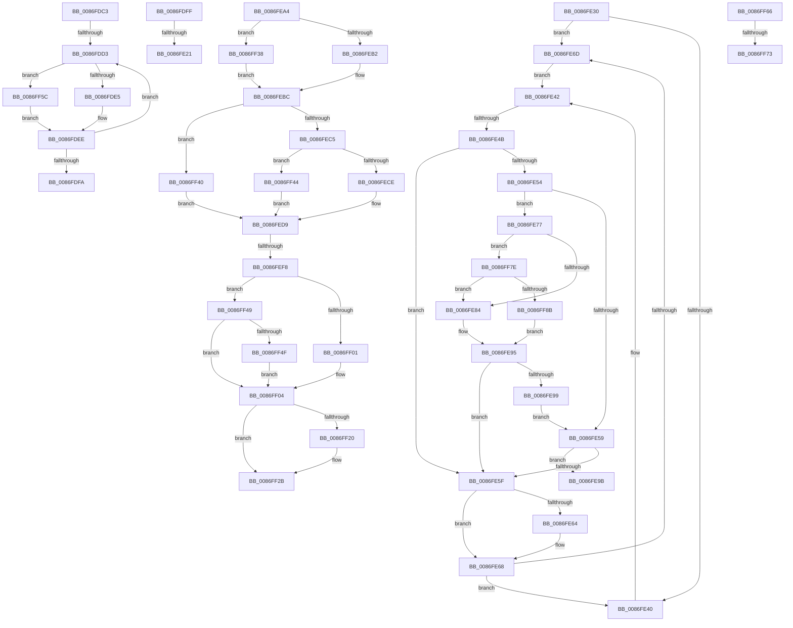

# sub_0086FDC3

- RVA: `0x0086FDC3`–`0x0086FF96` (길이 `467` bytes)
- VA: `0x000000014086FDC3`
- 실행 섹션: `PAGE`
- PDB 이름 있음: `아니요`; PDB Function 태그: `아니요`
- unwind 정보 RVA: `0x0006C27C`
- 디코드: `121`개 명령, `467/467` bytes 표시
- 미해석 바이트: `0` (있으면 어셈블리에 `.byte`로 보존)

> 이 문서는 커널 이미지의 기계어와 PDB 기호를 분석해 생성했습니다. 4번과 5번은 함수 원형과 자료형을 바이너리 사용 방식에서 추정한 C 해석이며 원본 소스 복구 결과는 아닙니다.

## 1. Dependencies

- 직접 호출 지점: **6**; 고유 호출 대상: **6**
- 직접 호출자로 확인된 함수: **0**
- RIP 상대 이미지 참조: **0**

### Outgoing calls
- `0x0086FE10` → [CmpAllocatePool](../../text/3C/CmpAllocatePool_function_003CD504.md) (function, `0x003CD504`)
- `0x0086FE8C` → [CmpTransUowIsEqual](../70/CmpTransUowIsEqual_function_007049CC.md) (function, `0x007049CC`)
- `0x0086FEE7` → [ExAllocatePool2](../../poolcode/B8/ExAllocatePool2_function_00B820F0.md) (function, `0x00B820F0`)
- `0x0086FF0A` → [memcpy](../../text/6C/memcpy_function_006C6840.md) (function, `0x006C6840`)
- `0x0086FF15` → [SepConcatenatePrivileges](../9D/SepConcatenatePrivileges_function_009D7AD0.md) (function, `0x009D7AD0`)
- `0x0086FF26` → [ExFreePoolWithTag](../../poolcode/B8/ExFreePoolWithTag_function_00B82870.md) (function, `0x00B82870`)

### Direct callers
- 이 함수 시작 RVA로 연결되는 직접 call은 확인되지 않았습니다. 간접 호출은 완전히 역산할 수 없습니다.

### Static image references
- 디코드된 RIP-relative 메모리 참조가 없습니다.

## 2. Other-region calls and transfers

- 다른 실행 섹션으로 향하는 call: **4**
  - `0x0086FE10` → [CmpAllocatePool](../../text/3C/CmpAllocatePool_function_003CD504.md) (`PAGE` → `.text`)
  - `0x0086FEE7` → [ExAllocatePool2](../../poolcode/B8/ExAllocatePool2_function_00B820F0.md) (`PAGE` → `POOLCODE`)
  - `0x0086FF0A` → [memcpy](../../text/6C/memcpy_function_006C6840.md) (`PAGE` → `.text`)
  - `0x0086FF26` → [ExFreePoolWithTag](../../poolcode/B8/ExFreePoolWithTag_function_00B82870.md) (`PAGE` → `POOLCODE`)
- call이 아닌 외부 분기/꼬리 이동: **10**
  - `0x0086FDCD` → [sub_0086FA65 + 0x4A](Unknown_function_0086FA65.md) (`tail-transfer`)
  - `0x0086FDFA` → [sub_0086FA65 + 0x4A](Unknown_function_0086FA65.md) (`tail-transfer`)
  - `0x0086FE1B` → [sub_0086FA65 + 0x27](Unknown_function_0086FA65.md) (`tail-transfer`)
  - `0x0086FE2B` → [sub_0086FA65 + 0x285](Unknown_function_0086FA65.md) (`tail-transfer`)
  - `0x0086FE45` → [sub_0086FA65 + 0xC5](Unknown_function_0086FA65.md) (`tail-transfer`)
  - `0x0086FE9F` → [sub_0086FA65 + 0xC5](Unknown_function_0086FA65.md) (`tail-transfer`)
  - `0x0086FEF2` → [sub_0086FA65 + 0x1C7](Unknown_function_0086FA65.md) (`tail-transfer`)
  - `0x0086FF33` → [sub_0086FA65 + 0x1C7](Unknown_function_0086FA65.md) (`tail-transfer`)
  - `0x0086FF6D` → [sub_0086FD40 + 0x24](Unknown_function_0086FD40.md) (`tail-transfer`)
  - `0x0086FF79` → [sub_0086FD40 + 0x32](Unknown_function_0086FD40.md) (`tail-transfer`)

## 3. Assembly (complete function range)

```asm
0086FDC3  48 8B 8E C0 00 00 00            mov rcx, qword ptr [rsi + 0xc0]
0086FDCA  48 85 C9                        test rcx, rcx
0086FDCD  0F 84 DC FC FF FF               je 0x14086faaf
0086FDD3  48 8B 51 10                     mov rdx, qword ptr [rcx + 0x10]
0086FDD7  4C 0F BF C0                     movsx r8, ax
0086FDDB  66 83 F8 02                     cmp ax, 2
0086FDDF  0F 8D 77 01 00 00               jge 0x14086ff5c
0086FDE5  4A 89 54 C5 FF                  mov qword ptr [rbp + r8*8 - 1], rdx
0086FDEA  4C 8B 7D 0F                     mov r15, qword ptr [rbp + 0xf]
0086FDEE  48 8B 49 18                     mov rcx, qword ptr [rcx + 0x18]
0086FDF2  66 FF C8                        dec ax
0086FDF5  48 85 C9                        test rcx, rcx
0086FDF8  75 D9                           jne 0x14086fdd3
0086FDFA  E9 B0 FC FF FF                  jmp 0x14086faaf
0086FDFF  8B D0                           mov edx, eax
0086FE01  B9 00 01 00 00                  mov ecx, 0x100
0086FE06  48 C1 E2 03                     shl rdx, 3
0086FE0A  41 B8 43 4D 36 35               mov r8d, 0x35364d43
0086FE10  E8 EF D6 B5 FF                  call 0x1403cd504
0086FE15  4C 8B F8                        mov r15, rax
0086FE18  48 85 C0                        test rax, rax
0086FE1B  0F 85 6B FC FF FF               jne 0x14086fa8c
0086FE21  C7 45 DF 9A 00 00 C0            mov dword ptr [rbp - 0x21], 0xc000009a
0086FE28  40 32 F6                        xor sil, sil
0086FE2B  E9 BA FE FF FF                  jmp 0x14086fcea
0086FE30  49 81 C5 D0 00 00 00            add r13, 0xd0
0086FE37  49 8B 7D 08                     mov rdi, qword ptr [r13 + 8]
0086FE3B  4C 3B EF                        cmp r13, rdi
0086FE3E  75 2D                           jne 0x14086fe6d
0086FE40  33 F6                           xor esi, esi
0086FE42  48 85 F6                        test rsi, rsi
0086FE45  0F 84 DF FC FF FF               je 0x14086fb2a
0086FE4B  48 8B 4E 38                     mov rcx, qword ptr [rsi + 0x38]
0086FE4F  48 85 C9                        test rcx, rcx
0086FE52  74 0B                           je 0x14086fe5f
0086FE54  49 3B C8                        cmp rcx, r8
0086FE57  75 1E                           jne 0x14086fe77
0086FE59  83 7E 44 09                     cmp dword ptr [rsi + 0x44], 9
0086FE5D  74 3C                           je 0x14086fe9b
0086FE5F  48 85 FF                        test rdi, rdi
0086FE62  75 04                           jne 0x14086fe68
0086FE64  49 8B 7D 08                     mov rdi, qword ptr [r13 + 8]
0086FE68  4C 3B EF                        cmp r13, rdi
0086FE6B  74 D3                           je 0x14086fe40
0086FE6D  48 8D 77 E0                     lea rsi, [rdi - 0x20]
0086FE71  48 8B 7F 08                     mov rdi, qword ptr [rdi + 8]
0086FE75  EB CB                           jmp 0x14086fe42
0086FE77  48 8B 41 38                     mov rax, qword ptr [rcx + 0x38]
0086FE7B  48 85 C0                        test rax, rax
0086FE7E  0F 85 FA 00 00 00               jne 0x14086ff7e
0086FE84  49 8D 50 58                     lea rdx, [r8 + 0x58]
0086FE88  48 83 C1 58                     add rcx, 0x58
0086FE8C  E8 3B 4B E9 FF                  call 0x1407049cc
0086FE91  4C 8B 45 67                     mov r8, qword ptr [rbp + 0x67]
0086FE95  84 C0                           test al, al
0086FE97  74 C6                           je 0x14086fe5f
0086FE99  EB BE                           jmp 0x14086fe59
0086FE9B  4C 8B 66 58                     mov r12, qword ptr [rsi + 0x58]
0086FE9F  E9 86 FC FF FF                  jmp 0x14086fb2a
0086FEA4  41 BC 08 00 00 00               mov r12d, 8
0086FEAA  85 D2                           test edx, edx
0086FEAC  0F 84 86 00 00 00               je 0x14086ff38
0086FEB2  8D 04 52                        lea eax, [rdx + rdx*2]
0086FEB5  8D 0C 85 08 00 00 00            lea ecx, [rax*4 + 8]
0086FEBC  48 85 FF                        test rdi, rdi
0086FEBF  0F 84 7B 00 00 00               je 0x14086ff40
0086FEC5  45 85 C0                        test r8d, r8d
0086FEC8  0F 84 76 00 00 00               je 0x14086ff44
0086FECE  43 8D 04 40                     lea eax, [r8 + r8*2]
0086FED2  8D 04 85 08 00 00 00            lea eax, [rax*4 + 8]
0086FED9  8D 14 01                        lea edx, [rcx + rax]
0086FEDC  41 B8 53 65 50 72               mov r8d, 0x72506553
0086FEE2  B9 00 01 00 00                  mov ecx, 0x100
0086FEE7  E8 04 22 31 00                  call 0x140b820f0
0086FEEC  48 8B F8                        mov rdi, rax
0086FEEF  48 85 C0                        test rax, rax
0086FEF2  0F 84 34 FD FF FF               je 0x14086fc2c
0086FEF8  49 8B 55 00                     mov rdx, qword ptr [r13]
0086FEFC  48 85 D2                        test rdx, rdx
0086FEFF  75 48                           jne 0x14086ff49
0086FF01  45 33 E4                        xor r12d, r12d
0086FF04  45 8B C4                        mov r8d, r12d
0086FF07  48 8B CF                        mov rcx, rdi
0086FF0A  E8 31 69 E5 FF                  call 0x1406c6840
0086FF0F  4D 8B C7                        mov r8, r15
0086FF12  48 8B CF                        mov rcx, rdi
0086FF15  E8 B6 7B 16 00                  call 0x1409d7ad0
0086FF1A  80 7B 0B 00                     cmp byte ptr [rbx + 0xb], 0
0086FF1E  74 0B                           je 0x14086ff2b
0086FF20  49 8B 4D 00                     mov rcx, qword ptr [r13]
0086FF24  33 D2                           xor edx, edx
0086FF26  E8 45 29 31 00                  call 0x140b82870
0086FF2B  49 89 7D 00                     mov qword ptr [r13], rdi
0086FF2F  C6 43 0B 01                     mov byte ptr [rbx + 0xb], 1
0086FF33  E9 F4 FC FF FF                  jmp 0x14086fc2c
0086FF38  41 8B CC                        mov ecx, r12d
0086FF3B  E9 7C FF FF FF                  jmp 0x14086febc
0086FF40  33 C0                           xor eax, eax
0086FF42  EB 95                           jmp 0x14086fed9
0086FF44  41 8B C4                        mov eax, r12d
0086FF47  EB 90                           jmp 0x14086fed9
0086FF49  8B 02                           mov eax, dword ptr [rdx]
0086FF4B  85 C0                           test eax, eax
0086FF4D  74 B5                           je 0x14086ff04
0086FF4F  8D 04 40                        lea eax, [rax + rax*2]
0086FF52  44 8D 24 85 08 00 00 00         lea r12d, [rax*4 + 8]
0086FF5A  EB A8                           jmp 0x14086ff04
0086FF5C  4B 89 54 C7 F0                  mov qword ptr [r15 + r8*8 - 0x10], rdx
0086FF61  E9 88 FE FF FF                  jmp 0x14086fdee
0086FF66  48 8B 42 38                     mov rax, qword ptr [rdx + 0x38]
0086FF6A  48 85 C0                        test rax, rax
0086FF6D  0F 84 F1 FD FF FF               je 0x14086fd64
0086FF73  48 3B C8                        cmp rcx, rax
0086FF76  0F 94 C0                        sete al
0086FF79  E9 F4 FD FF FF                  jmp 0x14086fd72
0086FF7E  49 8B 50 38                     mov rdx, qword ptr [r8 + 0x38]
0086FF82  48 85 D2                        test rdx, rdx
0086FF85  0F 84 F9 FE FF FF               je 0x14086fe84
0086FF8B  48 3B C2                        cmp rax, rdx
0086FF8E  0F 94 C0                        sete al
0086FF91  E9 FF FE FF FF                  jmp 0x14086fe95
```

## 4. C-style interpretation (structured pseudocode)

```c
__int64 __fastcall sub_0086FDC3(void)
{
    __int64 result;

loc_0086FDD3:
    if (((unsigned __int16)(result)) >= 2) goto loc_0086FF5C;
    *(unsigned __int64 *)(v_rbp + (__int16)((unsigned __int16)(result)) * 8 - 1) = *(unsigned __int64 *)(*(unsigned __int64 *)(v_rsi + 192) + 16);
loc_0086FDEE:
    result = (unsigned __int16)((result) - 1);
    if (*(unsigned __int64 *)(*(unsigned __int64 *)(v_rsi + 192) + 24) != 0) goto loc_0086FDD3;
loc_0086FF5C:
    *(unsigned __int64 *)(*(unsigned __int64 *)(v_rbp + 15) + (__int16)((unsigned __int16)(result)) * 8 - 16) = *(unsigned __int64 *)(*(unsigned __int64 *)(v_rsi + 192) + 16);
    goto loc_0086FDEE;
}
```

## 5. (Beta) C Style

```c
void sub_0086FDC3(void)
{
    int64_t result;

loc_0086FDD3:
    if (((uint16_t)(result)) >= 2) goto loc_0086FF5C;
    *(uint64_t *)(local_rbp + (int16_t)((uint16_t)(result)) * 8 - 0x1) = *(uint64_t *)(*(uint64_t *)(local_rsi + 0xC0) + 0x10);
loc_0086FDEE:
    result = (uint16_t)((result) - 1);
    if (*(uint64_t *)(*(uint64_t *)(local_rsi + 0xC0) + 0x18) != 0) goto loc_0086FDD3;
loc_0086FF5C:
    *(uint64_t *)(*(uint64_t *)(local_rbp + 0xF) + (int16_t)((uint16_t)(result)) * 8 - 0x10) = *(uint64_t *)(*(uint64_t *)(local_rsi + 0xC0) + 0x10);
    goto loc_0086FDEE;
}
```

## 6. Execution-region graph

[열기: 2D/3D 그래프와 함수 탐색 컨트롤 패널](../../../control-panel.html?section=page&rva=0x0086FDC3&view=graph)

- 2D 그래프는 위에서 아래로 흐르고, 3D 그래프는 빈 공간을 드래그해 회전합니다. Shift+드래그는 이동, 휠은 확대·축소, 함수 노드 선택은 대상 보고서 이동입니다.

### Static fallback


