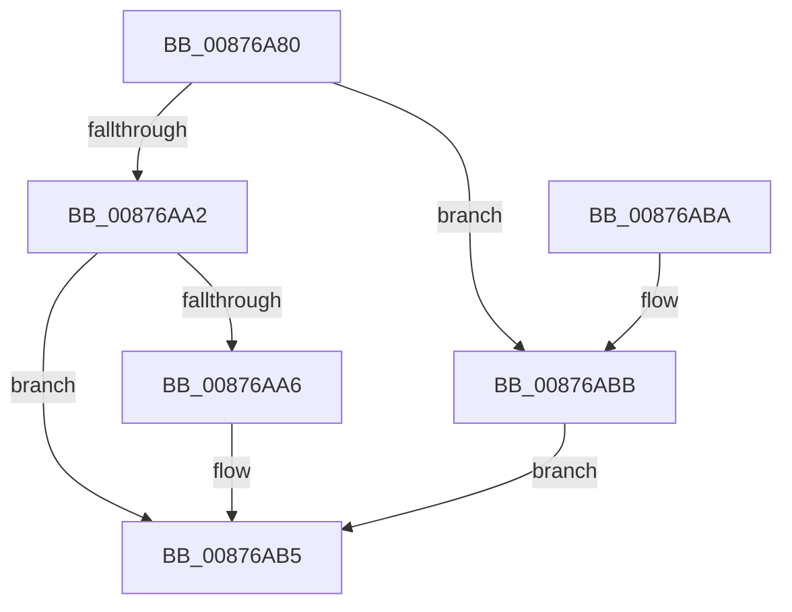

# CmCheckNoTxContext

- RVA: `0x00876A80`–`0x00876ABF` (길이 `63` bytes)
- VA: `0x0000000140876A80`
- 실행 섹션: `PAGE`
- PDB 이름 있음: `예`; PDB Function 태그: `아니요`
- unwind 정보 RVA: `0x00069B1C`
- 디코드: `18`개 명령, `63/63` bytes 표시
- 미해석 바이트: `0` (있으면 어셈블리에 `.byte`로 보존)

> 이 문서는 커널 이미지의 기계어와 PDB 기호를 분석해 생성했습니다. 4번과 5번은 함수 원형과 자료형을 바이너리 사용 방식에서 추정한 C 해석이며 원본 소스 복구 결과는 아닙니다.

## 1. Dependencies

- 직접 호출 지점: **1**; 고유 호출 대상: **1**
- 직접 호출자로 확인된 함수: **7**
- RIP 상대 이미지 참조: **1**

### Outgoing calls
- `0x00876A8F` → `ext-ms-win-ntos-tm-l1-1-0.dll!TmCurrentTransaction` (import, 간접 대상; import `ext-ms-win-ntos-tm-l1-1-0.dll!TmCurrentTransaction`)

### Direct callers
- [NtCompactKeys](../7D/NtCompactKeys_function_007DF730.md) at `0x007DF777`
- [NtCompressKey](../7D/NtCompressKey_function_007DF9D0.md) at `0x007DFA24`
- [NtReplaceKey](../7E/NtReplaceKey_function_007E0970.md) at `0x007E0A14`
- [NtRestoreKey](../7E/NtRestoreKey_function_007E0CC0.md) at `0x007E0D62`
- [NtSaveMergedKeys](../7E/NtSaveMergedKeys_function_007E1070.md) at `0x007E1116`
- [CmLoadDifferencingKey](CmLoadDifferencingKey_function_00875670.md) at `0x0087583A`
- [NtSaveKeyEx](../A8/NtSaveKeyEx_function_00A853C0.md) at `0x00A85454`

### Static image references
- `0x00876A8F` → RVA `0x001513C0` (`ext-ms-win-ntos-tm-l1-1-0.dll!TmCurrentTransaction (IAT)`; read)

## 2. Other-region calls and transfers

- 다른 실행 섹션으로 향하는 call: **0**
- 별도 외부 분기/꼬리 이동을 확인하지 못했습니다.

## 3. Assembly (complete function range)

```asm
00876A80  48 83 EC 28                     sub rsp, 0x28
00876A84  48 83 64 24 30 00               and qword ptr [rsp + 0x30], 0
00876A8A  48 8D 4C 24 30                  lea rcx, [rsp + 0x30]
00876A8F  48 FF 15 2A A9 8D FF            call qword ptr [rip - 0x7256d6]
00876A96  0F 1F 44 00 00                  nop dword ptr [rax + rax]
00876A9B  3D BB 00 00 C0                  cmp eax, 0xc00000bb
00876AA0  74 19                           je 0x140876abb
00876AA2  85 C0                           test eax, eax
00876AA4  78 0F                           js 0x140876ab5
00876AA6  48 8B 44 24 30                  mov rax, qword ptr [rsp + 0x30]
00876AAB  48 F7 D8                        neg rax
00876AAE  1B C0                           sbb eax, eax
00876AB0  25 01 00 19 C0                  and eax, 0xc0190001
00876AB5  48 83 C4 28                     add rsp, 0x28
00876AB9  C3                              ret
00876ABA  CC                              int3
00876ABB  33 C0                           xor eax, eax
00876ABD  EB F6                           jmp 0x140876ab5
```

## 4. C-style interpretation (structured pseudocode)

```c
__int64 __fastcall CmCheckNoTxContext(void)
{
    __int64 result;
    __int64 v_rsp;
    unsigned __int64 v_stack_p8;

    v_rsp = (v_rsp) - (40);
    result = ext_ms_win_ntos_tm_l1_1_0_dll_TmCurrentTransaction(v_stack_p8, a2, a3, a4);
    if (((unsigned int)(result)) == 0xC00000BBULL) goto loc_00876ABB;
    if (!(sign_flag)) {
        result = v_stack_p8;
        result = -(result);
        result = (unsigned int)((result) & (0xC0190001ULL));
    }
    v_rsp = (v_rsp) + (40);
    return result;
loc_00876ABB:
    result = 0;
    goto loc_00876AB5;
}
```

## 5. (Beta) C Style

```c
void CmCheckNoTxContext(void)
{
    int64_t result;
    int64_t local_rsp;
    uint64_t v_stack_p8;

    local_rsp = (local_rsp) - (40);
    result = kernel_indirect_call(v_stack_p8, a2, a3, a4);
    if (((uint32_t)(result)) == 0xC00000BBULL) goto loc_00876ABB;
    if (!(sign_flag)) {
        result = v_stack_p8;
        result = -(result);
        result = (uint32_t)((result) & (0xC0190001ULL));
    }
    local_rsp = (local_rsp) + (40);
    return result;
loc_00876ABB:
    result = 0;
    goto loc_00876AB5;
}
```

## 6. Execution-region graph

[열기: 2D/3D 그래프와 함수 탐색 컨트롤 패널](../../../control-panel.html?section=page&rva=0x00876A80&view=graph)

- 2D 그래프는 위에서 아래로 흐르고, 3D 그래프는 빈 공간을 드래그해 회전합니다. Shift+드래그는 이동, 휠은 확대·축소, 함수 노드 선택은 대상 보고서 이동입니다.

### Static fallback


