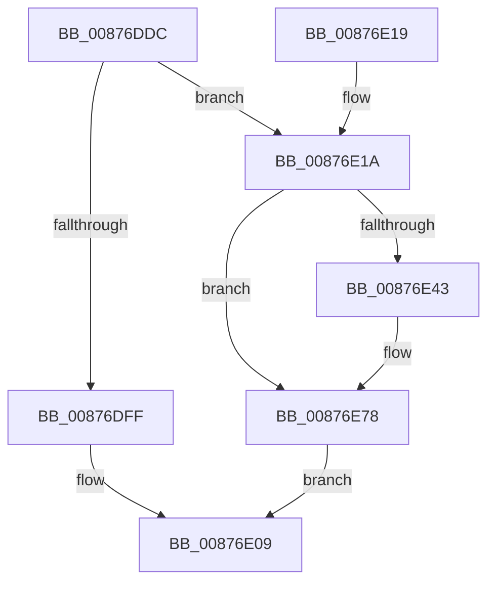

# CmConvertHandleToKernelHandle

- RVA: `0x00876DDC`–`0x00876E7C` (길이 `160` bytes)
- VA: `0x0000000140876DDC`
- 실행 섹션: `PAGE`
- PDB 이름 있음: `예`; PDB Function 태그: `아니요`
- unwind 정보 RVA: `0x0006CB08`
- 디코드: `43`개 명령, `160/160` bytes 표시
- 미해석 바이트: `0` (있으면 어셈블리에 `.byte`로 보존)

> 이 문서는 커널 이미지의 기계어와 PDB 기호를 분석해 생성했습니다. 4번과 5번은 함수 원형과 자료형을 바이너리 사용 방식에서 추정한 C 해석이며 원본 소스 복구 결과는 아닙니다.

## 1. Dependencies

- 직접 호출 지점: **3**; 고유 호출 대상: **3**
- 직접 호출자로 확인된 함수: **2**
- RIP 상대 이미지 참조: **1**

### Outgoing calls
- `0x00876E38` → [ObReferenceObjectByHandle](../86/ObReferenceObjectByHandle_function_00868DB0.md) (function, `0x00868DB0`)
- `0x00876E67` → [ObOpenObjectByPointer](../8B/ObOpenObjectByPointer_function_008B7420.md) (function, `0x008B7420`)
- `0x00876E73` → [ObfDereferenceObject](../../text/2F/ObfDereferenceObject_function_002F9350.md) (function, `0x002F9350`)

### Direct callers
- [CmLoadDifferencingKey](CmLoadDifferencingKey_function_00875670.md) at `0x00875B46`
- [CmUnloadKey](../9A/CmUnloadKey_function_009AF2FC.md) at `0x009AF85D`

### Static image references
- `0x00876DF0` → RVA `0x00FC6AC0` (`ALMOSTRO`; read)

## 2. Other-region calls and transfers

- 다른 실행 섹션으로 향하는 call: **1**
  - `0x00876E73` → [ObfDereferenceObject](../../text/2F/ObfDereferenceObject_function_002F9350.md) (`PAGE` → `.text`)
- 별도 외부 분기/꼬리 이동을 확인하지 못했습니다.

## 3. Assembly (complete function range)

```asm
00876DDC  48 89 5C 24 08                  mov qword ptr [rsp + 8], rbx
00876DE1  48 89 74 24 18                  mov qword ptr [rsp + 0x18], rsi
00876DE6  48 89 54 24 10                  mov qword ptr [rsp + 0x10], rdx
00876DEB  57                              push rdi
00876DEC  48 83 EC 40                     sub rsp, 0x40
00876DF0  48 8B 35 C9 FC 74 00            mov rsi, qword ptr [rip + 0x74fcc9]
00876DF7  41 8B F9                        mov edi, r9d
00876DFA  48 85 C9                        test rcx, rcx
00876DFD  75 1B                           jne 0x140876e1a
00876DFF  48 8B 44 24 70                  mov rax, qword ptr [rsp + 0x70]
00876E04  48 21 08                        and qword ptr [rax], rcx
00876E07  33 C0                           xor eax, eax
00876E09  48 8B 5C 24 50                  mov rbx, qword ptr [rsp + 0x50]
00876E0E  48 8B 74 24 60                  mov rsi, qword ptr [rsp + 0x60]
00876E13  48 83 C4 40                     add rsp, 0x40
00876E17  5F                              pop rdi
00876E18  C3                              ret
00876E19  CC                              int3
00876E1A  48 83 64 24 28 00               and qword ptr [rsp + 0x28], 0
00876E20  48 8D 44 24 58                  lea rax, [rsp + 0x58]
00876E25  48 83 64 24 58 00               and qword ptr [rsp + 0x58], 0
00876E2B  45 8A C8                        mov r9b, r8b
00876E2E  4C 8B C6                        mov r8, rsi
00876E31  48 89 44 24 20                  mov qword ptr [rsp + 0x20], rax
00876E36  8B D7                           mov edx, edi
00876E38  E8 73 1F FF FF                  call 0x140868db0
00876E3D  8B D8                           mov ebx, eax
00876E3F  85 C0                           test eax, eax
00876E41  78 35                           js 0x140876e78
00876E43  48 8B 44 24 70                  mov rax, qword ptr [rsp + 0x70]
00876E48  44 8B CF                        mov r9d, edi
00876E4B  48 8B 4C 24 58                  mov rcx, qword ptr [rsp + 0x58]
00876E50  45 33 C0                        xor r8d, r8d
00876E53  48 89 44 24 30                  mov qword ptr [rsp + 0x30], rax
00876E58  BA 00 02 00 00                  mov edx, 0x200
00876E5D  C6 44 24 28 00                  mov byte ptr [rsp + 0x28], 0
00876E62  48 89 74 24 20                  mov qword ptr [rsp + 0x20], rsi
00876E67  E8 B4 05 04 00                  call 0x1408b7420
00876E6C  48 8B 4C 24 58                  mov rcx, qword ptr [rsp + 0x58]
00876E71  8B D8                           mov ebx, eax
00876E73  E8 D8 24 A8 FF                  call 0x1402f9350
00876E78  8B C3                           mov eax, ebx
00876E7A  EB 8D                           jmp 0x140876e09
```

## 4. C-style interpretation (structured pseudocode)

```c
__int64 __fastcall CmConvertHandleToKernelHandle(__int64 a1, __int64 a2, unsigned __int8 a3, int a4, __int64 a5)
{
    __int64 result;
    __int64 v_rbx;
    __int64 v_rsp;
    unsigned __int64 v_stack_p10;
    unsigned __int64 v_stack_p18;
    unsigned __int64 v_stack_p20;
    unsigned __int64 v_stack_p28;
    unsigned __int64 v_stack_p30;
    unsigned __int64 v_stack_p58;
    unsigned __int64 v_stack_p8;

    v_stack_p8 = v_rbx;
    v_stack_p18 = v_rsi;
    v_stack_p10 = a2;
    v_rsp = (v_rsp) - (64);
    if (a1 != 0) goto loc_00876E1A;
    result = 0;
loc_00876E09:
    v_rsp = (v_rsp) + (64);
    return result;
loc_00876E1A:
    v_stack_p20 = v_stack_p58;
    result = ObReferenceObjectByHandle(a1, (unsigned int)((unsigned int)((unsigned int)(a4))), v_stack_p18, a3);
    v_rbx = (unsigned int)((unsigned int)(result));
    if (!(sign_flag)) {
        result = a5;
        a4 = (unsigned int)((unsigned int)(a4));
        a1 = v_stack_p58;
        a3 = 0;
        v_stack_p30 = result;
        a2 = 512;
        v_stack_p28 = 0;
        v_stack_p20 = v_stack_p18;
        result = ObOpenObjectByPointer(a1, a2, a3, a4);
        a1 = v_stack_p58;
        v_rbx = (unsigned int)(result);
        result = ObfDereferenceObject(a1, a2, a3, a4);
    }
    goto loc_00876E09;
}
```

## 5. (Beta) C Style

```c
int64_t CmConvertHandleToKernelHandle(int64_t Arg1, int64_t Arg2, uint8_t Arg3, int32_t Arg4, void *Arg5)
{
    uint8_t *arg5 = (uint8_t *)Arg5;

    int64_t result;
    int64_t local_rbx;
    int64_t local_rsp;
    uint64_t v_stack_p10;
    uint64_t v_stack_p18;
    uint64_t v_stack_p20;
    uint64_t v_stack_p28;
    uint64_t v_stack_p30;
    uint64_t v_stack_p58;
    uint64_t v_stack_p8;

    v_stack_p8 = local_rbx;
    v_stack_p18 = local_rsi;
    v_stack_p10 = Arg2;
    local_rsp = (local_rsp) - (64);
    if (Arg1 != 0) goto loc_00876E1A;
    result = 0;
loc_00876E09:
    local_rsp = (local_rsp) + (64);
    return result;
loc_00876E1A:
    v_stack_p20 = v_stack_p58;
    result = ObReferenceObjectByHandle(Arg1, (uint32_t)((uint32_t)((uint32_t)(Arg4))), v_stack_p18, Arg3);
    local_rbx = (uint32_t)((uint32_t)(result));
    if (!(sign_flag)) {
        result = Arg5;
        Arg4 = (uint32_t)((uint32_t)(Arg4));
        Arg1 = v_stack_p58;
        Arg3 = 0;
        v_stack_p30 = result;
        Arg2 = 512;
        v_stack_p28 = 0;
        v_stack_p20 = v_stack_p18;
        result = ObOpenObjectByPointer(Arg1, Arg2, Arg3, Arg4);
        Arg1 = v_stack_p58;
        local_rbx = (uint32_t)(result);
        result = ObfDereferenceObject(Arg1, Arg2, Arg3, Arg4);
    }
    goto loc_00876E09;
}
```

### 관측된 메모리 오프셋

구조체 형식이 확인되지 않은 접근은 인자 기준의 오프셋으로만 기록했습니다.

| 기준 인자 | 오프셋 표현 | 폭 (bit) | 접근 |
|---|---:|---:|---|
| `Arg5` | `+ 0x0` | `64` | `R/W` |

## 6. Execution-region graph

[열기: 2D/3D 그래프와 함수 탐색 컨트롤 패널](../../../control-panel.html?section=page&rva=0x00876DDC&view=graph)

- 2D 그래프는 위에서 아래로 흐르고, 3D 그래프는 빈 공간을 드래그해 회전합니다. Shift+드래그는 이동, 휠은 확대·축소, 함수 노드 선택은 대상 보고서 이동입니다.

### Static fallback


