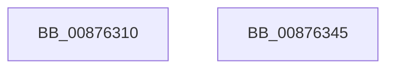

# CmOpenKeyCallout

- RVA: `0x00876310`–`0x00876346` (길이 `54` bytes)
- VA: `0x0000000140876310`
- 실행 섹션: `PAGE`
- PDB 이름 있음: `예`; PDB Function 태그: `아니요`
- unwind 정보 RVA: `0x00064C80`
- 디코드: `17`개 명령, `54/54` bytes 표시
- 미해석 바이트: `0` (있으면 어셈블리에 `.byte`로 보존)

> 이 문서는 커널 이미지의 기계어와 PDB 기호를 분석해 생성했습니다. 4번과 5번은 함수 원형과 자료형을 바이너리 사용 방식에서 추정한 C 해석이며 원본 소스 복구 결과는 아닙니다.

## 1. Dependencies

- 직접 호출 지점: **1**; 고유 호출 대상: **1**
- 직접 호출자로 확인된 함수: **1**
- RIP 상대 이미지 참조: **0**

### Outgoing calls
- `0x00876338` → [CmOpenKey](CmOpenKey_function_00876350.md) (function, `0x00876350`)

### Direct callers
- [KeExpandKernelStackAndCalloutInternal](../../text/2F/KeExpandKernelStackAndCalloutInternal_function_002F8450.md) at `0x002F8515`

### Static image references
- 디코드된 RIP-relative 메모리 참조가 없습니다.

## 2. Other-region calls and transfers

- 다른 실행 섹션으로 향하는 call: **0**
- 별도 외부 분기/꼬리 이동을 확인하지 못했습니다.

## 3. Assembly (complete function range)

```asm
00876310  40 53                           push rbx
00876312  48 83 EC 30                     sub rsp, 0x30
00876316  8A 41 30                        mov al, byte ptr [rcx + 0x30]
00876319  48 8B D9                        mov rbx, rcx
0087631C  44 8B 49 20                     mov r9d, dword ptr [rcx + 0x20]
00876320  4C 8B 41 18                     mov r8, qword ptr [rcx + 0x18]
00876324  8B 51 10                        mov edx, dword ptr [rcx + 0x10]
00876327  88 44 24 28                     mov byte ptr [rsp + 0x28], al
0087632B  48 8B 41 28                     mov rax, qword ptr [rcx + 0x28]
0087632F  48 8B 49 08                     mov rcx, qword ptr [rcx + 8]
00876333  48 89 44 24 20                  mov qword ptr [rsp + 0x20], rax
00876338  E8 13 00 00 00                  call 0x140876350
0087633D  89 03                           mov dword ptr [rbx], eax
0087633F  48 83 C4 30                     add rsp, 0x30
00876343  5B                              pop rbx
00876344  C3                              ret
00876345  CC                              int3
```

## 4. C-style interpretation (structured pseudocode)

```c
__int64 __fastcall CmOpenKeyCallout(__int64 a1)
{
    __int64 result;
    __int64 v_rsp;
    unsigned __int8 v_stack_m10;
    unsigned __int64 v_stack_m18;

    v_rsp = (v_rsp) - (48);
    v_stack_m10 = (unsigned __int8)(*(unsigned __int8 *)(a1 + 48));
    v_stack_m18 = *(unsigned __int64 *)(a1 + 40);
    result = CmOpenKey(*(unsigned __int64 *)(a1 + 8), (unsigned int)(*(unsigned int *)(a1 + 16)), *(unsigned __int64 *)(a1 + 24), (unsigned int)(*(unsigned int *)(a1 + 32)));
    *(unsigned int *)(a1) = (unsigned int)(result);
    v_rsp = (v_rsp) + (48);
    return result;
}
```

## 5. (Beta) C Style

```c
int64_t CmOpenKeyCallout(void *Arg1)
{
    uint8_t *arg1 = (uint8_t *)Arg1;

    int64_t result;
    int64_t local_rsp;
    uint8_t v_stack_m10;
    uint64_t v_stack_m18;

    local_rsp = (local_rsp) - (48);
    v_stack_m10 = (uint8_t)(*(uint8_t *)(arg1 + 0x30));
    v_stack_m18 = *(uint64_t *)(arg1 + 0x28);
    result = CmOpenKey(*(uint64_t *)(arg1 + 0x8), (uint32_t)(*(uint32_t *)(arg1 + 0x10)), *(uint64_t *)(arg1 + 0x18), (uint32_t)(*(uint32_t *)(arg1 + 0x20)));
    *(uint32_t *)(arg1) = (uint32_t)(result);
    local_rsp = (local_rsp) + (48);
    return result;
}
```

### 관측된 메모리 오프셋

구조체 형식이 확인되지 않은 접근은 인자 기준의 오프셋으로만 기록했습니다.

| 기준 인자 | 오프셋 표현 | 폭 (bit) | 접근 |
|---|---:|---:|---|
| `Arg1` | `+ 0x0` | `32` | `W` |
| `Arg1` | `+ 0x8` | `64` | `R` |
| `Arg1` | `+ 0x10` | `32` | `R` |
| `Arg1` | `+ 0x18` | `64` | `R` |
| `Arg1` | `+ 0x20` | `32` | `R` |
| `Arg1` | `+ 0x28` | `64` | `R` |
| `Arg1` | `+ 0x30` | `8` | `R` |

## 6. Execution-region graph

[열기: 2D/3D 그래프와 함수 탐색 컨트롤 패널](../../../control-panel.html?section=page&rva=0x00876310&view=graph)

- 2D 그래프는 위에서 아래로 흐르고, 3D 그래프는 빈 공간을 드래그해 회전합니다. Shift+드래그는 이동, 휠은 확대·축소, 함수 노드 선택은 대상 보고서 이동입니다.

### Static fallback


