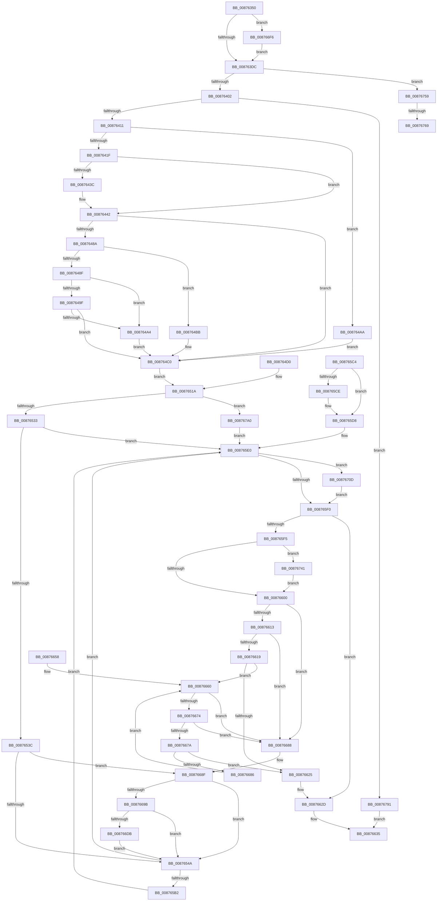

# CmOpenKey

- RVA: `0x00876350`–`0x008767AB` (길이 `1,115` bytes)
- VA: `0x0000000140876350`
- 실행 섹션: `PAGE`
- PDB 이름 있음: `예`; PDB Function 태그: `예`
- unwind 정보 RVA: `0x0006CA1C`
- 디코드: `257`개 명령, `1,115/1,115` bytes 표시
- 미해석 바이트: `0` (있으면 어셈블리에 `.byte`로 보존)

> 이 문서는 커널 이미지의 기계어와 PDB 기호를 분석해 생성했습니다. 4번과 5번은 함수 원형과 자료형을 바이너리 사용 방식에서 추정한 C 해석이며 원본 소스 복구 결과는 아닙니다.

## 1. Dependencies

- 직접 호출 지점: **20**; 고유 호출 대상: **17**
- 직접 호출자로 확인된 함수: **3**
- RIP 상대 이미지 참조: **3**

### Outgoing calls
- `0x008763F5` → [CmpAcquireShutdownRundown](../../pagecmrc/BC/CmpAcquireShutdownRundown_function_00BC9400.md) (function, `0x00BC9400`)
- `0x0087643C` → [ExRaiseDatatypeMisalignment](../89/ExRaiseDatatypeMisalignment_function_00899FD0.md) (function, `0x00899FD0`)
- `0x008764BB` → [ExRaiseDatatypeMisalignment](../89/ExRaiseDatatypeMisalignment_function_00899FD0.md) (function, `0x00899FD0`)
- `0x0087651A` → [CmpAllocateParseContext](CmpAllocateParseContext_function_008767B4.md) (function, `0x008767B4`)
- `0x00876565` → [PsGetCurrentSilo](../../text/40/PsGetCurrentSilo_function_004094A0.md) (function, `0x004094A0`)
- `0x00876594` → [ObOpenObjectByNameEx](../89/ObOpenObjectByNameEx_function_0089A8A0.md) (function, `0x0089A8A0`)
- `0x008765D3` → [NtClose](../86/NtClose_function_00868870.md) (function, `0x00868870`)
- `0x00876628` → [CmSiFreeMemory](../../text/47/CmSiFreeMemory_function_00475D80.md) (function, `0x00475D80`)
- `0x0087662D` → [CmpReleaseShutdownRundown](../../pagecmrc/BC/CmpReleaseShutdownRundown_function_00BC9880.md) (function, `0x00BC9880`)
- `0x00876640` → [_security_check_cookie](../../text/6A/_security_check_cookie_function_006AC640.md) (function, `0x006AC640`)
- `0x00876663` → [CmpFreeExtraParameter](CmpFreeExtraParameter_function_00876894.md) (function, `0x00876894`)
- `0x008766CE` → [ObReferenceObjectByHandle](../86/ObReferenceObjectByHandle_function_00868DB0.md) (function, `0x00868DB0`)
- `0x008766EC` → [ObfDereferenceObject](../../text/2F/ObfDereferenceObject_function_002F9350.md) (function, `0x002F9350`)
- `0x00876703` → [EtwGetKernelTraceTimestamp](../../text/39/EtwGetKernelTraceTimestamp_function_0039FC50.md) (function, `0x0039FC50`)
- `0x00876737` → [guard_dispatch_icall](../../text/6B/guard_dispatch_icall_function_006BAAD0.md) (function, `0x006BAAD0`)
- `0x00876741` → [CmpLockRegistry](../../pagecmrc/BC/CmpLockRegistry_function_00BC9B34.md) (function, `0x00BC9B34`)
- `0x0087674A` → [CmpDereferenceKeyControlBlock](../85/CmpDereferenceKeyControlBlock_function_00851310.md) (function, `0x00851310`)
- `0x0087674F` → [CmpUnlockRegistry](../../pagecmrc/BC/CmpUnlockRegistry_function_00BC9A84.md) (function, `0x00BC9A84`)
- `0x00876786` → [guard_dispatch_icall](../../text/6B/guard_dispatch_icall_function_006BAAD0.md) (function, `0x006BAAD0`)
- `0x00876791` → [CmpReleaseShutdownRundown](../../pagecmrc/BC/CmpReleaseShutdownRundown_function_00BC9880.md) (function, `0x00BC9880`)

### Direct callers
- [CmOpenKeyForBugCheckRecovery](../7D/CmOpenKeyForBugCheckRecovery_function_007DF3C0.md) at `0x007DF45A`
- [NtOpenKeyTransactedEx](NtOpenKeyTransactedEx_function_00874EC0.md) at `0x00874FC7`
- [CmOpenKeyCallout](CmOpenKeyCallout_function_00876310.md) at `0x00876338`

### Static image references
- `0x00876369` → RVA `0x00E0A740` (`.data`; read)
- `0x008763CF` → RVA `0x00FD8008` (`PAGEDATA`; read)
- `0x0087655E` → RVA `0x00FC6AC0` (`ALMOSTRO`; read)

## 2. Other-region calls and transfers

- 다른 실행 섹션으로 향하는 call: **12**
  - `0x008763F5` → [CmpAcquireShutdownRundown](../../pagecmrc/BC/CmpAcquireShutdownRundown_function_00BC9400.md) (`PAGE` → `PAGECMRC`)
  - `0x00876565` → [PsGetCurrentSilo](../../text/40/PsGetCurrentSilo_function_004094A0.md) (`PAGE` → `.text`)
  - `0x00876628` → [CmSiFreeMemory](../../text/47/CmSiFreeMemory_function_00475D80.md) (`PAGE` → `.text`)
  - `0x0087662D` → [CmpReleaseShutdownRundown](../../pagecmrc/BC/CmpReleaseShutdownRundown_function_00BC9880.md) (`PAGE` → `PAGECMRC`)
  - `0x00876640` → [_security_check_cookie](../../text/6A/_security_check_cookie_function_006AC640.md) (`PAGE` → `.text`)
  - `0x008766EC` → [ObfDereferenceObject](../../text/2F/ObfDereferenceObject_function_002F9350.md) (`PAGE` → `.text`)
  - `0x00876703` → [EtwGetKernelTraceTimestamp](../../text/39/EtwGetKernelTraceTimestamp_function_0039FC50.md) (`PAGE` → `.text`)
  - `0x00876737` → [guard_dispatch_icall](../../text/6B/guard_dispatch_icall_function_006BAAD0.md) (`PAGE` → `.text`)
  - `0x00876741` → [CmpLockRegistry](../../pagecmrc/BC/CmpLockRegistry_function_00BC9B34.md) (`PAGE` → `PAGECMRC`)
  - `0x0087674F` → [CmpUnlockRegistry](../../pagecmrc/BC/CmpUnlockRegistry_function_00BC9A84.md) (`PAGE` → `PAGECMRC`)
  - `0x00876786` → [guard_dispatch_icall](../../text/6B/guard_dispatch_icall_function_006BAAD0.md) (`PAGE` → `.text`)
  - `0x00876791` → [CmpReleaseShutdownRundown](../../pagecmrc/BC/CmpReleaseShutdownRundown_function_00BC9880.md) (`PAGE` → `PAGECMRC`)
- call이 아닌 외부 분기/꼬리 이동: **2**
  - `0x00876763` → [sub_00B179D0](../B1/Unknown_function_00B179D0.md) (`tail-transfer`)
  - `0x0087678C` → [sub_00B179D0](../B1/Unknown_function_00B179D0.md) (`tail-transfer`)

## 3. Assembly (complete function range)

```asm
00876350  4C 8B DC                        mov r11, rsp
00876353  45 89 4B 20                     mov dword ptr [r11 + 0x20], r9d
00876357  53                              push rbx
00876358  56                              push rsi
00876359  57                              push rdi
0087635A  41 54                           push r12
0087635C  41 55                           push r13
0087635E  41 56                           push r14
00876360  41 57                           push r15
00876362  48 81 EC E0 00 00 00            sub rsp, 0xe0
00876369  48 8B 05 D0 43 59 00            mov rax, qword ptr [rip + 0x5943d0]
00876370  48 33 C4                        xor rax, rsp
00876373  48 89 84 24 D8 00 00 00         mov qword ptr [rsp + 0xd8], rax
0087637B  45 8B E9                        mov r13d, r9d
0087637E  4D 8B F0                        mov r14, r8
00876381  8B F2                           mov esi, edx
00876383  48 8B F9                        mov rdi, rcx
00876386  48 89 8C 24 88 00 00 00         mov qword ptr [rsp + 0x88], rcx
0087638E  48 89 8C 24 B0 00 00 00         mov qword ptr [rsp + 0xb0], rcx
00876396  4C 89 84 24 80 00 00 00         mov qword ptr [rsp + 0x80], r8
0087639E  33 DB                           xor ebx, ebx
008763A0  44 8B FB                        mov r15d, ebx
008763A3  48 89 5C 24 78                  mov qword ptr [rsp + 0x78], rbx
008763A8  0F 57 C0                        xorps xmm0, xmm0
008763AB  41 0F 11 43 88                  movups xmmword ptr [r11 - 0x78], xmm0
008763B0  88 5C 24 40                     mov byte ptr [rsp + 0x40], bl
008763B4  48 89 5C 24 70                  mov qword ptr [rsp + 0x70], rbx
008763B9  89 5C 24 50                     mov dword ptr [rsp + 0x50], ebx
008763BD  41 0F 11 43 A0                  movups xmmword ptr [r11 - 0x60], xmm0
008763C2  41 0F 11 43 B0                  movups xmmword ptr [r11 - 0x50], xmm0
008763C7  48 89 9C 24 90 00 00 00         mov qword ptr [rsp + 0x90], rbx
008763CF  48 39 1D 32 1C 76 00            cmp qword ptr [rip + 0x761c32], rbx
008763D6  0F 85 1A 03 00 00               jne 0x1408766f6
008763DC  44 8B E6                        mov r12d, esi
008763DF  41 81 E4 00 03 00 00            and r12d, 0x300
008763E6  44 89 64 24 60                  mov dword ptr [rsp + 0x60], r12d
008763EB  81 E6 FF FC FF FF               and esi, 0xfffffcff
008763F1  89 74 24 68                     mov dword ptr [rsp + 0x68], esi
008763F5  E8 06 30 35 00                  call 0x140bc9400
008763FA  84 C0                           test al, al
008763FC  0F 84 57 03 00 00               je 0x140876759
00876402  41 8B C5                        mov eax, r13d
00876405  83 E0 1C                        and eax, 0x1c
00876408  41 3B C5                        cmp eax, r13d
0087640B  0F 85 80 03 00 00               jne 0x140876791
00876411  80 BC 24 48 01 00 00 01         cmp byte ptr [rsp + 0x148], 1
00876419  0F 85 8B 00 00 00               jne 0x1408764aa
0087641F  49 B9 00 00 FF FF FF 7F 00 00   movabs r9, 0x7fffffff0000
00876429  49 8B C1                        mov rax, r9
0087642C  49 3B F9                        cmp rdi, r9
0087642F  48 0F 42 C7                     cmovb rax, rdi
00876433  48 89 18                        mov qword ptr [rax], rbx
00876436  41 F6 C6 03                     test r14b, 3
0087643A  74 06                           je 0x140876442
0087643C  E8 8F 3B 02 00                  call 0x140899fd0
00876441  CC                              int3
00876442  49 8B C1                        mov rax, r9
00876445  4D 3B F1                        cmp r14, r9
00876448  49 0F 42 C6                     cmovb rax, r14
0087644C  90                              nop
0087644D  0F B6 00                        movzx eax, byte ptr [rax]
00876450  49 8B 4E 10                     mov rcx, qword ptr [r14 + 0x10]
00876454  0F 57 C0                        xorps xmm0, xmm0
00876457  0F 11 44 24 50                  movups xmmword ptr [rsp + 0x50], xmm0
0087645C  49 3B C9                        cmp rcx, r9
0087645F  49 0F 43 C9                     cmovae rcx, r9
00876463  90                              nop
00876464  8B 01                           mov eax, dword ptr [rcx]
00876466  89 44 24 50                     mov dword ptr [rsp + 0x50], eax
0087646A  48 8B 51 08                     mov rdx, qword ptr [rcx + 8]
0087646E  48 89 54 24 58                  mov qword ptr [rsp + 0x58], rdx
00876473  0F 28 44 24 50                  movaps xmm0, xmmword ptr [rsp + 0x50]
00876478  66 0F 7F 84 24 A0 00 00 00      movdqa xmmword ptr [rsp + 0xa0], xmm0
00876481  66 0F 7E C0                     movd eax, xmm0
00876485  66 85 C0                        test ax, ax
00876488  74 36                           je 0x1408764c0
0087648A  F6 C2 01                        test dl, 1
0087648D  75 2C                           jne 0x1408764bb
0087648F  0F B7 C0                        movzx eax, ax
00876492  4C 8D 04 10                     lea r8, [rax + rdx]
00876496  48 8D 0C 10                     lea rcx, [rax + rdx]
0087649A  49 3B C9                        cmp rcx, r9
0087649D  77 05                           ja 0x1408764a4
0087649F  4C 3B C2                        cmp r8, rdx
008764A2  73 1C                           jae 0x1408764c0
008764A4  41 0F B6 01                     movzx eax, byte ptr [r9]
008764A8  EB 16                           jmp 0x1408764c0
008764AA  49 8B 46 10                     mov rax, qword ptr [r14 + 0x10]
008764AE  0F 10 00                        movups xmm0, xmmword ptr [rax]
008764B1  0F 11 84 24 A0 00 00 00         movups xmmword ptr [rsp + 0xa0], xmm0
008764B9  EB 05                           jmp 0x1408764c0
008764BB  E8 10 3B 02 00                  call 0x140899fd0
008764C0  49 8B 46 08                     mov rax, qword ptr [r14 + 8]
008764C4  48 89 44 24 50                  mov qword ptr [rsp + 0x50], rax
008764C9  48 89 44 24 70                  mov qword ptr [rsp + 0x70], rax
008764CE  EB 4A                           jmp 0x14087651a
008764D0  44 8B F8                        mov r15d, eax
008764D3  33 C0                           xor eax, eax
008764D5  66 89 84 24 A0 00 00 00         mov word ptr [rsp + 0xa0], ax
008764DD  48 89 84 24 A8 00 00 00         mov qword ptr [rsp + 0xa8], rax
008764E5  33 DB                           xor ebx, ebx
008764E7  44 8B AC 24 38 01 00 00         mov r13d, dword ptr [rsp + 0x138]
008764EF  48 8B 44 24 70                  mov rax, qword ptr [rsp + 0x70]
008764F4  48 89 44 24 50                  mov qword ptr [rsp + 0x50], rax
008764F9  44 8B 64 24 60                  mov r12d, dword ptr [rsp + 0x60]
008764FE  48 8B 84 24 B0 00 00 00         mov rax, qword ptr [rsp + 0xb0]
00876506  48 89 84 24 88 00 00 00         mov qword ptr [rsp + 0x88], rax
0087650E  8B 74 24 68                     mov esi, dword ptr [rsp + 0x68]
00876512  4C 8B B4 24 80 00 00 00         mov r14, qword ptr [rsp + 0x80]
0087651A  E8 95 02 00 00                  call 0x1408767b4
0087651F  48 8B F8                        mov rdi, rax
00876522  48 89 84 24 80 00 00 00         mov qword ptr [rsp + 0x80], rax
0087652A  48 85 C0                        test rax, rax
0087652D  0F 84 6D 02 00 00               je 0x1408767a0
00876533  45 85 FF                        test r15d, r15d
00876536  0F 88 A4 00 00 00               js 0x1408765e0
0087653C  48 83 3D C4 1A 76 00 00         cmp qword ptr [rip + 0x761ac4], 0
00876544  0F 85 45 01 00 00               jne 0x14087668f
0087654A  44 89 67 1C                     mov dword ptr [rdi + 0x1c], r12d
0087654E  48 8B 84 24 40 01 00 00         mov rax, qword ptr [rsp + 0x140]
00876556  48 89 47 48                     mov qword ptr [rdi + 0x48], rax
0087655A  44 89 6F 18                     mov dword ptr [rdi + 0x18], r13d
0087655E  48 8B 1D 5B 05 75 00            mov rbx, qword ptr [rip + 0x75055b]
00876565  E8 36 2F B9 FF                  call 0x1404094a0
0087656A  48 8D 4C 24 78                  lea rcx, [rsp + 0x78]
0087656F  48 89 4C 24 38                  mov qword ptr [rsp + 0x38], rcx
00876574  48 89 44 24 30                  mov qword ptr [rsp + 0x30], rax
00876579  48 89 7C 24 28                  mov qword ptr [rsp + 0x28], rdi
0087657E  89 74 24 20                     mov dword ptr [rsp + 0x20], esi
00876582  45 33 C9                        xor r9d, r9d
00876585  44 0F B6 84 24 48 01 00 00      movzx r8d, byte ptr [rsp + 0x148]
0087658E  48 8B D3                        mov rdx, rbx
00876591  49 8B CE                        mov rcx, r14
00876594  E8 07 43 02 00                  call 0x14089a8a0
00876599  44 8B F8                        mov r15d, eax
0087659C  0F B6 4C 24 40                  movzx ecx, byte ptr [rsp + 0x40]
008765A1  B8 01 00 00 00                  mov eax, 1
008765A6  45 85 FF                        test r15d, r15d
008765A9  0F 49 C8                        cmovns ecx, eax
008765AC  88 4C 24 40                     mov byte ptr [rsp + 0x40], cl
008765B0  78 2E                           js 0x1408765e0
008765B2  48 8B 4C 24 78                  mov rcx, qword ptr [rsp + 0x78]
008765B7  48 8B 84 24 88 00 00 00         mov rax, qword ptr [rsp + 0x88]
008765BF  48 89 08                        mov qword ptr [rax], rcx
008765C2  EB 1C                           jmp 0x1408765e0
008765C4  44 8B F8                        mov r15d, eax
008765C7  80 7C 24 40 00                  cmp byte ptr [rsp + 0x40], 0
008765CC  74 0A                           je 0x1408765d8
008765CE  48 8B 4C 24 78                  mov rcx, qword ptr [rsp + 0x78]
008765D3  E8 98 22 FF FF                  call 0x140868870
008765D8  48 8B BC 24 80 00 00 00         mov rdi, qword ptr [rsp + 0x80]
008765E0  48 8B 05 21 1A 76 00            mov rax, qword ptr [rip + 0x761a21]
008765E7  48 85 C0                        test rax, rax
008765EA  0F 85 1D 01 00 00               jne 0x14087670d
008765F0  48 85 FF                        test rdi, rdi
008765F3  74 38                           je 0x14087662d
008765F5  48 83 7F 58 00                  cmp qword ptr [rdi + 0x58], 0
008765FA  0F 85 41 01 00 00               jne 0x140876741
00876600  48 8D 9F 90 00 00 00            lea rbx, [rdi + 0x90]
00876607  48 8B 03                        mov rax, qword ptr [rbx]
0087660A  48 8B 08                        mov rcx, qword ptr [rax]
0087660D  48 39 58 08                     cmp qword ptr [rax + 8], rbx
00876611  75 75                           jne 0x140876688
00876613  48 39 41 08                     cmp qword ptr [rcx + 8], rax
00876617  75 6F                           jne 0x140876688
00876619  48 89 0B                        mov qword ptr [rbx], rcx
0087661C  48 89 59 08                     mov qword ptr [rcx + 8], rbx
00876620  48 3B C3                        cmp rax, rbx
00876623  75 3B                           jne 0x140876660
00876625  48 8B CF                        mov rcx, rdi
00876628  E8 53 F7 BF FF                  call 0x140475d80
0087662D  E8 4E 32 35 00                  call 0x140bc9880
00876632  41 8B C7                        mov eax, r15d
00876635  48 8B 8C 24 D8 00 00 00         mov rcx, qword ptr [rsp + 0xd8]
0087663D  48 33 CC                        xor rcx, rsp
00876640  E8 FB 5F E3 FF                  call 0x1406ac640
00876645  48 81 C4 E0 00 00 00            add rsp, 0xe0
0087664C  41 5F                           pop r15
0087664E  41 5E                           pop r14
00876650  41 5D                           pop r13
00876652  41 5C                           pop r12
00876654  5F                              pop rdi
00876655  5E                              pop rsi
00876656  5B                              pop rbx
00876657  C3                              ret
00876658  CC                              int3
00876659  0F 1F 80 00 00 00 00            nop dword ptr [rax]
00876660  48 8B C8                        mov rcx, rax
00876663  E8 2C 02 00 00                  call 0x140876894
00876668  48 8B 03                        mov rax, qword ptr [rbx]
0087666B  48 8B 08                        mov rcx, qword ptr [rax]
0087666E  48 39 58 08                     cmp qword ptr [rax + 8], rbx
00876672  75 14                           jne 0x140876688
00876674  48 39 41 08                     cmp qword ptr [rcx + 8], rax
00876678  75 0E                           jne 0x140876688
0087667A  48 89 0B                        mov qword ptr [rbx], rcx
0087667D  48 89 59 08                     mov qword ptr [rcx + 8], rbx
00876681  48 3B C3                        cmp rax, rbx
00876684  74 9F                           je 0x140876625
00876686  EB D8                           jmp 0x140876660
00876688  B9 03 00 00 00                  mov ecx, 3
0087668D  CD 29                           int 0x29
0087668F  48 83 7C 24 50 00               cmp qword ptr [rsp + 0x50], 0
00876695  0F 84 AF FE FF FF               je 0x14087654a
0087669B  65 48 8B 04 25 88 01 00 00      mov rax, qword ptr gs:[0x188]
008766A4  44 0F B6 88 32 02 00 00         movzx r9d, byte ptr [rax + 0x232]
008766AC  4C 8B 05 0D 04 75 00            mov r8, qword ptr [rip + 0x75040d]
008766B3  48 89 5C 24 50                  mov qword ptr [rsp + 0x50], rbx
008766B8  48 89 5C 24 28                  mov qword ptr [rsp + 0x28], rbx
008766BD  48 8D 44 24 50                  lea rax, [rsp + 0x50]
008766C2  48 89 44 24 20                  mov qword ptr [rsp + 0x20], rax
008766C7  33 D2                           xor edx, edx
008766C9  48 8B 4C 24 70                  mov rcx, qword ptr [rsp + 0x70]
008766CE  E8 DD 26 FF FF                  call 0x140868db0
008766D3  85 C0                           test eax, eax
008766D5  0F 88 6F FE FF FF               js 0x14087654a
008766DB  48 8B 4C 24 50                  mov rcx, qword ptr [rsp + 0x50]
008766E0  48 8B 41 08                     mov rax, qword ptr [rcx + 8]
008766E4  48 89 84 24 90 00 00 00         mov qword ptr [rsp + 0x90], rax
008766EC  E8 5F 2C A8 FF                  call 0x1402f9350
008766F1  E9 54 FE FF FF                  jmp 0x14087654a
008766F6  BA 00 00 02 00                  mov edx, 0x20000
008766FB  48 8D 8C 24 B8 00 00 00         lea rcx, [rsp + 0xb8]
00876703  E8 48 95 B2 FF                  call 0x14039fc50
00876708  E9 CF FC FF FF                  jmp 0x1408763dc
0087670D  48 8D 8C 24 A0 00 00 00         lea rcx, [rsp + 0xa0]
00876715  48 89 4C 24 28                  mov qword ptr [rsp + 0x28], rcx
0087671A  48 8B 8C 24 90 00 00 00         mov rcx, qword ptr [rsp + 0x90]
00876722  48 89 4C 24 20                  mov qword ptr [rsp + 0x20], rcx
00876727  45 33 C9                        xor r9d, r9d
0087672A  45 8B C7                        mov r8d, r15d
0087672D  48 8D 94 24 B8 00 00 00         lea rdx, [rsp + 0xb8]
00876735  B1 0B                           mov cl, 0xb
00876737  E8 94 43 E4 FF                  call 0x1406baad0
0087673C  E9 AF FE FF FF                  jmp 0x1408765f0
00876741  E8 EE 33 35 00                  call 0x140bc9b34
00876746  48 8B 4F 58                     mov rcx, qword ptr [rdi + 0x58]
0087674A  E8 C1 AB FD FF                  call 0x140851310
0087674F  E8 30 33 35 00                  call 0x140bc9a84
00876754  E9 A7 FE FF FF                  jmp 0x140876600
00876759  48 8B 05 A8 18 76 00            mov rax, qword ptr [rip + 0x7618a8]
00876760  48 85 C0                        test rax, rax
00876763  0F 84 67 12 2A 00               je 0x140b179d0
00876769  48 89 5C 24 28                  mov qword ptr [rsp + 0x28], rbx
0087676E  48 89 5C 24 20                  mov qword ptr [rsp + 0x20], rbx
00876773  45 33 C9                        xor r9d, r9d
00876776  41 B8 89 01 00 C0               mov r8d, 0xc0000189
0087677C  48 8D 94 24 B8 00 00 00         lea rdx, [rsp + 0xb8]
00876784  B1 0B                           mov cl, 0xb
00876786  E8 45 43 E4 FF                  call 0x1406baad0
0087678B  90                              nop
0087678C  E9 3F 12 2A 00                  jmp 0x140b179d0
00876791  E8 EA 30 35 00                  call 0x140bc9880
00876796  B8 F2 00 00 C0                  mov eax, 0xc00000f2
0087679B  E9 95 FE FF FF                  jmp 0x140876635
008767A0  41 BF 9A 00 00 C0               mov r15d, 0xc000009a
008767A6  E9 35 FE FF FF                  jmp 0x1408765e0
```

## 4. C-style interpretation (structured pseudocode)

```c
__int64 __fastcall CmOpenKey(__int64 a1, int a2, __int64 a3, int a4, __int64 a5, unsigned __int8 a6)
{
    __int64 result;
    __int64 v_r12;
    __int64 v_rbx;
    __int64 v_rsi;
    __int64 v_rsp;
    unsigned __int64 v_stack_m40;
    unsigned __int64 v_stack_m68;
    unsigned __int64 v_stack_m70;
    unsigned __int64 v_stack_m78;
    unsigned __int64 v_stack_m88;
    unsigned __int64 v_stack_m90;
    unsigned __int64 v_stack_m98;
    unsigned __int64 v_stack_mA0;
    unsigned __int64 v_stack_mA8;
    unsigned int v_stack_mB0;
    unsigned int v_stack_mB8;
    unsigned __int64 v_stack_mC0;
    unsigned int v_stack_mC8;
    unsigned __int8 v_stack_mD8;
    unsigned __int64 v_stack_mE0;
    unsigned __int64 v_stack_mE8;
    unsigned __int64 v_stack_mF0;
    unsigned int v_stack_mF8;
    unsigned int v_stack_p20;
    unsigned __int64 v_stack_p28;
    unsigned __int64 v_stack_p50;
    unsigned __int64 v_stack_p70;
    unsigned __int64 v_stack_p90;
    unsigned __int64 v_stack_pA0;
    unsigned __int64 v_stack_pB8;

    *(unsigned int *)(v_rsp + 32) = a4;
    v_rsp = (v_rsp) - (224);
    result = (*(unsigned __int64 *)(v_rip + 5850064)) ^ (v_rsp);
    v_stack_m40 = result;
    v_stack_m90 = a1;
    v_stack_m68 = a1;
    v_stack_m98 = a3;
    v_rbx = 0;
    v_stack_mA0 = 0;
    *(unsigned __int64 *)(v_rsp - 120) = v_xmm0;
    v_stack_mD8 = 0;
    v_stack_mA8 = 0;
    v_stack_mC8 = 0;
    *(unsigned __int64 *)(v_rsp - 96) = v_xmm0;
    *(unsigned __int64 *)(v_rsp - 80) = v_xmm0;
    v_stack_m88 = 0;
    if ((*(unsigned __int64 *)(v_rip + 7740466)) != 0) goto loc_008766F6;
loc_008763DC:
    v_r12 = (unsigned int)(((unsigned int)((unsigned int)((unsigned int)(a2)))) & (768));
    v_stack_mB8 = (unsigned int)(v_r12);
    v_rsi = (unsigned int)(((unsigned int)(a2)) & (0xFFFFFCFFULL));
    v_stack_mB0 = (unsigned int)(v_rsi);
    result = CmpAcquireShutdownRundown(a1, a2, a3, a4);
    if ((unsigned __int8)(result) == 0) goto loc_00876759;
    result = (unsigned int)(((unsigned int)((unsigned int)((unsigned int)(a4)))) & (28));
    if (((unsigned int)(result)) != ((unsigned int)((unsigned int)(a4)))) goto loc_00876791;
    if (a6 != 1) goto loc_008764AA;
    if (a1 < a4) { a4 = a1; }
    *(unsigned __int64 *)(a4) = 0;
    result = a4;
    if ((((unsigned __int8)(a3)) & (3)) != 0) {
        result = ExRaiseDatatypeMisalignment(a1, a2, a3, a4);
    }
    if (a3 < a4) { a4 = a3; }
    v_stack_mC8 = v_xmm0;
    a1 = *(unsigned __int64 *)(a3 + 16);
    if ((*(unsigned __int64 *)(a3 + 16)) >= a4) { a1 = a4; }
    v_stack_mC8 = (unsigned int)((unsigned int)(*(unsigned int *)(a1)));
    v_stack_mC0 = *(unsigned __int64 *)(a1 + 8);
    v_stack_m78 = v_xmm0;
    if ((unsigned __int16)((unsigned int)(*(unsigned int *)(a1))) == 0) goto loc_008764C0;
    if ((((unsigned __int8)(*(unsigned __int64 *)(a1 + 8))) & (1)) != 0) goto loc_008764BB;
    if (((unsigned __int16)((unsigned int)(*(unsigned int *)(a1))) + *(unsigned __int64 *)(a1 + 8) * 1) > a4) goto loc_008764A4;
    if (((unsigned __int16)((unsigned int)(*(unsigned int *)(a1))) + *(unsigned __int64 *)(a1 + 8) * 1) >= (*(unsigned __int64 *)(a1 + 8))) goto loc_008764C0;
loc_008764A4:
    goto loc_008764C0;
loc_008764AA:
    v_stack_m78 = v_xmm0;
    goto loc_008764C0;
loc_008764BB:
    result = ExRaiseDatatypeMisalignment((unsigned __int16)((unsigned int)(*(unsigned int *)(a1))) + *(unsigned __int64 *)(a1 + 8) * 1, *(unsigned __int64 *)(a1 + 8), (unsigned __int16)((unsigned int)(*(unsigned int *)(a1))) + *(unsigned __int64 *)(a1 + 8) * 1, a4);
loc_008764C0:
    v_stack_mC8 = *(unsigned __int64 *)(a3 + 8);
    v_stack_mA8 = *(unsigned __int64 *)(a3 + 8);
    goto loc_0087651A;
loc_0087651A:
    result = CmpAllocateParseContext((unsigned __int16)((unsigned int)(*(unsigned int *)(a1))) + *(unsigned __int64 *)(a1 + 8) * 1, *(unsigned __int64 *)(a1 + 8), (unsigned __int16)((unsigned int)(*(unsigned int *)(a1))) + *(unsigned __int64 *)(a1 + 8) * 1, a4);
    v_stack_m98 = result;
    if (result == 0) goto loc_008767A0;
    if (sign_flag) goto loc_008765E0;
    if ((*(unsigned __int64 *)(v_rip + 7740100)) != 0) goto loc_0087668F;
loc_0087654A:
    *(unsigned int *)(result + 28) = (unsigned int)(v_r12);
    *(unsigned __int64 *)(result + 72) = a5;
    *(unsigned int *)(result + 24) = (unsigned int)((unsigned int)(a4));
    result = PsGetCurrentSilo((unsigned __int16)((unsigned int)(*(unsigned int *)(a1))) + *(unsigned __int64 *)(a1 + 8) * 1, *(unsigned __int64 *)(a1 + 8), (unsigned __int16)((unsigned int)(*(unsigned int *)(a1))) + *(unsigned __int64 *)(a1 + 8) * 1, a4);
    v_stack_mE0 = v_stack_mA0;
    v_stack_mE8 = result;
    v_stack_mF0 = result;
    v_stack_mF8 = (unsigned int)(v_rsi);
    a4 = 0;
    result = ObOpenObjectByNameEx(a3, *(unsigned __int64 *)(v_rip + 7669083), a6, a4);
    a1 = v_stack_mD8;
    if (!sign_flag) { a1 = 1; }
    v_stack_mD8 = (unsigned __int8)(a1);
    if (sign_flag) goto loc_008765E0;
    *(unsigned __int64 *)(v_stack_m90) = v_stack_mA0;
    goto loc_008765E0;
loc_008765E0:
    if (*(unsigned __int64 *)(v_rip + 7739937) != 0) goto loc_0087670D;
loc_008765F0:
    if (result == 0) goto loc_0087662D;
    if ((*(unsigned __int64 *)(result + 88)) != 0) goto loc_00876741;
loc_00876600:
    if ((*(unsigned __int64 *)(*(unsigned __int64 *)(result + 144) + 8)) != (result + 144)) goto loc_00876688;
    if ((*(unsigned __int64 *)(*(unsigned __int64 *)(*(unsigned __int64 *)(result + 144)) + 8)) != (*(unsigned __int64 *)(result + 144))) goto loc_00876688;
    *(unsigned __int64 *)(result + 144) = *(unsigned __int64 *)(*(unsigned __int64 *)(result + 144));
    *(unsigned __int64 *)(*(unsigned __int64 *)(*(unsigned __int64 *)(result + 144)) + 8) = result + 144;
    if ((*(unsigned __int64 *)(result + 144)) != (result + 144)) goto loc_00876660;
loc_00876625:
    result = CmSiFreeMemory(result, *(unsigned __int64 *)(v_rip + 7669083), a6, a4);
loc_0087662D:
    result = CmpReleaseShutdownRundown(result, *(unsigned __int64 *)(v_rip + 7669083), a6, a4);
loc_00876635:
    a1 = (v_stack_m40) ^ (v_rsp);
    result = _security_check_cookie(a1, *(unsigned __int64 *)(v_rip + 7669083), a6, a4);
    v_rsp = (v_rsp) + (224);
    return result;
loc_00876660:
    result = CmpFreeExtraParameter(result, *(unsigned __int64 *)(v_rip + 7669083), a6, a4);
    if ((*(unsigned __int64 *)(*(unsigned __int64 *)(result + 144) + 8)) != (result + 144)) goto loc_00876688;
    if ((*(unsigned __int64 *)(*(unsigned __int64 *)(*(unsigned __int64 *)(result + 144)) + 8)) != (*(unsigned __int64 *)(result + 144))) goto loc_00876688;
    *(unsigned __int64 *)(result + 144) = *(unsigned __int64 *)(*(unsigned __int64 *)(result + 144));
    *(unsigned __int64 *)(*(unsigned __int64 *)(*(unsigned __int64 *)(result + 144)) + 8) = result + 144;
    if ((*(unsigned __int64 *)(result + 144)) == (result + 144)) goto loc_00876625;
    goto loc_00876660;
loc_00876688:
loc_0087668F:
    if (v_stack_p50 == 0) goto loc_0087654A;
    v_stack_p50 = result + 144;
    v_stack_p28 = result + 144;
    v_stack_p20 = v_stack_p50;
    a2 = 0;
    result = ObReferenceObjectByHandle(v_stack_p70, a2, *(unsigned __int64 *)(v_rip + 7668749), *(unsigned __int8 *)(*(unsigned __int64 *)(gs_base + (0 + 392)) + 562));
    if (sign_flag) goto loc_0087654A;
    v_stack_p90 = *(unsigned __int64 *)(v_stack_p50 + 8);
    result = ObfDereferenceObject(v_stack_p50, a2, *(unsigned __int64 *)(v_rip + 7668749), *(unsigned __int8 *)(*(unsigned __int64 *)(gs_base + (0 + 392)) + 562));
    goto loc_0087654A;
loc_008766F6:
    result = EtwGetKernelTraceTimestamp(v_stack_pB8, (unsigned int)(0x20000ULL), *(unsigned __int64 *)(v_rip + 7668749), *(unsigned __int8 *)(*(unsigned __int64 *)(gs_base + (0 + 392)) + 562));
    goto loc_008763DC;
loc_0087670D:
    v_stack_p28 = v_stack_pA0;
    v_stack_p20 = v_stack_p90;
    a4 = 0;
    result = guard_dispatch_icall(11, v_stack_pB8, (unsigned int)((unsigned int)((unsigned int)((unsigned int)(result)))), a4);
    goto loc_008765F0;
loc_00876741:
    result = CmpLockRegistry(11, v_stack_pB8, (unsigned int)((unsigned int)((unsigned int)((unsigned int)(result)))), a4);
    result = CmpDereferenceKeyControlBlock(*(unsigned __int64 *)(result + 88), v_stack_pB8, (unsigned int)((unsigned int)((unsigned int)((unsigned int)(result)))), a4);
    result = CmpUnlockRegistry(*(unsigned __int64 *)(result + 88), v_stack_pB8, (unsigned int)((unsigned int)((unsigned int)((unsigned int)(result)))), a4);
    goto loc_00876600;
loc_00876759:
    v_stack_p28 = result + 144;
    v_stack_p20 = result + 144;
    a4 = 0;
    result = guard_dispatch_icall(11, v_stack_pB8, (unsigned int)(0xC0000189ULL), a4);
loc_00876791:
    result = CmpReleaseShutdownRundown(11, v_stack_pB8, (unsigned int)(0xC0000189ULL), a4);
    goto loc_00876635;
loc_008767A0:
    goto loc_008765E0;
}
```

## 5. (Beta) C Style

```c
int64_t CmOpenKey(int64_t Arg1, int32_t Arg2, void *Arg3, int32_t Arg4, int64_t Arg5, uint8_t Arg6)
{
    uint8_t *arg3 = (uint8_t *)Arg3;

    int64_t result;
    int64_t local_r12;
    int64_t local_rbx;
    int64_t local_rsi;
    int64_t local_rsp;
    uint64_t v_stack_m40;
    uint64_t v_stack_m68;
    uint64_t v_stack_m70;
    uint64_t v_stack_m78;
    uint64_t v_stack_m88;
    uint64_t v_stack_m90;
    uint64_t v_stack_m98;
    uint64_t v_stack_mA0;
    uint64_t v_stack_mA8;
    uint32_t v_stack_mB0;
    uint32_t v_stack_mB8;
    uint64_t v_stack_mC0;
    uint32_t v_stack_mC8;
    uint8_t v_stack_mD8;
    uint64_t v_stack_mE0;
    uint64_t v_stack_mE8;
    uint64_t v_stack_mF0;
    uint32_t v_stack_mF8;
    uint32_t v_stack_p20;
    uint64_t v_stack_p28;
    uint64_t v_stack_p50;
    uint64_t v_stack_p70;
    uint64_t v_stack_p90;
    uint64_t v_stack_pA0;
    uint64_t v_stack_pB8;

    *(uint32_t *)(local_rsp + 0x20) = Arg4;
    local_rsp = (local_rsp) - (224);
    result = (*(uint64_t *)(v_rip + 0x5943D0)) ^ (local_rsp);
    v_stack_m40 = result;
    v_stack_m90 = Arg1;
    v_stack_m68 = Arg1;
    v_stack_m98 = Arg3;
    local_rbx = 0;
    v_stack_mA0 = 0;
    *(uint64_t *)(local_rsp - 0x78) = v_xmm0;
    v_stack_mD8 = 0;
    v_stack_mA8 = 0;
    v_stack_mC8 = 0;
    *(uint64_t *)(local_rsp - 0x60) = v_xmm0;
    *(uint64_t *)(local_rsp - 0x50) = v_xmm0;
    v_stack_m88 = 0;
    if ((*(uint64_t *)(v_rip + 0x761C32)) != 0) goto loc_008766F6;
loc_008763DC:
    local_r12 = (uint32_t)(((uint32_t)((uint32_t)((uint32_t)(Arg2)))) & (768));
    v_stack_mB8 = (uint32_t)(local_r12);
    local_rsi = (uint32_t)(((uint32_t)(Arg2)) & (0xFFFFFCFFULL));
    v_stack_mB0 = (uint32_t)(local_rsi);
    result = CmpAcquireShutdownRundown(Arg1, Arg2, Arg3, Arg4);
    if ((uint8_t)(result) == 0) goto loc_00876759;
    result = (uint32_t)(((uint32_t)((uint32_t)((uint32_t)(Arg4)))) & (28));
    if (((uint32_t)(result)) != ((uint32_t)((uint32_t)(Arg4)))) goto loc_00876791;
    if (Arg6 != 1) goto loc_008764AA;
    if (Arg1 < Arg4) { Arg4 = Arg1; }
    *(uint64_t *)(Arg4) = 0;
    result = Arg4;
    if ((((uint8_t)(Arg3)) & (3)) != 0) {
        result = ExRaiseDatatypeMisalignment(Arg1, Arg2, Arg3, Arg4);
    }
    if (Arg3 < Arg4) { Arg4 = Arg3; }
    v_stack_mC8 = v_xmm0;
    Arg1 = *(uint64_t *)(arg3 + 0x10);
    if ((*(uint64_t *)(arg3 + 0x10)) >= Arg4) { Arg1 = Arg4; }
    v_stack_mC8 = (uint32_t)((uint32_t)(*(uint32_t *)(Arg1)));
    v_stack_mC0 = *(uint64_t *)(Arg1 + 0x8);
    v_stack_m78 = v_xmm0;
    if ((uint16_t)((uint32_t)(*(uint32_t *)(Arg1))) == 0) goto loc_008764C0;
    if ((((uint8_t)(*(uint64_t *)(Arg1 + 0x8))) & (1)) != 0) goto loc_008764BB;
    if (((uint16_t)((uint32_t)(*(uint32_t *)(Arg1))) + *(uint64_t *)(Arg1 + 0x8) * 1) > Arg4) goto loc_008764A4;
    if (((uint16_t)((uint32_t)(*(uint32_t *)(Arg1))) + *(uint64_t *)(Arg1 + 0x8) * 1) >= (*(uint64_t *)(Arg1 + 0x8))) goto loc_008764C0;
loc_008764A4:
    goto loc_008764C0;
loc_008764AA:
    v_stack_m78 = v_xmm0;
    goto loc_008764C0;
loc_008764BB:
    result = ExRaiseDatatypeMisalignment((uint16_t)((uint32_t)(*(uint32_t *)(Arg1))) + *(uint64_t *)(Arg1 + 0x8) * 1, *(uint64_t *)(Arg1 + 0x8), (uint16_t)((uint32_t)(*(uint32_t *)(Arg1))) + *(uint64_t *)(Arg1 + 0x8) * 1, Arg4);
loc_008764C0:
    v_stack_mC8 = *(uint64_t *)(arg3 + 0x8);
    v_stack_mA8 = *(uint64_t *)(arg3 + 0x8);
    goto loc_0087651A;
loc_0087651A:
    result = CmpAllocateParseContext((uint16_t)((uint32_t)(*(uint32_t *)(Arg1))) + *(uint64_t *)(Arg1 + 0x8) * 1, *(uint64_t *)(Arg1 + 0x8), (uint16_t)((uint32_t)(*(uint32_t *)(Arg1))) + *(uint64_t *)(Arg1 + 0x8) * 1, Arg4);
    v_stack_m98 = result;
    if (result == 0) goto loc_008767A0;
    if (sign_flag) goto loc_008765E0;
    if ((*(uint64_t *)(v_rip + 0x761AC4)) != 0) goto loc_0087668F;
loc_0087654A:
    *(uint32_t *)(result + 0x1C) = (uint32_t)(local_r12);
    *(uint64_t *)(result + 0x48) = Arg5;
    *(uint32_t *)(result + 0x18) = (uint32_t)((uint32_t)(Arg4));
    result = PsGetCurrentSilo((uint16_t)((uint32_t)(*(uint32_t *)(Arg1))) + *(uint64_t *)(Arg1 + 0x8) * 1, *(uint64_t *)(Arg1 + 0x8), (uint16_t)((uint32_t)(*(uint32_t *)(Arg1))) + *(uint64_t *)(Arg1 + 0x8) * 1, Arg4);
    v_stack_mE0 = v_stack_mA0;
    v_stack_mE8 = result;
    v_stack_mF0 = result;
    v_stack_mF8 = (uint32_t)(local_rsi);
    Arg4 = 0;
    result = ObOpenObjectByNameEx(Arg3, *(uint64_t *)(v_rip + 0x75055B), Arg6, Arg4);
    Arg1 = v_stack_mD8;
    if (!sign_flag) { Arg1 = 1; }
    v_stack_mD8 = (uint8_t)(Arg1);
    if (sign_flag) goto loc_008765E0;
    *(uint64_t *)(v_stack_m90) = v_stack_mA0;
    goto loc_008765E0;
loc_008765E0:
    if (*(uint64_t *)(v_rip + 0x761A21) != 0) goto loc_0087670D;
loc_008765F0:
    if (result == 0) goto loc_0087662D;
    if ((*(uint64_t *)(result + 0x58)) != 0) goto loc_00876741;
loc_00876600:
    if ((*(uint64_t *)(*(uint64_t *)(result + 0x90) + 0x8)) != (result + 144)) goto loc_00876688;
    if ((*(uint64_t *)(*(uint64_t *)(*(uint64_t *)(result + 0x90)) + 0x8)) != (*(uint64_t *)(result + 0x90))) goto loc_00876688;
    *(uint64_t *)(result + 0x90) = *(uint64_t *)(*(uint64_t *)(result + 0x90));
    *(uint64_t *)(*(uint64_t *)(*(uint64_t *)(result + 0x90)) + 0x8) = result + 144;
    if ((*(uint64_t *)(result + 0x90)) != (result + 144)) goto loc_00876660;
loc_00876625:
    result = CmSiFreeMemory(result, *(uint64_t *)(v_rip + 0x75055B), Arg6, Arg4);
loc_0087662D:
    result = CmpReleaseShutdownRundown(result, *(uint64_t *)(v_rip + 0x75055B), Arg6, Arg4);
loc_00876635:
    Arg1 = (v_stack_m40) ^ (local_rsp);
    result = _security_check_cookie(Arg1, *(uint64_t *)(v_rip + 0x75055B), Arg6, Arg4);
    local_rsp = (local_rsp) + (224);
    return result;
loc_00876660:
    result = CmpFreeExtraParameter(result, *(uint64_t *)(v_rip + 0x75055B), Arg6, Arg4);
    if ((*(uint64_t *)(*(uint64_t *)(result + 0x90) + 0x8)) != (result + 144)) goto loc_00876688;
    if ((*(uint64_t *)(*(uint64_t *)(*(uint64_t *)(result + 0x90)) + 0x8)) != (*(uint64_t *)(result + 0x90))) goto loc_00876688;
    *(uint64_t *)(result + 0x90) = *(uint64_t *)(*(uint64_t *)(result + 0x90));
    *(uint64_t *)(*(uint64_t *)(*(uint64_t *)(result + 0x90)) + 0x8) = result + 144;
    if ((*(uint64_t *)(result + 0x90)) == (result + 144)) goto loc_00876625;
    goto loc_00876660;
loc_00876688:
loc_0087668F:
    if (v_stack_p50 == 0) goto loc_0087654A;
    v_stack_p50 = result + 144;
    v_stack_p28 = result + 144;
    v_stack_p20 = v_stack_p50;
    Arg2 = 0;
    result = ObReferenceObjectByHandle(v_stack_p70, Arg2, *(uint64_t *)(v_rip + 0x75040D), *(uint8_t *)(*(uint64_t *)(gs_base + (0 + 0x188)) + 0x232));
    if (sign_flag) goto loc_0087654A;
    v_stack_p90 = *(uint64_t *)(v_stack_p50 + 0x8);
    result = ObfDereferenceObject(v_stack_p50, Arg2, *(uint64_t *)(v_rip + 0x75040D), *(uint8_t *)(*(uint64_t *)(gs_base + (0 + 0x188)) + 0x232));
    goto loc_0087654A;
loc_008766F6:
    result = EtwGetKernelTraceTimestamp(v_stack_pB8, (uint32_t)(0x20000ULL), *(uint64_t *)(v_rip + 0x75040D), *(uint8_t *)(*(uint64_t *)(gs_base + (0 + 0x188)) + 0x232));
    goto loc_008763DC;
loc_0087670D:
    v_stack_p28 = v_stack_pA0;
    v_stack_p20 = v_stack_p90;
    Arg4 = 0;
    result = guard_dispatch_icall(11, v_stack_pB8, (uint32_t)((uint32_t)((uint32_t)((uint32_t)(result)))), Arg4);
    goto loc_008765F0;
loc_00876741:
    result = CmpLockRegistry(11, v_stack_pB8, (uint32_t)((uint32_t)((uint32_t)((uint32_t)(result)))), Arg4);
    result = CmpDereferenceKeyControlBlock(*(uint64_t *)(result + 0x58), v_stack_pB8, (uint32_t)((uint32_t)((uint32_t)((uint32_t)(result)))), Arg4);
    result = CmpUnlockRegistry(*(uint64_t *)(result + 0x58), v_stack_pB8, (uint32_t)((uint32_t)((uint32_t)((uint32_t)(result)))), Arg4);
    goto loc_00876600;
loc_00876759:
    v_stack_p28 = result + 144;
    v_stack_p20 = result + 144;
    Arg4 = 0;
    result = guard_dispatch_icall(11, v_stack_pB8, (uint32_t)(0xC0000189ULL), Arg4);
loc_00876791:
    result = CmpReleaseShutdownRundown(11, v_stack_pB8, (uint32_t)(0xC0000189ULL), Arg4);
    goto loc_00876635;
loc_008767A0:
    goto loc_008765E0;
}
```

### 관측된 메모리 오프셋

구조체 형식이 확인되지 않은 접근은 인자 기준의 오프셋으로만 기록했습니다.

| 기준 인자 | 오프셋 표현 | 폭 (bit) | 접근 |
|---|---:|---:|---|
| `Arg3` | `+ 0x10` | `64` | `R` |

## 6. Execution-region graph

[열기: 2D/3D 그래프와 함수 탐색 컨트롤 패널](../../../control-panel.html?section=page&rva=0x00876350&view=graph)

- 2D 그래프는 위에서 아래로 흐르고, 3D 그래프는 빈 공간을 드래그해 회전합니다. Shift+드래그는 이동, 휠은 확대·축소, 함수 노드 선택은 대상 보고서 이동입니다.

### Static fallback


