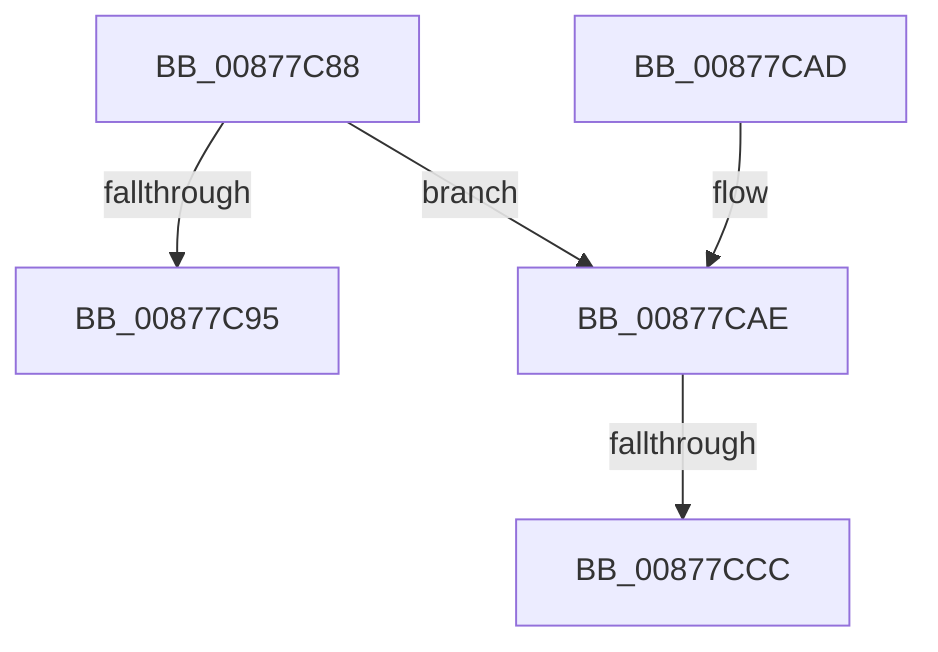

# CmReleaseLoadKeyContext

- RVA: `0x00877C88`–`0x00877CE0` (길이 `88` bytes)
- VA: `0x0000000140877C88`
- 실행 섹션: `PAGE`
- PDB 이름 있음: `예`; PDB Function 태그: `예`
- unwind 정보 RVA: `0x0006CB78`
- 디코드: `24`개 명령, `88/88` bytes 표시
- 미해석 바이트: `0` (있으면 어셈블리에 `.byte`로 보존)

> 이 문서는 커널 이미지의 기계어와 PDB 기호를 분석해 생성했습니다. 4번과 5번은 함수 원형과 자료형을 바이너리 사용 방식에서 추정한 C 해석이며 원본 소스 복구 결과는 아닙니다.

## 1. Dependencies

- 직접 호출 지점: **7**; 고유 호출 대상: **5**
- 직접 호출자로 확인된 함수: **1**
- RIP 상대 이미지 참조: **0**

### Outgoing calls
- `0x00877C95` → [CmpLockRegistry](../../pagecmrc/BC/CmpLockRegistry_function_00BC9B34.md) (function, `0x00BC9B34`)
- `0x00877C9D` → [CmpDereferenceKeyControlBlock](../85/CmpDereferenceKeyControlBlock_function_00851310.md) (function, `0x00851310`)
- `0x00877CA2` → [CmpUnlockRegistry](../../pagecmrc/BC/CmpUnlockRegistry_function_00BC9A84.md) (function, `0x00BC9A84`)
- `0x00877CAE` → [LOCK_HIVE_LOAD](../9B/LOCK_HIVE_LOAD_function_009B2300.md) (function, `0x009B2300`)
- `0x00877CB3` → [CmpLockRegistry](../../pagecmrc/BC/CmpLockRegistry_function_00BC9B34.md) (function, `0x00BC9B34`)
- `0x00877CCC` → [CmpDereferenceKeyControlBlock](../85/CmpDereferenceKeyControlBlock_function_00851310.md) (function, `0x00851310`)
- `0x00877CD5` → [CmpDoQueueLateUnloadWorker](../84/CmpDoQueueLateUnloadWorker_function_0084FB18.md) (function, `0x0084FB18`)

### Direct callers
- [CmLoadDifferencingKey](CmLoadDifferencingKey_function_00875670.md) at `0x008760B9`
- [CmLoadDifferencingKey](CmLoadDifferencingKey_function_00875670.md) at `0x008762E3`

### Static image references
- 디코드된 RIP-relative 메모리 참조가 없습니다.

## 2. Other-region calls and transfers

- 다른 실행 섹션으로 향하는 call: **3**
  - `0x00877C95` → [CmpLockRegistry](../../pagecmrc/BC/CmpLockRegistry_function_00BC9B34.md) (`PAGE` → `PAGECMRC`)
  - `0x00877CA2` → [CmpUnlockRegistry](../../pagecmrc/BC/CmpUnlockRegistry_function_00BC9A84.md) (`PAGE` → `PAGECMRC`)
  - `0x00877CB3` → [CmpLockRegistry](../../pagecmrc/BC/CmpLockRegistry_function_00BC9B34.md) (`PAGE` → `PAGECMRC`)
- call이 아닌 외부 분기/꼬리 이동: **2**
  - `0x00877CC6` → [sub_00B17CD8](../B1/Unknown_function_00B17CD8.md) (`tail-transfer`)
  - `0x00877CDB` → [sub_00B17CD8 + 0x5](../B1/Unknown_function_00B17CD8.md) (`tail-transfer`)

## 3. Assembly (complete function range)

```asm
00877C88  40 53                           push rbx
00877C8A  48 83 EC 20                     sub rsp, 0x20
00877C8E  48 8B D9                        mov rbx, rcx
00877C91  85 D2                           test edx, edx
00877C93  78 19                           js 0x140877cae
00877C95  E8 9A 1E 35 00                  call 0x140bc9b34
00877C9A  48 8B CB                        mov rcx, rbx
00877C9D  E8 6E 96 FD FF                  call 0x140851310
00877CA2  E8 DD 1D 35 00                  call 0x140bc9a84
00877CA7  48 83 C4 20                     add rsp, 0x20
00877CAB  5B                              pop rbx
00877CAC  C3                              ret
00877CAD  CC                              int3
00877CAE  E8 4D A6 13 00                  call 0x1409b2300
00877CB3  E8 7C 1E 35 00                  call 0x140bc9b34
00877CB8  48 8B 43 20                     mov rax, qword ptr [rbx + 0x20]
00877CBC  48 8B CB                        mov rcx, rbx
00877CBF  80 B8 80 0B 00 00 01            cmp byte ptr [rax + 0xb80], 1
00877CC6  0F 85 0C 00 2A 00               jne 0x140b17cd8
00877CCC  E8 3F 96 FD FF                  call 0x140851310
00877CD1  48 8B 4B 20                     mov rcx, qword ptr [rbx + 0x20]
00877CD5  E8 3E 7E FD FF                  call 0x14084fb18
00877CDA  90                              nop
00877CDB  E9 FD FF 29 00                  jmp 0x140b17cdd
```

## 4. C-style interpretation (structured pseudocode)

```c
__int64 __fastcall CmReleaseLoadKeyContext(__int64 a1, int a2)
{
    __int64 result;
    __int64 v_rsp;

    v_rsp = (v_rsp) - (32);
    if (sign_flag) goto loc_00877CAE;
    result = CmpLockRegistry(a1, a2, a3, a4);
    result = CmpDereferenceKeyControlBlock(a1, a2, a3, a4);
    result = CmpUnlockRegistry(a1, a2, a3, a4);
    v_rsp = (v_rsp) + (32);
    return result;
loc_00877CAE:
    result = LOCK_HIVE_LOAD(a1, a2, a3, a4);
    result = CmpLockRegistry(a1, a2, a3, a4);
    result = CmpDereferenceKeyControlBlock(a1, a2, a3, a4);
    result = CmpDoQueueLateUnloadWorker(*(unsigned __int64 *)(a1 + 32), a2, a3, a4);
}
```

## 5. (Beta) C Style

```c
int64_t CmReleaseLoadKeyContext(void *Arg1, int32_t Arg2)
{
    uint8_t *arg1 = (uint8_t *)Arg1;

    int64_t result;
    int64_t local_rsp;

    local_rsp = (local_rsp) - (32);
    if (sign_flag) goto loc_00877CAE;
    result = CmpLockRegistry(Arg1, Arg2, a3, a4);
    result = CmpDereferenceKeyControlBlock(Arg1, Arg2, a3, a4);
    result = CmpUnlockRegistry(Arg1, Arg2, a3, a4);
    local_rsp = (local_rsp) + (32);
    return result;
loc_00877CAE:
    result = LOCK_HIVE_LOAD(Arg1, Arg2, a3, a4);
    result = CmpLockRegistry(Arg1, Arg2, a3, a4);
    result = CmpDereferenceKeyControlBlock(Arg1, Arg2, a3, a4);
    result = CmpDoQueueLateUnloadWorker(*(uint64_t *)(arg1 + 0x20), Arg2, a3, a4);
}
```

### 관측된 메모리 오프셋

구조체 형식이 확인되지 않은 접근은 인자 기준의 오프셋으로만 기록했습니다.

| 기준 인자 | 오프셋 표현 | 폭 (bit) | 접근 |
|---|---:|---:|---|
| `Arg1` | `+ 0x20` | `64` | `R` |

## 6. Execution-region graph

[열기: 2D/3D 그래프와 함수 탐색 컨트롤 패널](../../../control-panel.html?section=page&rva=0x00877C88&view=graph)

- 2D 그래프는 위에서 아래로 흐르고, 3D 그래프는 빈 공간을 드래그해 회전합니다. Shift+드래그는 이동, 휠은 확대·축소, 함수 노드 선택은 대상 보고서 이동입니다.

### Static fallback


