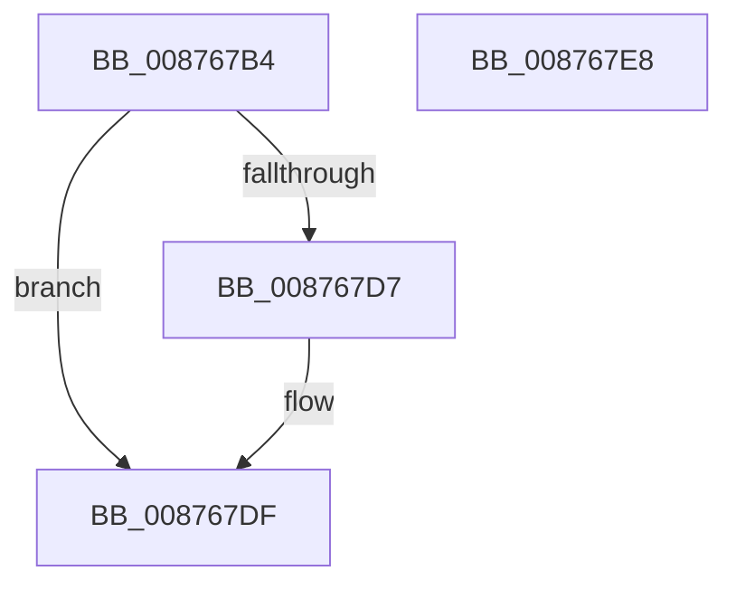

# CmpAllocateParseContext

- RVA: `0x008767B4`–`0x008767E9` (길이 `53` bytes)
- VA: `0x00000001408767B4`
- 실행 섹션: `PAGE`
- PDB 이름 있음: `예`; PDB Function 태그: `아니요`
- unwind 정보 RVA: `0x0005CF00`
- 디코드: `16`개 명령, `53/53` bytes 표시
- 미해석 바이트: `0` (있으면 어셈블리에 `.byte`로 보존)

> 이 문서는 커널 이미지의 기계어와 PDB 기호를 분석해 생성했습니다. 4번과 5번은 함수 원형과 자료형을 바이너리 사용 방식에서 추정한 C 해석이며 원본 소스 복구 결과는 아닙니다.

## 1. Dependencies

- 직접 호출 지점: **2**; 고유 호출 대상: **2**
- 직접 호출자로 확인된 함수: **3**
- RIP 상대 이미지 참조: **0**

### Outgoing calls
- `0x008767CA` → [CmpAllocatePool](../../text/3C/CmpAllocatePool_function_003CD504.md) (function, `0x003CD504`)
- `0x008767DA` → [CmpInitializeParseContext](CmpInitializeParseContext_function_008767F0.md) (function, `0x008767F0`)

### Direct callers
- [CmCreateKey](CmCreateKey_function_00875020.md) at `0x0087537B`
- [CmOpenKey](CmOpenKey_function_00876350.md) at `0x0087651A`
- [CmpParseKey](../89/CmpParseKey_function_0089DDC0.md) at `0x0089E43B`

### Static image references
- 디코드된 RIP-relative 메모리 참조가 없습니다.

## 2. Other-region calls and transfers

- 다른 실행 섹션으로 향하는 call: **1**
  - `0x008767CA` → [CmpAllocatePool](../../text/3C/CmpAllocatePool_function_003CD504.md) (`PAGE` → `.text`)
- 별도 외부 분기/꼬리 이동을 확인하지 못했습니다.

## 3. Assembly (complete function range)

```asm
008767B4  40 53                           push rbx
008767B6  48 83 EC 20                     sub rsp, 0x20
008767BA  BA D0 01 00 00                  mov edx, 0x1d0
008767BF  B9 40 00 00 00                  mov ecx, 0x40
008767C4  41 B8 43 4D 36 34               mov r8d, 0x34364d43
008767CA  E8 35 6D B5 FF                  call 0x1403cd504
008767CF  48 8B D8                        mov rbx, rax
008767D2  48 85 C0                        test rax, rax
008767D5  74 08                           je 0x1408767df
008767D7  48 8B C8                        mov rcx, rax
008767DA  E8 11 00 00 00                  call 0x1408767f0
008767DF  48 8B C3                        mov rax, rbx
008767E2  48 83 C4 20                     add rsp, 0x20
008767E6  5B                              pop rbx
008767E7  C3                              ret
008767E8  CC                              int3
```

## 4. C-style interpretation (structured pseudocode)

```c
__int64 __fastcall CmpAllocateParseContext(void)
{
    __int64 result;
    __int64 v_rsp;

    v_rsp = (v_rsp) - (32);
    result = CmpAllocatePool(64, 464, (unsigned int)(0x34364D43ULL), a4);
    if (result != 0) {
        a1 = result;
        result = CmpInitializeParseContext(a1, 464, (unsigned int)(0x34364D43ULL), a4);
    }
    v_rsp = (v_rsp) + (32);
    return result;
}
```

## 5. (Beta) C Style

```c
void CmpAllocateParseContext(void)
{
    int64_t result;
    int64_t local_rsp;

    local_rsp = (local_rsp) - (32);
    result = CmpAllocatePool(64, 464, (uint32_t)(0x34364D43ULL), a4);
    if (result != 0) {
        a1 = result;
        result = CmpInitializeParseContext(a1, 464, (uint32_t)(0x34364D43ULL), a4);
    }
    local_rsp = (local_rsp) + (32);
    return result;
}
```

## 6. Execution-region graph

[열기: 2D/3D 그래프와 함수 탐색 컨트롤 패널](../../../control-panel.html?section=page&rva=0x008767B4&view=graph)

- 2D 그래프는 위에서 아래로 흐르고, 3D 그래프는 빈 공간을 드래그해 회전합니다. Shift+드래그는 이동, 휠은 확대·축소, 함수 노드 선택은 대상 보고서 이동입니다.

### Static fallback


