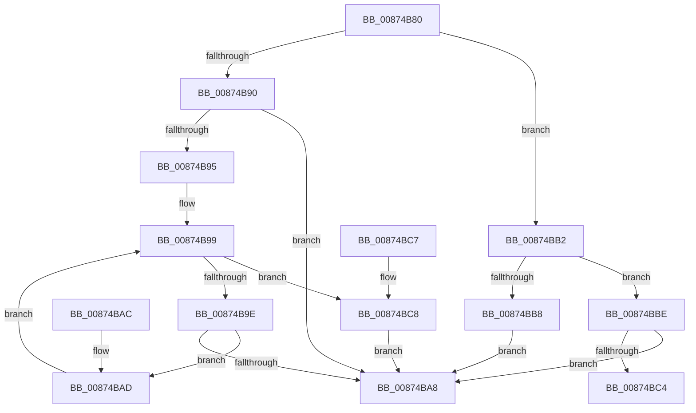

# CmpBindHiveToTrans

- RVA: `0x00874B80`–`0x00874BD3` (길이 `83` bytes)
- VA: `0x0000000140874B80`
- 실행 섹션: `PAGE`
- PDB 이름 있음: `예`; PDB Function 태그: `아니요`
- unwind 정보 RVA: `0x000DB714`
- 디코드: `30`개 명령, `83/83` bytes 표시
- 미해석 바이트: `0` (있으면 어셈블리에 `.byte`로 보존)

> 이 문서는 커널 이미지의 기계어와 PDB 기호를 분석해 생성했습니다. 4번과 5번은 함수 원형과 자료형을 바이너리 사용 방식에서 추정한 C 해석이며 원본 소스 복구 결과는 아닙니다.

## 1. Dependencies

- 직접 호출 지점: **0**; 고유 호출 대상: **0**
- 직접 호출자로 확인된 함수: **3**
- RIP 상대 이미지 참조: **0**

### Outgoing calls
- 직접 디코드된 call 명령이 없습니다.

### Direct callers
- [CmpTransSearchAddLightWeightTrans](CmpTransSearchAddLightWeightTrans_function_00873494.md) at `0x0087358A`
- [CmpTransSearchAddTrans](CmpTransSearchAddTrans_function_008743FC.md) at `0x00874495`
- [CmpTransAllocateTrans](../A9/CmpTransAllocateTrans_function_00A95DF8.md) at `0x00A95E86`

### Static image references
- 디코드된 RIP-relative 메모리 참조가 없습니다.

## 2. Other-region calls and transfers

- 다른 실행 섹션으로 향하는 call: **0**
- 별도 외부 분기/꼬리 이동을 확인하지 못했습니다.

## 3. Assembly (complete function range)

```asm
00874B80  8B 42 30                        mov eax, dword ptr [rdx + 0x30]
00874B83  45 33 C0                        xor r8d, r8d
00874B86  41 B9 01 00 00 00               mov r9d, 1
00874B8C  84 C0                           test al, al
00874B8E  78 22                           js 0x140874bb2
00874B90  48 85 C9                        test rcx, rcx
00874B93  74 13                           je 0x140874ba8
00874B95  44 8B 52 70                     mov r10d, dword ptr [rdx + 0x70]
00874B99  45 3B C2                        cmp r8d, r10d
00874B9C  73 2A                           jae 0x140874bc8
00874B9E  41 8B C0                        mov eax, r8d
00874BA1  48 3B 4C C2 78                  cmp rcx, qword ptr [rdx + rax*8 + 0x78]
00874BA6  75 05                           jne 0x140874bad
00874BA8  41 8B C1                        mov eax, r9d
00874BAB  C3                              ret
00874BAC  CC                              int3
00874BAD  45 03 C1                        add r8d, r9d
00874BB0  EB E7                           jmp 0x140874b99
00874BB2  44 39 42 70                     cmp dword ptr [rdx + 0x70], r8d
00874BB6  75 06                           jne 0x140874bbe
00874BB8  48 89 4A 78                     mov qword ptr [rdx + 0x78], rcx
00874BBC  EB EA                           jmp 0x140874ba8
00874BBE  48 39 4A 78                     cmp qword ptr [rdx + 0x78], rcx
00874BC2  74 E4                           je 0x140874ba8
00874BC4  33 C0                           xor eax, eax
00874BC6  C3                              ret
00874BC7  CC                              int3
00874BC8  4A 89 4C D2 78                  mov qword ptr [rdx + r10*8 + 0x78], rcx
00874BCD  44 01 4A 70                     add dword ptr [rdx + 0x70], r9d
00874BD1  EB D5                           jmp 0x140874ba8
```

## 4. C-style interpretation (structured pseudocode)

```c
__int64 __fastcall CmpBindHiveToTrans(__int64 a1, __int64 a2, int a3)
{
    __int64 result;

    a3 = 0;
    if (sign_flag) goto loc_00874BB2;
    if (a1 == 0) goto loc_00874BA8;
loc_00874B99:
    if (0 >= ((unsigned int)((unsigned int)(*(unsigned int *)(a2 + 112))))) goto loc_00874BC8;
    if (a1 != (*(unsigned __int64 *)(a2 + 0 * 8 + 120))) goto loc_00874BAD;
loc_00874BA8:
    return 1;
loc_00874BAD:
    a3 = (unsigned int)((a3) + (1));
    goto loc_00874B99;
loc_00874BB2:
    if ((*(unsigned int *)(a2 + 112)) != a3) goto loc_00874BBE;
    *(unsigned __int64 *)(a2 + 120) = a1;
    goto loc_00874BA8;
loc_00874BBE:
    if ((*(unsigned __int64 *)(a2 + 120)) == a1) goto loc_00874BA8;
    result = 0;
    return result;
loc_00874BC8:
    *(unsigned __int64 *)(a2 + (unsigned int)(*(unsigned int *)(a2 + 112)) * 8 + 120) = a1;
    goto loc_00874BA8;
}
```

## 5. (Beta) C Style

```c
int64_t CmpBindHiveToTrans(int64_t Arg1, void *Arg2, int32_t Arg3)
{
    uint8_t *arg2 = (uint8_t *)Arg2;

    int64_t result;

    Arg3 = 0;
    if (sign_flag) goto loc_00874BB2;
    if (Arg1 == 0) goto loc_00874BA8;
loc_00874B99:
    if (0 >= ((uint32_t)((uint32_t)(*(uint32_t *)(arg2 + 0x70))))) goto loc_00874BC8;
    if (Arg1 != (*(uint64_t *)(arg2 + 0x0 * 8 + 0x78))) goto loc_00874BAD;
loc_00874BA8:
    return 1;
loc_00874BAD:
    Arg3 = (uint32_t)((Arg3) + (1));
    goto loc_00874B99;
loc_00874BB2:
    if ((*(uint32_t *)(arg2 + 0x70)) != Arg3) goto loc_00874BBE;
    *(uint64_t *)(arg2 + 0x78) = Arg1;
    goto loc_00874BA8;
loc_00874BBE:
    if ((*(uint64_t *)(arg2 + 0x78)) == Arg1) goto loc_00874BA8;
    result = 0;
    return result;
loc_00874BC8:
    *(uint64_t *)(arg2 + (uint32_t)(*(uint32_t *)(arg2 + 0x70)) * 8 + 0x78) = Arg1;
    goto loc_00874BA8;
}
```

### 관측된 메모리 오프셋

구조체 형식이 확인되지 않은 접근은 인자 기준의 오프셋으로만 기록했습니다.

| 기준 인자 | 오프셋 표현 | 폭 (bit) | 접근 |
|---|---:|---:|---|
| `Arg2` | `+ 0x30` | `32` | `R` |
| `Arg2` | `+ 0x70` | `32` | `R` |
| `Arg2` | `+ 0x70` | `32` | `R/W` |
| `Arg2` | `+ 0x78` | `64` | `R` |
| `Arg2` | `+ 0x78` | `64` | `W` |
| `Arg2` | `+ 0x78 + r10*8` | `64` | `W` |
| `Arg2` | `+ 0x78 + rax*8` | `64` | `R` |

## 6. Execution-region graph

[열기: 2D/3D 그래프와 함수 탐색 컨트롤 패널](../../../control-panel.html?section=page&rva=0x00874B80&view=graph)

- 2D 그래프는 위에서 아래로 흐르고, 3D 그래프는 빈 공간을 드래그해 회전합니다. Shift+드래그는 이동, 휠은 확대·축소, 함수 노드 선택은 대상 보고서 이동입니다.

### Static fallback


