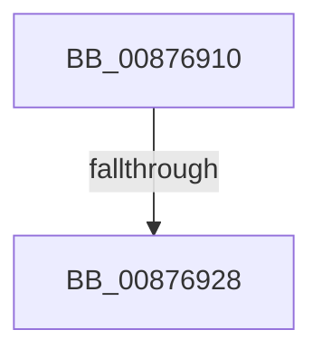

# CmpCleanupParseContext

- RVA: `0x00876910`–`0x0087692F` (길이 `31` bytes)
- VA: `0x0000000140876910`
- 실행 섹션: `PAGE`
- PDB 이름 있음: `예`; PDB Function 태그: `아니요`
- unwind 정보 RVA: `0x0006CA74`
- 디코드: `7`개 명령, `31/31` bytes 표시
- 미해석 바이트: `0` (있으면 어셈블리에 `.byte`로 보존)

> 이 문서는 커널 이미지의 기계어와 PDB 기호를 분석해 생성했습니다. 4번과 5번은 함수 원형과 자료형을 바이너리 사용 방식에서 추정한 C 해석이며 원본 소스 복구 결과는 아닙니다.

## 1. Dependencies

- 직접 호출 지점: **0**; 고유 호출 대상: **0**
- 직접 호출자로 확인된 함수: **16**
- RIP 상대 이미지 참조: **0**

### Outgoing calls
- 직접 디코드된 call 명령이 없습니다.

### Direct callers
- [CmpCreatePredefined](../7D/CmpCreatePredefined_function_007DA0CC.md) at `0x007DA1E2`
- [NtQueryOpenSubKeys](../7D/NtQueryOpenSubKeys_function_007DFF80.md) at `0x007E012D`
- [NtQueryOpenSubKeysEx](../7E/NtQueryOpenSubKeysEx_function_007E0190.md) at `0x007E0443`
- [CmpDoBuildVirtualStack](../7E/CmpDoBuildVirtualStack_function_007EB4C4.md) at `0x007EB942`
- [CmpDoReOpenTransKey](../7F/CmpDoReOpenTransKey_function_007F78E8.md) at `0x007F7A02`
- [CmpDoReOpenTransKey](../7F/CmpDoReOpenTransKey_function_007F78E8.md) at `0x007F7BA5`
- [CmKeyBodyReplicateToVirtual](../84/CmKeyBodyReplicateToVirtual_function_00843FE4.md) at `0x0084432F`
- [CmLoadDifferencingKey](CmLoadDifferencingKey_function_00875670.md) at `0x00875F2F`
- [CmpFreeParseContext](CmpFreeParseContext_function_008768E0.md) at `0x008768EB`
- [CmpLinkHiveToMaster](CmpLinkHiveToMaster_function_00877D6C.md) at `0x00878118`
- [CmpParseKey](../89/CmpParseKey_function_0089DDC0.md) at `0x0089E4EF`
- [CmUnloadKey](../9A/CmUnloadKey_function_009AF2FC.md) at `0x009AF7ED`
- [NtNotifyChangeMultipleKeys](../9D/NtNotifyChangeMultipleKeys_function_009DC6B0.md) at `0x009DC99A`
- [CmpStartSiloRegistryNamespace](../9E/CmpStartSiloRegistryNamespace_function_009E85D0.md) at `0x009E8669`
- [CmpResolveHiveLoadConflict](../A9/CmpResolveHiveLoadConflict_function_00A9E78C.md) at `0x00A9E860`
- [CmKeyBodyRemapToVirtual](../AC/CmKeyBodyRemapToVirtual_function_00AC9494.md) at `0x00AC9605`
- [CmInitSystem1](../../init/C5/CmInitSystem1_function_00C559CC.md) at `0x00C55F9D`
- [CmInitSystem1](../../init/C5/CmInitSystem1_function_00C559CC.md) at `0x00C55FC2`

### Static image references
- 디코드된 RIP-relative 메모리 참조가 없습니다.

## 2. Other-region calls and transfers

- 다른 실행 섹션으로 향하는 call: **0**
- call이 아닌 외부 분기/꼬리 이동: **1**
  - `0x00876922` → [sub_008769B9](Unknown_function_008769B9.md) (`tail-transfer`)

## 3. Assembly (complete function range)

```asm
00876910  48 89 5C 24 10                  mov qword ptr [rsp + 0x10], rbx
00876915  57                              push rdi
00876916  48 83 EC 20                     sub rsp, 0x20
0087691A  48 83 79 58 00                  cmp qword ptr [rcx + 0x58], 0
0087691F  48 8B D9                        mov rbx, rcx
00876922  0F 85 91 00 00 00               jne 0x1408769b9
00876928  48 81 C3 90 00 00 00            add rbx, 0x90
```

## 4. C-style interpretation (structured pseudocode)

```c
void __fastcall CmpCleanupParseContext(__int64 a1)
{
    __int64 v_rbx;
    __int64 v_rsp;
    unsigned __int64 v_stack_p10;

    v_stack_p10 = v_rbx;
    v_rsp = (v_rsp) - (32);
    v_rbx = (a1) + (144);
    return;
}
```

## 5. (Beta) C Style

```c
void CmpCleanupParseContext(void *Arg1)
{
    uint8_t *arg1 = (uint8_t *)Arg1;

    int64_t local_rbx;
    int64_t local_rsp;
    uint64_t v_stack_p10;

    v_stack_p10 = local_rbx;
    local_rsp = (local_rsp) - (32);
    local_rbx = (Arg1) + (144);
    return;
}
```

### 관측된 메모리 오프셋

구조체 형식이 확인되지 않은 접근은 인자 기준의 오프셋으로만 기록했습니다.

| 기준 인자 | 오프셋 표현 | 폭 (bit) | 접근 |
|---|---:|---:|---|
| `Arg1` | `+ 0x58` | `64` | `R` |

## 6. Execution-region graph

[열기: 2D/3D 그래프와 함수 탐색 컨트롤 패널](../../../control-panel.html?section=page&rva=0x00876910&view=graph)

- 2D 그래프는 위에서 아래로 흐르고, 3D 그래프는 빈 공간을 드래그해 회전합니다. Shift+드래그는 이동, 휠은 확대·축소, 함수 노드 선택은 대상 보고서 이동입니다.

### Static fallback


