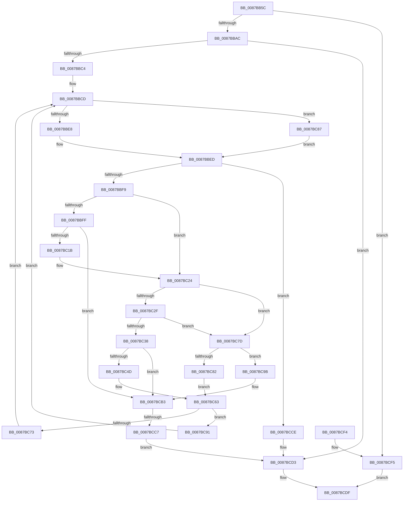

# CmpClearKeyAccessBits

- RVA: `0x0087BB5C`–`0x0087BCFC` (길이 `416` bytes)
- VA: `0x000000014087BB5C`
- 실행 섹션: `PAGE`
- PDB 이름 있음: `예`; PDB Function 태그: `예`
- unwind 정보 RVA: `0x0006CEEC`
- 디코드: `119`개 명령, `416/416` bytes 표시
- 미해석 바이트: `0` (있으면 어셈블리에 `.byte`로 보존)

> 이 문서는 커널 이미지의 기계어와 PDB 기호를 분석해 생성했습니다. 4번과 5번은 함수 원형과 자료형을 바이너리 사용 방식에서 추정한 C 해석이며 원본 소스 복구 결과는 아닙니다.

## 1. Dependencies

- 직접 호출 지점: **10**; 고유 호출 대상: **9**
- 직접 호출자로 확인된 함수: **1**
- RIP 상대 이미지 참조: **0**

### Outgoing calls
- `0x0087BB9B` → [ExAllocatePool2](../../poolcode/B8/ExAllocatePool2_function_00B820F0.md) (function, `0x00B820F0`)
- `0x0087BBE8` → [HvpGetCellFlat](../85/HvpGetCellFlat_function_00854C60.md) (function, `0x00854C60`)
- `0x0087BC0C` → [HvpMarkCellDirty](../85/HvpMarkCellDirty_function_00858080.md) (function, `0x00858080`)
- `0x0087BC42` → [CmpFindSubKeyByNumber](../85/CmpFindSubKeyByNumber_function_0085C930.md) (function, `0x0085C930`)
- `0x0087BC73` → [HvpReleaseCellPaged](../85/HvpReleaseCellPaged_function_00855F40.md) (function, `0x00855F40`)
- `0x0087BC87` → [HvpGetCellPaged](../85/HvpGetCellPaged_function_00854CB0.md) (function, `0x00854CB0`)
- `0x0087BC91` → [HvpReleaseCellFlat](../85/HvpReleaseCellFlat_function_0085CC20.md) (function, `0x0085CC20`)
- `0x0087BCAE` → [CmpLogClearAccessBitsEvent](CmpLogClearAccessBitsEvent_function_0087C64C.md) (function, `0x0087C64C`)
- `0x0087BCC7` → [HvpReleaseCellFlat](../85/HvpReleaseCellFlat_function_0085CC20.md) (function, `0x0085CC20`)
- `0x0087BCD8` → [ExFreePoolWithTag](../../poolcode/B8/ExFreePoolWithTag_function_00B82870.md) (function, `0x00B82870`)

### Direct callers
- [CmpReorganizeHive](CmpReorganizeHive_function_0087B92C.md) at `0x0087BAC8`

### Static image references
- 디코드된 RIP-relative 메모리 참조가 없습니다.

## 2. Other-region calls and transfers

- 다른 실행 섹션으로 향하는 call: **2**
  - `0x0087BB9B` → [ExAllocatePool2](../../poolcode/B8/ExAllocatePool2_function_00B820F0.md) (`PAGE` → `POOLCODE`)
  - `0x0087BCD8` → [ExFreePoolWithTag](../../poolcode/B8/ExFreePoolWithTag_function_00B82870.md) (`PAGE` → `POOLCODE`)
- call이 아닌 외부 분기/꼬리 이동: **1**
  - `0x0087BCC1` → [sub_00B18A04](../B1/Unknown_function_00B18A04.md) (`tail-transfer`)

## 3. Assembly (complete function range)

```asm
0087BB5C  48 89 5C 24 08                  mov qword ptr [rsp + 8], rbx
0087BB61  48 89 54 24 10                  mov qword ptr [rsp + 0x10], rdx
0087BB66  55                              push rbp
0087BB67  56                              push rsi
0087BB68  57                              push rdi
0087BB69  41 54                           push r12
0087BB6B  41 55                           push r13
0087BB6D  41 56                           push r14
0087BB6F  41 57                           push r15
0087BB71  48 8B EC                        mov rbp, rsp
0087BB74  48 83 EC 30                     sub rsp, 0x30
0087BB78  48 8B D9                        mov rbx, rcx
0087BB7B  33 FF                           xor edi, edi
0087BB7D  41 83 CF FF                     or r15d, 0xffffffff
0087BB81  89 7D 50                        mov dword ptr [rbp + 0x50], edi
0087BB84  B9 00 01 00 00                  mov ecx, 0x100
0087BB89  44 89 7D F0                     mov dword ptr [rbp - 0x10], r15d
0087BB8D  BA 00 10 00 00                  mov edx, 0x1000
0087BB92  89 7D F4                        mov dword ptr [rbp - 0xc], edi
0087BB95  41 B8 43 6D 7A 31               mov r8d, 0x317a6d43
0087BB9B  E8 50 65 30 00                  call 0x140b820f0
0087BBA0  48 8B F0                        mov rsi, rax
0087BBA3  48 85 C0                        test rax, rax
0087BBA6  0F 84 49 01 00 00               je 0x14087bcf5
0087BBAC  48 8B 43 40                     mov rax, qword ptr [rbx + 0x40]
0087BBB0  44 8B F7                        mov r14d, edi
0087BBB3  8B 48 24                        mov ecx, dword ptr [rax + 0x24]
0087BBB6  89 0E                           mov dword ptr [rsi], ecx
0087BBB8  89 7E 04                        mov dword ptr [rsi + 4], edi
0087BBBB  41 3B CF                        cmp ecx, r15d
0087BBBE  0F 84 0F 01 00 00               je 0x14087bcd3
0087BBC4  8B 43 68                        mov eax, dword ptr [rbx + 0x68]
0087BBC7  44 8B EF                        mov r13d, edi
0087BBCA  89 45 58                        mov dword ptr [rbp + 0x58], eax
0087BBCD  F6 83 8C 00 00 00 01            test byte ptr [rbx + 0x8c], 1
0087BBD4  4C 8D 45 F0                     lea r8, [rbp - 0x10]
0087BBD8  45 8B E6                        mov r12d, r14d
0087BBDB  48 8B CB                        mov rcx, rbx
0087BBDE  42 8B 14 E6                     mov edx, dword ptr [rsi + r12*8]
0087BBE2  0F 84 9F 00 00 00               je 0x14087bc87
0087BBE8  E8 73 90 FD FF                  call 0x140854c60
0087BBED  4C 8B F8                        mov r15, rax
0087BBF0  48 85 C0                        test rax, rax
0087BBF3  0F 84 D5 00 00 00               je 0x14087bcce
0087BBF9  40 38 78 0C                     cmp byte ptr [rax + 0xc], dil
0087BBFD  74 25                           je 0x14087bc24
0087BBFF  42 8B 14 E6                     mov edx, dword ptr [rsi + r12*8]
0087BC03  45 33 C9                        xor r9d, r9d
0087BC06  45 33 C0                        xor r8d, r8d
0087BC09  48 8B CB                        mov rcx, rbx
0087BC0C  E8 6F C4 FD FF                  call 0x140858080
0087BC11  8B F8                           mov edi, eax
0087BC13  85 C0                           test eax, eax
0087BC15  0F 88 98 00 00 00               js 0x14087bcb3
0087BC1B  33 FF                           xor edi, edi
0087BC1D  41 88 7F 0C                     mov byte ptr [r15 + 0xc], dil
0087BC21  41 FF C5                        inc r13d
0087BC24  46 8B 44 E6 04                  mov r8d, dword ptr [rsi + r12*8 + 4]
0087BC29  45 3B 47 14                     cmp r8d, dword ptr [r15 + 0x14]
0087BC2D  73 4E                           jae 0x14087bc7d
0087BC2F  41 81 FE FF 01 00 00            cmp r14d, 0x1ff
0087BC36  74 45                           je 0x14087bc7d
0087BC38  4C 8D 4D 50                     lea r9, [rbp + 0x50]
0087BC3C  49 8B D7                        mov rdx, r15
0087BC3F  48 8B CB                        mov rcx, rbx
0087BC42  E8 E9 0C FE FF                  call 0x14085c930
0087BC47  8B F8                           mov edi, eax
0087BC49  85 C0                           test eax, eax
0087BC4B  78 66                           js 0x14087bcb3
0087BC4D  42 FF 44 E6 04                  inc dword ptr [rsi + r12*8 + 4]
0087BC52  41 FF C6                        inc r14d
0087BC55  8B 45 50                        mov eax, dword ptr [rbp + 0x50]
0087BC58  33 FF                           xor edi, edi
0087BC5A  42 89 04 F6                     mov dword ptr [rsi + r14*8], eax
0087BC5E  42 89 7C F6 04                  mov dword ptr [rsi + r14*8 + 4], edi
0087BC63  F6 83 8C 00 00 00 01            test byte ptr [rbx + 0x8c], 1
0087BC6A  48 8D 55 F0                     lea rdx, [rbp - 0x10]
0087BC6E  48 8B CB                        mov rcx, rbx
0087BC71  75 1E                           jne 0x14087bc91
0087BC73  E8 C8 A2 FD FF                  call 0x140855f40
0087BC78  E9 50 FF FF FF                  jmp 0x14087bbcd
0087BC7D  45 85 F6                        test r14d, r14d
0087BC80  74 19                           je 0x14087bc9b
0087BC82  41 FF CE                        dec r14d
0087BC85  EB DC                           jmp 0x14087bc63
0087BC87  E8 24 90 FD FF                  call 0x140854cb0
0087BC8C  E9 5C FF FF FF                  jmp 0x14087bbed
0087BC91  E8 8A 0F FE FF                  call 0x14085cc20
0087BC96  E9 32 FF FF FF                  jmp 0x14087bbcd
0087BC9B  44 8B 43 68                     mov r8d, dword ptr [rbx + 0x68]
0087BC9F  41 8B D5                        mov edx, r13d
0087BCA2  44 2B 45 58                     sub r8d, dword ptr [rbp + 0x58]
0087BCA6  48 8B 4D 48                     mov rcx, qword ptr [rbp + 0x48]
0087BCAA  41 C1 E8 03                     shr r8d, 3
0087BCAE  E8 99 09 00 00                  call 0x14087c64c
0087BCB3  F6 83 8C 00 00 00 01            test byte ptr [rbx + 0x8c], 1
0087BCBA  48 8D 55 F0                     lea rdx, [rbp - 0x10]
0087BCBE  48 8B CB                        mov rcx, rbx
0087BCC1  0F 84 3D CD 29 00               je 0x140b18a04
0087BCC7  E8 54 0F FE FF                  call 0x14085cc20
0087BCCC  EB 05                           jmp 0x14087bcd3
0087BCCE  BF 9A 00 00 C0                  mov edi, 0xc000009a
0087BCD3  33 D2                           xor edx, edx
0087BCD5  48 8B CE                        mov rcx, rsi
0087BCD8  E8 93 6B 30 00                  call 0x140b82870
0087BCDD  8B C7                           mov eax, edi
0087BCDF  48 8B 5C 24 70                  mov rbx, qword ptr [rsp + 0x70]
0087BCE4  48 83 C4 30                     add rsp, 0x30
0087BCE8  41 5F                           pop r15
0087BCEA  41 5E                           pop r14
0087BCEC  41 5D                           pop r13
0087BCEE  41 5C                           pop r12
0087BCF0  5F                              pop rdi
0087BCF1  5E                              pop rsi
0087BCF2  5D                              pop rbp
0087BCF3  C3                              ret
0087BCF4  CC                              int3
0087BCF5  B8 9A 00 00 C0                  mov eax, 0xc000009a
0087BCFA  EB E3                           jmp 0x14087bcdf
```

## 4. C-style interpretation (structured pseudocode)

```c
__int64 __fastcall CmpClearKeyAccessBits(__int64 a1, __int64 a2, __int64 a3, int a4)
{
    __int64 result;
    __int64 v_r13;
    __int64 v_r14;
    __int64 v_r15;
    __int64 v_rdi;
    __int64 v_rsp;
    unsigned int v_stack_m44;
    unsigned int v_stack_m48;
    unsigned __int64 v_stack_p10;
    unsigned int v_stack_p18;
    unsigned int v_stack_p20;
    unsigned __int64 v_stack_p8;

    v_stack_p8 = v_rbx;
    v_stack_p10 = a2;
    v_rsp = (v_rsp) - (48);
    v_rdi = 0;
    v_r15 = (unsigned int)((v_r15) | (0xFFFFFFFFULL));
    v_stack_p18 = 0;
    v_stack_m48 = (unsigned int)(v_r15);
    v_stack_m44 = 0;
    result = ExAllocatePool2(256, (unsigned int)(0x1000ULL), (unsigned int)(0x317A6D43ULL), a4);
    if (result == 0) goto loc_0087BCF5;
    *(unsigned int *)(result) = (unsigned int)((unsigned int)(*(unsigned int *)(*(unsigned __int64 *)(a1 + 64) + 36)));
    *(unsigned int *)(result + 4) = 0;
    if (((unsigned int)((unsigned int)(*(unsigned int *)(*(unsigned __int64 *)(a1 + 64) + 36)))) == ((unsigned int)(v_r15))) goto loc_0087BCD3;
    v_stack_p20 = (unsigned int)((unsigned int)(*(unsigned int *)(a1 + 104)));
loc_0087BBCD:
    if (((*(unsigned __int8 *)(a1 + 140)) & (1)) == 0) goto loc_0087BC87;
    result = HvpGetCellFlat(a1, (unsigned int)(*(unsigned int *)(result + 0 * 8)), v_stack_m48, a4);
loc_0087BBED:
    if (result == 0) goto loc_0087BCCE;
    if ((*(unsigned __int8 *)(result + 12)) == 0) goto loc_0087BC24;
    a4 = 0;
    a3 = 0;
    result = HvpMarkCellDirty(a1, (unsigned int)(*(unsigned int *)(result + 0 * 8)), a3, a4);
    if (sign_flag) goto loc_0087BCB3;
    v_rdi = 0;
    *(unsigned __int8 *)(result + 12) = 0;
    v_r13 = (unsigned int)((0) + 1);
loc_0087BC24:
    if (((unsigned int)((unsigned int)(*(unsigned int *)(result + 0 * 8 + 4)))) >= (*(unsigned int *)(result + 20))) goto loc_0087BC7D;
    if (0 == 511) goto loc_0087BC7D;
    result = CmpFindSubKeyByNumber(a1, result, (unsigned int)(*(unsigned int *)(result + 0 * 8 + 4)), v_stack_p18);
    if (sign_flag) goto loc_0087BCB3;
    v_r14 = (unsigned int)((0) + 1);
    v_rdi = 0;
    *(unsigned int *)(result + v_r14 * 8) = (unsigned int)((unsigned int)(v_stack_p18));
    *(unsigned int *)(result + v_r14 * 8 + 4) = 0;
loc_0087BC63:
    if (((*(unsigned __int8 *)(a1 + 140)) & (1)) != 0) goto loc_0087BC91;
    result = HvpReleaseCellPaged(a1, v_stack_m48, (unsigned int)(*(unsigned int *)(result + 0 * 8 + 4)), v_stack_p18);
    goto loc_0087BBCD;
loc_0087BC7D:
    if ((unsigned int)(v_r14) == 0) goto loc_0087BC9B;
    v_r14 = (unsigned int)((v_r14) - 1);
    goto loc_0087BC63;
loc_0087BC87:
    result = HvpGetCellPaged(a1, v_stack_m48, (unsigned int)(*(unsigned int *)(result + 0 * 8 + 4)), v_stack_p18);
    goto loc_0087BBED;
loc_0087BC91:
    result = HvpReleaseCellFlat(a1, v_stack_m48, (unsigned int)(*(unsigned int *)(result + 0 * 8 + 4)), v_stack_p18);
    goto loc_0087BBCD;
loc_0087BC9B:
    a3 = (unsigned int)(((unsigned int)(*(unsigned int *)(a1 + 104))) - (v_stack_p20));
    a3 = (unsigned int)((a3) >> (3));
    result = CmpLogClearAccessBitsEvent(v_stack_p10, (unsigned int)((unsigned int)(v_r13)), a3, v_stack_p18);
loc_0087BCB3:
    result = HvpReleaseCellFlat(a1, v_stack_m48, a3, v_stack_p18);
    goto loc_0087BCD3;
loc_0087BCCE:
loc_0087BCD3:
    a2 = 0;
    result = ExFreePoolWithTag(result, a2, a3, v_stack_p18);
loc_0087BCDF:
    v_rsp = (v_rsp) + (48);
    return (unsigned int)((unsigned int)((unsigned int)(0xC000009AULL)));
loc_0087BCF5:
    goto loc_0087BCDF;
}
```

## 5. (Beta) C Style

```c
int64_t CmpClearKeyAccessBits(void *Arg1, int64_t Arg2, int64_t Arg3, int32_t Arg4)
{
    uint8_t *arg1 = (uint8_t *)Arg1;

    int64_t result;
    int64_t local_r13;
    int64_t local_r14;
    int64_t local_r15;
    int64_t local_rdi;
    int64_t local_rsp;
    uint32_t v_stack_m44;
    uint32_t v_stack_m48;
    uint64_t v_stack_p10;
    uint32_t v_stack_p18;
    uint32_t v_stack_p20;
    uint64_t v_stack_p8;

    v_stack_p8 = local_rbx;
    v_stack_p10 = Arg2;
    local_rsp = (local_rsp) - (48);
    local_rdi = 0;
    local_r15 = (uint32_t)((local_r15) | (0xFFFFFFFFULL));
    v_stack_p18 = 0;
    v_stack_m48 = (uint32_t)(local_r15);
    v_stack_m44 = 0;
    result = ExAllocatePool2(256, (uint32_t)(0x1000ULL), (uint32_t)(0x317A6D43ULL), Arg4);
    if (result == 0) goto loc_0087BCF5;
    *(uint32_t *)(result) = (uint32_t)((uint32_t)(*(uint32_t *)(*(uint64_t *)(arg1 + 0x40) + 0x24)));
    *(uint32_t *)(result + 0x4) = 0;
    if (((uint32_t)((uint32_t)(*(uint32_t *)(*(uint64_t *)(arg1 + 0x40) + 0x24)))) == ((uint32_t)(local_r15))) goto loc_0087BCD3;
    v_stack_p20 = (uint32_t)((uint32_t)(*(uint32_t *)(arg1 + 0x68)));
loc_0087BBCD:
    if (((*(uint8_t *)(arg1 + 0x8C)) & (1)) == 0) goto loc_0087BC87;
    result = HvpGetCellFlat(Arg1, (uint32_t)(*(uint32_t *)(result + 0x0 * 8)), v_stack_m48, Arg4);
loc_0087BBED:
    if (result == 0) goto loc_0087BCCE;
    if ((*(uint8_t *)(result + 0xC)) == 0) goto loc_0087BC24;
    Arg4 = 0;
    Arg3 = 0;
    result = HvpMarkCellDirty(Arg1, (uint32_t)(*(uint32_t *)(result + 0x0 * 8)), Arg3, Arg4);
    if (sign_flag) goto loc_0087BCB3;
    local_rdi = 0;
    *(uint8_t *)(result + 0xC) = 0;
    local_r13 = (uint32_t)((0) + 1);
loc_0087BC24:
    if (((uint32_t)((uint32_t)(*(uint32_t *)(result + 0x0 * 8 + 0x4)))) >= (*(uint32_t *)(result + 0x14))) goto loc_0087BC7D;
    if (0 == 511) goto loc_0087BC7D;
    result = CmpFindSubKeyByNumber(Arg1, result, (uint32_t)(*(uint32_t *)(result + 0x0 * 8 + 0x4)), v_stack_p18);
    if (sign_flag) goto loc_0087BCB3;
    local_r14 = (uint32_t)((0) + 1);
    local_rdi = 0;
    *(uint32_t *)(result + local_r14 * 8) = (uint32_t)((uint32_t)(v_stack_p18));
    *(uint32_t *)(result + local_r14 * 8 + 0x4) = 0;
loc_0087BC63:
    if (((*(uint8_t *)(arg1 + 0x8C)) & (1)) != 0) goto loc_0087BC91;
    result = HvpReleaseCellPaged(Arg1, v_stack_m48, (uint32_t)(*(uint32_t *)(result + 0x0 * 8 + 0x4)), v_stack_p18);
    goto loc_0087BBCD;
loc_0087BC7D:
    if ((uint32_t)(local_r14) == 0) goto loc_0087BC9B;
    local_r14 = (uint32_t)((local_r14) - 1);
    goto loc_0087BC63;
loc_0087BC87:
    result = HvpGetCellPaged(Arg1, v_stack_m48, (uint32_t)(*(uint32_t *)(result + 0x0 * 8 + 0x4)), v_stack_p18);
    goto loc_0087BBED;
loc_0087BC91:
    result = HvpReleaseCellFlat(Arg1, v_stack_m48, (uint32_t)(*(uint32_t *)(result + 0x0 * 8 + 0x4)), v_stack_p18);
    goto loc_0087BBCD;
loc_0087BC9B:
    Arg3 = (uint32_t)(((uint32_t)(*(uint32_t *)(arg1 + 0x68))) - (v_stack_p20));
    Arg3 = (uint32_t)((Arg3) >> (3));
    result = CmpLogClearAccessBitsEvent(v_stack_p10, (uint32_t)((uint32_t)(local_r13)), Arg3, v_stack_p18);
loc_0087BCB3:
    result = HvpReleaseCellFlat(Arg1, v_stack_m48, Arg3, v_stack_p18);
    goto loc_0087BCD3;
loc_0087BCCE:
loc_0087BCD3:
    Arg2 = 0;
    result = ExFreePoolWithTag(result, Arg2, Arg3, v_stack_p18);
loc_0087BCDF:
    local_rsp = (local_rsp) + (48);
    return (uint32_t)((uint32_t)((uint32_t)(0xC000009AULL)));
loc_0087BCF5:
    goto loc_0087BCDF;
}
```

### 관측된 메모리 오프셋

구조체 형식이 확인되지 않은 접근은 인자 기준의 오프셋으로만 기록했습니다.

| 기준 인자 | 오프셋 표현 | 폭 (bit) | 접근 |
|---|---:|---:|---|
| `Arg1` | `+ 0x40` | `64` | `R` |
| `Arg1` | `+ 0x68` | `32` | `R` |
| `Arg1` | `+ 0x8C` | `8` | `R` |

## 6. Execution-region graph

[열기: 2D/3D 그래프와 함수 탐색 컨트롤 패널](../../../control-panel.html?section=page&rva=0x0087BB5C&view=graph)

- 2D 그래프는 위에서 아래로 흐르고, 3D 그래프는 빈 공간을 드래그해 회전합니다. Shift+드래그는 이동, 휠은 확대·축소, 함수 노드 선택은 대상 보고서 이동입니다.

### Static fallback


