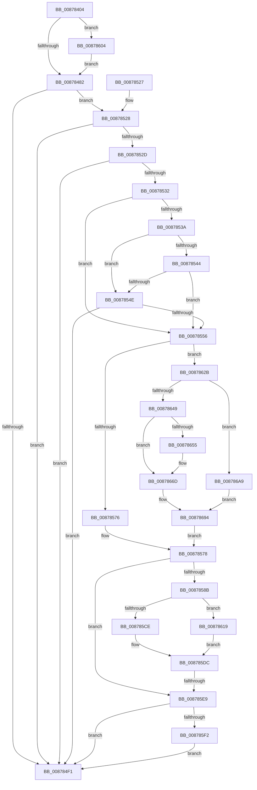

# CmpCmdHiveOpen

- RVA: `0x00878404`–`0x008786AD` (길이 `681` bytes)
- VA: `0x0000000140878404`
- 실행 섹션: `PAGE`
- PDB 이름 있음: `예`; PDB Function 태그: `예`
- unwind 정보 RVA: `0x0006CC4C`
- 디코드: `175`개 명령, `681/681` bytes 표시
- 미해석 바이트: `0` (있으면 어셈블리에 `.byte`로 보존)

> 이 문서는 커널 이미지의 기계어와 PDB 기호를 분석해 생성했습니다. 4번과 5번은 함수 원형과 자료형을 바이너리 사용 방식에서 추정한 C 해석이며 원본 소스 복구 결과는 아닙니다.

## 1. Dependencies

- 직접 호출 지점: **11**; 고유 호출 대상: **9**
- 직접 호출자로 확인된 함수: **4**
- RIP 상대 이미지 참조: **1**

### Outgoing calls
- `0x00878467` → [IoSetThreadHardErrorMode](../../text/46/IoSetThreadHardErrorMode_function_00466BF0.md) (function, `0x00466BF0`)
- `0x008784E5` → [CmpInitHiveFromFile](CmpInitHiveFromFile_function_008794D4.md) (function, `0x008794D4`)
- `0x008784F5` → [IoSetThreadHardErrorMode](../../text/46/IoSetThreadHardErrorMode_function_00466BF0.md) (function, `0x00466BF0`)
- `0x00878507` → [_security_check_cookie](../../text/6A/_security_check_cookie_function_006AC640.md) (function, `0x006AC640`)
- `0x00878580` → [RtlImpersonateSelfEx](RtlImpersonateSelfEx_function_008793A0.md) (function, `0x008793A0`)
- `0x008785B9` → [CmpInitHiveFromFile](CmpInitHiveFromFile_function_008794D4.md) (function, `0x008794D4`)
- `0x008785DC` → [PsImpersonateClient](../8C/PsImpersonateClient_function_008CBE10.md) (function, `0x008CBE10`)
- `0x008785FA` → [ObfDereferenceObjectWithTag](../../text/2F/ObfDereferenceObjectWithTag_function_002F78E0.md) (function, `0x002F78E0`)
- `0x0087863A` → [PspLockThreadSecurityShared](../../text/3C/PspLockThreadSecurityShared_function_003C4720.md) (function, `0x003C4720`)
- `0x00878675` → [ObfReferenceObjectWithTag](../../text/21/ObfReferenceObjectWithTag_function_00210710.md) (function, `0x00210710`)
- `0x0087869A` → [PspUnlockThreadSecurityShared](../../text/3C/PspUnlockThreadSecurityShared_function_003C2E40.md) (function, `0x003C2E40`)

### Direct callers
- [CmReplaceKey](../7E/CmReplaceKey_function_007EA1C8.md) at `0x007EA27B`
- [CmpFlushBackupHive](../7E/CmpFlushBackupHive_function_007EC1A8.md) at `0x007EC414`
- [CmLoadAppKey](CmLoadAppKey_function_00876FFC.md) at `0x0087770D`
- [CmLoadKey](CmLoadKey_function_008787CC.md) at `0x0087899F`

### Static image references
- `0x0087841B` → RVA `0x00E0A740` (`.data`; read)

## 2. Other-region calls and transfers

- 다른 실행 섹션으로 향하는 call: **7**
  - `0x00878467` → [IoSetThreadHardErrorMode](../../text/46/IoSetThreadHardErrorMode_function_00466BF0.md) (`PAGE` → `.text`)
  - `0x008784F5` → [IoSetThreadHardErrorMode](../../text/46/IoSetThreadHardErrorMode_function_00466BF0.md) (`PAGE` → `.text`)
  - `0x00878507` → [_security_check_cookie](../../text/6A/_security_check_cookie_function_006AC640.md) (`PAGE` → `.text`)
  - `0x008785FA` → [ObfDereferenceObjectWithTag](../../text/2F/ObfDereferenceObjectWithTag_function_002F78E0.md) (`PAGE` → `.text`)
  - `0x0087863A` → [PspLockThreadSecurityShared](../../text/3C/PspLockThreadSecurityShared_function_003C4720.md) (`PAGE` → `.text`)
  - `0x00878675` → [ObfReferenceObjectWithTag](../../text/21/ObfReferenceObjectWithTag_function_00210710.md) (`PAGE` → `.text`)
  - `0x0087869A` → [PspUnlockThreadSecurityShared](../../text/3C/PspUnlockThreadSecurityShared_function_003C2E40.md) (`PAGE` → `.text`)
- call이 아닌 외부 분기/꼬리 이동: **1**
  - `0x008785E3` → [sub_00B17D20](../B1/Unknown_function_00B17D20.md) (`tail-transfer`)

## 3. Assembly (complete function range)

```asm
00878404  48 89 5C 24 10                  mov qword ptr [rsp + 0x10], rbx
00878409  55                              push rbp
0087840A  56                              push rsi
0087840B  57                              push rdi
0087840C  41 54                           push r12
0087840E  41 55                           push r13
00878410  41 56                           push r14
00878412  41 57                           push r15
00878414  48 81 EC B0 00 00 00            sub rsp, 0xb0
0087841B  48 8B 05 1E 23 59 00            mov rax, qword ptr [rip + 0x59231e]
00878422  48 33 C4                        xor rax, rsp
00878425  48 89 84 24 A8 00 00 00         mov qword ptr [rsp + 0xa8], rax
0087842D  48 8B 84 24 30 01 00 00         mov rax, qword ptr [rsp + 0x130]
00878435  4C 8B E9                        mov r13, rcx
00878438  4C 8B B4 24 28 01 00 00         mov r14, qword ptr [rsp + 0x128]
00878440  33 C9                           xor ecx, ecx
00878442  48 8B AC 24 20 01 00 00         mov rbp, qword ptr [rsp + 0x120]
0087844A  49 8B F9                        mov rdi, r9
0087844D  4C 89 74 24 70                  mov qword ptr [rsp + 0x70], r14
00878452  4D 8B F8                        mov r15, r8
00878455  48 89 44 24 60                  mov qword ptr [rsp + 0x60], rax
0087845A  40 8A F2                        mov sil, dl
0087845D  4C 89 4C 24 58                  mov qword ptr [rsp + 0x58], r9
00878462  4C 89 44 24 68                  mov qword ptr [rsp + 0x68], r8
00878467  E8 84 E7 BE FF                  call 0x140466bf0
0087846C  8B 9C 24 18 01 00 00            mov ebx, dword ptr [rsp + 0x118]
00878473  33 C9                           xor ecx, ecx
00878475  88 44 24 50                     mov byte ptr [rsp + 0x50], al
00878479  F6 C3 01                        test bl, 1
0087847C  0F 85 82 01 00 00               jne 0x140878604
00878482  44 8B A4 24 10 01 00 00         mov r12d, dword ptr [rsp + 0x110]
0087848A  8B D1                           mov edx, ecx
0087848C  48 8B 44 24 60                  mov rax, qword ptr [rsp + 0x60]
00878491  0F BA EA 13                     bts edx, 0x13
00878495  F6 C3 04                        test bl, 4
00878498  48 89 44 24 48                  mov qword ptr [rsp + 0x48], rax
0087849D  4C 89 74 24 40                  mov qword ptr [rsp + 0x40], r14
008784A2  4D 8B CF                        mov r9, r15
008784A5  0F 44 D1                        cmove edx, ecx
008784A8  48 89 6C 24 28                  mov qword ptr [rsp + 0x28], rbp
008784AD  8B CA                           mov ecx, edx
008784AF  44 89 64 24 20                  mov dword ptr [rsp + 0x20], r12d
008784B4  81 C9 00 80 10 00               or ecx, 0x108000
008784BA  4C 8B C7                        mov r8, rdi
008784BD  F6 C3 08                        test bl, 8
008784C0  0F 44 CA                        cmove ecx, edx
008784C3  8B D1                           mov edx, ecx
008784C5  0F BA EA 1B                     bts edx, 0x1b
008784C9  F6 C3 40                        test bl, 0x40
008784CC  0F 44 D1                        cmove edx, ecx
008784CF  8B CA                           mov ecx, edx
008784D1  83 C9 02                        or ecx, 2
008784D4  41 0F BA E4 1D                  bt r12d, 0x1d
008784D9  0F 43 CA                        cmovae ecx, edx
008784DC  89 4C 24 54                     mov dword ptr [rsp + 0x54], ecx
008784E0  8B D1                           mov edx, ecx
008784E2  49 8B CD                        mov rcx, r13
008784E5  E8 EA 0F 00 00                  call 0x1408794d4
008784EA  8B F8                           mov edi, eax
008784EC  48 85 ED                        test rbp, rbp
008784EF  74 37                           je 0x140878528
008784F1  8A 4C 24 50                     mov cl, byte ptr [rsp + 0x50]
008784F5  E8 F6 E6 BE FF                  call 0x140466bf0
008784FA  8B C7                           mov eax, edi
008784FC  48 8B 8C 24 A8 00 00 00         mov rcx, qword ptr [rsp + 0xa8]
00878504  48 33 CC                        xor rcx, rsp
00878507  E8 34 41 E3 FF                  call 0x1406ac640
0087850C  48 8B 9C 24 F8 00 00 00         mov rbx, qword ptr [rsp + 0xf8]
00878514  48 81 C4 B0 00 00 00            add rsp, 0xb0
0087851B  41 5F                           pop r15
0087851D  41 5E                           pop r14
0087851F  41 5D                           pop r13
00878521  41 5C                           pop r12
00878523  5F                              pop rdi
00878524  5E                              pop rsi
00878525  5D                              pop rbp
00878526  C3                              ret
00878527  CC                              int3
00878528  40 84 F6                        test sil, sil
0087852B  74 C4                           je 0x1408784f1
0087852D  F6 C3 20                        test bl, 0x20
00878530  75 BF                           jne 0x1408784f1
00878532  81 FF 22 00 00 C0               cmp edi, 0xc0000022
00878538  74 1C                           je 0x140878556
0087853A  05 9C FF FF 3F                  add eax, 0x3fffff9c
0087853F  83 F8 0E                        cmp eax, 0xe
00878542  77 0A                           ja 0x14087854e
00878544  B9 41 44 00 00                  mov ecx, 0x4441
00878549  0F A3 C1                        bt ecx, eax
0087854C  72 08                           jb 0x140878556
0087854E  81 FF 93 01 00 C0               cmp edi, 0xc0000193
00878554  75 9B                           jne 0x1408784f1
00878556  65 48 8B 3C 25 88 01 00 00      mov rdi, qword ptr gs:[0x188]
0087855F  40 32 F6                        xor sil, sil
00878562  40 32 ED                        xor bpl, bpl
00878565  45 33 F6                        xor r14d, r14d
00878568  8B 87 A0 05 00 00               mov eax, dword ptr [rdi + 0x5a0]
0087856E  A8 08                           test al, 8
00878570  0F 85 B5 00 00 00               jne 0x14087862b
00878576  33 DB                           xor ebx, ebx
00878578  33 D2                           xor edx, edx
0087857A  45 33 C0                        xor r8d, r8d
0087857D  8D 4A 02                        lea ecx, [rdx + 2]
00878580  E8 1B 0E 00 00                  call 0x1408793a0
00878585  8B F8                           mov edi, eax
00878587  85 C0                           test eax, eax
00878589  78 5E                           js 0x1408785e9
0087858B  48 8B 44 24 60                  mov rax, qword ptr [rsp + 0x60]
00878590  4D 8B CF                        mov r9, r15
00878593  4C 8B 44 24 58                  mov r8, qword ptr [rsp + 0x58]
00878598  49 8B CD                        mov rcx, r13
0087859B  8B 54 24 54                     mov edx, dword ptr [rsp + 0x54]
0087859F  48 89 44 24 48                  mov qword ptr [rsp + 0x48], rax
008785A4  48 8B 44 24 70                  mov rax, qword ptr [rsp + 0x70]
008785A9  48 89 44 24 40                  mov qword ptr [rsp + 0x40], rax
008785AE  48 83 64 24 28 00               and qword ptr [rsp + 0x28], 0
008785B4  44 89 64 24 20                  mov dword ptr [rsp + 0x20], r12d
008785B9  E8 16 0F 00 00                  call 0x1408794d4
008785BE  65 48 8B 0C 25 88 01 00 00      mov rcx, qword ptr gs:[0x188]
008785C7  8B F8                           mov edi, eax
008785C9  48 85 DB                        test rbx, rbx
008785CC  74 4B                           je 0x140878619
008785CE  44 89 74 24 20                  mov dword ptr [rsp + 0x20], r14d
008785D3  44 8A CD                        mov r9b, bpl
008785D6  44 8A C6                        mov r8b, sil
008785D9  48 8B D3                        mov rdx, rbx
008785DC  E8 2F 38 05 00                  call 0x1408cbe10
008785E1  85 FF                           test edi, edi
008785E3  0F 89 37 F7 29 00               jns 0x140b17d20
008785E9  48 85 DB                        test rbx, rbx
008785EC  0F 84 FF FE FF FF               je 0x1408784f1
008785F2  BA 44 66 6C 74                  mov edx, 0x746c6644
008785F7  48 8B CB                        mov rcx, rbx
008785FA  E8 E1 F2 A7 FF                  call 0x1402f78e0
008785FF  E9 ED FE FF FF                  jmp 0x1408784f1
00878604  F6 C3 02                        test bl, 2
00878607  B9 00 80 00 00                  mov ecx, 0x8000
0087860C  B8 00 80 04 00                  mov eax, 0x48000
00878611  0F 44 C8                        cmove ecx, eax
00878614  E9 69 FE FF FF                  jmp 0x140878482
00878619  45 33 C9                        xor r9d, r9d
0087861C  C7 44 24 20 02 00 00 00         mov dword ptr [rsp + 0x20], 2
00878624  45 33 C0                        xor r8d, r8d
00878627  33 D2                           xor edx, edx
00878629  EB B1                           jmp 0x1408785dc
0087862B  65 4C 8B 3C 25 88 01 00 00      mov r15, qword ptr gs:[0x188]
00878634  48 8B CF                        mov rcx, rdi
00878637  49 8B D7                        mov rdx, r15
0087863A  E8 E1 C0 B4 FF                  call 0x1403c4720
0087863F  8B 87 A0 05 00 00               mov eax, dword ptr [rdi + 0x5a0]
00878645  A8 08                           test al, 8
00878647  74 60                           je 0x1408786a9
00878649  48 8B 9F 48 06 00 00            mov rbx, qword ptr [rdi + 0x648]
00878650  48 85 DB                        test rbx, rbx
00878653  75 18                           jne 0x14087866d
00878655  48 8B 9F 38 05 00 00            mov rbx, qword ptr [rdi + 0x538]
0087865C  8B B7 A0 05 00 00               mov esi, dword ptr [rdi + 0x5a0]
00878662  48 83 E3 F8                     and rbx, 0xfffffffffffffff8
00878666  C1 EE 08                        shr esi, 8
00878669  40 80 E6 01                     and sil, 1
0087866D  BA 44 66 6C 74                  mov edx, 0x746c6644
00878672  48 8B CB                        mov rcx, rbx
00878675  E8 96 80 99 FF                  call 0x140210710
0087867A  44 8B B7 38 05 00 00            mov r14d, dword ptr [rdi + 0x538]
00878681  40 8A AF 38 05 00 00            mov bpl, byte ptr [rdi + 0x538]
00878688  41 83 E6 03                     and r14d, 3
0087868C  40 C0 ED 02                     shr bpl, 2
00878690  40 80 E5 01                     and bpl, 1
00878694  49 8B D7                        mov rdx, r15
00878697  48 8B CF                        mov rcx, rdi
0087869A  E8 A1 A7 B4 FF                  call 0x1403c2e40
0087869F  4C 8B 7C 24 68                  mov r15, qword ptr [rsp + 0x68]
008786A4  E9 CF FE FF FF                  jmp 0x140878578
008786A9  33 DB                           xor ebx, ebx
008786AB  EB E7                           jmp 0x140878694
```

## 4. C-style interpretation (structured pseudocode)

```c
__int64 __fastcall CmpCmdHiveOpen(__int64 a1, unsigned __int8 a2, __int64 a3, __int64 a4, unsigned int a5, unsigned int a6, __int64 a7, __int64 a8, __int64 a9)
{
    __int64 result;
    __int64 v_r14;
    __int64 v_rbp;
    __int64 v_rbx;
    __int64 v_rsi;
    __int64 v_rsp;
    unsigned __int64 v_stack_m40;
    unsigned __int64 v_stack_m78;
    unsigned __int64 v_stack_m80;
    unsigned __int64 v_stack_m88;
    unsigned __int64 v_stack_m90;
    unsigned int v_stack_m94;
    unsigned __int8 v_stack_m98;
    unsigned __int64 v_stack_mA0;
    unsigned __int64 v_stack_mA8;
    unsigned __int64 v_stack_mC0;
    unsigned int v_stack_mC8;
    unsigned __int64 v_stack_p10;
    unsigned int v_stack_p20;
    unsigned __int64 v_stack_p28;
    unsigned __int64 v_stack_p40;
    unsigned __int64 v_stack_p48;
    unsigned int v_stack_p54;
    unsigned __int64 v_stack_p58;
    unsigned __int64 v_stack_p60;
    unsigned __int64 v_stack_p68;
    unsigned __int64 v_stack_p70;

    v_stack_p10 = v_rbx;
    v_rsp = (v_rsp) - (176);
    result = (*(unsigned __int64 *)(v_rip + 5841694)) ^ (v_rsp);
    v_stack_m40 = result;
    a1 = 0;
    v_stack_m78 = a8;
    v_stack_m88 = a9;
    v_stack_m90 = a4;
    v_stack_m80 = a3;
    result = IoSetThreadHardErrorMode(a1, a2, a3, a4);
    a1 = 0;
    v_stack_m98 = (unsigned __int8)(result);
    if ((((unsigned __int8)((unsigned int)(a6))) & (1)) != 0) goto loc_00878604;
loc_00878482:
    v_stack_mA0 = v_stack_m88;
    v_stack_mA8 = a8;
    a2 = 0;
    if ((((unsigned __int8)((unsigned int)(a6))) & (4)) == 0) { a2 = 0; }
    v_stack_mC0 = a7;
    v_stack_mC8 = (unsigned int)((unsigned int)(a5));
    a1 = (unsigned int)(((unsigned int)(a2)) | (0x108000ULL));
    if ((((unsigned __int8)((unsigned int)(a6))) & (8)) == 0) { a1 = a2; }
    a2 = (unsigned int)((unsigned int)(a1));
    if ((((unsigned __int8)((unsigned int)(a6))) & (64)) == 0) { a2 = (unsigned int)(a1); }
    a1 = (unsigned int)(((unsigned int)(a2)) | (2));
    if (condition_is_above_or_equal) { a1 = a2; }
    v_stack_m94 = (unsigned int)(a1);
    result = CmpInitHiveFromFile(a1, (unsigned int)((unsigned int)(a1)), a4, a3);
    if (a7 == 0) goto loc_00878528;
loc_008784F1:
    result = IoSetThreadHardErrorMode(v_stack_m98, (unsigned int)((unsigned int)(a1)), a4, a3);
    a1 = (v_stack_m40) ^ (v_rsp);
    result = _security_check_cookie(a1, (unsigned int)((unsigned int)(a1)), a4, a3);
    v_rsp = (v_rsp) + (176);
    return result;
loc_00878528:
    if (a2 == 0) goto loc_008784F1;
    if ((((unsigned __int8)(v_stack_p10)) & (32)) != 0) goto loc_008784F1;
    if (((unsigned int)((unsigned int)((unsigned int)(result)))) == 0xC0000022ULL) goto loc_00878556;
    result = (unsigned int)((result) + (0x3FFFFF9CULL));
    if (((unsigned int)(result)) > 14) goto loc_0087854E;
    if (((unsigned int)(result)) < 14) goto loc_00878556;
loc_0087854E:
    if (((unsigned int)((unsigned int)((unsigned int)(result)))) != 0xC0000193ULL) goto loc_008784F1;
loc_00878556:
    v_rsi = 0;
    v_rbp = 0;
    v_r14 = 0;
    if ((((unsigned __int8)((unsigned int)(*(unsigned int *)(*(unsigned __int64 *)(gs_base + (0 + 392)) + 1440)))) & (8)) != 0) goto loc_0087862B;
    v_rbx = 0;
loc_00878578:
    a2 = 0;
    a3 = 0;
    result = RtlImpersonateSelfEx(a2 + 2, a2, a3, a3);
    if (sign_flag) goto loc_008785E9;
    v_stack_p48 = v_stack_p60;
    v_stack_p40 = v_stack_p70;
    v_stack_p20 = (unsigned int)((unsigned int)(a5));
    result = CmpInitHiveFromFile(a1, (unsigned int)(v_stack_p54), v_stack_p58, 0);
    if (0 == 0) goto loc_00878619;
    v_stack_p20 = 0;
loc_008785DC:
    result = PsImpersonateClient(*(unsigned __int64 *)(gs_base + (0 + 392)), 0, 0, 0);
loc_008785E9:
    if (0 == 0) goto loc_008784F1;
    result = ObfDereferenceObjectWithTag(0, (unsigned int)(0x746C6644ULL), 0, 0);
    goto loc_008784F1;
loc_00878604:
    a1 = (unsigned int)(0x8000ULL);
    if (((0) & (2)) == 0) { a1 = (unsigned int)((unsigned int)(0x48000ULL)); }
    goto loc_00878482;
loc_00878619:
    a4 = 0;
    v_stack_p20 = 2;
    a3 = 0;
    a2 = 0;
    goto loc_008785DC;
loc_0087862B:
    result = PspLockThreadSecurityShared((unsigned int)((unsigned int)(result)), *(unsigned __int64 *)(gs_base + (0 + 392)), a3, a4);
    if ((((unsigned __int8)((unsigned int)(*(unsigned int *)((unsigned int)((unsigned int)(result)) + 1440)))) & (8)) == 0) goto loc_008786A9;
    v_rbx = *(unsigned __int64 *)((unsigned int)((unsigned int)(result)) + 1608);
    if (*(unsigned __int64 *)((unsigned int)((unsigned int)(result)) + 1608) == 0) {
        v_rbx = *(unsigned __int64 *)((unsigned int)((unsigned int)(result)) + 1336);
        v_rsi = *(unsigned int *)((unsigned int)((unsigned int)(result)) + 1440);
        v_rbx = (v_rbx) & (-8);
        v_rsi = (unsigned int)((v_rsi) >> (8));
        v_rsi = (unsigned __int8)((v_rsi) & (1));
    }
    result = ObfReferenceObjectWithTag(v_rbx, (unsigned int)(0x746C6644ULL), a3, a4);
    v_r14 = (unsigned int)(((unsigned int)(*(unsigned int *)((unsigned int)((unsigned int)(result)) + 1336))) & (3));
    v_rbp = (unsigned __int8)((*(unsigned __int8 *)((unsigned int)((unsigned int)(result)) + 1336)) >> (2));
    v_rbp = (unsigned __int8)((v_rbp) & (1));
loc_00878694:
    result = PspUnlockThreadSecurityShared((unsigned int)((unsigned int)(result)), *(unsigned __int64 *)(gs_base + (0 + 392)), a3, a4);
    goto loc_00878578;
loc_008786A9:
    v_rbx = 0;
    goto loc_00878694;
}
```

## 5. (Beta) C Style

```c
int64_t CmpCmdHiveOpen(int64_t Arg1, uint8_t Arg2, int64_t Arg3, int64_t Arg4, uint32_t Arg5, uint32_t Arg6, int64_t Arg7, int64_t Arg8, int64_t Arg9)
{
    int64_t result;
    int64_t local_r14;
    int64_t local_rbp;
    int64_t local_rbx;
    int64_t local_rsi;
    int64_t local_rsp;
    uint64_t v_stack_m40;
    uint64_t v_stack_m78;
    uint64_t v_stack_m80;
    uint64_t v_stack_m88;
    uint64_t v_stack_m90;
    uint32_t v_stack_m94;
    uint8_t v_stack_m98;
    uint64_t v_stack_mA0;
    uint64_t v_stack_mA8;
    uint64_t v_stack_mC0;
    uint32_t v_stack_mC8;
    uint64_t v_stack_p10;
    uint32_t v_stack_p20;
    uint64_t v_stack_p28;
    uint64_t v_stack_p40;
    uint64_t v_stack_p48;
    uint32_t v_stack_p54;
    uint64_t v_stack_p58;
    uint64_t v_stack_p60;
    uint64_t v_stack_p68;
    uint64_t v_stack_p70;

    v_stack_p10 = local_rbx;
    local_rsp = (local_rsp) - (176);
    result = (*(uint64_t *)(v_rip + 0x59231E)) ^ (local_rsp);
    v_stack_m40 = result;
    Arg1 = 0;
    v_stack_m78 = Arg8;
    v_stack_m88 = Arg9;
    v_stack_m90 = Arg4;
    v_stack_m80 = Arg3;
    result = IoSetThreadHardErrorMode(Arg1, Arg2, Arg3, Arg4);
    Arg1 = 0;
    v_stack_m98 = (uint8_t)(result);
    if ((((uint8_t)((uint32_t)(Arg6))) & (1)) != 0) goto loc_00878604;
loc_00878482:
    v_stack_mA0 = v_stack_m88;
    v_stack_mA8 = Arg8;
    Arg2 = 0;
    if ((((uint8_t)((uint32_t)(Arg6))) & (4)) == 0) { Arg2 = 0; }
    v_stack_mC0 = Arg7;
    v_stack_mC8 = (uint32_t)((uint32_t)(Arg5));
    Arg1 = (uint32_t)(((uint32_t)(Arg2)) | (0x108000ULL));
    if ((((uint8_t)((uint32_t)(Arg6))) & (8)) == 0) { Arg1 = Arg2; }
    Arg2 = (uint32_t)((uint32_t)(Arg1));
    if ((((uint8_t)((uint32_t)(Arg6))) & (64)) == 0) { Arg2 = (uint32_t)(Arg1); }
    Arg1 = (uint32_t)(((uint32_t)(Arg2)) | (2));
    if (condition_is_above_or_equal) { Arg1 = Arg2; }
    v_stack_m94 = (uint32_t)(Arg1);
    result = CmpInitHiveFromFile(Arg1, (uint32_t)((uint32_t)(Arg1)), Arg4, Arg3);
    if (Arg7 == 0) goto loc_00878528;
loc_008784F1:
    result = IoSetThreadHardErrorMode(v_stack_m98, (uint32_t)((uint32_t)(Arg1)), Arg4, Arg3);
    Arg1 = (v_stack_m40) ^ (local_rsp);
    result = _security_check_cookie(Arg1, (uint32_t)((uint32_t)(Arg1)), Arg4, Arg3);
    local_rsp = (local_rsp) + (176);
    return result;
loc_00878528:
    if (Arg2 == 0) goto loc_008784F1;
    if ((((uint8_t)(v_stack_p10)) & (32)) != 0) goto loc_008784F1;
    if (((uint32_t)((uint32_t)((uint32_t)(result)))) == 0xC0000022ULL) goto loc_00878556;
    result = (uint32_t)((result) + (0x3FFFFF9CULL));
    if (((uint32_t)(result)) > 14) goto loc_0087854E;
    if (((uint32_t)(result)) < 14) goto loc_00878556;
loc_0087854E:
    if (((uint32_t)((uint32_t)((uint32_t)(result)))) != 0xC0000193ULL) goto loc_008784F1;
loc_00878556:
    local_rsi = 0;
    local_rbp = 0;
    local_r14 = 0;
    if ((((uint8_t)((uint32_t)(*(uint32_t *)(*(uint64_t *)(gs_base + (0 + 0x188)) + 0x5A0)))) & (8)) != 0) goto loc_0087862B;
    local_rbx = 0;
loc_00878578:
    Arg2 = 0;
    Arg3 = 0;
    result = RtlImpersonateSelfEx(Arg2 + 2, Arg2, Arg3, Arg3);
    if (sign_flag) goto loc_008785E9;
    v_stack_p48 = v_stack_p60;
    v_stack_p40 = v_stack_p70;
    v_stack_p20 = (uint32_t)((uint32_t)(Arg5));
    result = CmpInitHiveFromFile(Arg1, (uint32_t)(v_stack_p54), v_stack_p58, 0);
    if (0 == 0) goto loc_00878619;
    v_stack_p20 = 0;
loc_008785DC:
    result = PsImpersonateClient(*(uint64_t *)(gs_base + (0 + 0x188)), 0, 0, 0);
loc_008785E9:
    if (0 == 0) goto loc_008784F1;
    result = ObfDereferenceObjectWithTag(0, (uint32_t)(0x746C6644ULL), 0, 0);
    goto loc_008784F1;
loc_00878604:
    Arg1 = (uint32_t)(0x8000ULL);
    if (((0) & (2)) == 0) { Arg1 = (uint32_t)((uint32_t)(0x48000ULL)); }
    goto loc_00878482;
loc_00878619:
    Arg4 = 0;
    v_stack_p20 = 2;
    Arg3 = 0;
    Arg2 = 0;
    goto loc_008785DC;
loc_0087862B:
    result = PspLockThreadSecurityShared((uint32_t)((uint32_t)(result)), *(uint64_t *)(gs_base + (0 + 0x188)), Arg3, Arg4);
    if ((((uint8_t)((uint32_t)(*(uint32_t *)((uint32_t)((uint32_t)(result)) + 0x5A0)))) & (8)) == 0) goto loc_008786A9;
    local_rbx = *(uint64_t *)((uint32_t)((uint32_t)(result)) + 0x648);
    if (*(uint64_t *)((uint32_t)((uint32_t)(result)) + 0x648) == 0) {
        local_rbx = *(uint64_t *)((uint32_t)((uint32_t)(result)) + 0x538);
        local_rsi = *(uint32_t *)((uint32_t)((uint32_t)(result)) + 0x5A0);
        local_rbx = (local_rbx) & (-8);
        local_rsi = (uint32_t)((local_rsi) >> (8));
        local_rsi = (uint8_t)((local_rsi) & (1));
    }
    result = ObfReferenceObjectWithTag(local_rbx, (uint32_t)(0x746C6644ULL), Arg3, Arg4);
    local_r14 = (uint32_t)(((uint32_t)(*(uint32_t *)((uint32_t)((uint32_t)(result)) + 0x538))) & (3));
    local_rbp = (uint8_t)((*(uint8_t *)((uint32_t)((uint32_t)(result)) + 0x538)) >> (2));
    local_rbp = (uint8_t)((local_rbp) & (1));
loc_00878694:
    result = PspUnlockThreadSecurityShared((uint32_t)((uint32_t)(result)), *(uint64_t *)(gs_base + (0 + 0x188)), Arg3, Arg4);
    goto loc_00878578;
loc_008786A9:
    local_rbx = 0;
    goto loc_00878694;
}
```

## 6. Execution-region graph

[열기: 2D/3D 그래프와 함수 탐색 컨트롤 패널](../../../control-panel.html?section=page&rva=0x00878404&view=graph)

- 2D 그래프는 위에서 아래로 흐르고, 3D 그래프는 빈 공간을 드래그해 회전합니다. Shift+드래그는 이동, 휠은 확대·축소, 함수 노드 선택은 대상 보고서 이동입니다.

### Static fallback


