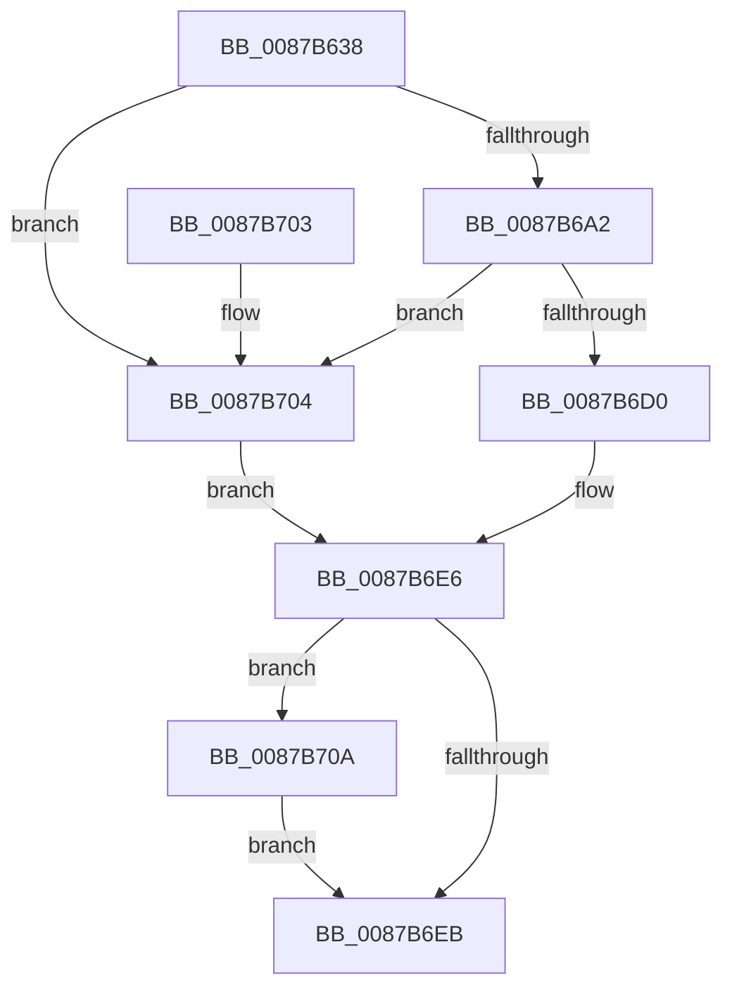

# CmpCreateEvent

- RVA: `0x0087B638`–`0x0087B711` (길이 `217` bytes)
- VA: `0x000000014087B638`
- 실행 섹션: `PAGE`
- PDB 이름 있음: `예`; PDB Function 태그: `아니요`
- unwind 정보 RVA: `0x0006CE88`
- 디코드: `61`개 명령, `217/217` bytes 표시
- 미해석 바이트: `0` (있으면 어셈블리에 `.byte`로 보존)

> 이 문서는 커널 이미지의 기계어와 PDB 기호를 분석해 생성했습니다. 4번과 5번은 함수 원형과 자료형을 바이너리 사용 방식에서 추정한 C 해석이며 원본 소스 복구 결과는 아닙니다.

## 1. Dependencies

- 직접 호출 지점: **3**; 고유 호출 대상: **3**
- 직접 호출자로 확인된 함수: **3**
- RIP 상대 이미지 참조: **0**

### Outgoing calls
- `0x0087B697` → [ZwCreateEvent](../../text/6A/ZwCreateEvent_function_006AD9D0.md) (function, `0x006AD9D0`)
- `0x0087B6C5` → [ObReferenceObjectByHandle](../86/ObReferenceObjectByHandle_function_00868DB0.md) (function, `0x00868DB0`)
- `0x0087B70A` → [ZwClose](../../text/6A/ZwClose_function_006AD2B0.md) (function, `0x006AD2B0`)

### Direct callers
- [CmpDoFileRead](../../text/48/CmpDoFileRead_function_00485658.md) at `0x004856AB`
- [CmpGetVolumeClusterSize](CmpGetVolumeClusterSize_function_0087B3D4.md) at `0x0087B469`
- [CmpDoFileWrite](../A6/CmpDoFileWrite_function_00A65880.md) at `0x00A6598D`

### Static image references
- 디코드된 RIP-relative 메모리 참조가 없습니다.

## 2. Other-region calls and transfers

- 다른 실행 섹션으로 향하는 call: **2**
  - `0x0087B697` → [ZwCreateEvent](../../text/6A/ZwCreateEvent_function_006AD9D0.md) (`PAGE` → `.text`)
  - `0x0087B70A` → [ZwClose](../../text/6A/ZwClose_function_006AD2B0.md) (`PAGE` → `.text`)
- 별도 외부 분기/꼬리 이동을 확인하지 못했습니다.

## 3. Assembly (complete function range)

```asm
0087B638  48 8B C4                        mov rax, rsp
0087B63B  48 89 58 08                     mov qword ptr [rax + 8], rbx
0087B63F  48 89 70 10                     mov qword ptr [rax + 0x10], rsi
0087B643  48 89 78 18                     mov qword ptr [rax + 0x18], rdi
0087B647  55                              push rbp
0087B648  48 8B EC                        mov rbp, rsp
0087B64B  48 83 EC 70                     sub rsp, 0x70
0087B64F  83 65 E4 00                     and dword ptr [rbp - 0x1c], 0
0087B653  49 8B F8                        mov rdi, r8
0087B656  48 83 65 28 00                  and qword ptr [rbp + 0x28], 0
0087B65B  4C 8D 45 C8                     lea r8, [rbp - 0x38]
0087B65F  48 83 65 D0 00                  and qword ptr [rbp - 0x30], 0
0087B664  48 8B F2                        mov rsi, rdx
0087B667  48 83 65 D8 00                  and qword ptr [rbp - 0x28], 0
0087B66C  0F 57 C0                        xorps xmm0, xmm0
0087B66F  44 8B C9                        mov r9d, ecx
0087B672  48 C7 45 C8 30 00 00 00         mov qword ptr [rbp - 0x38], 0x30
0087B67A  83 65 CC 00                     and dword ptr [rbp - 0x34], 0
0087B67E  48 8D 4D 28                     lea rcx, [rbp + 0x28]
0087B682  BA 03 00 1F 00                  mov edx, 0x1f0003
0087B687  C7 45 E0 40 02 00 00            mov dword ptr [rbp - 0x20], 0x240
0087B68E  F3 0F 7F 45 E8                  movdqu xmmword ptr [rbp - 0x18], xmm0
0087B693  C6 40 A8 00                     mov byte ptr [rax - 0x58], 0
0087B697  E8 34 23 E3 FF                  call 0x1406ad9d0
0087B69C  8B D8                           mov ebx, eax
0087B69E  85 C0                           test eax, eax
0087B6A0  78 62                           js 0x14087b704
0087B6A2  48 83 64 24 28 00               and qword ptr [rsp + 0x28], 0
0087B6A8  48 8D 45 C0                     lea rax, [rbp - 0x40]
0087B6AC  48 8B 4D 28                     mov rcx, qword ptr [rbp + 0x28]
0087B6B0  45 33 C9                        xor r9d, r9d
0087B6B3  48 83 65 C0 00                  and qword ptr [rbp - 0x40], 0
0087B6B8  45 33 C0                        xor r8d, r8d
0087B6BB  BA 03 00 1F 00                  mov edx, 0x1f0003
0087B6C0  48 89 44 24 20                  mov qword ptr [rsp + 0x20], rax
0087B6C5  E8 E6 D6 FE FF                  call 0x140868db0
0087B6CA  8B D8                           mov ebx, eax
0087B6CC  85 C0                           test eax, eax
0087B6CE  78 34                           js 0x14087b704
0087B6D0  48 8B 45 28                     mov rax, qword ptr [rbp + 0x28]
0087B6D4  33 C9                           xor ecx, ecx
0087B6D6  48 89 06                        mov qword ptr [rsi], rax
0087B6D9  33 DB                           xor ebx, ebx
0087B6DB  48 8B 45 C0                     mov rax, qword ptr [rbp - 0x40]
0087B6DF  48 89 07                        mov qword ptr [rdi], rax
0087B6E2  48 89 4D 28                     mov qword ptr [rbp + 0x28], rcx
0087B6E6  48 85 C9                        test rcx, rcx
0087B6E9  75 1F                           jne 0x14087b70a
0087B6EB  4C 8D 5C 24 70                  lea r11, [rsp + 0x70]
0087B6F0  8B C3                           mov eax, ebx
0087B6F2  49 8B 5B 10                     mov rbx, qword ptr [r11 + 0x10]
0087B6F6  49 8B 73 18                     mov rsi, qword ptr [r11 + 0x18]
0087B6FA  49 8B 7B 20                     mov rdi, qword ptr [r11 + 0x20]
0087B6FE  49 8B E3                        mov rsp, r11
0087B701  5D                              pop rbp
0087B702  C3                              ret
0087B703  CC                              int3
0087B704  48 8B 4D 28                     mov rcx, qword ptr [rbp + 0x28]
0087B708  EB DC                           jmp 0x14087b6e6
0087B70A  E8 A1 1B E3 FF                  call 0x1406ad2b0
0087B70F  EB DA                           jmp 0x14087b6eb
```

## 4. C-style interpretation (structured pseudocode)

```c
__int64 __fastcall CmpCreateEvent(int a1, __int64 a2, __int64 a3)
{
    __int64 result;
    __int64 v_rbx;
    __int64 v_rsp;
    unsigned __int64 v_stack_m20;
    unsigned int v_stack_m24;
    unsigned int v_stack_m28;
    unsigned __int64 v_stack_m30;
    unsigned __int64 v_stack_m38;
    unsigned int v_stack_m3C;
    unsigned __int64 v_stack_m40;
    unsigned __int64 v_stack_m48;
    unsigned __int64 v_stack_m50;
    unsigned __int64 v_stack_m58;
    unsigned __int64 v_stack_m8;
    unsigned __int64 v_stack_p20;

    *(unsigned __int64 *)(v_rsp + 8) = v_rbx;
    *(unsigned __int64 *)(v_rsp + 16) = v_rsi;
    *(unsigned __int64 *)(v_rsp + 24) = v_rdi;
    v_rsp = (v_rsp) - (112);
    v_stack_m40 = 48;
    v_stack_m28 = 576;
    v_stack_m20 = v_xmm0;
    *(unsigned __int8 *)(v_rsp - 88) = 0;
    result = ZwCreateEvent(v_stack_p20, (unsigned int)(0x1F0003ULL), v_stack_m40, (unsigned int)(a1));
    if (sign_flag) goto loc_0087B704;
    a4 = 0;
    a3 = 0;
    v_stack_m58 = v_stack_m48;
    result = ObReferenceObjectByHandle(v_stack_p20, (unsigned int)(0x1F0003ULL), a3, a4);
    if (sign_flag) goto loc_0087B704;
    a1 = 0;
    *(unsigned __int64 *)(a2) = v_stack_p20;
    v_rbx = 0;
    *(unsigned __int64 *)(a3) = v_stack_m48;
    v_stack_p20 = 0;
loc_0087B6E6:
    if (0 != 0) goto loc_0087B70A;
loc_0087B6EB:
    return 0;
loc_0087B704:
    goto loc_0087B6E6;
loc_0087B70A:
    result = ZwClose(v_stack_p20, (unsigned int)(0x1F0003ULL), a3, a4);
    goto loc_0087B6EB;
}
```

## 5. (Beta) C Style

```c
int64_t CmpCreateEvent(int32_t Arg1, void *Arg2, void *Arg3)
{
    uint8_t *arg2 = (uint8_t *)Arg2;
    uint8_t *arg3 = (uint8_t *)Arg3;

    int64_t result;
    int64_t local_rbx;
    int64_t local_rsp;
    uint64_t v_stack_m20;
    uint32_t v_stack_m24;
    uint32_t v_stack_m28;
    uint64_t v_stack_m30;
    uint64_t v_stack_m38;
    uint32_t v_stack_m3C;
    uint64_t v_stack_m40;
    uint64_t v_stack_m48;
    uint64_t v_stack_m50;
    uint64_t v_stack_m58;
    uint64_t v_stack_m8;
    uint64_t v_stack_p20;

    *(uint64_t *)(local_rsp + 0x8) = local_rbx;
    *(uint64_t *)(local_rsp + 0x10) = local_rsi;
    *(uint64_t *)(local_rsp + 0x18) = local_rdi;
    local_rsp = (local_rsp) - (112);
    v_stack_m40 = 48;
    v_stack_m28 = 576;
    v_stack_m20 = v_xmm0;
    *(uint8_t *)(local_rsp - 0x58) = 0;
    result = ZwCreateEvent(v_stack_p20, (uint32_t)(0x1F0003ULL), v_stack_m40, (uint32_t)(Arg1));
    if (sign_flag) goto loc_0087B704;
    a4 = 0;
    Arg3 = 0;
    v_stack_m58 = v_stack_m48;
    result = ObReferenceObjectByHandle(v_stack_p20, (uint32_t)(0x1F0003ULL), Arg3, a4);
    if (sign_flag) goto loc_0087B704;
    Arg1 = 0;
    *(uint64_t *)(arg2) = v_stack_p20;
    local_rbx = 0;
    *(uint64_t *)(arg3) = v_stack_m48;
    v_stack_p20 = 0;
loc_0087B6E6:
    if (0 != 0) goto loc_0087B70A;
loc_0087B6EB:
    return 0;
loc_0087B704:
    goto loc_0087B6E6;
loc_0087B70A:
    result = ZwClose(v_stack_p20, (uint32_t)(0x1F0003ULL), Arg3, a4);
    goto loc_0087B6EB;
}
```

### 관측된 메모리 오프셋

구조체 형식이 확인되지 않은 접근은 인자 기준의 오프셋으로만 기록했습니다.

| 기준 인자 | 오프셋 표현 | 폭 (bit) | 접근 |
|---|---:|---:|---|
| `Arg2` | `+ 0x0` | `64` | `W` |
| `Arg3` | `+ 0x0` | `64` | `W` |

## 6. Execution-region graph

[열기: 2D/3D 그래프와 함수 탐색 컨트롤 패널](../../../control-panel.html?section=page&rva=0x0087B638&view=graph)

- 2D 그래프는 위에서 아래로 흐르고, 3D 그래프는 빈 공간을 드래그해 회전합니다. Shift+드래그는 이동, 휠은 확대·축소, 함수 노드 선택은 대상 보고서 이동입니다.

### Static fallback


