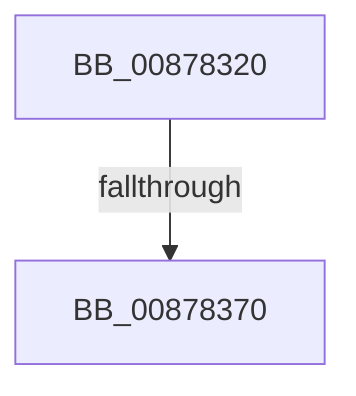

# CmpEtwDumpKcb

- RVA: `0x00878320`–`0x00878374` (길이 `84` bytes)
- VA: `0x0000000140878320`
- 실행 섹션: `PAGE`
- PDB 이름 있음: `예`; PDB Function 태그: `아니요`
- unwind 정보 RVA: `0x0006CBF8`
- 디코드: `21`개 명령, `84/84` bytes 표시
- 미해석 바이트: `0` (있으면 어셈블리에 `.byte`로 보존)

> 이 문서는 커널 이미지의 기계어와 PDB 기호를 분석해 생성했습니다. 4번과 5번은 함수 원형과 자료형을 바이너리 사용 방식에서 추정한 C 해석이며 원본 소스 복구 결과는 아닙니다.

## 1. Dependencies

- 직접 호출 지점: **0**; 고유 호출 대상: **0**
- 직접 호출자로 확인된 함수: **1**
- RIP 상대 이미지 참조: **2**

### Outgoing calls
- 직접 디코드된 call 명령이 없습니다.

### Direct callers
- [CmpLinkHiveToMaster](CmpLinkHiveToMaster_function_00877D6C.md) at `0x0087801C`

### Static image references
- `0x0087832D` → RVA `0x00E0A740` (`.data`; read)
- `0x0087833F` → RVA `0x00FD8008` (`PAGEDATA`; read)

## 2. Other-region calls and transfers

- 다른 실행 섹션으로 향하는 call: **0**
- call이 아닌 외부 분기/꼬리 이동: **1**
  - `0x0087836E` → [sub_008783D6](Unknown_function_008783D6.md) (`tail-transfer`)

## 3. Assembly (complete function range)

```asm
00878320  4C 8B DC                        mov r11, rsp
00878323  55                              push rbp
00878324  56                              push rsi
00878325  57                              push rdi
00878326  48 81 EC A0 00 00 00            sub rsp, 0xa0
0087832D  48 8B 05 0C 24 59 00            mov rax, qword ptr [rip + 0x59240c]
00878334  48 33 C4                        xor rax, rsp
00878337  48 89 84 24 90 00 00 00         mov qword ptr [rsp + 0x90], rax
0087833F  48 8B 35 C2 FC 75 00            mov rsi, qword ptr [rip + 0x75fcc2]
00878346  0F 57 C9                        xorps xmm1, xmm1
00878349  0F 57 C0                        xorps xmm0, xmm0
0087834C  0F B6 EA                        movzx ebp, dl
0087834F  48 8B F9                        mov rdi, rcx
00878352  0F 11 4C 24 60                  movups xmmword ptr [rsp + 0x60], xmm1
00878357  0F 11 4C 24 70                  movups xmmword ptr [rsp + 0x70], xmm1
0087835C  41 0F 11 4B C8                  movups xmmword ptr [r11 - 0x38], xmm1
00878361  0F 11 44 24 40                  movups xmmword ptr [rsp + 0x40], xmm0
00878366  0F 11 44 24 50                  movups xmmword ptr [rsp + 0x50], xmm0
0087836B  48 85 F6                        test rsi, rsi
0087836E  74 66                           je 0x1408783d6
00878370  49 8D 4B A8                     lea rcx, [r11 - 0x58]
```

## 4. C-style interpretation (structured pseudocode)

```c
__int64 __fastcall CmpEtwDumpKcb(__int64 a1, unsigned __int8 a2)
{
    __int64 result;
    __int64 v_rsp;
    unsigned __int64 v_stack_m28;
    unsigned __int64 v_stack_m48;
    unsigned __int64 v_stack_m58;
    unsigned __int64 v_stack_m68;
    unsigned __int64 v_stack_m78;

    v_rsp = (v_rsp) - (160);
    result = (*(unsigned __int64 *)(v_rip + 5841932)) ^ (v_rsp);
    v_stack_m28 = result;
    v_stack_m58 = v_xmm1;
    v_stack_m48 = v_xmm1;
    *(unsigned __int64 *)(v_rsp - 56) = v_xmm1;
    v_stack_m78 = v_xmm0;
    v_stack_m68 = v_xmm0;
    return result;
}
```

## 5. (Beta) C Style

```c
int64_t CmpEtwDumpKcb(int64_t Arg1, uint8_t Arg2)
{
    int64_t result;
    int64_t local_rsp;
    uint64_t v_stack_m28;
    uint64_t v_stack_m48;
    uint64_t v_stack_m58;
    uint64_t v_stack_m68;
    uint64_t v_stack_m78;

    local_rsp = (local_rsp) - (160);
    result = (*(uint64_t *)(v_rip + 0x59240C)) ^ (local_rsp);
    v_stack_m28 = result;
    v_stack_m58 = v_xmm1;
    v_stack_m48 = v_xmm1;
    *(uint64_t *)(local_rsp - 0x38) = v_xmm1;
    v_stack_m78 = v_xmm0;
    v_stack_m68 = v_xmm0;
    return result;
}
```

## 6. Execution-region graph

[열기: 2D/3D 그래프와 함수 탐색 컨트롤 패널](../../../control-panel.html?section=page&rva=0x00878320&view=graph)

- 2D 그래프는 위에서 아래로 흐르고, 3D 그래프는 빈 공간을 드래그해 회전합니다. Shift+드래그는 이동, 휠은 확대·축소, 함수 노드 선택은 대상 보고서 이동입니다.

### Static fallback


