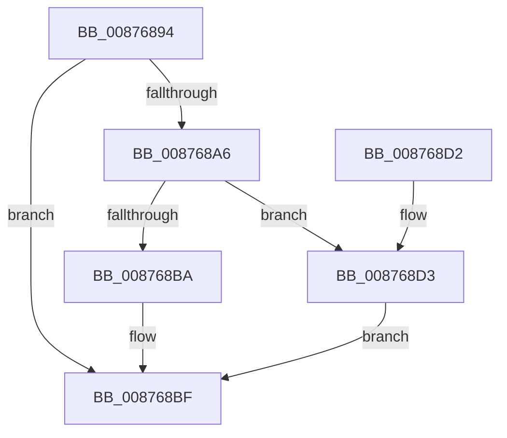

# CmpFreeExtraParameter

- RVA: `0x00876894`–`0x008768DA` (길이 `70` bytes)
- VA: `0x0000000140876894`
- 실행 섹션: `PAGE`
- PDB 이름 있음: `예`; PDB Function 태그: `아니요`
- unwind 정보 RVA: `0x0005DAC8`
- 디코드: `21`개 명령, `70/70` bytes 표시
- 미해석 바이트: `0` (있으면 어셈블리에 `.byte`로 보존)

> 이 문서는 커널 이미지의 기계어와 PDB 기호를 분석해 생성했습니다. 4번과 5번은 함수 원형과 자료형을 바이너리 사용 방식에서 추정한 C 해석이며 원본 소스 복구 결과는 아닙니다.

## 1. Dependencies

- 직접 호출 지점: **3**; 고유 호출 대상: **3**
- 직접 호출자로 확인된 함수: **4**
- RIP 상대 이미지 참조: **1**

### Outgoing calls
- `0x008768BA` → [VrpOriginalKeyNameParameterCleanup](../../text/47/VrpOriginalKeyNameParameterCleanup_function_00479060.md) (function, `0x00479060`)
- `0x008768C7` → [CmpFreePoolWithTag](../../text/44/CmpFreePoolWithTag_function_004489E0.md) (function, `0x004489E0`)
- `0x008768D3` → [guard_dispatch_icall](../../text/6B/guard_dispatch_icall_function_006BAAD0.md) (function, `0x006BAAD0`)

### Direct callers
- [CmOpenKey](CmOpenKey_function_00876350.md) at `0x00876663`
- [VrpPreOpenOrCreate](../93/VrpPreOpenOrCreate_function_00932B84.md) at `0x00932EE0`
- [VrpPostOpenOrCreate](../93/VrpPostOpenOrCreate_function_00936510.md) at `0x0093689B`
- [sub_00B24D7E](../B2/Unknown_function_00B24D7E.md) at `0x00B24E1A`

### Static image references
- `0x008768AE` → RVA `0x00479060` (`VrpOriginalKeyNameParameterCleanup`; read)

## 2. Other-region calls and transfers

- 다른 실행 섹션으로 향하는 call: **3**
  - `0x008768BA` → [VrpOriginalKeyNameParameterCleanup](../../text/47/VrpOriginalKeyNameParameterCleanup_function_00479060.md) (`PAGE` → `.text`)
  - `0x008768C7` → [CmpFreePoolWithTag](../../text/44/CmpFreePoolWithTag_function_004489E0.md) (`PAGE` → `.text`)
  - `0x008768D3` → [guard_dispatch_icall](../../text/6B/guard_dispatch_icall_function_006BAAD0.md) (`PAGE` → `.text`)
- 별도 외부 분기/꼬리 이동을 확인하지 못했습니다.

## 3. Assembly (complete function range)

```asm
00876894  40 53                           push rbx
00876896  48 83 EC 20                     sub rsp, 0x20
0087689A  48 8B 41 20                     mov rax, qword ptr [rcx + 0x20]
0087689E  48 8B D9                        mov rbx, rcx
008768A1  48 85 C0                        test rax, rax
008768A4  74 19                           je 0x1408768bf
008768A6  48 8D 51 30                     lea rdx, [rcx + 0x30]
008768AA  48 83 C1 10                     add rcx, 0x10
008768AE  4C 8D 05 AB 27 C0 FF            lea r8, [rip - 0x3fd855]
008768B5  49 3B C0                        cmp rax, r8
008768B8  75 19                           jne 0x1408768d3
008768BA  E8 A1 27 C0 FF                  call 0x140479060
008768BF  BA 43 4D 45 50                  mov edx, 0x50454d43
008768C4  48 8B CB                        mov rcx, rbx
008768C7  E8 14 21 BD FF                  call 0x1404489e0
008768CC  48 83 C4 20                     add rsp, 0x20
008768D0  5B                              pop rbx
008768D1  C3                              ret
008768D2  CC                              int3
008768D3  E8 F8 41 E4 FF                  call 0x1406baad0
008768D8  EB E5                           jmp 0x1408768bf
```

## 4. C-style interpretation (structured pseudocode)

```c
__int64 __fastcall CmpFreeExtraParameter(__int64 a1)
{
    __int64 result;
    __int64 v_rsp;

    v_rsp = (v_rsp) - (32);
    if (*(unsigned __int64 *)(a1 + 32) == 0) goto loc_008768BF;
    a1 = (a1) + (16);
    if ((*(unsigned __int64 *)(a1 + 32)) != (v_rip - 4184149)) goto loc_008768D3;
    result = VrpOriginalKeyNameParameterCleanup(a1, a1 + 48, v_rip - 4184149, a4);
loc_008768BF:
    result = CmpFreePoolWithTag(a1, (unsigned int)(0x50454D43ULL), v_rip - 4184149, a4);
    v_rsp = (v_rsp) + (32);
    return result;
loc_008768D3:
    result = guard_dispatch_icall(a1, (unsigned int)(0x50454D43ULL), v_rip - 4184149, a4);
    goto loc_008768BF;
}
```

## 5. (Beta) C Style

```c
int64_t CmpFreeExtraParameter(void *Arg1)
{
    uint8_t *arg1 = (uint8_t *)Arg1;

    int64_t result;
    int64_t local_rsp;

    local_rsp = (local_rsp) - (32);
    if (*(uint64_t *)(arg1 + 0x20) == 0) goto loc_008768BF;
    Arg1 = (Arg1) + (16);
    if ((*(uint64_t *)(arg1 + 0x20)) != (v_rip - 4184149)) goto loc_008768D3;
    result = VrpOriginalKeyNameParameterCleanup(Arg1, Arg1 + 48, v_rip - 4184149, a4);
loc_008768BF:
    result = CmpFreePoolWithTag(Arg1, (uint32_t)(0x50454D43ULL), v_rip - 4184149, a4);
    local_rsp = (local_rsp) + (32);
    return result;
loc_008768D3:
    result = guard_dispatch_icall(Arg1, (uint32_t)(0x50454D43ULL), v_rip - 4184149, a4);
    goto loc_008768BF;
}
```

### 관측된 메모리 오프셋

구조체 형식이 확인되지 않은 접근은 인자 기준의 오프셋으로만 기록했습니다.

| 기준 인자 | 오프셋 표현 | 폭 (bit) | 접근 |
|---|---:|---:|---|
| `Arg1` | `+ 0x20` | `64` | `R` |
| `Arg1` | `+ 0x30` | `64` | `R` |

## 6. Execution-region graph

[열기: 2D/3D 그래프와 함수 탐색 컨트롤 패널](../../../control-panel.html?section=page&rva=0x00876894&view=graph)

- 2D 그래프는 위에서 아래로 흐르고, 3D 그래프는 빈 공간을 드래그해 회전합니다. Shift+드래그는 이동, 휠은 확대·축소, 함수 노드 선택은 대상 보고서 이동입니다.

### Static fallback


