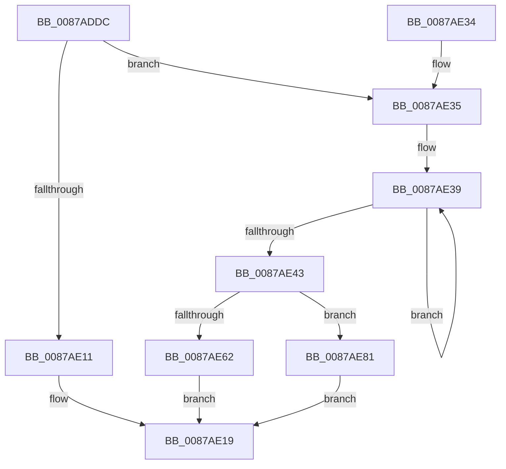

# CmpGetCompleteFileName

- RVA: `0x0087ADDC`–`0x0087AEA4` (길이 `200` bytes)
- VA: `0x000000014087ADDC`
- 실행 섹션: `PAGE`
- PDB 이름 있음: `예`; PDB Function 태그: `아니요`
- unwind 정보 RVA: `0x0006CE04`
- 디코드: `58`개 명령, `200/200` bytes 표시
- 미해석 바이트: `0` (있으면 어셈블리에 `.byte`로 보존)

> 이 문서는 커널 이미지의 기계어와 PDB 기호를 분석해 생성했습니다. 4번과 5번은 함수 원형과 자료형을 바이너리 사용 방식에서 추정한 C 해석이며 원본 소스 복구 결과는 아닙니다.

## 1. Dependencies

- 직접 호출 지점: **4**; 고유 호출 대상: **4**
- 직접 호출자로 확인된 함수: **1**
- RIP 상대 이미지 참조: **1**

### Outgoing calls
- `0x0087AE54` → [CmSiAllocateMemory](../../text/49/CmSiAllocateMemory_function_00490C18.md) (function, `0x00490C18`)
- `0x0087AE6F` → [RtlAppendUnicodeStringToString](../../text/40/RtlAppendUnicodeStringToString_function_0040FA50.md) (function, `0x0040FA50`)
- `0x0087AE7A` → [RtlAppendUnicodeToString](../../text/40/RtlAppendUnicodeToString_function_0040F990.md) (function, `0x0040F990`)
- `0x0087AE9A` → [SetFailureLocation](../../text/46/SetFailureLocation_function_0046EF54.md) (function, `0x0046EF54`)

### Direct callers
- [CmpOpenHiveFile](CmpOpenHiveFile_function_0087A71C.md) at `0x0087A82F`

### Static image references
- `0x0087ADF6` → RVA `0x00B4CE70` (`CmFileNameExtensions`; read)

## 2. Other-region calls and transfers

- 다른 실행 섹션으로 향하는 call: **4**
  - `0x0087AE54` → [CmSiAllocateMemory](../../text/49/CmSiAllocateMemory_function_00490C18.md) (`PAGE` → `.text`)
  - `0x0087AE6F` → [RtlAppendUnicodeStringToString](../../text/40/RtlAppendUnicodeStringToString_function_0040FA50.md) (`PAGE` → `.text`)
  - `0x0087AE7A` → [RtlAppendUnicodeToString](../../text/40/RtlAppendUnicodeToString_function_0040F990.md) (`PAGE` → `.text`)
  - `0x0087AE9A` → [SetFailureLocation](../../text/46/SetFailureLocation_function_0046EF54.md) (`PAGE` → `.text`)
- 별도 외부 분기/꼬리 이동을 확인하지 못했습니다.

## 3. Assembly (complete function range)

```asm
0087ADDC  48 89 5C 24 08                  mov qword ptr [rsp + 8], rbx
0087ADE1  48 89 6C 24 10                  mov qword ptr [rsp + 0x10], rbp
0087ADE6  48 89 74 24 18                  mov qword ptr [rsp + 0x18], rsi
0087ADEB  57                              push rdi
0087ADEC  41 56                           push r14
0087ADEE  41 57                           push r15
0087ADF0  48 83 EC 30                     sub rsp, 0x30
0087ADF4  8B C2                           mov eax, edx
0087ADF6  4C 8D 35 73 20 2D 00            lea r14, [rip + 0x2d2073]
0087ADFD  33 FF                           xor edi, edi
0087ADFF  49 8B F1                        mov rsi, r9
0087AE02  4D 8B F8                        mov r15, r8
0087AE05  48 8B E9                        mov rbp, rcx
0087AE08  4D 8B 34 C6                     mov r14, qword ptr [r14 + rax*8]
0087AE0C  4D 85 F6                        test r14, r14
0087AE0F  75 24                           jne 0x14087ae35
0087AE11  0F 10 01                        movups xmm0, xmmword ptr [rcx]
0087AE14  F3 41 0F 7F 01                  movdqu xmmword ptr [r9], xmm0
0087AE19  48 8B 5C 24 50                  mov rbx, qword ptr [rsp + 0x50]
0087AE1E  8B C7                           mov eax, edi
0087AE20  48 8B 6C 24 58                  mov rbp, qword ptr [rsp + 0x58]
0087AE25  48 8B 74 24 60                  mov rsi, qword ptr [rsp + 0x60]
0087AE2A  48 83 C4 30                     add rsp, 0x30
0087AE2E  41 5F                           pop r15
0087AE30  41 5E                           pop r14
0087AE32  5F                              pop rdi
0087AE33  C3                              ret
0087AE34  CC                              int3
0087AE35  48 83 CB FF                     or rbx, 0xffffffffffffffff
0087AE39  48 FF C3                        inc rbx
0087AE3C  66 41 39 3C 5E                  cmp word ptr [r14 + rbx*2], di
0087AE41  75 F6                           jne 0x14087ae39
0087AE43  66 FF C3                        inc bx
0087AE46  BA 43 4D 77 62                  mov edx, 0x62774d43
0087AE4B  66 03 DB                        add bx, bx
0087AE4E  66 03 19                        add bx, word ptr [rcx]
0087AE51  0F B7 CB                        movzx ecx, bx
0087AE54  E8 BF 5D C1 FF                  call 0x140490c18
0087AE59  48 89 46 08                     mov qword ptr [rsi + 8], rax
0087AE5D  48 85 C0                        test rax, rax
0087AE60  74 1F                           je 0x14087ae81
0087AE62  48 8B D5                        mov rdx, rbp
0087AE65  66 89 3E                        mov word ptr [rsi], di
0087AE68  48 8B CE                        mov rcx, rsi
0087AE6B  66 89 5E 02                     mov word ptr [rsi + 2], bx
0087AE6F  E8 DC 4B B9 FF                  call 0x14040fa50
0087AE74  49 8B D6                        mov rdx, r14
0087AE77  48 8B CE                        mov rcx, rsi
0087AE7A  E8 11 4B B9 FF                  call 0x14040f990
0087AE7F  EB 98                           jmp 0x14087ae19
0087AE81  33 D2                           xor edx, edx
0087AE83  C7 44 24 20 10 00 00 00         mov dword ptr [rsp + 0x20], 0x10
0087AE8B  BF 9A 00 00 C0                  mov edi, 0xc000009a
0087AE90  49 8B CF                        mov rcx, r15
0087AE93  44 8B CF                        mov r9d, edi
0087AE96  44 8D 42 30                     lea r8d, [rdx + 0x30]
0087AE9A  E8 B5 40 BF FF                  call 0x14046ef54
0087AE9F  E9 75 FF FF FF                  jmp 0x14087ae19
```

## 4. C-style interpretation (structured pseudocode)

```c
__int64 __fastcall CmpGetCompleteFileName(__int64 a1, int a2, __int64 a3, __int64 a4)
{
    __int64 result;
    __int64 v_rbx;
    __int64 v_rdi;
    __int64 v_rsp;
    unsigned __int64 v_stack_p10;
    unsigned __int64 v_stack_p18;
    unsigned int v_stack_p20;
    unsigned __int64 v_stack_p8;

    v_stack_p8 = v_rbx;
    v_stack_p10 = v_rbp;
    v_stack_p18 = v_rsi;
    v_rsp = (v_rsp) - (48);
    v_rdi = 0;
    if (*(unsigned __int64 *)(v_rip + 2957427 + (unsigned int)(a2) * 8) != 0) goto loc_0087AE35;
    *(unsigned __int64 *)(a4) = v_xmm0;
loc_0087AE19:
    v_rsp = (v_rsp) + (48);
    return 0;
loc_0087AE35:
    v_rbx = (v_stack_p8) | (-1);
loc_0087AE39:
    v_rbx = (v_rbx) + 1;
    if ((*(unsigned __int16 *)(*(unsigned __int64 *)(v_rip + 2957427 + (unsigned int)(a2) * 8) + v_rbx * 2)) != 0) goto loc_0087AE39;
    v_rbx = (unsigned __int16)((v_rbx) + 1);
    v_rbx = (unsigned __int16)((v_rbx) + ((unsigned __int16)(v_rbx)));
    v_rbx = (unsigned __int16)((v_rbx) + (*(unsigned __int16 *)(a1)));
    result = CmSiAllocateMemory((unsigned __int16)(v_rbx), (unsigned int)(0x62774D43ULL), a3, a4);
    *(unsigned __int64 *)(v_stack_p18 + 8) = result;
    if (result == 0) goto loc_0087AE81;
    *(unsigned __int16 *)(v_stack_p18) = 0;
    *(unsigned __int16 *)(v_stack_p18 + 2) = (unsigned __int16)(v_rbx);
    result = RtlAppendUnicodeStringToString(v_stack_p18, v_stack_p10, a3, a4);
    result = RtlAppendUnicodeToString(v_stack_p18, *(unsigned __int64 *)(v_rip + 2957427 + (unsigned int)(a2) * 8), a3, a4);
    goto loc_0087AE19;
loc_0087AE81:
    a2 = 0;
    v_stack_p20 = 16;
    result = SetFailureLocation(a3, a2, a2 + 48, (unsigned int)((unsigned int)((unsigned int)(0xC000009AULL))));
    goto loc_0087AE19;
}
```

## 5. (Beta) C Style

```c
int64_t CmpGetCompleteFileName(void *Arg1, int32_t Arg2, int64_t Arg3, void *Arg4)
{
    uint8_t *arg1 = (uint8_t *)Arg1;
    uint8_t *arg4 = (uint8_t *)Arg4;

    int64_t result;
    int64_t local_rbx;
    int64_t local_rdi;
    int64_t local_rsp;
    uint64_t v_stack_p10;
    uint64_t v_stack_p18;
    uint32_t v_stack_p20;
    uint64_t v_stack_p8;

    v_stack_p8 = local_rbx;
    v_stack_p10 = local_rbp;
    v_stack_p18 = local_rsi;
    local_rsp = (local_rsp) - (48);
    local_rdi = 0;
    if (*(uint64_t *)(v_rip + 0x2D2073 + (uint32_t)(Arg2) * 8) != 0) goto loc_0087AE35;
    *(uint64_t *)(arg4) = v_xmm0;
loc_0087AE19:
    local_rsp = (local_rsp) + (48);
    return 0;
loc_0087AE35:
    local_rbx = (v_stack_p8) | (-1);
loc_0087AE39:
    local_rbx = (local_rbx) + 1;
    if ((*(uint16_t *)(*(uint64_t *)(v_rip + 0x2D2073 + (uint32_t)(Arg2) * 8) + local_rbx * 2)) != 0) goto loc_0087AE39;
    local_rbx = (uint16_t)((local_rbx) + 1);
    local_rbx = (uint16_t)((local_rbx) + ((uint16_t)(local_rbx)));
    local_rbx = (uint16_t)((local_rbx) + (*(uint16_t *)(arg1)));
    result = CmSiAllocateMemory((uint16_t)(local_rbx), (uint32_t)(0x62774D43ULL), Arg3, Arg4);
    *(uint64_t *)(v_stack_p18 + 0x8) = result;
    if (result == 0) goto loc_0087AE81;
    *(uint16_t *)(v_stack_p18) = 0;
    *(uint16_t *)(v_stack_p18 + 0x2) = (uint16_t)(local_rbx);
    result = RtlAppendUnicodeStringToString(v_stack_p18, v_stack_p10, Arg3, Arg4);
    result = RtlAppendUnicodeToString(v_stack_p18, *(uint64_t *)(v_rip + 0x2D2073 + (uint32_t)(Arg2) * 8), Arg3, Arg4);
    goto loc_0087AE19;
loc_0087AE81:
    Arg2 = 0;
    v_stack_p20 = 16;
    result = SetFailureLocation(Arg3, Arg2, Arg2 + 48, (uint32_t)((uint32_t)((uint32_t)(0xC000009AULL))));
    goto loc_0087AE19;
}
```

### 관측된 메모리 오프셋

구조체 형식이 확인되지 않은 접근은 인자 기준의 오프셋으로만 기록했습니다.

| 기준 인자 | 오프셋 표현 | 폭 (bit) | 접근 |
|---|---:|---:|---|
| `Arg1` | `+ 0x0` | `16` | `R` |
| `Arg1` | `+ 0x0` | `128` | `R` |
| `Arg4` | `+ 0x0` | `16` | `W` |
| `Arg4` | `+ 0x0` | `128` | `W` |
| `Arg4` | `+ 0x2` | `16` | `W` |
| `Arg4` | `+ 0x8` | `64` | `W` |

## 6. Execution-region graph

[열기: 2D/3D 그래프와 함수 탐색 컨트롤 패널](../../../control-panel.html?section=page&rva=0x0087ADDC&view=graph)

- 2D 그래프는 위에서 아래로 흐르고, 3D 그래프는 빈 공간을 드래그해 회전합니다. Shift+드래그는 이동, 휠은 확대·축소, 함수 노드 선택은 대상 보고서 이동입니다.

### Static fallback


