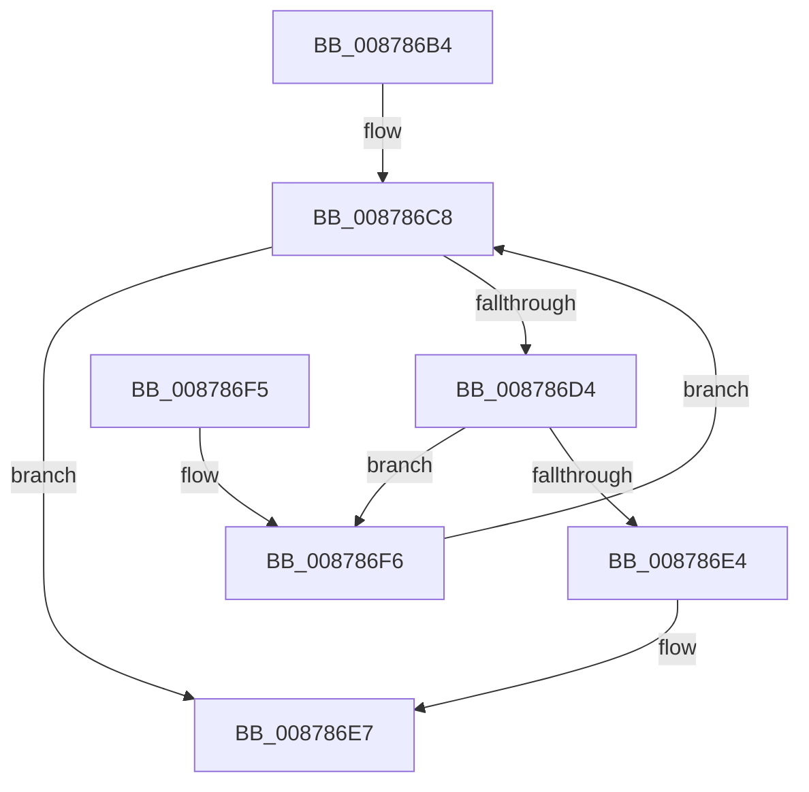

# CmpGetLastHive

- RVA: `0x008786B4`–`0x008786FC` (길이 `72` bytes)
- VA: `0x00000001408786B4`
- 실행 섹션: `PAGE`
- PDB 이름 있음: `예`; PDB Function 태그: `아니요`
- unwind 정보 RVA: `0x0006CC84`
- 디코드: `21`개 명령, `72/72` bytes 표시
- 미해석 바이트: `0` (있으면 어셈블리에 `.byte`로 보존)

> 이 문서는 커널 이미지의 기계어와 PDB 기호를 분석해 생성했습니다. 4번과 5번은 함수 원형과 자료형을 바이너리 사용 방식에서 추정한 C 해석이며 원본 소스 복구 결과는 아닙니다.

## 1. Dependencies

- 직접 호출 지점: **3**; 고유 호출 대상: **3**
- 직접 호출자로 확인된 함수: **2**
- RIP 상대 이미지 참조: **2**

### Outgoing calls
- `0x008786BC` → [CmpLockHiveListShared](../84/CmpLockHiveListShared_function_0084E3C8.md) (function, `0x0084E3C8`)
- `0x008786DB` → [CmpReferenceHive](../84/CmpReferenceHive_function_0084FCF0.md) (function, `0x0084FCF0`)
- `0x008786E7` → [CmpUnlockHiveList](../84/CmpUnlockHiveList_function_0084E424.md) (function, `0x0084E424`)

### Direct callers
- [CmpDoFlushAll](../../text/34/CmpDoFlushAll_function_00349A9C.md) at `0x00349ABB`
- [CmLoadAppKey](CmLoadAppKey_function_00876FFC.md) at `0x00877755`

### Static image references
- `0x008786C1` → RVA `0x00FD9D20` (`PAGEDATA`; read)
- `0x008786C8` → RVA `0x00FD9D18` (`PAGEDATA`; read)

## 2. Other-region calls and transfers

- 다른 실행 섹션으로 향하는 call: **0**
- 별도 외부 분기/꼬리 이동을 확인하지 못했습니다.

## 3. Assembly (complete function range)

```asm
008786B4  40 53                           push rbx
008786B6  48 83 EC 20                     sub rsp, 0x20
008786BA  33 DB                           xor ebx, ebx
008786BC  E8 07 5D FD FF                  call 0x14084e3c8
008786C1  4C 8B 05 58 16 76 00            mov r8, qword ptr [rip + 0x761658]
008786C8  48 8D 05 49 16 76 00            lea rax, [rip + 0x761649]
008786CF  4C 3B C0                        cmp r8, rax
008786D2  74 13                           je 0x1408786e7
008786D4  49 8D 88 B8 F9 FF FF            lea rcx, [r8 - 0x648]
008786DB  E8 10 76 FD FF                  call 0x14084fcf0
008786E0  84 C0                           test al, al
008786E2  74 12                           je 0x1408786f6
008786E4  48 8B D9                        mov rbx, rcx
008786E7  E8 38 5D FD FF                  call 0x14084e424
008786EC  48 8B C3                        mov rax, rbx
008786EF  48 83 C4 20                     add rsp, 0x20
008786F3  5B                              pop rbx
008786F4  C3                              ret
008786F5  CC                              int3
008786F6  4D 8B 40 08                     mov r8, qword ptr [r8 + 8]
008786FA  EB CC                           jmp 0x1408786c8
```

## 4. C-style interpretation (structured pseudocode)

```c
__int64 __fastcall CmpGetLastHive(void)
{
    __int64 result;
    __int64 v_rbx;
    __int64 v_rsp;

    v_rsp = (v_rsp) - (32);
    v_rbx = 0;
    result = CmpLockHiveListShared(a1, a2, a3, a4);
loc_008786C8:
    if ((*(unsigned __int64 *)(v_rip + 7738968)) == (v_rip + 7738953)) goto loc_008786E7;
    result = CmpReferenceHive(*(unsigned __int64 *)(v_rip + 7738968) - 1608, a2, *(unsigned __int64 *)(v_rip + 7738968), a4);
    if ((unsigned __int8)(result) == 0) goto loc_008786F6;
loc_008786E7:
    result = CmpUnlockHiveList(*(unsigned __int64 *)(v_rip + 7738968) - 1608, a2, *(unsigned __int64 *)(v_rip + 7738968), a4);
    v_rsp = (v_rsp) + (32);
    return *(unsigned __int64 *)(v_rip + 7738968) - 1608;
loc_008786F6:
    goto loc_008786C8;
}
```

## 5. (Beta) C Style

```c
void CmpGetLastHive(void)
{
    int64_t result;
    int64_t local_rbx;
    int64_t local_rsp;

    local_rsp = (local_rsp) - (32);
    local_rbx = 0;
    result = CmpLockHiveListShared(a1, a2, a3, a4);
loc_008786C8:
    if ((*(uint64_t *)(v_rip + 0x761658)) == (v_rip + 7738953)) goto loc_008786E7;
    result = CmpReferenceHive(*(uint64_t *)(v_rip + 0x761658) - 1608, a2, *(uint64_t *)(v_rip + 0x761658), a4);
    if ((uint8_t)(result) == 0) goto loc_008786F6;
loc_008786E7:
    result = CmpUnlockHiveList(*(uint64_t *)(v_rip + 0x761658) - 1608, a2, *(uint64_t *)(v_rip + 0x761658), a4);
    local_rsp = (local_rsp) + (32);
    return *(uint64_t *)(v_rip + 0x761658) - 1608;
loc_008786F6:
    goto loc_008786C8;
}
```

## 6. Execution-region graph

[열기: 2D/3D 그래프와 함수 탐색 컨트롤 패널](../../../control-panel.html?section=page&rva=0x008786B4&view=graph)

- 2D 그래프는 위에서 아래로 흐르고, 3D 그래프는 빈 공간을 드래그해 회전합니다. Shift+드래그는 이동, 휠은 확대·축소, 함수 노드 선택은 대상 보고서 이동입니다.

### Static fallback


