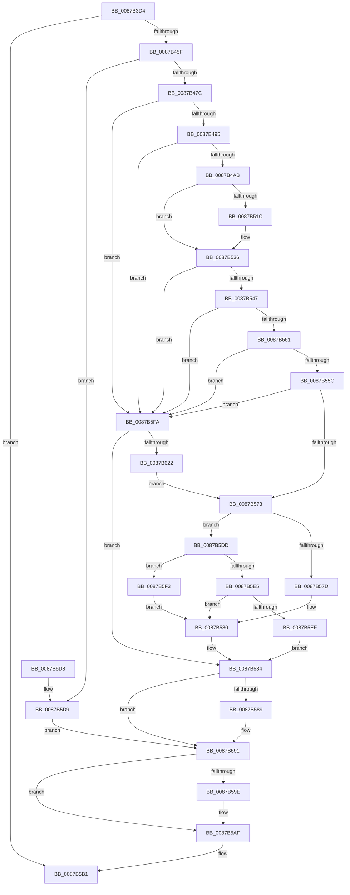

# CmpGetVolumeClusterSize

- RVA: `0x0087B3D4`–`0x0087B62F` (길이 `603` bytes)
- VA: `0x000000014087B3D4`
- 실행 섹션: `PAGE`
- PDB 이름 있음: `예`; PDB Function 태그: `아니요`
- unwind 정보 RVA: `0x0006CE60`
- 디코드: `158`개 명령, `603/603` bytes 표시
- 미해석 바이트: `0` (있으면 어셈블리에 `.byte`로 보존)

> 이 문서는 커널 이미지의 기계어와 PDB 기호를 분석해 생성했습니다. 4번과 5번은 함수 원형과 자료형을 바이너리 사용 방식에서 추정한 C 해석이며 원본 소스 복구 결과는 아닙니다.

## 1. Dependencies

- 직접 호출 지점: **13**; 고유 호출 대상: **11**
- 직접 호출자로 확인된 함수: **2**
- RIP 상대 이미지 참조: **3**

### Outgoing calls
- `0x0087B452` → [ObReferenceObjectByHandle](../86/ObReferenceObjectByHandle_function_00868DB0.md) (function, `0x00868DB0`)
- `0x0087B469` → [CmpCreateEvent](CmpCreateEvent_function_0087B638.md) (function, `0x0087B638`)
- `0x0087B480` → [IoGetAttachedDeviceReference](../../text/41/IoGetAttachedDeviceReference_function_0041D940.md) (function, `0x0041D940`)
- `0x0087B49A` → [IoAllocateIrp](../../text/20/IoAllocateIrp_function_002065D0.md) (function, `0x002065D0`)
- `0x0087B50D` → [IofCallDriver](../../text/29/IofCallDriver_function_0029B4B0.md) (function, `0x0029B4B0`)
- `0x0087B52D` → [KeWaitForSingleObject](../../text/20/KeWaitForSingleObject_function_0020E6B0.md) (function, `0x0020E6B0`)
- `0x0087B539` → [IoFreeIrp](../../text/24/IoFreeIrp_function_0024DF70.md) (function, `0x0024DF70`)
- `0x0087B58C` → [ObfDereferenceObject](../../text/2F/ObfDereferenceObject_function_002F9350.md) (function, `0x002F9350`)
- `0x0087B594` → [ObfDereferenceObject](../../text/2F/ObfDereferenceObject_function_002F9350.md) (function, `0x002F9350`)
- `0x0087B5A1` → [ObfDereferenceObject](../../text/2F/ObfDereferenceObject_function_002F9350.md) (function, `0x002F9350`)
- `0x0087B5AA` → [ZwClose](../../text/6A/ZwClose_function_006AD2B0.md) (function, `0x006AD2B0`)
- `0x0087B5B8` → [_security_check_cookie](../../text/6A/_security_check_cookie_function_006AC640.md) (function, `0x006AC640`)
- `0x0087B613` → [ZwQueryVolumeInformationFile](../../text/6A/ZwQueryVolumeInformationFile_function_006AD9F0.md) (function, `0x006AD9F0`)

### Direct callers
- [CmpCreateHive](CmpCreateHive_function_00879DF0.md) at `0x0087A443`
- [CmpOpenHiveFile](CmpOpenHiveFile_function_0087A71C.md) at `0x0087ABD0`

### Static image references
- `0x0087B3F0` → RVA `0x00E0A740` (`.data`; read)
- `0x0087B42B` → RVA `0x00EF7C68` (`.data`; read)
- `0x0087B4D6` → RVA `0x00A70E20` (`CmpGetVolumeClusterSizeCompletion`; read)

## 2. Other-region calls and transfers

- 다른 실행 섹션으로 향하는 call: **11**
  - `0x0087B480` → [IoGetAttachedDeviceReference](../../text/41/IoGetAttachedDeviceReference_function_0041D940.md) (`PAGE` → `.text`)
  - `0x0087B49A` → [IoAllocateIrp](../../text/20/IoAllocateIrp_function_002065D0.md) (`PAGE` → `.text`)
  - `0x0087B50D` → [IofCallDriver](../../text/29/IofCallDriver_function_0029B4B0.md) (`PAGE` → `.text`)
  - `0x0087B52D` → [KeWaitForSingleObject](../../text/20/KeWaitForSingleObject_function_0020E6B0.md) (`PAGE` → `.text`)
  - `0x0087B539` → [IoFreeIrp](../../text/24/IoFreeIrp_function_0024DF70.md) (`PAGE` → `.text`)
  - `0x0087B58C` → [ObfDereferenceObject](../../text/2F/ObfDereferenceObject_function_002F9350.md) (`PAGE` → `.text`)
  - `0x0087B594` → [ObfDereferenceObject](../../text/2F/ObfDereferenceObject_function_002F9350.md) (`PAGE` → `.text`)
  - `0x0087B5A1` → [ObfDereferenceObject](../../text/2F/ObfDereferenceObject_function_002F9350.md) (`PAGE` → `.text`)
  - `0x0087B5AA` → [ZwClose](../../text/6A/ZwClose_function_006AD2B0.md) (`PAGE` → `.text`)
  - `0x0087B5B8` → [_security_check_cookie](../../text/6A/_security_check_cookie_function_006AC640.md) (`PAGE` → `.text`)
  - `0x0087B613` → [ZwQueryVolumeInformationFile](../../text/6A/ZwQueryVolumeInformationFile_function_006AD9F0.md) (`PAGE` → `.text`)
- 별도 외부 분기/꼬리 이동을 확인하지 못했습니다.

## 3. Assembly (complete function range)

```asm
0087B3D4  48 89 5C 24 18                  mov qword ptr [rsp + 0x18], rbx
0087B3D9  55                              push rbp
0087B3DA  56                              push rsi
0087B3DB  57                              push rdi
0087B3DC  41 54                           push r12
0087B3DE  41 55                           push r13
0087B3E0  41 56                           push r14
0087B3E2  41 57                           push r15
0087B3E4  48 8D 6C 24 D9                  lea rbp, [rsp - 0x27]
0087B3E9  48 81 EC A0 00 00 00            sub rsp, 0xa0
0087B3F0  48 8B 05 49 F3 58 00            mov rax, qword ptr [rip + 0x58f349]
0087B3F7  48 33 C4                        xor rax, rsp
0087B3FA  48 89 45 17                     mov qword ptr [rbp + 0x17], rax
0087B3FE  48 83 64 24 28 00               and qword ptr [rsp + 0x28], 0
0087B404  33 C0                           xor eax, eax
0087B406  48 21 45 BF                     and qword ptr [rbp - 0x41], rax
0087B40A  0F 57 C0                        xorps xmm0, xmm0
0087B40D  48 21 45 C7                     and qword ptr [rbp - 0x39], rax
0087B411  4C 8B EA                        mov r13, rdx
0087B414  21 45 F7                        and dword ptr [rbp - 9], eax
0087B417  45 33 C9                        xor r9d, r9d
0087B41A  21 45 E3                        and dword ptr [rbp - 0x1d], eax
0087B41D  33 D2                           xor edx, edx
0087B41F  48 83 65 B7 00                  and qword ptr [rbp - 0x49], 0
0087B424  4C 8B E1                        mov r12, rcx
0087B427  48 89 45 0F                     mov qword ptr [rbp + 0xf], rax
0087B42B  48 8B 05 36 C8 67 00            mov rax, qword ptr [rip + 0x67c836]
0087B432  0F 11 45 FF                     movups xmmword ptr [rbp - 1], xmm0
0087B436  C7 45 DF 06 00 00 00            mov dword ptr [rbp - 0x21], 6
0087B43D  0F 11 45 CF                     movups xmmword ptr [rbp - 0x31], xmm0
0087B441  4C 8B 00                        mov r8, qword ptr [rax]
0087B444  48 8D 45 B7                     lea rax, [rbp - 0x49]
0087B448  48 89 44 24 20                  mov qword ptr [rsp + 0x20], rax
0087B44D  F3 0F 7F 45 E7                  movdqu xmmword ptr [rbp - 0x19], xmm0
0087B452  E8 59 D9 FE FF                  call 0x140868db0
0087B457  85 C0                           test eax, eax
0087B459  0F 88 52 01 00 00               js 0x14087b5b1
0087B45F  4C 8D 45 BF                     lea r8, [rbp - 0x41]
0087B463  33 C9                           xor ecx, ecx
0087B465  48 8D 55 C7                     lea rdx, [rbp - 0x39]
0087B469  E8 CA 01 00 00                  call 0x14087b638
0087B46E  4C 8B 7D B7                     mov r15, qword ptr [rbp - 0x49]
0087B472  8B D8                           mov ebx, eax
0087B474  85 C0                           test eax, eax
0087B476  0F 88 5D 01 00 00               js 0x14087b5d9
0087B47C  49 8B 4F 08                     mov rcx, qword ptr [r15 + 8]
0087B480  E8 BB 24 BA FF                  call 0x14041d940
0087B485  48 8B 7D BF                     mov rdi, qword ptr [rbp - 0x41]
0087B489  48 8B F0                        mov rsi, rax
0087B48C  48 85 C0                        test rax, rax
0087B48F  0F 84 65 01 00 00               je 0x14087b5fa
0087B495  8A 48 4C                        mov cl, byte ptr [rax + 0x4c]
0087B498  33 D2                           xor edx, edx
0087B49A  E8 31 B1 98 FF                  call 0x1402065d0
0087B49F  48 8B D8                        mov rbx, rax
0087B4A2  48 85 C0                        test rax, rax
0087B4A5  0F 84 4F 01 00 00               je 0x14087b5fa
0087B4AB  48 8B 88 B8 00 00 00            mov rcx, qword ptr [rax + 0xb8]
0087B4B2  48 8B D3                        mov rdx, rbx
0087B4B5  48 8D 45 DF                     lea rax, [rbp - 0x21]
0087B4B9  C6 41 B8 0E                     mov byte ptr [rcx - 0x48], 0xe
0087B4BD  48 89 71 E0                     mov qword ptr [rcx - 0x20], rsi
0087B4C1  C7 41 D0 00 14 2D 00            mov dword ptr [rcx - 0x30], 0x2d1400
0087B4C8  C7 41 C0 1C 00 00 00            mov dword ptr [rcx - 0x40], 0x1c
0087B4CF  C7 41 C8 0C 00 00 00            mov dword ptr [rcx - 0x38], 0xc
0087B4D6  48 8D 0D 43 59 1F 00            lea rcx, [rip + 0x1f5943]
0087B4DD  48 89 43 18                     mov qword ptr [rbx + 0x18], rax
0087B4E1  48 8D 45 DF                     lea rax, [rbp - 0x21]
0087B4E5  48 89 43 70                     mov qword ptr [rbx + 0x70], rax
0087B4E9  48 8B 83 B8 00 00 00            mov rax, qword ptr [rbx + 0xb8]
0087B4F0  C7 43 10 50 00 00 00            mov dword ptr [rbx + 0x10], 0x50
0087B4F7  C7 43 30 BB 00 00 C0            mov dword ptr [rbx + 0x30], 0xc00000bb
0087B4FE  48 89 48 F0                     mov qword ptr [rax - 0x10], rcx
0087B502  48 8B CE                        mov rcx, rsi
0087B505  48 89 78 F8                     mov qword ptr [rax - 8], rdi
0087B509  C6 40 BB E0                     mov byte ptr [rax - 0x45], 0xe0
0087B50D  E8 9E FF A1 FF                  call 0x14029b4b0
0087B512  44 8B F0                        mov r14d, eax
0087B515  3D 03 01 00 00                  cmp eax, 0x103
0087B51A  75 1A                           jne 0x14087b536
0087B51C  48 83 64 24 20 00               and qword ptr [rsp + 0x20], 0
0087B522  45 33 C9                        xor r9d, r9d
0087B525  45 33 C0                        xor r8d, r8d
0087B528  33 D2                           xor edx, edx
0087B52A  48 8B CF                        mov rcx, rdi
0087B52D  E8 7E 31 99 FF                  call 0x14020e6b0
0087B532  44 8B 73 30                     mov r14d, dword ptr [rbx + 0x30]
0087B536  48 8B CB                        mov rcx, rbx
0087B539  E8 32 2A 9D FF                  call 0x14024df70
0087B53E  45 85 F6                        test r14d, r14d
0087B541  0F 88 B3 00 00 00               js 0x14087b5fa
0087B547  83 7D E3 18                     cmp dword ptr [rbp - 0x1d], 0x18
0087B54B  0F 82 A9 00 00 00               jb 0x14087b5fa
0087B551  8B 55 F3                        mov edx, dword ptr [rbp - 0xd]
0087B554  85 D2                           test edx, edx
0087B556  0F 84 9E 00 00 00               je 0x14087b5fa
0087B55C  8D 42 FF                        lea eax, [rdx - 1]
0087B55F  B9 18 02 00 C0                  mov ecx, 0xc0000218
0087B564  85 C2                           test edx, eax
0087B566  44 0F 45 F1                     cmovne r14d, ecx
0087B56A  45 85 F6                        test r14d, r14d
0087B56D  0F 88 87 00 00 00               js 0x14087b5fa
0087B573  33 DB                           xor ebx, ebx
0087B575  81 FA 00 10 00 00               cmp edx, 0x1000
0087B57B  76 60                           jbe 0x14087b5dd
0087B57D  8D 53 08                        lea edx, [rbx + 8]
0087B580  41 89 55 00                     mov dword ptr [r13], edx
0087B584  48 85 F6                        test rsi, rsi
0087B587  74 08                           je 0x14087b591
0087B589  48 8B CE                        mov rcx, rsi
0087B58C  E8 BF DD A7 FF                  call 0x1402f9350
0087B591  49 8B CF                        mov rcx, r15
0087B594  E8 B7 DD A7 FF                  call 0x1402f9350
0087B599  48 85 FF                        test rdi, rdi
0087B59C  74 11                           je 0x14087b5af
0087B59E  48 8B CF                        mov rcx, rdi
0087B5A1  E8 AA DD A7 FF                  call 0x1402f9350
0087B5A6  48 8B 4D C7                     mov rcx, qword ptr [rbp - 0x39]
0087B5AA  E8 01 1D E3 FF                  call 0x1406ad2b0
0087B5AF  8B C3                           mov eax, ebx
0087B5B1  48 8B 4D 17                     mov rcx, qword ptr [rbp + 0x17]
0087B5B5  48 33 CC                        xor rcx, rsp
0087B5B8  E8 83 10 E3 FF                  call 0x1406ac640
0087B5BD  48 8B 9C 24 F0 00 00 00         mov rbx, qword ptr [rsp + 0xf0]
0087B5C5  48 81 C4 A0 00 00 00            add rsp, 0xa0
0087B5CC  41 5F                           pop r15
0087B5CE  41 5E                           pop r14
0087B5D0  41 5D                           pop r13
0087B5D2  41 5C                           pop r12
0087B5D4  5F                              pop rdi
0087B5D5  5E                              pop rsi
0087B5D6  5D                              pop rbp
0087B5D7  C3                              ret
0087B5D8  CC                              int3
0087B5D9  33 FF                           xor edi, edi
0087B5DB  EB B4                           jmp 0x14087b591
0087B5DD  81 FA 00 02 00 00               cmp edx, 0x200
0087B5E3  72 0E                           jb 0x14087b5f3
0087B5E5  C1 EA 09                        shr edx, 9
0087B5E8  8D 42 FF                        lea eax, [rdx - 1]
0087B5EB  85 C2                           test edx, eax
0087B5ED  74 91                           je 0x14087b580
0087B5EF  8B D9                           mov ebx, ecx
0087B5F1  EB 91                           jmp 0x14087b584
0087B5F3  BA 01 00 00 00                  mov edx, 1
0087B5F8  EB 86                           jmp 0x14087b580
0087B5FA  41 B9 18 00 00 00               mov r9d, 0x18
0087B600  C7 44 24 20 03 00 00 00         mov dword ptr [rsp + 0x20], 3
0087B608  4C 8D 45 FF                     lea r8, [rbp - 1]
0087B60C  49 8B CC                        mov rcx, r12
0087B60F  48 8D 55 CF                     lea rdx, [rbp - 0x31]
0087B613  E8 D8 23 E3 FF                  call 0x1406ad9f0
0087B618  8B D8                           mov ebx, eax
0087B61A  85 C0                           test eax, eax
0087B61C  0F 88 62 FF FF FF               js 0x14087b584
0087B622  8B 55 13                        mov edx, dword ptr [rbp + 0x13]
0087B625  B9 18 02 00 C0                  mov ecx, 0xc0000218
0087B62A  E9 44 FF FF FF                  jmp 0x14087b573
```

## 4. C-style interpretation (structured pseudocode)

```c
__int64 __fastcall CmpGetVolumeClusterSize(__int64 a1, __int64 a2, __int64 a3, int a4)
{
    __int64 result;
    __int64 v_r14;
    __int64 v_rbx;
    __int64 v_rdi;
    __int64 v_rsp;
    unsigned __int64 v_stack_m48;
    unsigned int v_stack_m4C;
    unsigned __int64 v_stack_m50;
    unsigned __int64 v_stack_m5F;
    unsigned __int64 v_stack_m60;
    unsigned int v_stack_m68;
    unsigned int v_stack_m6C;
    unsigned __int64 v_stack_m78;
    unsigned int v_stack_m7C;
    unsigned int v_stack_m80;
    unsigned __int64 v_stack_m90;
    unsigned __int64 v_stack_m98;
    unsigned __int64 v_stack_mA0;
    unsigned __int64 v_stack_mA8;
    unsigned __int64 v_stack_mB0;
    unsigned __int64 v_stack_mB8;
    unsigned __int64 v_stack_p18;
    unsigned int v_stack_p20;

    v_stack_p18 = v_rbx;
    v_rsp = (v_rsp) - (160);
    result = (*(unsigned __int64 *)(v_rip + 5829449)) ^ (v_rsp);
    v_stack_m48 = result;
    result = 0;
    a4 = 0;
    a2 = 0;
    v_stack_m50 = 0;
    v_stack_m60 = v_xmm0;
    v_stack_m80 = 6;
    v_stack_m90 = v_xmm0;
    v_stack_mB8 = v_stack_mA8;
    v_stack_m78 = v_xmm0;
    result = ObReferenceObjectByHandle(a1, a2, *(unsigned __int64 *)(*(unsigned __int64 *)(v_rip + 6801462)), a4);
    if (sign_flag) goto loc_0087B5B1;
    a1 = 0;
    result = CmpCreateEvent(a1, v_stack_m98, v_stack_mA0, a4);
    if (sign_flag) goto loc_0087B5D9;
    result = IoGetAttachedDeviceReference(*(unsigned __int64 *)(v_stack_mA8 + 8), v_stack_m98, v_stack_mA0, a4);
    if (result == 0) goto loc_0087B5FA;
    a2 = 0;
    result = IoAllocateIrp(*(unsigned __int8 *)(result + 76), a2, v_stack_mA0, a4);
    if (result == 0) goto loc_0087B5FA;
    *(unsigned __int8 *)(*(unsigned __int64 *)(result + 184) - 72) = 14;
    *(unsigned __int64 *)(*(unsigned __int64 *)(result + 184) - 32) = result;
    *(unsigned int *)(*(unsigned __int64 *)(result + 184) - 48) = 0x2D1400ULL;
    *(unsigned int *)(*(unsigned __int64 *)(result + 184) - 64) = 28;
    *(unsigned int *)(*(unsigned __int64 *)(result + 184) - 56) = 12;
    *(unsigned __int64 *)(result + 24) = v_stack_m80;
    *(unsigned __int64 *)(result + 112) = v_stack_m80;
    *(unsigned int *)(result + 16) = 80;
    *(unsigned int *)(result + 48) = 0xC00000BBULL;
    *(unsigned __int64 *)(*(unsigned __int64 *)(result + 184) - 16) = v_rip + 2054467;
    *(unsigned __int64 *)(*(unsigned __int64 *)(result + 184) - 8) = v_stack_mA0;
    *(unsigned __int8 *)(*(unsigned __int64 *)(result + 184) - 69) = 224;
    result = IofCallDriver(result, result, v_stack_mA0, a4);
    v_r14 = (unsigned int)((unsigned int)(result));
    if (((unsigned int)(result)) == 259) {
        a4 = 0;
        a3 = 0;
        a2 = 0;
        a1 = v_stack_mA0;
        result = KeWaitForSingleObject(a1, a2, a3, a4);
        v_r14 = *(unsigned int *)(result + 48);
    }
    result = IoFreeIrp(result, a2, a3, a4);
    if (sign_flag) goto loc_0087B5FA;
    if (v_stack_m7C < 24) goto loc_0087B5FA;
    if ((unsigned int)((unsigned int)(v_stack_m6C)) == 0) goto loc_0087B5FA;
    if ((((unsigned int)((unsigned int)(v_stack_m6C))) & ((unsigned int)((unsigned int)(v_stack_m6C) - 1))) != 0) { v_r14 = (unsigned int)((unsigned int)(0xC0000218ULL)); }
    if (sign_flag) goto loc_0087B5FA;
loc_0087B573:
    v_rbx = 0;
    if (((unsigned int)((unsigned int)(v_stack_m6C))) <= 0x1000ULL) goto loc_0087B5DD;
loc_0087B580:
    *(unsigned int *)(a2) = (unsigned int)(v_rbx + 8);
loc_0087B584:
    result = (unsigned int)(v_stack_m6C) - 1;
    if (result != 0) {
        a1 = result;
        result = ObfDereferenceObject(a1, v_rbx + 8, a3, a4);
    }
    result = ObfDereferenceObject(v_stack_mA8, v_rbx + 8, a3, a4);
    if (v_stack_mA0 != 0) {
        a1 = v_stack_mA0;
        result = ObfDereferenceObject(a1, v_rbx + 8, a3, a4);
        a1 = v_stack_m98;
        result = ZwClose(a1, v_rbx + 8, a3, a4);
    }
loc_0087B5B1:
    a1 = (v_stack_m48) ^ (v_rsp);
    result = _security_check_cookie(a1, v_rbx + 8, a3, a4);
    v_rsp = (v_rsp) + (160);
    return result;
loc_0087B5D9:
    v_rdi = 0;
    goto loc_0087B591;
loc_0087B5DD:
    if (((unsigned int)(v_rbx + 8)) < 512) goto loc_0087B5F3;
    a2 = (unsigned int)((v_rbx + 8) >> (9));
    if ((((unsigned int)(a2)) & ((unsigned int)(a2 - 1))) == 0) goto loc_0087B580;
    goto loc_0087B584;
loc_0087B5F3:
    goto loc_0087B580;
loc_0087B5FA:
    v_stack_p20 = 3;
    result = ZwQueryVolumeInformationFile(a1, v_stack_m90, v_stack_m60, 24);
    if (sign_flag) goto loc_0087B584;
    goto loc_0087B573;
}
```

## 5. (Beta) C Style

```c
int64_t CmpGetVolumeClusterSize(int64_t Arg1, void *Arg2, int64_t Arg3, int32_t Arg4)
{
    uint8_t *arg2 = (uint8_t *)Arg2;

    int64_t result;
    int64_t local_r14;
    int64_t local_rbx;
    int64_t local_rdi;
    int64_t local_rsp;
    uint64_t v_stack_m48;
    uint32_t v_stack_m4C;
    uint64_t v_stack_m50;
    uint64_t v_stack_m5F;
    uint64_t v_stack_m60;
    uint32_t v_stack_m68;
    uint32_t v_stack_m6C;
    uint64_t v_stack_m78;
    uint32_t v_stack_m7C;
    uint32_t v_stack_m80;
    uint64_t v_stack_m90;
    uint64_t v_stack_m98;
    uint64_t v_stack_mA0;
    uint64_t v_stack_mA8;
    uint64_t v_stack_mB0;
    uint64_t v_stack_mB8;
    uint64_t v_stack_p18;
    uint32_t v_stack_p20;

    v_stack_p18 = local_rbx;
    local_rsp = (local_rsp) - (160);
    result = (*(uint64_t *)(v_rip + 0x58F349)) ^ (local_rsp);
    v_stack_m48 = result;
    result = 0;
    Arg4 = 0;
    Arg2 = 0;
    v_stack_m50 = 0;
    v_stack_m60 = v_xmm0;
    v_stack_m80 = 6;
    v_stack_m90 = v_xmm0;
    v_stack_mB8 = v_stack_mA8;
    v_stack_m78 = v_xmm0;
    result = ObReferenceObjectByHandle(Arg1, Arg2, *(uint64_t *)(*(uint64_t *)(v_rip + 0x67C836)), Arg4);
    if (sign_flag) goto loc_0087B5B1;
    Arg1 = 0;
    result = CmpCreateEvent(Arg1, v_stack_m98, v_stack_mA0, Arg4);
    if (sign_flag) goto loc_0087B5D9;
    result = IoGetAttachedDeviceReference(*(uint64_t *)(v_stack_mA8 + 0x8), v_stack_m98, v_stack_mA0, Arg4);
    if (result == 0) goto loc_0087B5FA;
    Arg2 = 0;
    result = IoAllocateIrp(*(uint8_t *)(result + 0x4C), Arg2, v_stack_mA0, Arg4);
    if (result == 0) goto loc_0087B5FA;
    *(uint8_t *)(*(uint64_t *)(result + 0xB8) - 0x48) = 14;
    *(uint64_t *)(*(uint64_t *)(result + 0xB8) - 0x20) = result;
    *(uint32_t *)(*(uint64_t *)(result + 0xB8) - 0x30) = 0x2D1400ULL;
    *(uint32_t *)(*(uint64_t *)(result + 0xB8) - 0x40) = 28;
    *(uint32_t *)(*(uint64_t *)(result + 0xB8) - 0x38) = 12;
    *(uint64_t *)(result + 0x18) = v_stack_m80;
    *(uint64_t *)(result + 0x70) = v_stack_m80;
    *(uint32_t *)(result + 0x10) = 80;
    *(uint32_t *)(result + 0x30) = 0xC00000BBULL;
    *(uint64_t *)(*(uint64_t *)(result + 0xB8) - 0x10) = v_rip + 2054467;
    *(uint64_t *)(*(uint64_t *)(result + 0xB8) - 0x8) = v_stack_mA0;
    *(uint8_t *)(*(uint64_t *)(result + 0xB8) - 0x45) = 224;
    result = IofCallDriver(result, result, v_stack_mA0, Arg4);
    local_r14 = (uint32_t)((uint32_t)(result));
    if (((uint32_t)(result)) == 259) {
        Arg4 = 0;
        Arg3 = 0;
        Arg2 = 0;
        Arg1 = v_stack_mA0;
        result = KeWaitForSingleObject(Arg1, Arg2, Arg3, Arg4);
        local_r14 = *(uint32_t *)(result + 0x30);
    }
    result = IoFreeIrp(result, Arg2, Arg3, Arg4);
    if (sign_flag) goto loc_0087B5FA;
    if (v_stack_m7C < 24) goto loc_0087B5FA;
    if ((uint32_t)((uint32_t)(v_stack_m6C)) == 0) goto loc_0087B5FA;
    if ((((uint32_t)((uint32_t)(v_stack_m6C))) & ((uint32_t)((uint32_t)(v_stack_m6C) - 1))) != 0) { local_r14 = (uint32_t)((uint32_t)(0xC0000218ULL)); }
    if (sign_flag) goto loc_0087B5FA;
loc_0087B573:
    local_rbx = 0;
    if (((uint32_t)((uint32_t)(v_stack_m6C))) <= 0x1000ULL) goto loc_0087B5DD;
loc_0087B580:
    *(uint32_t *)(arg2) = (uint32_t)(local_rbx + 8);
loc_0087B584:
    result = (uint32_t)(v_stack_m6C) - 1;
    if (result != 0) {
        Arg1 = result;
        result = ObfDereferenceObject(Arg1, local_rbx + 8, Arg3, Arg4);
    }
    result = ObfDereferenceObject(v_stack_mA8, local_rbx + 8, Arg3, Arg4);
    if (v_stack_mA0 != 0) {
        Arg1 = v_stack_mA0;
        result = ObfDereferenceObject(Arg1, local_rbx + 8, Arg3, Arg4);
        Arg1 = v_stack_m98;
        result = ZwClose(Arg1, local_rbx + 8, Arg3, Arg4);
    }
loc_0087B5B1:
    Arg1 = (v_stack_m48) ^ (local_rsp);
    result = _security_check_cookie(Arg1, local_rbx + 8, Arg3, Arg4);
    local_rsp = (local_rsp) + (160);
    return result;
loc_0087B5D9:
    local_rdi = 0;
    goto loc_0087B591;
loc_0087B5DD:
    if (((uint32_t)(local_rbx + 8)) < 512) goto loc_0087B5F3;
    Arg2 = (uint32_t)((local_rbx + 8) >> (9));
    if ((((uint32_t)(Arg2)) & ((uint32_t)(Arg2 - 1))) == 0) goto loc_0087B580;
    goto loc_0087B584;
loc_0087B5F3:
    goto loc_0087B580;
loc_0087B5FA:
    v_stack_p20 = 3;
    result = ZwQueryVolumeInformationFile(Arg1, v_stack_m90, v_stack_m60, 24);
    if (sign_flag) goto loc_0087B584;
    goto loc_0087B573;
}
```

### 관측된 메모리 오프셋

구조체 형식이 확인되지 않은 접근은 인자 기준의 오프셋으로만 기록했습니다.

| 기준 인자 | 오프셋 표현 | 폭 (bit) | 접근 |
|---|---:|---:|---|
| `Arg2` | `+ 0x0` | `32` | `W` |

## 6. Execution-region graph

[열기: 2D/3D 그래프와 함수 탐색 컨트롤 패널](../../../control-panel.html?section=page&rva=0x0087B3D4&view=graph)

- 2D 그래프는 위에서 아래로 흐르고, 3D 그래프는 빈 공간을 드래그해 회전합니다. Shift+드래그는 이동, 휠은 확대·축소, 함수 노드 선택은 대상 보고서 이동입니다.

### Static fallback


