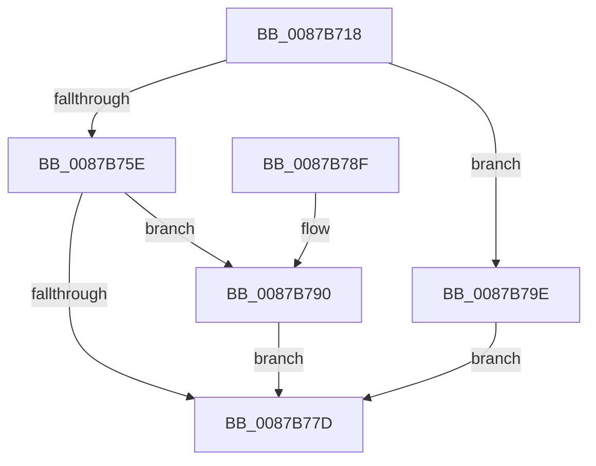

# CmpGetVolumeLogFileSizeCap

- RVA: `0x0087B718`–`0x0087B7A5` (길이 `141` bytes)
- VA: `0x000000014087B718`
- 실행 섹션: `PAGE`
- PDB 이름 있음: `예`; PDB Function 태그: `아니요`
- unwind 정보 RVA: `0x0006CEA0`
- 디코드: `37`개 명령, `141/141` bytes 표시
- 미해석 바이트: `0` (있으면 어셈블리에 `.byte`로 보존)

> 이 문서는 커널 이미지의 기계어와 PDB 기호를 분석해 생성했습니다. 4번과 5번은 함수 원형과 자료형을 바이너리 사용 방식에서 추정한 C 해석이며 원본 소스 복구 결과는 아닙니다.

## 1. Dependencies

- 직접 호출 지점: **2**; 고유 호출 대상: **2**
- 직접 호출자로 확인된 함수: **1**
- RIP 상대 이미지 참조: **1**

### Outgoing calls
- `0x0087B755` → [ZwQueryVolumeInformationFile](../../text/6A/ZwQueryVolumeInformationFile_function_006AD9F0.md) (function, `0x006AD9F0`)
- `0x0087B785` → [_security_check_cookie](../../text/6A/_security_check_cookie_function_006AC640.md) (function, `0x006AC640`)

### Direct callers
- [CmpOpenHiveFile](CmpOpenHiveFile_function_0087A71C.md) at `0x0087ABE0`

### Static image references
- `0x0087B71C` → RVA `0x00E0A740` (`.data`; read)

## 2. Other-region calls and transfers

- 다른 실행 섹션으로 향하는 call: **2**
  - `0x0087B755` → [ZwQueryVolumeInformationFile](../../text/6A/ZwQueryVolumeInformationFile_function_006AD9F0.md) (`PAGE` → `.text`)
  - `0x0087B785` → [_security_check_cookie](../../text/6A/_security_check_cookie_function_006AC640.md) (`PAGE` → `.text`)
- 별도 외부 분기/꼬리 이동을 확인하지 못했습니다.

## 3. Assembly (complete function range)

```asm
0087B718  48 83 EC 68                     sub rsp, 0x68
0087B71C  48 8B 05 1D F0 58 00            mov rax, qword ptr [rip + 0x58f01d]
0087B723  48 33 C4                        xor rax, rsp
0087B726  48 89 44 24 58                  mov qword ptr [rsp + 0x58], rax
0087B72B  33 C0                           xor eax, eax
0087B72D  C7 44 24 20 03 00 00 00         mov dword ptr [rsp + 0x20], 3
0087B735  0F 57 C0                        xorps xmm0, xmm0
0087B738  48 89 44 24 50                  mov qword ptr [rsp + 0x50], rax
0087B73D  4C 8D 44 24 40                  lea r8, [rsp + 0x40]
0087B742  48 8D 54 24 30                  lea rdx, [rsp + 0x30]
0087B747  44 8D 48 18                     lea r9d, [rax + 0x18]
0087B74B  0F 11 44 24 40                  movups xmmword ptr [rsp + 0x40], xmm0
0087B750  0F 11 44 24 30                  movups xmmword ptr [rsp + 0x30], xmm0
0087B755  E8 96 22 E3 FF                  call 0x1406ad9f0
0087B75A  85 C0                           test eax, eax
0087B75C  78 40                           js 0x14087b79e
0087B75E  8B 44 24 50                     mov eax, dword ptr [rsp + 0x50]
0087B762  8B 4C 24 54                     mov ecx, dword ptr [rsp + 0x54]
0087B766  48 0F AF C8                     imul rcx, rax
0087B76A  B8 00 00 00 02                  mov eax, 0x2000000
0087B76F  48 0F AF 4C 24 40               imul rcx, qword ptr [rsp + 0x40]
0087B775  48 C1 E9 0B                     shr rcx, 0xb
0087B779  3B C8                           cmp ecx, eax
0087B77B  72 13                           jb 0x14087b790
0087B77D  48 8B 4C 24 58                  mov rcx, qword ptr [rsp + 0x58]
0087B782  48 33 CC                        xor rcx, rsp
0087B785  E8 B6 0E E3 FF                  call 0x1406ac640
0087B78A  48 83 C4 68                     add rsp, 0x68
0087B78E  C3                              ret
0087B78F  CC                              int3
0087B790  BA 00 00 08 00                  mov edx, 0x80000
0087B795  8B C1                           mov eax, ecx
0087B797  3B CA                           cmp ecx, edx
0087B799  0F 46 C2                        cmovbe eax, edx
0087B79C  EB DF                           jmp 0x14087b77d
0087B79E  B8 00 00 00 02                  mov eax, 0x2000000
0087B7A3  EB D8                           jmp 0x14087b77d
```

## 4. C-style interpretation (structured pseudocode)

```c
__int64 __fastcall CmpGetVolumeLogFileSizeCap(void)
{
    __int64 result;
    __int64 v_rsp;
    unsigned __int64 v_stack_m10;
    unsigned int v_stack_m14;
    unsigned __int64 v_stack_m18;
    unsigned __int64 v_stack_m28;
    unsigned __int64 v_stack_m38;
    unsigned int v_stack_m48;

    v_rsp = (v_rsp) - (104);
    result = (*(unsigned __int64 *)(v_rip + 5828637)) ^ (v_rsp);
    v_stack_m10 = result;
    result = 0;
    v_stack_m48 = 3;
    v_stack_m18 = 0;
    v_stack_m28 = v_xmm0;
    v_stack_m38 = v_xmm0;
    result = ZwQueryVolumeInformationFile(a1, v_stack_m38, v_stack_m28, result + 24);
    if (sign_flag) goto loc_0087B79E;
    a1 = ((unsigned int)(v_stack_m14)) * ((unsigned int)(v_stack_m18));
    a1 = (a1) * (v_stack_m28);
    a1 = (a1) >> (11);
    if (((unsigned int)(a1)) < ((unsigned int)((unsigned int)(0x2000000ULL)))) goto loc_0087B790;
loc_0087B77D:
    a1 = (v_stack_m10) ^ (v_rsp);
    result = _security_check_cookie(a1, v_stack_m38, v_stack_m28, result + 24);
    v_rsp = (v_rsp) + (104);
    return result;
loc_0087B790:
    result = (unsigned int)((unsigned int)(a1));
    if (((unsigned int)(a1)) <= ((unsigned int)((unsigned int)(0x80000ULL)))) { result = (unsigned int)((unsigned int)(0x80000ULL)); }
    goto loc_0087B77D;
loc_0087B79E:
    goto loc_0087B77D;
}
```

## 5. (Beta) C Style

```c
void CmpGetVolumeLogFileSizeCap(void)
{
    int64_t result;
    int64_t local_rsp;
    uint64_t v_stack_m10;
    uint32_t v_stack_m14;
    uint64_t v_stack_m18;
    uint64_t v_stack_m28;
    uint64_t v_stack_m38;
    uint32_t v_stack_m48;

    local_rsp = (local_rsp) - (104);
    result = (*(uint64_t *)(v_rip + 0x58F01D)) ^ (local_rsp);
    v_stack_m10 = result;
    result = 0;
    v_stack_m48 = 3;
    v_stack_m18 = 0;
    v_stack_m28 = v_xmm0;
    v_stack_m38 = v_xmm0;
    result = ZwQueryVolumeInformationFile(a1, v_stack_m38, v_stack_m28, result + 24);
    if (sign_flag) goto loc_0087B79E;
    a1 = ((uint32_t)(v_stack_m14)) * ((uint32_t)(v_stack_m18));
    a1 = (a1) * (v_stack_m28);
    a1 = (a1) >> (11);
    if (((uint32_t)(a1)) < ((uint32_t)((uint32_t)(0x2000000ULL)))) goto loc_0087B790;
loc_0087B77D:
    a1 = (v_stack_m10) ^ (local_rsp);
    result = _security_check_cookie(a1, v_stack_m38, v_stack_m28, result + 24);
    local_rsp = (local_rsp) + (104);
    return result;
loc_0087B790:
    result = (uint32_t)((uint32_t)(a1));
    if (((uint32_t)(a1)) <= ((uint32_t)((uint32_t)(0x80000ULL)))) { result = (uint32_t)((uint32_t)(0x80000ULL)); }
    goto loc_0087B77D;
loc_0087B79E:
    goto loc_0087B77D;
}
```

## 6. Execution-region graph

[열기: 2D/3D 그래프와 함수 탐색 컨트롤 패널](../../../control-panel.html?section=page&rva=0x0087B718&view=graph)

- 2D 그래프는 위에서 아래로 흐르고, 3D 그래프는 빈 공간을 드래그해 회전합니다. Shift+드래그는 이동, 휠은 확대·축소, 함수 노드 선택은 대상 보고서 이동입니다.

### Static fallback


