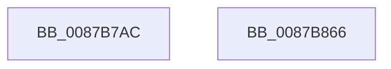

# CmpHiveInitialize

- RVA: `0x0087B7AC`–`0x0087B867` (길이 `187` bytes)
- VA: `0x000000014087B7AC`
- 실행 섹션: `PAGE`
- PDB 이름 있음: `예`; PDB Function 태그: `아니요`
- unwind 정보 RVA: `0x0005CAAC`
- 디코드: `40`개 명령, `187/187` bytes 표시
- 미해석 바이트: `0` (있으면 어셈블리에 `.byte`로 보존)

> 이 문서는 커널 이미지의 기계어와 PDB 기호를 분석해 생성했습니다. 4번과 5번은 함수 원형과 자료형을 바이너리 사용 방식에서 추정한 C 해석이며 원본 소스 복구 결과는 아닙니다.

## 1. Dependencies

- 직접 호출 지점: **3**; 고유 호출 대상: **3**
- 직접 호출자로 확인된 함수: **2**
- RIP 상대 이미지 참조: **1**

### Outgoing calls
- `0x0087B7C4` → [memset](../../text/6C/memset_function_006C6C40.md) (function, `0x006C6C40`)
- `0x0087B7CC` → [HvHiveInitialize](HvHiveInitialize_function_0087B8AC.md) (function, `0x0087B8AC`)
- `0x0087B830` → [CmpInitSecurityCache](CmpInitSecurityCache_function_0087B870.md) (function, `0x0087B870`)

### Direct callers
- [CmpCreateEmptyHiveClone](../7E/CmpCreateEmptyHiveClone_function_007EE2E0.md) at `0x007EE36A`
- [CmpCreateHive](CmpCreateHive_function_00879DF0.md) at `0x00879FA0`

### Static image references
- `0x0087B83B` → RVA `0x009B20D0` (`CmpLateUnloadHiveWorker`; read)

## 2. Other-region calls and transfers

- 다른 실행 섹션으로 향하는 call: **1**
  - `0x0087B7C4` → [memset](../../text/6C/memset_function_006C6C40.md) (`PAGE` → `.text`)
- 별도 외부 분기/꼬리 이동을 확인하지 못했습니다.

## 3. Assembly (complete function range)

```asm
0087B7AC  48 89 5C 24 08                  mov qword ptr [rsp + 8], rbx
0087B7B1  57                              push rdi
0087B7B2  48 83 EC 20                     sub rsp, 0x20
0087B7B6  48 8B FA                        mov rdi, rdx
0087B7B9  41 B8 D8 12 00 00               mov r8d, 0x12d8
0087B7BF  33 D2                           xor edx, edx
0087B7C1  48 8B D9                        mov rbx, rcx
0087B7C4  E8 77 B4 E4 FF                  call 0x1406c6c40
0087B7C9  48 8B CB                        mov rcx, rbx
0087B7CC  E8 DB 00 00 00                  call 0x14087b8ac
0087B7D1  C7 83 88 10 00 00 01 00 00 00   mov dword ptr [rbx + 0x1088], 1
0087B7DB  48 8D 83 48 06 00 00            lea rax, [rbx + 0x648]
0087B7E2  33 D2                           xor edx, edx
0087B7E4  48 8B CB                        mov rcx, rbx
0087B7E7  48 89 93 A8 12 00 00            mov qword ptr [rbx + 0x12a8], rdx
0087B7EE  48 89 40 08                     mov qword ptr [rax + 8], rax
0087B7F2  48 89 00                        mov qword ptr [rax], rax
0087B7F5  48 8D 83 18 10 00 00            lea rax, [rbx + 0x1018]
0087B7FC  48 89 93 68 06 00 00            mov qword ptr [rbx + 0x668], rdx
0087B803  C7 83 8C 0B 00 00 10 00 00 00   mov dword ptr [rbx + 0xb8c], 0x10
0087B80D  48 89 93 90 06 00 00            mov qword ptr [rbx + 0x690], rdx
0087B814  48 89 93 F8 06 00 00            mov qword ptr [rbx + 0x6f8], rdx
0087B81B  48 89 40 08                     mov qword ptr [rax + 8], rax
0087B81F  48 89 00                        mov qword ptr [rax], rax
0087B822  48 8D 83 58 06 00 00            lea rax, [rbx + 0x658]
0087B829  48 89 40 08                     mov qword ptr [rax + 8], rax
0087B82D  48 89 00                        mov qword ptr [rax], rax
0087B830  E8 3B 00 00 00                  call 0x14087b870
0087B835  89 93 C0 12 00 00               mov dword ptr [rbx + 0x12c0], edx
0087B83B  48 8D 05 8E 68 13 00            lea rax, [rip + 0x13688e]
0087B842  48 89 93 C8 12 00 00            mov qword ptr [rbx + 0x12c8], rdx
0087B849  48 89 5F 18                     mov qword ptr [rdi + 0x18], rbx
0087B84D  48 89 47 10                     mov qword ptr [rdi + 0x10], rax
0087B851  48 89 17                        mov qword ptr [rdi], rdx
0087B854  48 89 BB D0 12 00 00            mov qword ptr [rbx + 0x12d0], rdi
0087B85B  48 8B 5C 24 30                  mov rbx, qword ptr [rsp + 0x30]
0087B860  48 83 C4 20                     add rsp, 0x20
0087B864  5F                              pop rdi
0087B865  C3                              ret
0087B866  CC                              int3
```

## 4. C-style interpretation (structured pseudocode)

```c
__int64 __fastcall CmpHiveInitialize(__int64 a1, __int64 a2)
{
    __int64 result;
    __int64 v_rsp;
    unsigned __int64 v_stack_p8;

    v_stack_p8 = v_rbx;
    v_rsp = (v_rsp) - (32);
    a2 = 0;
    result = memset(a1, a2, (unsigned int)(0x12D8ULL), a4);
    result = HvHiveInitialize(a1, a2, (unsigned int)(0x12D8ULL), a4);
    *(unsigned int *)(a1 + 4232) = 1;
    a2 = 0;
    *(unsigned __int64 *)(a1 + 4776) = 0;
    *(unsigned __int64 *)(a1 + 1608 + 8) = a1 + 1608;
    *(unsigned __int64 *)(a1 + 1608) = a1 + 1608;
    *(unsigned __int64 *)(a1 + 1640) = 0;
    *(unsigned int *)(a1 + 2956) = 16;
    *(unsigned __int64 *)(a1 + 1680) = 0;
    *(unsigned __int64 *)(a1 + 1784) = 0;
    *(unsigned __int64 *)(a1 + 4120 + 8) = a1 + 4120;
    *(unsigned __int64 *)(a1 + 4120) = a1 + 4120;
    *(unsigned __int64 *)(a1 + 1624 + 8) = a1 + 1624;
    *(unsigned __int64 *)(a1 + 1624) = a1 + 1624;
    result = CmpInitSecurityCache(a1, a2, (unsigned int)(0x12D8ULL), a4);
    *(unsigned int *)(a1 + 4800) = 0;
    *(unsigned __int64 *)(a1 + 4808) = 0;
    *(unsigned __int64 *)(a2 + 24) = a1;
    *(unsigned __int64 *)(a2 + 16) = v_rip + 1271950;
    *(unsigned __int64 *)(a2) = 0;
    *(unsigned __int64 *)(a1 + 4816) = 0;
    v_rsp = (v_rsp) + (32);
    return v_rip + 1271950;
}
```

## 5. (Beta) C Style

```c
int64_t CmpHiveInitialize(void *Arg1, void *Arg2)
{
    uint8_t *arg1 = (uint8_t *)Arg1;
    uint8_t *arg2 = (uint8_t *)Arg2;

    int64_t result;
    int64_t local_rsp;
    uint64_t v_stack_p8;

    v_stack_p8 = local_rbx;
    local_rsp = (local_rsp) - (32);
    Arg2 = 0;
    result = memset(Arg1, Arg2, (uint32_t)(0x12D8ULL), a4);
    result = HvHiveInitialize(Arg1, Arg2, (uint32_t)(0x12D8ULL), a4);
    *(uint32_t *)(arg1 + 0x1088) = 1;
    Arg2 = 0;
    *(uint64_t *)(arg1 + 0x12A8) = 0;
    *(void **)(arg1 + 0x648 + 0x8) = Arg1 + 1608;
    *(void **)(arg1 + 0x648) = Arg1 + 1608;
    *(uint64_t *)(arg1 + 0x668) = 0;
    *(uint32_t *)(arg1 + 0xB8C) = 16;
    *(uint64_t *)(arg1 + 0x690) = 0;
    *(uint64_t *)(arg1 + 0x6F8) = 0;
    *(void **)(arg1 + 0x1018 + 0x8) = Arg1 + 4120;
    *(void **)(arg1 + 0x1018) = Arg1 + 4120;
    *(void **)(arg1 + 0x658 + 0x8) = Arg1 + 1624;
    *(void **)(arg1 + 0x658) = Arg1 + 1624;
    result = CmpInitSecurityCache(Arg1, Arg2, (uint32_t)(0x12D8ULL), a4);
    *(uint32_t *)(arg1 + 0x12C0) = 0;
    *(uint64_t *)(arg1 + 0x12C8) = 0;
    *(void **)(arg2 + 0x18) = Arg1;
    *(uint64_t *)(arg2 + 0x10) = v_rip + 1271950;
    *(uint64_t *)(arg2) = 0;
    *(uint64_t *)(arg1 + 0x12D0) = 0;
    local_rsp = (local_rsp) + (32);
    return v_rip + 1271950;
}
```

### 관측된 메모리 오프셋

구조체 형식이 확인되지 않은 접근은 인자 기준의 오프셋으로만 기록했습니다.

| 기준 인자 | 오프셋 표현 | 폭 (bit) | 접근 |
|---|---:|---:|---|
| `Arg1` | `+ 0x0` | `64` | `W` |
| `Arg1` | `+ 0x8` | `64` | `W` |
| `Arg1` | `+ 0x648` | `64` | `R` |
| `Arg1` | `+ 0x658` | `64` | `R` |
| `Arg1` | `+ 0x668` | `64` | `W` |
| `Arg1` | `+ 0x690` | `64` | `W` |
| `Arg1` | `+ 0x6F8` | `64` | `W` |
| `Arg1` | `+ 0xB8C` | `32` | `W` |
| `Arg1` | `+ 0x1018` | `64` | `R` |
| `Arg1` | `+ 0x1088` | `32` | `W` |
| `Arg1` | `+ 0x12A8` | `64` | `W` |
| `Arg1` | `+ 0x12C0` | `32` | `W` |
| `Arg1` | `+ 0x12C8` | `64` | `W` |
| `Arg1` | `+ 0x12D0` | `64` | `W` |
| `Arg2` | `+ 0x0` | `64` | `W` |
| `Arg2` | `+ 0x10` | `64` | `W` |
| `Arg2` | `+ 0x18` | `64` | `W` |

## 6. Execution-region graph

[열기: 2D/3D 그래프와 함수 탐색 컨트롤 패널](../../../control-panel.html?section=page&rva=0x0087B7AC&view=graph)

- 2D 그래프는 위에서 아래로 흐르고, 3D 그래프는 빈 공간을 드래그해 회전합니다. Shift+드래그는 이동, 휠은 확대·축소, 함수 노드 선택은 대상 보고서 이동입니다.

### Static fallback


