# CmpInitHiveFromFile

- RVA: `0x008794D4`–`0x00879A60` (길이 `1,420` bytes)
- VA: `0x00000001408794D4`
- 실행 섹션: `PAGE`
- PDB 이름 있음: `예`; PDB Function 태그: `아니요`
- unwind 정보 RVA: `0x0006CD44`
- 디코드: `323`개 명령, `1,420/1,420` bytes 표시
- 미해석 바이트: `0` (있으면 어셈블리에 `.byte`로 보존)

> 이 문서는 커널 이미지의 기계어와 PDB 기호를 분석해 생성했습니다. 4번과 5번은 함수 원형과 자료형을 바이너리 사용 방식에서 추정한 C 해석이며 원본 소스 복구 결과는 아닙니다.

## 1. Dependencies

- 직접 호출 지점: **24**; 고유 호출 대상: **17**
- 직접 호출자로 확인된 함수: **2**
- RIP 상대 이미지 참조: **13**

### Outgoing calls
- `0x0087963E` → [EtwWriteTransfer](../../text/41/EtwWriteTransfer_function_0041C830.md) (function, `0x0041C830`)
- `0x00879691` → [CmpOpenHiveFiles](CmpOpenHiveFiles_function_00879A68.md) (function, `0x00879A68`)
- `0x008796B6` → [SetFailureLocation](../../text/46/SetFailureLocation_function_0046EF54.md) (function, `0x0046EF54`)
- `0x008796C0` → [CmpReleaseHiveLoadUnloadRundown](../../pagecmrc/BC/CmpReleaseHiveLoadUnloadRundown_function_00BC9CAC.md) (function, `0x00BC9CAC`)
- `0x008796CE` → [ZwClose](../../text/6A/ZwClose_function_006AD2B0.md) (function, `0x006AD2B0`)
- `0x008796DC` → [ZwClose](../../text/6A/ZwClose_function_006AD2B0.md) (function, `0x006AD2B0`)
- `0x008796EA` → [ZwClose](../../text/6A/ZwClose_function_006AD2B0.md) (function, `0x006AD2B0`)
- `0x008797AB` → [EtwWriteTransfer](../../text/41/EtwWriteTransfer_function_0041C830.md) (function, `0x0041C830`)
- `0x008797BC` → [_security_check_cookie](../../text/6A/_security_check_cookie_function_006AC640.md) (function, `0x006AC640`)
- `0x008797DF` → [CmpAcquireHiveLoadUnloadRundown](../../pagecmrc/BC/CmpAcquireHiveLoadUnloadRundown_function_00BC9C6C.md) (function, `0x00BC9C6C`)
- `0x0087980B` → [memset](../../text/6C/memset_function_006C6C40.md) (function, `0x006C6C40`)
- `0x00879856` → [CmpCreateHive](CmpCreateHive_function_00879DF0.md) (function, `0x00879DF0`)
- `0x00879891` → [CmSiAllocateMemory](../../text/49/CmSiAllocateMemory_function_00490C18.md) (function, `0x00490C18`)
- `0x008798DE` → [memcpy](../../text/6C/memcpy_function_006C6840.md) (function, `0x006C6840`)
- `0x00879906` → [CmpLogEvent](CmpLogEvent_function_0087A664.md) (function, `0x0087A664`)
- `0x00879925` → [ZwQueryInformationFile](../../text/6A/ZwQueryInformationFile_function_006AD2F0.md) (function, `0x006AD2F0`)
- `0x00879973` → [CmpIsHiveLoadUnloadRundownActive](../../pagecmrc/BC/CmpIsHiveLoadUnloadRundownActive_function_00BC9FE4.md) (function, `0x00BC9FE4`)
- `0x0087998E` → [ZwClose](../../text/6A/ZwClose_function_006AD2B0.md) (function, `0x006AD2B0`)
- `0x0087999C` → [ZwClose](../../text/6A/ZwClose_function_006AD2B0.md) (function, `0x006AD2B0`)
- `0x008799B9` → [ZwClose](../../text/6A/ZwClose_function_006AD2B0.md) (function, `0x006AD2B0`)
- `0x008799DC` → [CmpAttachToRegistryProcess](../../pagecmrc/BC/CmpAttachToRegistryProcess_function_00BC98E0.md) (function, `0x00BC98E0`)
- `0x008799EB` → [CmpFlushHive](../9B/CmpFlushHive_function_009B3DC0.md) (function, `0x009B3DC0`)
- `0x008799F6` → [CmpDetachFromRegistryProcess](../../pagecmrc/BC/CmpDetachFromRegistryProcess_function_00BC9920.md) (function, `0x00BC9920`)
- `0x00879A1A` → [SetFailureLocation](../../text/46/SetFailureLocation_function_0046EF54.md) (function, `0x0046EF54`)

### Direct callers
- [CmpLoadHiveThread](../7D/CmpLoadHiveThread_function_007DB040.md) at `0x007DB2B6`
- [CmpCmdHiveOpen](CmpCmdHiveOpen_function_00878404.md) at `0x008784E5`
- [CmpCmdHiveOpen](CmpCmdHiveOpen_function_00878404.md) at `0x008785B9`

### Static image references
- `0x008794F0` → RVA `0x00E0A740` (`.data`; read)
- `0x00879508` → RVA `0x0005BCFD` (`.rdata`; read)
- `0x00879513` → RVA `0x00043590` (`.rdata`; read)
- `0x0087953A` → RVA `0x00E09F58` (`.data`; read)
- `0x00879584` → RVA `0x00E09F68` (`.data`; read)
- `0x008795C1` → RVA `0x00057503` (`.rdata`; read)
- `0x008795CB` → RVA `0x00E09F60` (`.data`; read)
- `0x008795FD` → RVA `0x0005750D` (`.rdata`; read)
- `0x00879626` → RVA `0x00E09F78` (`.data`; read)
- `0x00879726` → RVA `0x0005752E` (`.rdata`; read)
- `0x00879764` → RVA `0x00057538` (`.rdata`; read)
- `0x008798FA` → RVA `0x000108C0` (`.rdata`; read)
- `0x00879A24` → RVA `0x00E09F70` (`.data`; read)

## 2. Other-region calls and transfers

- 다른 실행 섹션으로 향하는 call: **20**
  - `0x0087963E` → [EtwWriteTransfer](../../text/41/EtwWriteTransfer_function_0041C830.md) (`PAGE` → `.text`)
  - `0x008796B6` → [SetFailureLocation](../../text/46/SetFailureLocation_function_0046EF54.md) (`PAGE` → `.text`)
  - `0x008796C0` → [CmpReleaseHiveLoadUnloadRundown](../../pagecmrc/BC/CmpReleaseHiveLoadUnloadRundown_function_00BC9CAC.md) (`PAGE` → `PAGECMRC`)
  - `0x008796CE` → [ZwClose](../../text/6A/ZwClose_function_006AD2B0.md) (`PAGE` → `.text`)
  - `0x008796DC` → [ZwClose](../../text/6A/ZwClose_function_006AD2B0.md) (`PAGE` → `.text`)
  - `0x008796EA` → [ZwClose](../../text/6A/ZwClose_function_006AD2B0.md) (`PAGE` → `.text`)
  - `0x008797AB` → [EtwWriteTransfer](../../text/41/EtwWriteTransfer_function_0041C830.md) (`PAGE` → `.text`)
  - `0x008797BC` → [_security_check_cookie](../../text/6A/_security_check_cookie_function_006AC640.md) (`PAGE` → `.text`)
  - `0x008797DF` → [CmpAcquireHiveLoadUnloadRundown](../../pagecmrc/BC/CmpAcquireHiveLoadUnloadRundown_function_00BC9C6C.md) (`PAGE` → `PAGECMRC`)
  - `0x0087980B` → [memset](../../text/6C/memset_function_006C6C40.md) (`PAGE` → `.text`)
  - `0x00879891` → [CmSiAllocateMemory](../../text/49/CmSiAllocateMemory_function_00490C18.md) (`PAGE` → `.text`)
  - `0x008798DE` → [memcpy](../../text/6C/memcpy_function_006C6840.md) (`PAGE` → `.text`)
  - `0x00879925` → [ZwQueryInformationFile](../../text/6A/ZwQueryInformationFile_function_006AD2F0.md) (`PAGE` → `.text`)
  - `0x00879973` → [CmpIsHiveLoadUnloadRundownActive](../../pagecmrc/BC/CmpIsHiveLoadUnloadRundownActive_function_00BC9FE4.md) (`PAGE` → `PAGECMRC`)
  - `0x0087998E` → [ZwClose](../../text/6A/ZwClose_function_006AD2B0.md) (`PAGE` → `.text`)
  - `0x0087999C` → [ZwClose](../../text/6A/ZwClose_function_006AD2B0.md) (`PAGE` → `.text`)
  - `0x008799B9` → [ZwClose](../../text/6A/ZwClose_function_006AD2B0.md) (`PAGE` → `.text`)
  - `0x008799DC` → [CmpAttachToRegistryProcess](../../pagecmrc/BC/CmpAttachToRegistryProcess_function_00BC98E0.md) (`PAGE` → `PAGECMRC`)
  - `0x008799F6` → [CmpDetachFromRegistryProcess](../../pagecmrc/BC/CmpDetachFromRegistryProcess_function_00BC9920.md) (`PAGE` → `PAGECMRC`)
  - `0x00879A1A` → [SetFailureLocation](../../text/46/SetFailureLocation_function_0046EF54.md) (`PAGE` → `.text`)
- 별도 외부 분기/꼬리 이동을 확인하지 못했습니다.

## 3. Assembly (complete function range)

```asm
008794D4  40 55                           push rbp
008794D6  53                              push rbx
008794D7  56                              push rsi
008794D8  57                              push rdi
008794D9  41 54                           push r12
008794DB  41 55                           push r13
008794DD  41 56                           push r14
008794DF  41 57                           push r15
008794E1  48 8D AC 24 58 FF FF FF         lea rbp, [rsp - 0xa8]
008794E9  48 81 EC A8 01 00 00            sub rsp, 0x1a8
008794F0  48 8B 05 49 12 59 00            mov rax, qword ptr [rip + 0x591249]
008794F7  48 33 C4                        xor rax, rsp
008794FA  48 89 85 90 00 00 00            mov qword ptr [rbp + 0x90], rax
00879501  48 8B 85 30 01 00 00            mov rax, qword ptr [rbp + 0x130]
00879508  48 8D 35 EE 27 7E FF            lea rsi, [rip - 0x81d812]
0087950F  83 65 84 00                     and dword ptr [rbp - 0x7c], 0
00879513  4C 8D 15 76 A0 7C FF            lea r10, [rip - 0x835f8a]
0087951A  48 83 64 24 78 00               and qword ptr [rsp + 0x78], 0
00879520  0F 57 C0                        xorps xmm0, xmm0
00879523  4C 8B B5 38 01 00 00            mov r14, qword ptr [rbp + 0x138]
0087952A  0F 57 C9                        xorps xmm1, xmm1
0087952D  48 89 45 D0                     mov qword ptr [rbp - 0x30], rax
00879531  45 32 FF                        xor r15b, r15b
00879534  33 C0                           xor eax, eax
00879536  4C 89 45 A0                     mov qword ptr [rbp - 0x60], r8
0087953A  83 3D 17 0A 59 00 04            cmp dword ptr [rip + 0x590a17], 4
00879541  48 8B F9                        mov rdi, rcx
00879544  4C 8B 85 18 01 00 00            mov r8, qword ptr [rbp + 0x118]
0087954B  4C 89 4D 90                     mov qword ptr [rbp - 0x70], r9
0087954F  44 8D 68 02                     lea r13d, [rax + 2]
00879553  89 55 80                        mov dword ptr [rbp - 0x80], edx
00879556  4C 89 45 98                     mov qword ptr [rbp - 0x68], r8
0087955A  0F 11 45 F8                     movups xmmword ptr [rbp - 8], xmm0
0087955E  48 89 45 18                     mov qword ptr [rbp + 0x18], rax
00879562  0F 11 45 08                     movups xmmword ptr [rbp + 8], xmm0
00879566  0F 11 45 E8                     movups xmmword ptr [rbp - 0x18], xmm0
0087956A  0F 11 4D 20                     movups xmmword ptr [rbp + 0x20], xmm1
0087956E  0F 11 4D 30                     movups xmmword ptr [rbp + 0x30], xmm1
00879572  0F 11 4D 40                     movups xmmword ptr [rbp + 0x40], xmm1
00879576  0F 11 45 B0                     movups xmmword ptr [rbp - 0x50], xmm0
0087957A  0F 11 45 C0                     movups xmmword ptr [rbp - 0x40], xmm0
0087957E  0F 86 CA 00 00 00               jbe 0x14087964e
00879584  F6 05 DD 09 59 00 08            test byte ptr [rip + 0x5909dd], 8
0087958B  0F 85 93 04 00 00               jne 0x140879a24
00879591  32 C0                           xor al, al
00879593  84 C0                           test al, al
00879595  0F 84 B3 00 00 00               je 0x14087964e
0087959B  48 8B 47 08                     mov rax, qword ptr [rdi + 8]
0087959F  48 8D 95 88 00 00 00            lea rdx, [rbp + 0x88]
008795A6  0F B7 09                        movzx ecx, word ptr [rcx]
008795A9  45 33 C9                        xor r9d, r9d
008795AC  83 65 7C 00                     and dword ptr [rbp + 0x7c], 0
008795B0  45 33 C0                        xor r8d, r8d
008795B3  83 A5 8C 00 00 00 00            and dword ptr [rbp + 0x8c], 0
008795BA  48 89 85 80 00 00 00            mov qword ptr [rbp + 0x80], rax
008795C1  0F B7 05 3B DF 7D FF            movzx eax, word ptr [rip - 0x8220c5]
008795C8  89 45 DC                        mov dword ptr [rbp - 0x24], eax
008795CB  48 8B 05 8E 09 59 00            mov rax, qword ptr [rip + 0x59098e]
008795D2  48 89 45 50                     mov qword ptr [rbp + 0x50], rax
008795D6  48 89 55 70                     mov qword ptr [rbp + 0x70], rdx
008795DA  48 8D 55 D8                     lea rdx, [rbp - 0x28]
008795DE  89 8D 88 00 00 00               mov dword ptr [rbp + 0x88], ecx
008795E4  44 89 6D 78                     mov dword ptr [rbp + 0x78], r13d
008795E8  C7 45 D8 00 00 00 0B            mov dword ptr [rbp - 0x28], 0xb000000
008795EF  48 C7 45 E0 08 00 00 00         mov qword ptr [rbp - 0x20], 8
008795F7  0F B7 00                        movzx eax, word ptr [rax]
008795FA  89 45 58                        mov dword ptr [rbp + 0x58], eax
008795FD  48 8D 05 09 DF 7D FF            lea rax, [rip - 0x8220f7]
00879604  48 89 45 60                     mov qword ptr [rbp + 0x60], rax
00879608  48 8B C6                        mov rax, rsi
0087960B  41 2B C2                        sub eax, r10d
0087960E  44 89 6D 5C                     mov dword ptr [rbp + 0x5c], r13d
00879612  C7 45 68 1F 00 00 00            mov dword ptr [rbp + 0x68], 0x1f
00879619  C7 45 6C 01 00 00 00            mov dword ptr [rbp + 0x6c], 1
00879620  89 45 88                        mov dword ptr [rbp - 0x78], eax
00879623  8B 45 88                        mov eax, dword ptr [rbp - 0x78]
00879626  48 8B 0D 4B 09 59 00            mov rcx, qword ptr [rip + 0x59094b]
0087962D  48 8D 45 50                     lea rax, [rbp + 0x50]
00879631  48 89 44 24 28                  mov qword ptr [rsp + 0x28], rax
00879636  C7 44 24 20 04 00 00 00         mov dword ptr [rsp + 0x20], 4
0087963E  E8 ED 31 BA FF                  call 0x14041c830
00879643  8B 55 80                        mov edx, dword ptr [rbp - 0x80]
00879646  4C 8B 45 98                     mov r8, qword ptr [rbp - 0x68]
0087964A  4C 8B 4D 90                     mov r9, qword ptr [rbp - 0x70]
0087964E  44 8B A5 10 01 00 00            mov r12d, dword ptr [rbp + 0x110]
00879655  41 8A 01                        mov al, byte ptr [r9]
00879658  48 8B CF                        mov rcx, rdi
0087965B  48 83 65 88 00                  and qword ptr [rbp - 0x78], 0
00879660  4C 8D 4D 84                     lea r9, [rbp - 0x7c]
00879664  88 44 24 70                     mov byte ptr [rsp + 0x70], al
00879668  48 8D 45 88                     lea rax, [rbp - 0x78]
0087966C  4C 89 74 24 40                  mov qword ptr [rsp + 0x40], r14
00879671  48 89 44 24 38                  mov qword ptr [rsp + 0x38], rax
00879676  48 8D 45 B0                     lea rax, [rbp - 0x50]
0087967A  4C 89 44 24 30                  mov qword ptr [rsp + 0x30], r8
0087967F  45 8B C4                        mov r8d, r12d
00879682  48 89 44 24 28                  mov qword ptr [rsp + 0x28], rax
00879687  48 8D 44 24 70                  lea rax, [rsp + 0x70]
0087968C  48 89 44 24 20                  mov qword ptr [rsp + 0x20], rax
00879691  E8 D2 03 00 00                  call 0x140879a68
00879696  8B D8                           mov ebx, eax
00879698  85 C0                           test eax, eax
0087969A  0F 89 36 01 00 00               jns 0x1408797d6
008796A0  C7 44 24 20 10 00 00 00         mov dword ptr [rsp + 0x20], 0x10
008796A8  44 8B C8                        mov r9d, eax
008796AB  41 B8 1C 00 00 00               mov r8d, 0x1c
008796B1  33 D2                           xor edx, edx
008796B3  49 8B CE                        mov rcx, r14
008796B6  E8 99 58 BF FF                  call 0x14046ef54
008796BB  45 84 FF                        test r15b, r15b
008796BE  74 05                           je 0x1408796c5
008796C0  E8 E7 05 35 00                  call 0x140bc9cac
008796C5  48 8B 4D B0                     mov rcx, qword ptr [rbp - 0x50]
008796C9  48 85 C9                        test rcx, rcx
008796CC  74 05                           je 0x1408796d3
008796CE  E8 DD 3B E3 FF                  call 0x1406ad2b0
008796D3  48 8B 4D B8                     mov rcx, qword ptr [rbp - 0x48]
008796D7  48 85 C9                        test rcx, rcx
008796DA  74 05                           je 0x1408796e1
008796DC  E8 CF 3B E3 FF                  call 0x1406ad2b0
008796E1  48 8B 4D C0                     mov rcx, qword ptr [rbp - 0x40]
008796E5  48 85 C9                        test rcx, rcx
008796E8  74 05                           je 0x1408796ef
008796EA  E8 C1 3B E3 FF                  call 0x1406ad2b0
008796EF  83 3D 62 08 59 00 04            cmp dword ptr [rip + 0x590862], 4
008796F6  0F 86 B4 00 00 00               jbe 0x1408797b0
008796FC  F6 05 65 08 59 00 08            test byte ptr [rip + 0x590865], 8
00879703  0F 85 39 03 00 00               jne 0x140879a42
00879709  32 C0                           xor al, al
0087970B  84 C0                           test al, al
0087970D  0F 84 9D 00 00 00               je 0x1408797b0
00879713  83 65 7C 00                     and dword ptr [rbp + 0x7c], 0
00879717  48 8D 45 88                     lea rax, [rbp - 0x78]
0087971B  48 89 45 70                     mov qword ptr [rbp + 0x70], rax
0087971F  48 8D 35 D7 25 7E FF            lea rsi, [rip - 0x81da29]
00879726  0F B7 05 01 DE 7D FF            movzx eax, word ptr [rip - 0x8221ff]
0087972D  48 8D 55 A0                     lea rdx, [rbp - 0x60]
00879731  89 45 A4                        mov dword ptr [rbp - 0x5c], eax
00879734  45 33 C9                        xor r9d, r9d
00879737  48 8B 05 22 08 59 00            mov rax, qword ptr [rip + 0x590822]
0087973E  45 33 C0                        xor r8d, r8d
00879741  48 89 45 50                     mov qword ptr [rbp + 0x50], rax
00879745  89 5D 88                        mov dword ptr [rbp - 0x78], ebx
00879748  C7 45 78 04 00 00 00            mov dword ptr [rbp + 0x78], 4
0087974F  C7 45 A0 00 00 00 0B            mov dword ptr [rbp - 0x60], 0xb000000
00879756  48 C7 45 A8 08 00 00 00         mov qword ptr [rbp - 0x58], 8
0087975E  0F B7 00                        movzx eax, word ptr [rax]
00879761  89 45 58                        mov dword ptr [rbp + 0x58], eax
00879764  48 8D 05 CD DD 7D FF            lea rax, [rip - 0x822233]
0087976B  48 89 45 60                     mov qword ptr [rbp + 0x60], rax
0087976F  48 8D 05 1A 9E 7C FF            lea rax, [rip - 0x8361e6]
00879776  2B F0                           sub esi, eax
00879778  C7 45 5C 02 00 00 00            mov dword ptr [rbp + 0x5c], 2
0087977F  C7 45 68 1E 00 00 00            mov dword ptr [rbp + 0x68], 0x1e
00879786  C7 45 6C 01 00 00 00            mov dword ptr [rbp + 0x6c], 1
0087978D  89 75 84                        mov dword ptr [rbp - 0x7c], esi
00879790  8B 45 84                        mov eax, dword ptr [rbp - 0x7c]
00879793  48 8B 0D DE 07 59 00            mov rcx, qword ptr [rip + 0x5907de]
0087979A  48 8D 45 50                     lea rax, [rbp + 0x50]
0087979E  48 89 44 24 28                  mov qword ptr [rsp + 0x28], rax
008797A3  C7 44 24 20 03 00 00 00         mov dword ptr [rsp + 0x20], 3
008797AB  E8 80 30 BA FF                  call 0x14041c830
008797B0  8B C3                           mov eax, ebx
008797B2  48 8B 8D 90 00 00 00            mov rcx, qword ptr [rbp + 0x90]
008797B9  48 33 CC                        xor rcx, rsp
008797BC  E8 7F 2E E3 FF                  call 0x1406ac640
008797C1  48 81 C4 A8 01 00 00            add rsp, 0x1a8
008797C8  41 5F                           pop r15
008797CA  41 5E                           pop r14
008797CC  41 5D                           pop r13
008797CE  41 5C                           pop r12
008797D0  5F                              pop rdi
008797D1  5E                              pop rsi
008797D2  5B                              pop rbx
008797D3  5D                              pop rbp
008797D4  C3                              ret
008797D5  CC                              int3
008797D6  45 84 FF                        test r15b, r15b
008797D9  0F 85 94 01 00 00               jne 0x140879973
008797DF  E8 88 04 35 00                  call 0x140bc9c6c
008797E4  44 8A F8                        mov r15b, al
008797E7  84 C0                           test al, al
008797E9  0F 84 DF 01 00 00               je 0x1408799ce
008797EF  44 8A 6C 24 70                  mov r13b, byte ptr [rsp + 0x70]
008797F4  41 B8 B0 01 00 00               mov r8d, 0x1b0
008797FA  41 8A C5                        mov al, r13b
008797FD  49 8B CE                        mov rcx, r14
00879800  F6 D8                           neg al
00879802  1B F6                           sbb esi, esi
00879804  33 D2                           xor edx, edx
00879806  F7 D6                           not esi
00879808  83 E6 05                        and esi, 5
0087980B  E8 30 D4 E4 FF                  call 0x1406c6c40
00879810  48 8B 45 D0                     mov rax, qword ptr [rbp - 0x30]
00879814  33 C9                           xor ecx, ecx
00879816  44 8B 4D 84                     mov r9d, dword ptr [rbp - 0x7c]
0087981A  8B D6                           mov edx, esi
0087981C  44 8B 45 80                     mov r8d, dword ptr [rbp - 0x80]
00879820  4C 89 74 24 60                  mov qword ptr [rsp + 0x60], r14
00879825  48 89 44 24 58                  mov qword ptr [rsp + 0x58], rax
0087982A  48 8D 45 B0                     lea rax, [rbp - 0x50]
0087982E  48 89 4C 24 50                  mov qword ptr [rsp + 0x50], rcx
00879833  48 89 4C 24 48                  mov qword ptr [rsp + 0x48], rcx
00879838  48 89 4C 24 40                  mov qword ptr [rsp + 0x40], rcx
0087983D  44 89 64 24 38                  mov dword ptr [rsp + 0x38], r12d
00879842  48 89 7C 24 30                  mov qword ptr [rsp + 0x30], rdi
00879847  48 89 44 24 28                  mov qword ptr [rsp + 0x28], rax
0087984C  48 89 4C 24 20                  mov qword ptr [rsp + 0x20], rcx
00879851  48 8D 4C 24 78                  lea rcx, [rsp + 0x78]
00879856  E8 95 05 00 00                  call 0x140879df0
0087985B  8B D8                           mov ebx, eax
0087985D  3D 2D 02 00 C0                  cmp eax, 0xc000022d
00879862  0F 84 22 01 00 00               je 0x14087998a
00879868  85 C0                           test eax, eax
0087986A  0F 88 F6 00 00 00               js 0x140879966
00879870  85 F6                           test esi, esi
00879872  74 15                           je 0x140879889
00879874  48 8B 44 24 78                  mov rax, qword ptr [rsp + 0x78]
00879879  F7 80 10 10 00 00 00 08 00 00   test dword ptr [rax + 0x1010], 0x800
00879883  0F 85 4F 01 00 00               jne 0x1408799d8
00879889  0F B7 0F                        movzx ecx, word ptr [rdi]
0087988C  BA 43 4D 4E 62                  mov edx, 0x624e4d43
00879891  E8 82 73 C1 FF                  call 0x140490c18
00879896  48 8B 4C 24 78                  mov rcx, qword ptr [rsp + 0x78]
0087989B  48 89 81 38 07 00 00            mov qword ptr [rcx + 0x738], rax
008798A2  48 8B 4C 24 78                  mov rcx, qword ptr [rsp + 0x78]
008798A7  48 83 B9 38 07 00 00 00         cmp qword ptr [rcx + 0x738], 0
008798AF  74 37                           je 0x1408798e8
008798B1  0F B7 07                        movzx eax, word ptr [rdi]
008798B4  66 89 81 30 07 00 00            mov word ptr [rcx + 0x730], ax
008798BB  0F B7 0F                        movzx ecx, word ptr [rdi]
008798BE  48 8B 44 24 78                  mov rax, qword ptr [rsp + 0x78]
008798C3  66 89 88 32 07 00 00            mov word ptr [rax + 0x732], cx
008798CA  48 8B 4C 24 78                  mov rcx, qword ptr [rsp + 0x78]
008798CF  44 0F B7 07                     movzx r8d, word ptr [rdi]
008798D3  48 8B 57 08                     mov rdx, qword ptr [rdi + 8]
008798D7  48 8B 89 38 07 00 00            mov rcx, qword ptr [rcx + 0x738]
008798DE  E8 5D CF E4 FF                  call 0x1406c6840
008798E3  48 8B 4C 24 78                  mov rcx, qword ptr [rsp + 0x78]
008798E8  48 8B 41 40                     mov rax, qword ptr [rcx + 0x40]
008798EC  8B 88 F8 0F 00 00               mov ecx, dword ptr [rax + 0xff8]
008798F2  F6 C1 04                        test cl, 4
008798F5  74 14                           je 0x14087990b
008798F7  4C 8B C7                        mov r8, rdi
008798FA  48 8D 0D BF 6F 79 FF            lea rcx, [rip - 0x869041]
00879901  BA 2A 00 00 80                  mov edx, 0x8000002a
00879906  E8 59 0D 00 00                  call 0x14087a664
0087990B  48 8B 4D B0                     mov rcx, qword ptr [rbp - 0x50]
0087990F  4C 8D 45 F8                     lea r8, [rbp - 8]
00879913  41 B9 28 00 00 00               mov r9d, 0x28
00879919  C7 44 24 20 04 00 00 00         mov dword ptr [rsp + 0x20], 4
00879921  48 8D 55 E8                     lea rdx, [rbp - 0x18]
00879925  E8 C6 39 E3 FF                  call 0x1406ad2f0
0087992A  85 C0                           test eax, eax
0087992C  78 10                           js 0x14087993e
0087992E  48 8B 4C 24 78                  mov rcx, qword ptr [rsp + 0x78]
00879933  48 8B 45 08                     mov rax, qword ptr [rbp + 8]
00879937  48 89 81 58 10 00 00            mov qword ptr [rcx + 0x1058], rax
0087993E  48 8B 4C 24 78                  mov rcx, qword ptr [rsp + 0x78]
00879943  33 DB                           xor ebx, ebx
00879945  8B 45 8C                        mov eax, dword ptr [rbp - 0x74]
00879948  89 81 BC 00 00 00               mov dword ptr [rcx + 0xbc], eax
0087994E  48 8B 44 24 78                  mov rax, qword ptr [rsp + 0x78]
00879953  48 8B 4D A0                     mov rcx, qword ptr [rbp - 0x60]
00879957  48 89 01                        mov qword ptr [rcx], rax
0087995A  48 8B 45 90                     mov rax, qword ptr [rbp - 0x70]
0087995E  44 88 28                        mov byte ptr [rax], r13b
00879961  E9 55 FD FF FF                  jmp 0x1408796bb
00879966  C7 44 24 20 20 00 00 00         mov dword ptr [rsp + 0x20], 0x20
0087996E  E9 35 FD FF FF                  jmp 0x1408796a8
00879973  E8 6C 06 35 00                  call 0x140bc9fe4
00879978  84 C0                           test al, al
0087997A  0F 84 6F FE FF FF               je 0x1408797ef
00879980  BB 89 01 00 C0                  mov ebx, 0xc0000189
00879985  E9 36 FD FF FF                  jmp 0x1408796c0
0087998A  48 8B 4D B0                     mov rcx, qword ptr [rbp - 0x50]
0087998E  E8 1D 39 E3 FF                  call 0x1406ad2b0
00879993  48 8B 4D B8                     mov rcx, qword ptr [rbp - 0x48]
00879997  48 85 C9                        test rcx, rcx
0087999A  74 05                           je 0x1408799a1
0087999C  E8 0F 39 E3 FF                  call 0x1406ad2b0
008799A1  48 8B 4D C0                     mov rcx, qword ptr [rbp - 0x40]
008799A5  8B 55 80                        mov edx, dword ptr [rbp - 0x80]
008799A8  4C 8B 45 98                     mov r8, qword ptr [rbp - 0x68]
008799AC  4C 8B 4D 90                     mov r9, qword ptr [rbp - 0x70]
008799B0  48 85 C9                        test rcx, rcx
008799B3  0F 84 9C FC FF FF               je 0x140879655
008799B9  E8 F2 38 E3 FF                  call 0x1406ad2b0
008799BE  8B 55 80                        mov edx, dword ptr [rbp - 0x80]
008799C1  4C 8B 45 98                     mov r8, qword ptr [rbp - 0x68]
008799C5  4C 8B 4D 90                     mov r9, qword ptr [rbp - 0x70]
008799C9  E9 87 FC FF FF                  jmp 0x140879655
008799CE  BB 89 01 00 C0                  mov ebx, 0xc0000189
008799D3  E9 ED FC FF FF                  jmp 0x1408796c5
008799D8  48 8D 4D 20                     lea rcx, [rbp + 0x20]
008799DC  E8 FF FE 34 00                  call 0x140bc98e0
008799E1  48 8B 4C 24 78                  mov rcx, qword ptr [rsp + 0x78]
008799E6  BA 0C 00 00 00                  mov edx, 0xc
008799EB  E8 D0 A3 13 00                  call 0x1409b3dc0
008799F0  48 8D 4D 20                     lea rcx, [rbp + 0x20]
008799F4  8B D8                           mov ebx, eax
008799F6  E8 25 FF 34 00                  call 0x140bc9920
008799FB  85 DB                           test ebx, ebx
008799FD  0F 89 86 FE FF FF               jns 0x140879889
00879A03  BA 01 00 00 00                  mov edx, 1
00879A08  C7 44 24 20 30 00 00 00         mov dword ptr [rsp + 0x20], 0x30
00879A10  44 8B CB                        mov r9d, ebx
00879A13  49 8B CE                        mov rcx, r14
00879A16  44 8D 42 1B                     lea r8d, [rdx + 0x1b]
00879A1A  E8 35 55 BF FF                  call 0x14046ef54
00879A1F  E9 65 FE FF FF                  jmp 0x140879889
00879A24  48 8B 05 45 05 59 00            mov rax, qword ptr [rip + 0x590545]
00879A2B  83 E0 08                        and eax, 8
00879A2E  48 3B 05 3B 05 59 00            cmp rax, qword ptr [rip + 0x59053b]
00879A35  0F 85 56 FB FF FF               jne 0x140879591
00879A3B  B0 01                           mov al, 1
00879A3D  E9 51 FB FF FF                  jmp 0x140879593
00879A42  48 8B 05 27 05 59 00            mov rax, qword ptr [rip + 0x590527]
00879A49  83 E0 08                        and eax, 8
00879A4C  48 3B 05 1D 05 59 00            cmp rax, qword ptr [rip + 0x59051d]
00879A53  0F 85 B0 FC FF FF               jne 0x140879709
00879A59  B0 01                           mov al, 1
00879A5B  E9 AB FC FF FF                  jmp 0x14087970b
```

## 4. C-style interpretation (structured pseudocode)

```c
__int64 __fastcall CmpInitHiveFromFile(__int64 a1, int a2, __int64 a3, __int64 a4, unsigned int a5, __int64 a6, __int64 a7, __int64 a8, __int64 a9, __int64 a10)
{
    __int64 result;
    __int64 v_r15;
    __int64 v_rbx;
    __int64 v_rsi;
    __int64 v_rsp;
    unsigned __int64 v_stack_m100;
    unsigned __int64 v_stack_m108;
    unsigned int v_stack_m10C;
    unsigned __int64 v_stack_m110;
    unsigned __int64 v_stack_m118;
    unsigned __int64 v_stack_m128;
    unsigned __int64 v_stack_m130;
    unsigned __int64 v_stack_m138;
    unsigned __int64 v_stack_m140;
    unsigned int v_stack_m144;
    unsigned __int64 v_stack_m148;
    unsigned __int64 v_stack_m150;
    unsigned __int64 v_stack_m158;
    unsigned int v_stack_m15C;
    unsigned int v_stack_m160;
    unsigned int v_stack_m164;
    unsigned int v_stack_m168;
    unsigned __int64 v_stack_m170;
    unsigned __int8 v_stack_m178;
    unsigned __int64 v_stack_m1A8;
    unsigned __int64 v_stack_m1B0;
    unsigned __int64 v_stack_m1B8;
    unsigned __int64 v_stack_m1C0;
    unsigned int v_stack_m1C8;
    unsigned __int64 v_stack_m58;
    unsigned int v_stack_m5C;
    unsigned __int64 v_stack_m60;
    unsigned __int64 v_stack_m68;
    unsigned int v_stack_m6C;
    unsigned int v_stack_m70;
    unsigned __int64 v_stack_m78;
    unsigned int v_stack_m7C;
    unsigned int v_stack_m80;
    unsigned __int64 v_stack_m88;
    unsigned int v_stack_m8C;
    unsigned int v_stack_m90;
    unsigned __int64 v_stack_m98;
    unsigned __int64 v_stack_mA8;
    unsigned __int64 v_stack_mB8;
    unsigned __int64 v_stack_mC8;
    unsigned __int64 v_stack_mD0;
    unsigned __int64 v_stack_mE0;
    unsigned __int64 v_stack_mE8;
    unsigned __int64 v_stack_mF0;
    unsigned __int64 v_stack_p20;
    unsigned __int64 v_stack_p28;
    unsigned __int64 v_stack_p30;
    unsigned int v_stack_p38;
    unsigned __int64 v_stack_p40;
    unsigned __int64 v_stack_p48;
    unsigned __int64 v_stack_p50;
    unsigned __int64 v_stack_p58;
    unsigned __int64 v_stack_p60;
    unsigned __int8 v_stack_p70;
    unsigned __int64 v_stack_p78;

    v_rsp = (v_rsp) - (424);
    result = (*(unsigned __int64 *)(v_rip + 5837385)) ^ (v_rsp);
    v_stack_m58 = result;
    v_stack_m118 = a9;
    v_r15 = 0;
    result = 0;
    v_stack_m148 = a3;
    v_stack_m158 = a4;
    v_stack_m168 = a2;
    v_stack_m150 = a6;
    v_stack_mF0 = v_xmm0;
    v_stack_mD0 = 0;
    v_stack_mE0 = v_xmm0;
    v_stack_m100 = v_xmm0;
    v_stack_mC8 = v_xmm1;
    v_stack_mB8 = v_xmm1;
    v_stack_mA8 = v_xmm1;
    v_stack_m138 = v_xmm0;
    v_stack_m128 = v_xmm0;
    if ((*(unsigned int *)(v_rip + 5835287)) <= 4) goto loc_0087964E;
    if (((*(unsigned __int8 *)(v_rip + 5835229)) & (8)) != 0) goto loc_00879A24;
loc_00879591:
    result = 0;
loc_00879593:
    if (0 != 0) {
        result = *(unsigned __int64 *)(a1 + 8);
        a2 = v_stack_m60;
        a1 = *(unsigned __int16 *)(a1);
        a4 = 0;
        a3 = 0;
        v_stack_m68 = result;
        result = *(unsigned __int16 *)(v_rip - 8528069);
        v_stack_m10C = (unsigned int)(result);
        result = *(unsigned __int64 *)(v_rip + 5835150);
        v_stack_m98 = result;
        v_stack_m78 = a2;
        a2 = v_stack_m110;
        v_stack_m60 = (unsigned int)(a1);
        v_stack_m70 = (unsigned int)(result + 2);
        v_stack_m110 = 0xB000000ULL;
        v_stack_m108 = 8;
        result = *(unsigned __int16 *)(result);
        v_stack_m90 = (unsigned int)(result);
        result = v_rip - 8528119;
        v_stack_m88 = result;
        result = v_rip - 8509458;
        result = (unsigned int)((result) - ((unsigned int)(v_rip - 8609674)));
        v_stack_m8C = (unsigned int)(result + 2);
        v_stack_m80 = 31;
        v_stack_m7C = 1;
        v_stack_m160 = (unsigned int)(result);
        result = v_stack_m160;
        a1 = *(unsigned __int64 *)(v_rip + 5835083);
        result = v_stack_m98;
        v_stack_m1C0 = result;
        v_stack_m1C8 = 4;
        result = EtwWriteTransfer(a1, a2, a3, a4);
        a2 = v_stack_m168;
        a3 = v_stack_m150;
        a4 = v_stack_m158;
    }
loc_00879655:
    v_stack_m178 = (unsigned __int8)(*(unsigned __int8 *)(a4));
    v_stack_m1A8 = a10;
    v_stack_m1B0 = v_stack_m160;
    v_stack_m1B8 = a3;
    v_stack_m1C0 = v_stack_m138;
    v_stack_m1C8 = v_stack_m178;
    result = CmpOpenHiveFiles(a1, a2, (unsigned int)((unsigned int)((unsigned int)(a5))), v_stack_m164);
    if (!sign_flag) goto loc_008797D6;
    v_stack_m1C8 = 16;
loc_008796A8:
    a2 = 0;
    result = SetFailureLocation(a10, a2, 28, (unsigned int)((unsigned int)(result)));
loc_008796BB:
    if (0 != 0) {
        result = CmpReleaseHiveLoadUnloadRundown(a10, a2, 28, (unsigned int)((unsigned int)(result)));
    }
    if (v_stack_m138 != 0) {
        result = ZwClose(v_stack_m138, a2, 28, (unsigned int)((unsigned int)(result)));
    }
    if (v_stack_m130 != 0) {
        result = ZwClose(v_stack_m130, a2, 28, (unsigned int)((unsigned int)(result)));
    }
    if (v_stack_m128 != 0) {
        result = ZwClose(v_stack_m128, a2, 28, (unsigned int)((unsigned int)(result)));
    }
    if ((*(unsigned int *)(v_rip + 5834850)) <= 4) goto loc_008797B0;
    if (((*(unsigned __int8 *)(v_rip + 5834853)) & (8)) != 0) goto loc_00879A42;
loc_00879709:
    result = 0;
loc_0087970B:
    v_rsi = v_rip - 8509458;
    if (0 != 0) {
        result = v_stack_m160;
        v_stack_m78 = result;
        v_rsi = v_rip - 8509993;
        result = *(unsigned __int16 *)(v_rip - 8528383);
        a2 = v_stack_m148;
        v_stack_m144 = (unsigned int)(result);
        a4 = 0;
        result = *(unsigned __int64 *)(v_rip + 5834786);
        a3 = 0;
        v_stack_m98 = result;
        v_stack_m160 = (unsigned int)((unsigned int)((unsigned int)(result)));
        v_stack_m70 = 4;
        v_stack_m148 = 0xB000000ULL;
        v_stack_m140 = 8;
        result = *(unsigned __int16 *)(result);
        v_stack_m90 = (unsigned int)(result);
        result = v_rip - 8528435;
        v_stack_m88 = result;
        result = v_rip - 8610278;
        v_rsi = (unsigned int)((v_rsi) - ((unsigned int)(result)));
        v_stack_m8C = 2;
        v_stack_m80 = 30;
        v_stack_m7C = 1;
        v_stack_m164 = (unsigned int)(v_rsi);
        result = v_stack_m164;
        a1 = *(unsigned __int64 *)(v_rip + 5834718);
        result = v_stack_m98;
        v_stack_m1C0 = result;
        v_stack_m1C8 = 3;
        result = EtwWriteTransfer(a1, a2, a3, a4);
    }
    a1 = (v_stack_m58) ^ (v_rsp);
    result = _security_check_cookie(a1, a2, a3, a4);
    v_rsp = (v_rsp) + (424);
    return result;
loc_008797D6:
    if (0 != 0) goto loc_00879973;
    result = CmpAcquireHiveLoadUnloadRundown(a1, a2, a3, a4);
    if ((unsigned __int8)(result) == 0) goto loc_008799CE;
loc_008797EF:
    result = (unsigned __int8)(-((unsigned __int8)(v_stack_p70)));
    a2 = 0;
    v_rsi = (unsigned int)(~(v_rsi));
    v_rsi = (unsigned int)((v_rsi) & (5));
    result = memset(a10, a2, 432, a4);
    a1 = 0;
    v_stack_p60 = a10;
    v_stack_p58 = v_stack_m118;
    v_stack_p50 = 0;
    v_stack_p48 = 0;
    v_stack_p40 = 0;
    v_stack_p38 = (unsigned int)((unsigned int)(a5));
    v_stack_p30 = 0;
    v_stack_p28 = v_stack_m138;
    v_stack_p20 = 0;
    result = CmpCreateHive(v_stack_p78, (unsigned int)((unsigned int)(v_rsi)), (unsigned int)(v_stack_m168), (unsigned int)(v_stack_m164));
    if (((unsigned int)(result)) == 0xC000022DULL) goto loc_0087998A;
    if (sign_flag) goto loc_00879966;
    if ((unsigned int)(v_rsi) == 0) goto loc_00879889;
    if (((*(unsigned int *)(v_stack_p78 + 4112)) & (0x800ULL)) != 0) goto loc_008799D8;
loc_00879889:
    result = CmSiAllocateMemory(*(unsigned __int16 *)(a1), (unsigned int)(0x624E4D43ULL), (unsigned int)(v_stack_m168), (unsigned int)(v_stack_m164));
    *(unsigned __int64 *)(v_stack_p78 + 1848) = result;
    if ((*(unsigned __int64 *)(v_stack_p78 + 1848)) != 0) {
        result = *(unsigned __int16 *)(a1);
        *(unsigned __int16 *)(v_stack_p78 + 1840) = (unsigned __int16)(result);
        a1 = *(unsigned __int16 *)(a1);
        result = v_stack_p78;
        *(unsigned __int16 *)(result + 1842) = (unsigned __int16)(a1);
        a1 = v_stack_p78;
        a3 = *(unsigned __int16 *)(a1);
        a2 = *(unsigned __int64 *)(a1 + 8);
        a1 = *(unsigned __int64 *)(a1 + 1848);
        result = memcpy(a1, a2, a3, (unsigned int)(v_stack_m164));
        a1 = v_stack_p78;
    }
    result = *(unsigned __int64 *)(a1 + 64);
    if ((((unsigned __int8)((unsigned int)(*(unsigned int *)(*(unsigned __int64 *)(a1 + 64) + 4088)))) & (4)) != 0) {
        a3 = a1;
        a1 = v_rip - 8818753;
        a2 = 0x8000002AULL;
        result = CmpLogEvent(a1, a2, a3, (unsigned int)(v_stack_m164));
    }
    v_stack_p20 = 4;
    result = ZwQueryInformationFile(v_stack_m138, v_stack_m100, v_stack_mF0, 40);
    if (!(sign_flag)) {
        a1 = v_stack_p78;
        result = v_stack_mE0;
        *(unsigned __int64 *)(a1 + 4184) = result;
    }
    v_rbx = 0;
    *(unsigned int *)(v_stack_p78 + 188) = (unsigned int)((unsigned int)(v_stack_m15C));
    *(unsigned __int64 *)(v_stack_m148) = v_stack_p78;
    *(unsigned __int8 *)(v_stack_m158) = (unsigned __int8)(v_stack_p70);
    goto loc_008796BB;
loc_00879966:
    v_stack_p20 = 32;
    goto loc_008796A8;
loc_00879973:
    result = CmpIsHiveLoadUnloadRundownActive(v_stack_m148, v_stack_m100, v_stack_mF0, 40);
    if ((unsigned __int8)(result) == 0) goto loc_008797EF;
    goto loc_008796C0;
loc_0087998A:
    result = ZwClose(v_stack_m138, v_stack_m100, v_stack_mF0, 40);
    if (v_stack_m130 != 0) {
        result = ZwClose(v_stack_m130, v_stack_m100, v_stack_mF0, 40);
    }
    if (v_stack_m128 == 0) goto loc_00879655;
    result = ZwClose(v_stack_m128, (unsigned int)(v_stack_m168), v_stack_m150, v_stack_m158);
    goto loc_00879655;
loc_008799CE:
    goto loc_008796C5;
loc_008799D8:
    result = CmpAttachToRegistryProcess(v_stack_mC8, (unsigned int)(v_stack_m168), v_stack_m150, v_stack_m158);
    result = CmpFlushHive(v_stack_p78, 12, v_stack_m150, v_stack_m158);
    result = CmpDetachFromRegistryProcess(v_stack_mC8, 12, v_stack_m150, v_stack_m158);
    if (!sign_flag) goto loc_00879889;
    v_stack_p20 = 48;
    result = SetFailureLocation(a10, 1, 1 + 27, (unsigned int)((unsigned int)((unsigned int)((unsigned int)(result)))));
    goto loc_00879889;
loc_00879A24:
    result = (unsigned int)((*(unsigned __int64 *)(v_rip + 5834053)) & (8));
    if (result != (*(unsigned __int64 *)(v_rip + 5834043))) goto loc_00879591;
    goto loc_00879593;
loc_00879A42:
    result = (unsigned int)((*(unsigned __int64 *)(v_rip + 5834023)) & (8));
    if (result != (*(unsigned __int64 *)(v_rip + 5834013))) goto loc_00879709;
    goto loc_0087970B;
}
```

## 5. (Beta) C Style

```c
int64_t CmpInitHiveFromFile(void *Arg1, int32_t Arg2, int64_t Arg3, int64_t Arg4, uint32_t Arg5, int64_t Arg6, uint64_t Arg7, uint64_t Arg8, int64_t Arg9, int64_t Arg10)
{
    uint8_t *arg1 = (uint8_t *)Arg1;

    int64_t result;
    int64_t local_r15;
    int64_t local_rbx;
    int64_t local_rsi;
    int64_t local_rsp;
    uint64_t v_stack_m100;
    uint64_t v_stack_m108;
    uint32_t v_stack_m10C;
    uint64_t v_stack_m110;
    uint64_t v_stack_m118;
    uint64_t v_stack_m128;
    uint64_t v_stack_m130;
    uint64_t v_stack_m138;
    uint64_t v_stack_m140;
    uint32_t v_stack_m144;
    uint64_t v_stack_m148;
    uint64_t v_stack_m150;
    uint64_t v_stack_m158;
    uint32_t v_stack_m15C;
    uint32_t v_stack_m160;
    uint32_t v_stack_m164;
    uint32_t v_stack_m168;
    uint64_t v_stack_m170;
    uint8_t v_stack_m178;
    uint64_t v_stack_m1A8;
    uint64_t v_stack_m1B0;
    uint64_t v_stack_m1B8;
    uint64_t v_stack_m1C0;
    uint32_t v_stack_m1C8;
    uint64_t v_stack_m58;
    uint32_t v_stack_m5C;
    uint64_t v_stack_m60;
    uint64_t v_stack_m68;
    uint32_t v_stack_m6C;
    uint32_t v_stack_m70;
    uint64_t v_stack_m78;
    uint32_t v_stack_m7C;
    uint32_t v_stack_m80;
    uint64_t v_stack_m88;
    uint32_t v_stack_m8C;
    uint32_t v_stack_m90;
    uint64_t v_stack_m98;
    uint64_t v_stack_mA8;
    uint64_t v_stack_mB8;
    uint64_t v_stack_mC8;
    uint64_t v_stack_mD0;
    uint64_t v_stack_mE0;
    uint64_t v_stack_mE8;
    uint64_t v_stack_mF0;
    uint64_t v_stack_p20;
    uint64_t v_stack_p28;
    uint64_t v_stack_p30;
    uint32_t v_stack_p38;
    uint64_t v_stack_p40;
    uint64_t v_stack_p48;
    uint64_t v_stack_p50;
    uint64_t v_stack_p58;
    uint64_t v_stack_p60;
    uint8_t v_stack_p70;
    uint64_t v_stack_p78;

    local_rsp = (local_rsp) - (424);
    result = (*(uint64_t *)(v_rip + 0x591249)) ^ (local_rsp);
    v_stack_m58 = result;
    v_stack_m118 = Arg9;
    local_r15 = 0;
    result = 0;
    v_stack_m148 = Arg3;
    v_stack_m158 = Arg4;
    v_stack_m168 = Arg2;
    v_stack_m150 = Arg6;
    v_stack_mF0 = v_xmm0;
    v_stack_mD0 = 0;
    v_stack_mE0 = v_xmm0;
    v_stack_m100 = v_xmm0;
    v_stack_mC8 = v_xmm1;
    v_stack_mB8 = v_xmm1;
    v_stack_mA8 = v_xmm1;
    v_stack_m138 = v_xmm0;
    v_stack_m128 = v_xmm0;
    if ((*(uint32_t *)(v_rip + 0x590A17)) <= 4) goto loc_0087964E;
    if (((*(uint8_t *)(v_rip + 0x5909DD)) & (8)) != 0) goto loc_00879A24;
loc_00879591:
    result = 0;
loc_00879593:
    if (0 != 0) {
        result = *(uint64_t *)(arg1 + 0x8);
        Arg2 = v_stack_m60;
        Arg1 = *(uint16_t *)(arg1);
        Arg4 = 0;
        Arg3 = 0;
        v_stack_m68 = result;
        result = *(uint16_t *)(v_rip - 0x8220C5);
        v_stack_m10C = (uint32_t)(result);
        result = *(uint64_t *)(v_rip + 0x59098E);
        v_stack_m98 = result;
        v_stack_m78 = Arg2;
        Arg2 = v_stack_m110;
        v_stack_m60 = (uint32_t)(Arg1);
        v_stack_m70 = (uint32_t)(result + 2);
        v_stack_m110 = 0xB000000ULL;
        v_stack_m108 = 8;
        result = *(uint16_t *)(result);
        v_stack_m90 = (uint32_t)(result);
        result = v_rip - 8528119;
        v_stack_m88 = result;
        result = v_rip - 8509458;
        result = (uint32_t)((result) - ((uint32_t)(v_rip - 8609674)));
        v_stack_m8C = (uint32_t)(result + 2);
        v_stack_m80 = 31;
        v_stack_m7C = 1;
        v_stack_m160 = (uint32_t)(result);
        result = v_stack_m160;
        Arg1 = *(uint64_t *)(v_rip + 0x59094B);
        result = v_stack_m98;
        v_stack_m1C0 = result;
        v_stack_m1C8 = 4;
        result = EtwWriteTransfer(Arg1, Arg2, Arg3, Arg4);
        Arg2 = v_stack_m168;
        Arg3 = v_stack_m150;
        Arg4 = v_stack_m158;
    }
loc_00879655:
    v_stack_m178 = (uint8_t)(*(uint8_t *)(Arg4));
    v_stack_m1A8 = Arg10;
    v_stack_m1B0 = v_stack_m160;
    v_stack_m1B8 = Arg3;
    v_stack_m1C0 = v_stack_m138;
    v_stack_m1C8 = v_stack_m178;
    result = CmpOpenHiveFiles(Arg1, Arg2, (uint32_t)((uint32_t)((uint32_t)(Arg5))), v_stack_m164);
    if (!sign_flag) goto loc_008797D6;
    v_stack_m1C8 = 16;
loc_008796A8:
    Arg2 = 0;
    result = SetFailureLocation(Arg10, Arg2, 28, (uint32_t)((uint32_t)(result)));
loc_008796BB:
    if (0 != 0) {
        result = CmpReleaseHiveLoadUnloadRundown(Arg10, Arg2, 28, (uint32_t)((uint32_t)(result)));
    }
    if (v_stack_m138 != 0) {
        result = ZwClose(v_stack_m138, Arg2, 28, (uint32_t)((uint32_t)(result)));
    }
    if (v_stack_m130 != 0) {
        result = ZwClose(v_stack_m130, Arg2, 28, (uint32_t)((uint32_t)(result)));
    }
    if (v_stack_m128 != 0) {
        result = ZwClose(v_stack_m128, Arg2, 28, (uint32_t)((uint32_t)(result)));
    }
    if ((*(uint32_t *)(v_rip + 0x590862)) <= 4) goto loc_008797B0;
    if (((*(uint8_t *)(v_rip + 0x590865)) & (8)) != 0) goto loc_00879A42;
loc_00879709:
    result = 0;
loc_0087970B:
    local_rsi = v_rip - 8509458;
    if (0 != 0) {
        result = v_stack_m160;
        v_stack_m78 = result;
        local_rsi = v_rip - 8509993;
        result = *(uint16_t *)(v_rip - 0x8221FF);
        Arg2 = v_stack_m148;
        v_stack_m144 = (uint32_t)(result);
        Arg4 = 0;
        result = *(uint64_t *)(v_rip + 0x590822);
        Arg3 = 0;
        v_stack_m98 = result;
        v_stack_m160 = (uint32_t)((uint32_t)((uint32_t)(result)));
        v_stack_m70 = 4;
        v_stack_m148 = 0xB000000ULL;
        v_stack_m140 = 8;
        result = *(uint16_t *)(result);
        v_stack_m90 = (uint32_t)(result);
        result = v_rip - 8528435;
        v_stack_m88 = result;
        result = v_rip - 8610278;
        local_rsi = (uint32_t)((local_rsi) - ((uint32_t)(result)));
        v_stack_m8C = 2;
        v_stack_m80 = 30;
        v_stack_m7C = 1;
        v_stack_m164 = (uint32_t)(local_rsi);
        result = v_stack_m164;
        Arg1 = *(uint64_t *)(v_rip + 0x5907DE);
        result = v_stack_m98;
        v_stack_m1C0 = result;
        v_stack_m1C8 = 3;
        result = EtwWriteTransfer(Arg1, Arg2, Arg3, Arg4);
    }
    Arg1 = (v_stack_m58) ^ (local_rsp);
    result = _security_check_cookie(Arg1, Arg2, Arg3, Arg4);
    local_rsp = (local_rsp) + (424);
    return result;
loc_008797D6:
    if (0 != 0) goto loc_00879973;
    result = CmpAcquireHiveLoadUnloadRundown(Arg1, Arg2, Arg3, Arg4);
    if ((uint8_t)(result) == 0) goto loc_008799CE;
loc_008797EF:
    result = (uint8_t)(-((uint8_t)(v_stack_p70)));
    Arg2 = 0;
    local_rsi = (uint32_t)(~(local_rsi));
    local_rsi = (uint32_t)((local_rsi) & (5));
    result = memset(Arg10, Arg2, 432, Arg4);
    Arg1 = 0;
    v_stack_p60 = Arg10;
    v_stack_p58 = v_stack_m118;
    v_stack_p50 = 0;
    v_stack_p48 = 0;
    v_stack_p40 = 0;
    v_stack_p38 = (uint32_t)((uint32_t)(Arg5));
    v_stack_p30 = 0;
    v_stack_p28 = v_stack_m138;
    v_stack_p20 = 0;
    result = CmpCreateHive(v_stack_p78, (uint32_t)((uint32_t)(local_rsi)), (uint32_t)(v_stack_m168), (uint32_t)(v_stack_m164));
    if (((uint32_t)(result)) == 0xC000022DULL) goto loc_0087998A;
    if (sign_flag) goto loc_00879966;
    if ((uint32_t)(local_rsi) == 0) goto loc_00879889;
    if (((*(uint32_t *)(v_stack_p78 + 0x1010)) & (0x800ULL)) != 0) goto loc_008799D8;
loc_00879889:
    result = CmSiAllocateMemory(*(uint16_t *)(arg1), (uint32_t)(0x624E4D43ULL), (uint32_t)(v_stack_m168), (uint32_t)(v_stack_m164));
    *(uint64_t *)(v_stack_p78 + 0x738) = result;
    if ((*(uint64_t *)(v_stack_p78 + 0x738)) != 0) {
        result = *(uint16_t *)(arg1);
        *(uint16_t *)(v_stack_p78 + 0x730) = (uint16_t)(result);
        Arg1 = *(uint16_t *)(arg1);
        result = v_stack_p78;
        *(uint16_t *)(result + 0x732) = (uint16_t)(Arg1);
        Arg1 = v_stack_p78;
        Arg3 = *(uint16_t *)(arg1);
        Arg2 = *(uint64_t *)(arg1 + 0x8);
        Arg1 = *(uint64_t *)(arg1 + 0x738);
        result = memcpy(Arg1, Arg2, Arg3, (uint32_t)(v_stack_m164));
        Arg1 = v_stack_p78;
    }
    result = *(uint64_t *)(arg1 + 0x40);
    if ((((uint8_t)((uint32_t)(*(uint32_t *)(*(uint64_t *)(arg1 + 0x40) + 0xFF8)))) & (4)) != 0) {
        Arg3 = Arg1;
        Arg1 = v_rip - 8818753;
        Arg2 = 0x8000002AULL;
        result = CmpLogEvent(Arg1, Arg2, Arg3, (uint32_t)(v_stack_m164));
    }
    v_stack_p20 = 4;
    result = ZwQueryInformationFile(v_stack_m138, v_stack_m100, v_stack_mF0, 40);
    if (!(sign_flag)) {
        Arg1 = v_stack_p78;
        result = v_stack_mE0;
        *(uint64_t *)(arg1 + 0x1058) = result;
    }
    local_rbx = 0;
    *(uint32_t *)(v_stack_p78 + 0xBC) = (uint32_t)((uint32_t)(v_stack_m15C));
    *(uint64_t *)(v_stack_m148) = v_stack_p78;
    *(uint8_t *)(v_stack_m158) = (uint8_t)(v_stack_p70);
    goto loc_008796BB;
loc_00879966:
    v_stack_p20 = 32;
    goto loc_008796A8;
loc_00879973:
    result = CmpIsHiveLoadUnloadRundownActive(v_stack_m148, v_stack_m100, v_stack_mF0, 40);
    if ((uint8_t)(result) == 0) goto loc_008797EF;
    goto loc_008796C0;
loc_0087998A:
    result = ZwClose(v_stack_m138, v_stack_m100, v_stack_mF0, 40);
    if (v_stack_m130 != 0) {
        result = ZwClose(v_stack_m130, v_stack_m100, v_stack_mF0, 40);
    }
    if (v_stack_m128 == 0) goto loc_00879655;
    result = ZwClose(v_stack_m128, (uint32_t)(v_stack_m168), v_stack_m150, v_stack_m158);
    goto loc_00879655;
loc_008799CE:
    goto loc_008796C5;
loc_008799D8:
    result = CmpAttachToRegistryProcess(v_stack_mC8, (uint32_t)(v_stack_m168), v_stack_m150, v_stack_m158);
    result = CmpFlushHive(v_stack_p78, 12, v_stack_m150, v_stack_m158);
    result = CmpDetachFromRegistryProcess(v_stack_mC8, 12, v_stack_m150, v_stack_m158);
    if (!sign_flag) goto loc_00879889;
    v_stack_p20 = 48;
    result = SetFailureLocation(Arg10, 1, 1 + 27, (uint32_t)((uint32_t)((uint32_t)((uint32_t)(result)))));
    goto loc_00879889;
loc_00879A24:
    result = (uint32_t)((*(uint64_t *)(v_rip + 0x590545)) & (8));
    if (result != (*(uint64_t *)(v_rip + 0x59053B))) goto loc_00879591;
    goto loc_00879593;
loc_00879A42:
    result = (uint32_t)((*(uint64_t *)(v_rip + 0x590527)) & (8));
    if (result != (*(uint64_t *)(v_rip + 0x59051D))) goto loc_00879709;
    goto loc_0087970B;
}
```

### 관측된 메모리 오프셋

구조체 형식이 확인되지 않은 접근은 인자 기준의 오프셋으로만 기록했습니다.

| 기준 인자 | 오프셋 표현 | 폭 (bit) | 접근 |
|---|---:|---:|---|
| `Arg1` | `+ 0x0` | `16` | `R` |
| `Arg1` | `+ 0x8` | `64` | `R` |

## 6. Execution-region graph

[열기: 2D/3D 그래프와 함수 탐색 컨트롤 패널](../../../control-panel.html?section=page&rva=0x008794D4&view=graph)

- 2D 그래프는 위에서 아래로 흐르고, 3D 그래프는 빈 공간을 드래그해 회전합니다. Shift+드래그는 이동, 휠은 확대·축소, 함수 노드 선택은 대상 보고서 이동입니다.

### Static fallback

```mermaid
flowchart TD
  bb_008794D4[BB_008794D4]
  bb_00879584[BB_00879584]
  bb_00879591[BB_00879591]
  bb_00879593[BB_00879593]
  bb_0087959B[BB_0087959B]
  bb_0087964E[BB_0087964E]
  bb_00879655[BB_00879655]
  bb_008796A0[BB_008796A0]
  bb_008796A8[BB_008796A8]
  bb_008796BB[BB_008796BB]
  bb_008796C0[BB_008796C0]
  bb_008796C5[BB_008796C5]
  bb_008796CE[BB_008796CE]
  bb_008796D3[BB_008796D3]
  bb_008796DC[BB_008796DC]
  bb_008796E1[BB_008796E1]
  bb_008796EA[BB_008796EA]
  bb_008796EF[BB_008796EF]
  bb_008796FC[BB_008796FC]
  bb_00879709[BB_00879709]
  bb_0087970B[BB_0087970B]
  bb_00879713[BB_00879713]
  bb_008797B0[BB_008797B0]
  bb_008797D5[BB_008797D5]
  bb_008797D6[BB_008797D6]
  bb_008797DF[BB_008797DF]
  bb_008797EF[BB_008797EF]
  bb_00879868[BB_00879868]
  bb_00879870[BB_00879870]
  bb_00879874[BB_00879874]
  bb_00879889[BB_00879889]
  bb_008798B1[BB_008798B1]
  bb_008798E8[BB_008798E8]
  bb_008798F7[BB_008798F7]
  bb_0087990B[BB_0087990B]
  bb_0087992E[BB_0087992E]
  bb_0087993E[BB_0087993E]
  bb_00879966[BB_00879966]
  bb_00879973[BB_00879973]
  bb_00879980[BB_00879980]
  bb_0087998A[BB_0087998A]
  bb_0087999C[BB_0087999C]
  bb_008799A1[BB_008799A1]
  bb_008799B9[BB_008799B9]
  bb_008799CE[BB_008799CE]
  bb_008799D8[BB_008799D8]
  bb_00879A03[BB_00879A03]
  bb_00879A24[BB_00879A24]
  bb_00879A3B[BB_00879A3B]
  bb_00879A42[BB_00879A42]
  bb_00879A59[BB_00879A59]
  bb_008794D4 -->|branch| bb_0087964E
  bb_008794D4 -->|fallthrough| bb_00879584
  bb_00879584 -->|branch| bb_00879A24
  bb_00879584 -->|fallthrough| bb_00879591
  bb_00879591 -->|flow| bb_00879593
  bb_00879593 -->|branch| bb_0087964E
  bb_00879593 -->|fallthrough| bb_0087959B
  bb_0087959B -->|flow| bb_0087964E
  bb_0087964E -->|flow| bb_00879655
  bb_00879655 -->|branch| bb_008797D6
  bb_00879655 -->|fallthrough| bb_008796A0
  bb_008796A0 -->|flow| bb_008796A8
  bb_008796A8 -->|flow| bb_008796BB
  bb_008796BB -->|branch| bb_008796C5
  bb_008796BB -->|fallthrough| bb_008796C0
  bb_008796C0 -->|flow| bb_008796C5
  bb_008796C5 -->|branch| bb_008796D3
  bb_008796C5 -->|fallthrough| bb_008796CE
  bb_008796CE -->|flow| bb_008796D3
  bb_008796D3 -->|branch| bb_008796E1
  bb_008796D3 -->|fallthrough| bb_008796DC
  bb_008796DC -->|flow| bb_008796E1
  bb_008796E1 -->|branch| bb_008796EF
  bb_008796E1 -->|fallthrough| bb_008796EA
  bb_008796EA -->|flow| bb_008796EF
  bb_008796EF -->|branch| bb_008797B0
  bb_008796EF -->|fallthrough| bb_008796FC
  bb_008796FC -->|branch| bb_00879A42
  bb_008796FC -->|fallthrough| bb_00879709
  bb_00879709 -->|flow| bb_0087970B
  bb_0087970B -->|branch| bb_008797B0
  bb_0087970B -->|fallthrough| bb_00879713
  bb_00879713 -->|flow| bb_008797B0
  bb_008797D5 -->|flow| bb_008797D6
  bb_008797D6 -->|branch| bb_00879973
  bb_008797D6 -->|fallthrough| bb_008797DF
  bb_008797DF -->|branch| bb_008799CE
  bb_008797DF -->|fallthrough| bb_008797EF
  bb_008797EF -->|branch| bb_0087998A
  bb_008797EF -->|fallthrough| bb_00879868
  bb_00879868 -->|branch| bb_00879966
  bb_00879868 -->|fallthrough| bb_00879870
  bb_00879870 -->|branch| bb_00879889
  bb_00879870 -->|fallthrough| bb_00879874
  bb_00879874 -->|branch| bb_008799D8
  bb_00879874 -->|fallthrough| bb_00879889
  bb_00879889 -->|branch| bb_008798E8
  bb_00879889 -->|fallthrough| bb_008798B1
  bb_008798B1 -->|flow| bb_008798E8
  bb_008798E8 -->|branch| bb_0087990B
  bb_008798E8 -->|fallthrough| bb_008798F7
  bb_008798F7 -->|flow| bb_0087990B
  bb_0087990B -->|branch| bb_0087993E
  bb_0087990B -->|fallthrough| bb_0087992E
  bb_0087992E -->|flow| bb_0087993E
  bb_0087993E -->|branch| bb_008796BB
  bb_00879966 -->|branch| bb_008796A8
  bb_00879973 -->|branch| bb_008797EF
  bb_00879973 -->|fallthrough| bb_00879980
  bb_00879980 -->|branch| bb_008796C0
  bb_0087998A -->|branch| bb_008799A1
  bb_0087998A -->|fallthrough| bb_0087999C
  bb_0087999C -->|flow| bb_008799A1
  bb_008799A1 -->|branch| bb_00879655
  bb_008799A1 -->|fallthrough| bb_008799B9
  bb_008799B9 -->|branch| bb_00879655
  bb_008799CE -->|branch| bb_008796C5
  bb_008799D8 -->|branch| bb_00879889
  bb_008799D8 -->|fallthrough| bb_00879A03
  bb_00879A03 -->|branch| bb_00879889
  bb_00879A24 -->|branch| bb_00879591
  bb_00879A24 -->|fallthrough| bb_00879A3B
  bb_00879A3B -->|branch| bb_00879593
  bb_00879A42 -->|branch| bb_00879709
  bb_00879A42 -->|fallthrough| bb_00879A59
  bb_00879A59 -->|branch| bb_0087970B
```


