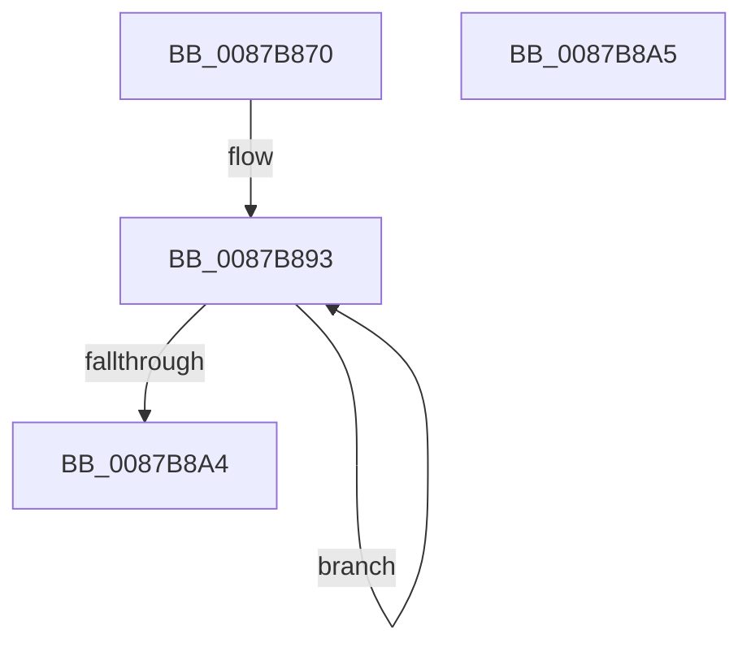

# CmpInitSecurityCache

- RVA: `0x0087B870`–`0x0087B8A6` (길이 `54` bytes)
- VA: `0x000000014087B870`
- 실행 섹션: `PAGE`
- PDB 이름 있음: `예`; PDB Function 태그: `아니요`
- unwind 정보 RVA: `0x000DB714`
- 디코드: `13`개 명령, `54/54` bytes 표시
- 미해석 바이트: `0` (있으면 어셈블리에 `.byte`로 보존)

> 이 문서는 커널 이미지의 기계어와 PDB 기호를 분석해 생성했습니다. 4번과 5번은 함수 원형과 자료형을 바이너리 사용 방식에서 추정한 C 해석이며 원본 소스 복구 결과는 아닙니다.

## 1. Dependencies

- 직접 호출 지점: **0**; 고유 호출 대상: **0**
- 직접 호출자로 확인된 함수: **3**
- RIP 상대 이미지 참조: **0**

### Outgoing calls
- 직접 디코드된 call 명령이 없습니다.

### Direct callers
- [CmpHiveInitialize](CmpHiveInitialize_function_0087B7AC.md) at `0x0087B830`
- [sub_00B28A98](../B2/Unknown_function_00B28A98.md) at `0x00B28BF6`
- [CmpGetSystemControlValues](../../init/C5/CmpGetSystemControlValues_function_00C5959C.md) at `0x00C59644`

### Static image references
- 디코드된 RIP-relative 메모리 참조가 없습니다.

## 2. Other-region calls and transfers

- 다른 실행 섹션으로 향하는 call: **0**
- 별도 외부 분기/꼬리 이동을 확인하지 못했습니다.

## 3. Assembly (complete function range)

```asm
0087B870  83 89 58 07 00 00 FF            or dword ptr [rcx + 0x758], 0xffffffff
0087B877  33 C0                           xor eax, eax
0087B879  48 89 81 60 07 00 00            mov qword ptr [rcx + 0x760], rax
0087B880  48 89 81 50 07 00 00            mov qword ptr [rcx + 0x750], rax
0087B887  48 81 C1 68 07 00 00            add rcx, 0x768
0087B88E  B8 40 00 00 00                  mov eax, 0x40
0087B893  48 89 49 08                     mov qword ptr [rcx + 8], rcx
0087B897  48 89 09                        mov qword ptr [rcx], rcx
0087B89A  48 83 C1 10                     add rcx, 0x10
0087B89E  48 83 E8 01                     sub rax, 1
0087B8A2  75 EF                           jne 0x14087b893
0087B8A4  C3                              ret
0087B8A5  CC                              int3
```

## 4. C-style interpretation (structured pseudocode)

```c
__int64 __fastcall CmpInitSecurityCache(__int64 a1)
{
    __int64 result;

    result = 0;
    *(unsigned __int64 *)(a1 + 1888) = 0;
    *(unsigned __int64 *)(a1 + 1872) = 0;
    a1 = (a1) + (0x768ULL);
loc_0087B893:
    *(unsigned __int64 *)(a1 + 8) = a1;
    *(unsigned __int64 *)(a1) = a1;
    a1 = (a1) + (16);
    result = (64) - (1);
    if (condition_is_not_equal) goto loc_0087B893;
    return result;
}
```

## 5. (Beta) C Style

```c
int64_t CmpInitSecurityCache(void *Arg1)
{
    uint8_t *arg1 = (uint8_t *)Arg1;

    int64_t result;

    result = 0;
    *(uint64_t *)(arg1 + 0x760) = 0;
    *(uint64_t *)(arg1 + 0x750) = 0;
    Arg1 = (Arg1) + (0x768ULL);
loc_0087B893:
    *(void **)(arg1 + 0x8) = Arg1;
    *(void **)(arg1) = Arg1;
    Arg1 = (Arg1) + (16);
    result = (64) - (1);
    if (condition_is_not_equal) goto loc_0087B893;
    return result;
}
```

### 관측된 메모리 오프셋

구조체 형식이 확인되지 않은 접근은 인자 기준의 오프셋으로만 기록했습니다.

| 기준 인자 | 오프셋 표현 | 폭 (bit) | 접근 |
|---|---:|---:|---|
| `Arg1` | `+ 0x0` | `64` | `W` |
| `Arg1` | `+ 0x8` | `64` | `W` |
| `Arg1` | `+ 0x750` | `64` | `W` |
| `Arg1` | `+ 0x758` | `32` | `R/W` |
| `Arg1` | `+ 0x760` | `64` | `W` |

## 6. Execution-region graph

[열기: 2D/3D 그래프와 함수 탐색 컨트롤 패널](../../../control-panel.html?section=page&rva=0x0087B870&view=graph)

- 2D 그래프는 위에서 아래로 흐르고, 3D 그래프는 빈 공간을 드래그해 회전합니다. Shift+드래그는 이동, 휠은 확대·축소, 함수 노드 선택은 대상 보고서 이동입니다.

### Static fallback


