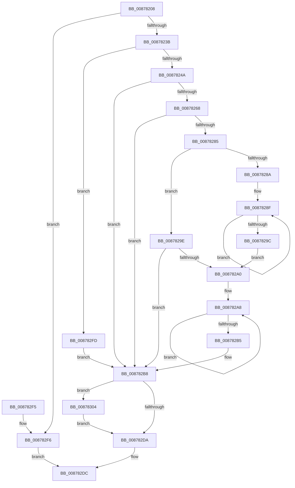

# CmpInitializeKcbCache

- RVA: `0x00878208`–`0x0087830E` (길이 `262` bytes)
- VA: `0x0000000140878208`
- 실행 섹션: `PAGE`
- PDB 이름 있음: `예`; PDB Function 태그: `아니요`
- unwind 정보 RVA: `0x0006CBDC`
- 디코드: `73`개 명령, `262/262` bytes 표시
- 미해석 바이트: `0` (있으면 어셈블리에 `.byte`로 보존)

> 이 문서는 커널 이미지의 기계어와 PDB 기호를 분석해 생성했습니다. 4번과 5번은 함수 원형과 자료형을 바이너리 사용 방식에서 추정한 C 해석이며 원본 소스 복구 결과는 아닙니다.

## 1. Dependencies

- 직접 호출 지점: **3**; 고유 호출 대상: **2**
- 직접 호출자로 확인된 함수: **2**
- RIP 상대 이미지 참조: **0**

### Outgoing calls
- `0x0087825B` → [ExAllocatePool2](../../poolcode/B8/ExAllocatePool2_function_00B820F0.md) (function, `0x00B820F0`)
- `0x00878278` → [ExAllocatePool2](../../poolcode/B8/ExAllocatePool2_function_00B820F0.md) (function, `0x00B820F0`)
- `0x00878307` → [CmpDeleteKcbCache](../A7/CmpDeleteKcbCache_function_00A70184.md) (function, `0x00A70184`)

### Direct callers
- [CmpLinkHiveToMaster](CmpLinkHiveToMaster_function_00877D6C.md) at `0x00877E4D`
- [CmInitSystem1](../../init/C5/CmInitSystem1_function_00C559CC.md) at `0x00C55D98`

### Static image references
- 디코드된 RIP-relative 메모리 참조가 없습니다.

## 2. Other-region calls and transfers

- 다른 실행 섹션으로 향하는 call: **2**
  - `0x0087825B` → [ExAllocatePool2](../../poolcode/B8/ExAllocatePool2_function_00B820F0.md) (`PAGE` → `POOLCODE`)
  - `0x00878278` → [ExAllocatePool2](../../poolcode/B8/ExAllocatePool2_function_00B820F0.md) (`PAGE` → `POOLCODE`)
- 별도 외부 분기/꼬리 이동을 확인하지 못했습니다.

## 3. Assembly (complete function range)

```asm
00878208  48 89 5C 24 08                  mov qword ptr [rsp + 8], rbx
0087820D  48 89 6C 24 10                  mov qword ptr [rsp + 0x10], rbp
00878212  48 89 74 24 18                  mov qword ptr [rsp + 0x18], rsi
00878217  57                              push rdi
00878218  41 56                           push r14
0087821A  41 57                           push r15
0087821C  48 83 EC 20                     sub rsp, 0x20
00878220  45 33 FF                        xor r15d, r15d
00878223  8B FA                           mov edi, edx
00878225  48 8B F1                        mov rsi, rcx
00878228  BB 9A 00 00 C0                  mov ebx, 0xc000009a
0087822D  45 8B F7                        mov r14d, r15d
00878230  8D 47 FF                        lea eax, [rdi - 1]
00878233  85 C2                           test edx, eax
00878235  0F 85 BB 00 00 00               jne 0x1408782f6
0087823B  41 8B EF                        mov ebp, r15d
0087823E  81 FF AA AA AA 0A               cmp edi, 0xaaaaaaa
00878244  0F 87 B3 00 00 00               ja 0x1408782fd
0087824A  8D 14 7F                        lea edx, [rdi + rdi*2]
0087824D  B9 00 01 00 00                  mov ecx, 0x100
00878252  C1 E2 03                        shl edx, 3
00878255  41 B8 43 4D 43 61               mov r8d, 0x61434d43
0087825B  E8 90 9E 30 00                  call 0x140b820f0
00878260  4C 8B F0                        mov r14, rax
00878263  48 85 C0                        test rax, rax
00878266  74 50                           je 0x1408782b8
00878268  BA 00 03 00 00                  mov edx, 0x300
0087826D  B9 00 01 00 00                  mov ecx, 0x100
00878272  41 B8 43 4D 43 61               mov r8d, 0x61434d43
00878278  E8 73 9E 30 00                  call 0x140b820f0
0087827D  48 8B E8                        mov rbp, rax
00878280  48 85 C0                        test rax, rax
00878283  74 33                           je 0x1408782b8
00878285  41 3B FF                        cmp edi, r15d
00878288  76 14                           jbe 0x14087829e
0087828A  49 8B C6                        mov rax, r14
0087828D  8B CF                           mov ecx, edi
0087828F  4C 89 38                        mov qword ptr [rax], r15
00878292  48 8D 40 18                     lea rax, [rax + 0x18]
00878296  48 83 E9 01                     sub rcx, 1
0087829A  75 F3                           jne 0x14087828f
0087829C  EB 02                           jmp 0x1408782a0
0087829E  75 18                           jne 0x1408782b8
008782A0  48 8B C5                        mov rax, rbp
008782A3  B9 20 00 00 00                  mov ecx, 0x20
008782A8  4C 89 38                        mov qword ptr [rax], r15
008782AB  48 8D 40 18                     lea rax, [rax + 0x18]
008782AF  48 83 E9 01                     sub rcx, 1
008782B3  75 F3                           jne 0x1408782a8
008782B5  41 8B DF                        mov ebx, r15d
008782B8  4C 89 B6 70 06 00 00            mov qword ptr [rsi + 0x670], r14
008782BF  89 BE 78 06 00 00               mov dword ptr [rsi + 0x678], edi
008782C5  48 89 AE 80 06 00 00            mov qword ptr [rsi + 0x680], rbp
008782CC  C7 86 88 06 00 00 20 00 00 00   mov dword ptr [rsi + 0x688], 0x20
008782D6  85 DB                           test ebx, ebx
008782D8  78 2A                           js 0x140878304
008782DA  8B C3                           mov eax, ebx
008782DC  48 8B 5C 24 40                  mov rbx, qword ptr [rsp + 0x40]
008782E1  48 8B 6C 24 48                  mov rbp, qword ptr [rsp + 0x48]
008782E6  48 8B 74 24 50                  mov rsi, qword ptr [rsp + 0x50]
008782EB  48 83 C4 20                     add rsp, 0x20
008782EF  41 5F                           pop r15
008782F1  41 5E                           pop r14
008782F3  5F                              pop rdi
008782F4  C3                              ret
008782F5  CC                              int3
008782F6  B8 0D 00 00 C0                  mov eax, 0xc000000d
008782FB  EB DF                           jmp 0x1408782dc
008782FD  BB 0D 00 00 C0                  mov ebx, 0xc000000d
00878302  EB B4                           jmp 0x1408782b8
00878304  48 8B CE                        mov rcx, rsi
00878307  E8 78 7E 1F 00                  call 0x140a70184
0087830C  EB CC                           jmp 0x1408782da
```

## 4. C-style interpretation (structured pseudocode)

```c
__int64 __fastcall CmpInitializeKcbCache(__int64 a1, int a2)
{
    __int64 result;
    __int64 v_r15;
    __int64 v_rsp;
    unsigned __int64 v_stack_p10;
    unsigned __int64 v_stack_p18;
    unsigned __int64 v_stack_p8;

    v_stack_p8 = v_rbx;
    v_stack_p10 = v_rbp;
    v_stack_p18 = v_rsi;
    v_rsp = (v_rsp) - (32);
    v_r15 = 0;
    if (((a2) & ((unsigned int)((unsigned int)(a2) - 1))) != 0) goto loc_008782F6;
    if (((unsigned int)((unsigned int)(a2))) > 0xAAAAAAAULL) goto loc_008782FD;
    a2 = (unsigned int)(((unsigned int)(a2) + (unsigned int)(a2) * 2) << (3));
    result = ExAllocatePool2(256, a2, (unsigned int)(0x61434D43ULL), a4);
    if (result == 0) goto loc_008782B8;
    result = ExAllocatePool2(256, 768, (unsigned int)(0x61434D43ULL), a4);
    if (result == 0) goto loc_008782B8;
    if (((unsigned int)((unsigned int)(a2))) <= 0) goto loc_0087829E;
loc_0087828F:
    *(unsigned __int64 *)(result) = 0;
    a1 = ((unsigned int)((unsigned int)((unsigned int)(a2)))) - (1);
    if (condition_is_not_equal) goto loc_0087828F;
    goto loc_008782A0;
loc_0087829E:
    if (condition_is_not_equal) goto loc_008782B8;
loc_008782A0:
loc_008782A8:
    *(unsigned __int64 *)(result) = 0;
    a1 = (32) - (1);
    if (condition_is_not_equal) goto loc_008782A8;
loc_008782B8:
    *(unsigned __int64 *)(a1 + 1648) = result;
    *(unsigned int *)(a1 + 1656) = (unsigned int)((unsigned int)(a2));
    *(unsigned __int64 *)(a1 + 1664) = result;
    *(unsigned int *)(a1 + 1672) = 32;
    if (sign_flag) goto loc_00878304;
loc_008782DA:
loc_008782DC:
    v_rsp = (v_rsp) + (32);
    return 0;
loc_008782F6:
    goto loc_008782DC;
loc_008782FD:
    goto loc_008782B8;
loc_00878304:
    result = CmpDeleteKcbCache(v_stack_p18, 768, (unsigned int)(0x61434D43ULL), a4);
    goto loc_008782DA;
}
```

## 5. (Beta) C Style

```c
int64_t CmpInitializeKcbCache(void *Arg1, void *Arg2)
{
    uint8_t *arg1 = (uint8_t *)Arg1;
    uint8_t *arg2 = (uint8_t *)Arg2;

    int64_t result;
    int64_t local_r15;
    int64_t local_rsp;
    uint64_t v_stack_p10;
    uint64_t v_stack_p18;
    uint64_t v_stack_p8;

    v_stack_p8 = local_rbx;
    v_stack_p10 = local_rbp;
    v_stack_p18 = local_rsi;
    local_rsp = (local_rsp) - (32);
    local_r15 = 0;
    if (((Arg2) & ((uint32_t)((uint32_t)(Arg2) - 1))) != 0) goto loc_008782F6;
    if (((uint32_t)((uint32_t)(Arg2))) > 0xAAAAAAAULL) goto loc_008782FD;
    Arg2 = (uint32_t)(((uint32_t)(Arg2) + (uint32_t)(Arg2) * 2) << (3));
    result = ExAllocatePool2(256, Arg2, (uint32_t)(0x61434D43ULL), a4);
    if (result == 0) goto loc_008782B8;
    result = ExAllocatePool2(256, 768, (uint32_t)(0x61434D43ULL), a4);
    if (result == 0) goto loc_008782B8;
    if (((uint32_t)((uint32_t)(Arg2))) <= 0) goto loc_0087829E;
loc_0087828F:
    *(uint64_t *)(result) = 0;
    Arg1 = ((uint32_t)((uint32_t)((uint32_t)(Arg2)))) - (1);
    if (condition_is_not_equal) goto loc_0087828F;
    goto loc_008782A0;
loc_0087829E:
    if (condition_is_not_equal) goto loc_008782B8;
loc_008782A0:
loc_008782A8:
    *(uint64_t *)(result) = 0;
    Arg1 = (32) - (1);
    if (condition_is_not_equal) goto loc_008782A8;
loc_008782B8:
    *(uint64_t *)(arg1 + 0x670) = result;
    *(uint32_t *)(arg1 + 0x678) = (uint32_t)((uint32_t)(Arg2));
    *(uint64_t *)(arg1 + 0x680) = result;
    *(uint32_t *)(arg1 + 0x688) = 32;
    if (sign_flag) goto loc_00878304;
loc_008782DA:
loc_008782DC:
    local_rsp = (local_rsp) + (32);
    return 0;
loc_008782F6:
    goto loc_008782DC;
loc_008782FD:
    goto loc_008782B8;
loc_00878304:
    result = CmpDeleteKcbCache(v_stack_p18, 768, (uint32_t)(0x61434D43ULL), a4);
    goto loc_008782DA;
}
```

### 관측된 메모리 오프셋

구조체 형식이 확인되지 않은 접근은 인자 기준의 오프셋으로만 기록했습니다.

| 기준 인자 | 오프셋 표현 | 폭 (bit) | 접근 |
|---|---:|---:|---|
| `Arg1` | `+ 0x670` | `64` | `W` |
| `Arg1` | `+ 0x678` | `32` | `W` |
| `Arg1` | `+ 0x680` | `64` | `W` |
| `Arg1` | `+ 0x688` | `32` | `W` |
| `Arg2` | `- 0x1` | `32` | `R` |

## 6. Execution-region graph

[열기: 2D/3D 그래프와 함수 탐색 컨트롤 패널](../../../control-panel.html?section=page&rva=0x00878208&view=graph)

- 2D 그래프는 위에서 아래로 흐르고, 3D 그래프는 빈 공간을 드래그해 회전합니다. Shift+드래그는 이동, 휠은 확대·축소, 함수 노드 선택은 대상 보고서 이동입니다.

### Static fallback


