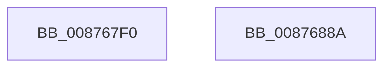

# CmpInitializeParseContext

- RVA: `0x008767F0`–`0x0087688B` (길이 `155` bytes)
- VA: `0x00000001408767F0`
- 실행 섹션: `PAGE`
- PDB 이름 있음: `예`; PDB Function 태그: `아니요`
- unwind 정보 RVA: `0x0005CF00`
- 디코드: `34`개 명령, `155/155` bytes 표시
- 미해석 바이트: `0` (있으면 어셈블리에 `.byte`로 보존)

> 이 문서는 커널 이미지의 기계어와 PDB 기호를 분석해 생성했습니다. 4번과 5번은 함수 원형과 자료형을 바이너리 사용 방식에서 추정한 C 해석이며 원본 소스 복구 결과는 아닙니다.

## 1. Dependencies

- 직접 호출 지점: **1**; 고유 호출 대상: **1**
- 직접 호출자로 확인된 함수: **15**
- RIP 상대 이미지 참조: **0**

### Outgoing calls
- `0x00876839` → [memset](../../text/6C/memset_function_006C6C40.md) (function, `0x006C6C40`)

### Direct callers
- [CmpCreatePredefined](../7D/CmpCreatePredefined_function_007DA0CC.md) at `0x007DA133`
- [NtQueryOpenSubKeys](../7D/NtQueryOpenSubKeys_function_007DFF80.md) at `0x007DFFFD`
- [NtQueryOpenSubKeysEx](../7E/NtQueryOpenSubKeysEx_function_007E0190.md) at `0x007E0218`
- [CmpDoBuildVirtualStack](../7E/CmpDoBuildVirtualStack_function_007EB4C4.md) at `0x007EB573`
- [CmpDoReOpenTransKey](../7F/CmpDoReOpenTransKey_function_007F78E8.md) at `0x007F799D`
- [CmpDoReOpenTransKey](../7F/CmpDoReOpenTransKey_function_007F78E8.md) at `0x007F7B3C`
- [CmKeyBodyReplicateToVirtual](../84/CmKeyBodyReplicateToVirtual_function_00843FE4.md) at `0x008440C3`
- [CmLoadDifferencingKey](CmLoadDifferencingKey_function_00875670.md) at `0x008757D6`
- [CmpAllocateParseContext](CmpAllocateParseContext_function_008767B4.md) at `0x008767DA`
- [CmpLinkHiveToMaster](CmpLinkHiveToMaster_function_00877D6C.md) at `0x00877E24`
- [CmUnloadKey](../9A/CmUnloadKey_function_009AF2FC.md) at `0x009AF368`
- [NtNotifyChangeMultipleKeys](../9D/NtNotifyChangeMultipleKeys_function_009DC6B0.md) at `0x009DC959`
- [CmpStartSiloRegistryNamespace](../9E/CmpStartSiloRegistryNamespace_function_009E85D0.md) at `0x009E8639`
- [CmpResolveHiveLoadConflict](../A9/CmpResolveHiveLoadConflict_function_00A9E78C.md) at `0x00A9E811`
- [CmKeyBodyRemapToVirtual](../AC/CmKeyBodyRemapToVirtual_function_00AC9494.md) at `0x00AC954B`
- [CmInitSystem1](../../init/C5/CmInitSystem1_function_00C559CC.md) at `0x00C55A73`

### Static image references
- 디코드된 RIP-relative 메모리 참조가 없습니다.

## 2. Other-region calls and transfers

- 다른 실행 섹션으로 향하는 call: **1**
  - `0x00876839` → [memset](../../text/6C/memset_function_006C6C40.md) (`PAGE` → `.text`)
- 별도 외부 분기/꼬리 이동을 확인하지 못했습니다.

## 3. Assembly (complete function range)

```asm
008767F0  40 53                           push rbx
008767F2  48 83 EC 20                     sub rsp, 0x20
008767F6  0F 57 C0                        xorps xmm0, xmm0
008767F9  33 C0                           xor eax, eax
008767FB  0F 11 01                        movups xmmword ptr [rcx], xmm0
008767FE  48 8B D9                        mov rbx, rcx
00876801  33 D2                           xor edx, edx
00876803  0F 11 41 10                     movups xmmword ptr [rcx + 0x10], xmm0
00876807  41 B8 E0 00 00 00               mov r8d, 0xe0
0087680D  0F 11 41 20                     movups xmmword ptr [rcx + 0x20], xmm0
00876811  0F 11 41 30                     movups xmmword ptr [rcx + 0x30], xmm0
00876815  0F 11 41 40                     movups xmmword ptr [rcx + 0x40], xmm0
00876819  0F 11 41 50                     movups xmmword ptr [rcx + 0x50], xmm0
0087681D  0F 11 41 64                     movups xmmword ptr [rcx + 0x64], xmm0
00876821  0F 11 41 74                     movups xmmword ptr [rcx + 0x74], xmm0
00876825  48 89 81 84 00 00 00            mov qword ptr [rcx + 0x84], rax
0087682C  89 81 8C 00 00 00               mov dword ptr [rcx + 0x8c], eax
00876832  48 81 C1 A0 00 00 00            add rcx, 0xa0
00876839  E8 02 04 E5 FF                  call 0x1406c6c40
0087683E  C7 43 60 FF FF FF FF            mov dword ptr [rbx + 0x60], 0xffffffff
00876845  48 8D 83 90 00 00 00            lea rax, [rbx + 0x90]
0087684C  48 C7 83 98 00 00 00 00 00 00 00  mov qword ptr [rbx + 0x98], 0
00876857  0F 57 C0                        xorps xmm0, xmm0
0087685A  48 89 40 08                     mov qword ptr [rax + 8], rax
0087685E  48 89 00                        mov qword ptr [rax], rax
00876861  0F 11 83 80 01 00 00            movups xmmword ptr [rbx + 0x180], xmm0
00876868  0F 11 83 90 01 00 00            movups xmmword ptr [rbx + 0x190], xmm0
0087686F  0F 11 83 A0 01 00 00            movups xmmword ptr [rbx + 0x1a0], xmm0
00876876  0F 11 83 B0 01 00 00            movups xmmword ptr [rbx + 0x1b0], xmm0
0087687D  0F 11 83 C0 01 00 00            movups xmmword ptr [rbx + 0x1c0], xmm0
00876884  48 83 C4 20                     add rsp, 0x20
00876888  5B                              pop rbx
00876889  C3                              ret
0087688A  CC                              int3
```

## 4. C-style interpretation (structured pseudocode)

```c
__int64 __fastcall CmpInitializeParseContext(__int64 a1, int a2)
{
    __int64 result;
    __int64 v_rsp;

    v_rsp = (v_rsp) - (32);
    result = 0;
    *(unsigned __int64 *)(a1) = v_xmm0;
    a2 = 0;
    *(unsigned __int64 *)(a1 + 16) = v_xmm0;
    *(unsigned __int64 *)(a1 + 32) = v_xmm0;
    *(unsigned __int64 *)(a1 + 48) = v_xmm0;
    *(unsigned __int64 *)(a1 + 64) = v_xmm0;
    *(unsigned __int64 *)(a1 + 80) = v_xmm0;
    *(unsigned __int64 *)(a1 + 100) = v_xmm0;
    *(unsigned __int64 *)(a1 + 116) = v_xmm0;
    *(unsigned __int64 *)(a1 + 132) = 0;
    *(unsigned int *)(a1 + 140) = 0;
    a1 = (a1) + (160);
    result = memset(a1, a2, 224, a4);
    *(unsigned int *)(a1 + 96) = 0xFFFFFFFFULL;
    *(unsigned __int64 *)(a1 + 152) = 0;
    *(unsigned __int64 *)(a1 + 144 + 8) = a1 + 144;
    *(unsigned __int64 *)(a1 + 144) = a1 + 144;
    *(unsigned __int64 *)(a1 + 384) = v_xmm0;
    *(unsigned __int64 *)(a1 + 400) = v_xmm0;
    *(unsigned __int64 *)(a1 + 416) = v_xmm0;
    *(unsigned __int64 *)(a1 + 432) = v_xmm0;
    *(unsigned __int64 *)(a1 + 448) = v_xmm0;
    v_rsp = (v_rsp) + (32);
    return a1 + 144;
}
```

## 5. (Beta) C Style

```c
void *CmpInitializeParseContext(void *Arg1, int32_t Arg2)
{
    uint8_t *arg1 = (uint8_t *)Arg1;

    int64_t result;
    int64_t local_rsp;

    local_rsp = (local_rsp) - (32);
    result = 0;
    *(uint64_t *)(arg1) = v_xmm0;
    Arg2 = 0;
    *(uint64_t *)(arg1 + 0x10) = v_xmm0;
    *(uint64_t *)(arg1 + 0x20) = v_xmm0;
    *(uint64_t *)(arg1 + 0x30) = v_xmm0;
    *(uint64_t *)(arg1 + 0x40) = v_xmm0;
    *(uint64_t *)(arg1 + 0x50) = v_xmm0;
    *(uint64_t *)(arg1 + 0x64) = v_xmm0;
    *(uint64_t *)(arg1 + 0x74) = v_xmm0;
    *(uint64_t *)(arg1 + 0x84) = 0;
    *(uint32_t *)(arg1 + 0x8C) = 0;
    Arg1 = (Arg1) + (160);
    result = memset(Arg1, Arg2, 224, a4);
    *(uint32_t *)(arg1 + 0x60) = 0xFFFFFFFFULL;
    *(uint64_t *)(arg1 + 0x98) = 0;
    *(void **)(arg1 + 0x90 + 0x8) = Arg1 + 144;
    *(void **)(arg1 + 0x90) = Arg1 + 144;
    *(uint64_t *)(arg1 + 0x180) = v_xmm0;
    *(uint64_t *)(arg1 + 0x190) = v_xmm0;
    *(uint64_t *)(arg1 + 0x1A0) = v_xmm0;
    *(uint64_t *)(arg1 + 0x1B0) = v_xmm0;
    *(uint64_t *)(arg1 + 0x1C0) = v_xmm0;
    local_rsp = (local_rsp) + (32);
    return Arg1 + 144;
}
```

### 관측된 메모리 오프셋

구조체 형식이 확인되지 않은 접근은 인자 기준의 오프셋으로만 기록했습니다.

| 기준 인자 | 오프셋 표현 | 폭 (bit) | 접근 |
|---|---:|---:|---|
| `Arg1` | `+ 0x0` | `64` | `W` |
| `Arg1` | `+ 0x0` | `128` | `R` |
| `Arg1` | `+ 0x8` | `64` | `W` |
| `Arg1` | `+ 0x10` | `128` | `R` |
| `Arg1` | `+ 0x20` | `128` | `R` |
| `Arg1` | `+ 0x30` | `128` | `R` |
| `Arg1` | `+ 0x40` | `128` | `R` |
| `Arg1` | `+ 0x50` | `128` | `R` |
| `Arg1` | `+ 0x60` | `32` | `W` |
| `Arg1` | `+ 0x64` | `128` | `R` |
| `Arg1` | `+ 0x74` | `128` | `R` |
| `Arg1` | `+ 0x84` | `64` | `W` |
| `Arg1` | `+ 0x8C` | `32` | `W` |
| `Arg1` | `+ 0x90` | `64` | `R` |
| `Arg1` | `+ 0x98` | `64` | `W` |
| `Arg1` | `+ 0x180` | `128` | `R` |
| `Arg1` | `+ 0x190` | `128` | `R` |
| `Arg1` | `+ 0x1A0` | `128` | `R` |
| `Arg1` | `+ 0x1B0` | `128` | `R` |
| `Arg1` | `+ 0x1C0` | `128` | `R` |

## 6. Execution-region graph

[열기: 2D/3D 그래프와 함수 탐색 컨트롤 패널](../../../control-panel.html?section=page&rva=0x008767F0&view=graph)

- 2D 그래프는 위에서 아래로 흐르고, 3D 그래프는 빈 공간을 드래그해 회전합니다. Shift+드래그는 이동, 휠은 확대·축소, 함수 노드 선택은 대상 보고서 이동입니다.

### Static fallback


