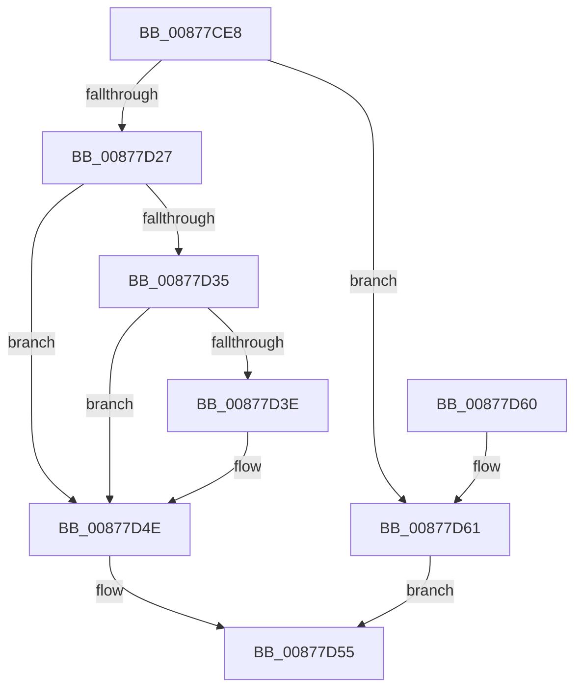

# CmpIsThisSameFile

- RVA: `0x00877CE8`–`0x00877D65` (길이 `125` bytes)
- VA: `0x0000000140877CE8`
- 실행 섹션: `PAGE`
- PDB 이름 있음: `예`; PDB Function 태그: `아니요`
- unwind 정보 RVA: `0x0006CB94`
- 디코드: `39`개 명령, `125/125` bytes 표시
- 미해석 바이트: `0` (있으면 어셈블리에 `.byte`로 보존)

> 이 문서는 커널 이미지의 기계어와 PDB 기호를 분석해 생성했습니다. 4번과 5번은 함수 원형과 자료형을 바이너리 사용 방식에서 추정한 C 해석이며 원본 소스 복구 결과는 아닙니다.

## 1. Dependencies

- 직접 호출 지점: **2**; 고유 호출 대상: **2**
- 직접 호출자로 확인된 함수: **2**
- RIP 상대 이미지 참조: **1**

### Outgoing calls
- `0x00877D1E` → [ObReferenceObjectByHandle](../86/ObReferenceObjectByHandle_function_00868DB0.md) (function, `0x00868DB0`)
- `0x00877D4E` → [ObfDereferenceObject](../../text/2F/ObfDereferenceObject_function_002F9350.md) (function, `0x002F9350`)

### Direct callers
- [CmpIsHiveAlreadyLoaded](../7E/CmpIsHiveAlreadyLoaded_function_007EA594.md) at `0x007EA5F6`
- [CmpIsHiveAlreadyLoaded](../7E/CmpIsHiveAlreadyLoaded_function_007EA594.md) at `0x007EA66A`
- [CmLoadAppKey](CmLoadAppKey_function_00876FFC.md) at `0x008777BF`

### Static image references
- `0x00877CF4` → RVA `0x00EF7C68` (`.data`; read)

## 2. Other-region calls and transfers

- 다른 실행 섹션으로 향하는 call: **1**
  - `0x00877D4E` → [ObfDereferenceObject](../../text/2F/ObfDereferenceObject_function_002F9350.md) (`PAGE` → `.text`)
- 별도 외부 분기/꼬리 이동을 확인하지 못했습니다.

## 3. Assembly (complete function range)

```asm
00877CE8  4C 8B DC                        mov r11, rsp
00877CEB  49 89 5B 08                     mov qword ptr [r11 + 8], rbx
00877CEF  57                              push rdi
00877CF0  48 83 EC 30                     sub rsp, 0x30
00877CF4  48 8B 05 6D FF 67 00            mov rax, qword ptr [rip + 0x67ff6d]
00877CFB  4C 8B D2                        mov r10, rdx
00877CFE  33 DB                           xor ebx, ebx
00877D00  48 8B F9                        mov rdi, rcx
00877D03  49 89 5B F0                     mov qword ptr [r11 - 0x10], rbx
00877D07  45 33 C9                        xor r9d, r9d
00877D0A  33 D2                           xor edx, edx
00877D0C  49 89 5B 18                     mov qword ptr [r11 + 0x18], rbx
00877D10  4C 8B 00                        mov r8, qword ptr [rax]
00877D13  49 8B CA                        mov rcx, r10
00877D16  49 8D 43 18                     lea rax, [r11 + 0x18]
00877D1A  49 89 43 E8                     mov qword ptr [r11 - 0x18], rax
00877D1E  E8 8D 10 FF FF                  call 0x140868db0
00877D23  85 C0                           test eax, eax
00877D25  78 3A                           js 0x140877d61
00877D27  4C 8B 47 28                     mov r8, qword ptr [rdi + 0x28]
00877D2B  48 8B 4C 24 50                  mov rcx, qword ptr [rsp + 0x50]
00877D30  4D 85 C0                        test r8, r8
00877D33  74 19                           je 0x140877d4e
00877D35  48 8B 51 28                     mov rdx, qword ptr [rcx + 0x28]
00877D39  48 85 D2                        test rdx, rdx
00877D3C  74 10                           je 0x140877d4e
00877D3E  4C 3B C2                        cmp r8, rdx
00877D41  0F B6 DB                        movzx ebx, bl
00877D44  41 B9 01 00 00 00               mov r9d, 1
00877D4A  41 0F 44 D9                     cmove ebx, r9d
00877D4E  E8 FD 15 A8 FF                  call 0x1402f9350
00877D53  8A C3                           mov al, bl
00877D55  48 8B 5C 24 40                  mov rbx, qword ptr [rsp + 0x40]
00877D5A  48 83 C4 30                     add rsp, 0x30
00877D5E  5F                              pop rdi
00877D5F  C3                              ret
00877D60  CC                              int3
00877D61  32 C0                           xor al, al
00877D63  EB F0                           jmp 0x140877d55
```

## 4. C-style interpretation (structured pseudocode)

```c
__int64 __fastcall CmpIsThisSameFile(__int64 a1, __int64 a2, __int64 a3, int a4)
{
    __int64 result;
    __int64 v_rbx;
    __int64 v_rsp;
    unsigned __int64 v_stack_p18;
    unsigned __int64 v_stack_p8;

    *(unsigned __int64 *)(v_rsp + 8) = v_rbx;
    v_rsp = (v_rsp) - (48);
    v_rbx = 0;
    *(unsigned __int64 *)(v_rsp - 16) = 0;
    a4 = 0;
    a2 = 0;
    *(unsigned __int64 *)(v_rsp + 24) = 0;
    *(unsigned __int64 *)(v_rsp - 24) = v_rsp + 24;
    result = ObReferenceObjectByHandle(0, a2, *(unsigned __int64 *)(*(unsigned __int64 *)(v_rip + 6815597)), a4);
    if (sign_flag) goto loc_00877D61;
    if (*(unsigned __int64 *)(a1 + 40) == 0) goto loc_00877D4E;
    if (*(unsigned __int64 *)(v_stack_p18 + 40) != 0) {
        v_rbx = 0;
        a4 = 1;
        if ((*(unsigned __int64 *)(a1 + 40)) == (*(unsigned __int64 *)(v_stack_p18 + 40))) { v_rbx = a4; }
    }
    result = ObfDereferenceObject(v_stack_p18, *(unsigned __int64 *)(v_stack_p18 + 40), *(unsigned __int64 *)(a1 + 40), a4);
loc_00877D55:
    v_rsp = (v_rsp) + (48);
    return (unsigned __int8)(v_rbx);
loc_00877D61:
    result = 0;
    goto loc_00877D55;
}
```

## 5. (Beta) C Style

```c
int64_t CmpIsThisSameFile(void *Arg1, int64_t Arg2, int64_t Arg3, int32_t Arg4)
{
    uint8_t *arg1 = (uint8_t *)Arg1;

    int64_t result;
    int64_t local_rbx;
    int64_t local_rsp;
    uint64_t v_stack_p18;
    uint64_t v_stack_p8;

    *(uint64_t *)(local_rsp + 0x8) = local_rbx;
    local_rsp = (local_rsp) - (48);
    local_rbx = 0;
    *(uint64_t *)(local_rsp - 0x10) = 0;
    Arg4 = 0;
    Arg2 = 0;
    *(uint64_t *)(local_rsp + 0x18) = 0;
    *(uint64_t *)(local_rsp - 0x18) = local_rsp + 24;
    result = ObReferenceObjectByHandle(0, Arg2, *(uint64_t *)(*(uint64_t *)(v_rip + 0x67FF6D)), Arg4);
    if (sign_flag) goto loc_00877D61;
    if (*(uint64_t *)(arg1 + 0x28) == 0) goto loc_00877D4E;
    if (*(uint64_t *)(v_stack_p18 + 0x28) != 0) {
        local_rbx = 0;
        Arg4 = 1;
        if ((*(uint64_t *)(arg1 + 0x28)) == (*(uint64_t *)(v_stack_p18 + 0x28))) { local_rbx = Arg4; }
    }
    result = ObfDereferenceObject(v_stack_p18, *(uint64_t *)(v_stack_p18 + 0x28), *(uint64_t *)(arg1 + 0x28), Arg4);
loc_00877D55:
    local_rsp = (local_rsp) + (48);
    return (uint8_t)(local_rbx);
loc_00877D61:
    result = 0;
    goto loc_00877D55;
}
```

### 관측된 메모리 오프셋

구조체 형식이 확인되지 않은 접근은 인자 기준의 오프셋으로만 기록했습니다.

| 기준 인자 | 오프셋 표현 | 폭 (bit) | 접근 |
|---|---:|---:|---|
| `Arg1` | `+ 0x28` | `64` | `R` |

## 6. Execution-region graph

[열기: 2D/3D 그래프와 함수 탐색 컨트롤 패널](../../../control-panel.html?section=page&rva=0x00877CE8&view=graph)

- 2D 그래프는 위에서 아래로 흐르고, 3D 그래프는 빈 공간을 드래그해 회전합니다. Shift+드래그는 이동, 휠은 확대·축소, 함수 노드 선택은 대상 보고서 이동입니다.

### Static fallback


