# CmpLinkHiveToMaster

- RVA: `0x00877D6C`–`0x00878200` (길이 `1,172` bytes)
- VA: `0x0000000140877D6C`
- 실행 섹션: `PAGE`
- PDB 이름 있음: `예`; PDB Function 태그: `예`
- unwind 정보 RVA: `0x0006CBA4`
- 디코드: `266`개 명령, `1,172/1,172` bytes 표시
- 미해석 바이트: `0` (있으면 어셈블리에 `.byte`로 보존)

> 이 문서는 커널 이미지의 기계어와 PDB 기호를 분석해 생성했습니다. 4번과 5번은 함수 원형과 자료형을 바이너리 사용 방식에서 추정한 C 해석이며 원본 소스 복구 결과는 아닙니다.

## 1. Dependencies

- 직접 호출 지점: **32**; 고유 호출 대상: **25**
- 직접 호출자로 확인된 함수: **6**
- RIP 상대 이미지 참조: **5**

### Outgoing calls
- `0x00877DF5` → [memset](../../text/6C/memset_function_006C6C40.md) (function, `0x006C6C40`)
- `0x00877E24` → [CmpInitializeParseContext](CmpInitializeParseContext_function_008767F0.md) (function, `0x008767F0`)
- `0x00877E2E` → [CmpInitializeDelayDerefContext](../../text/42/CmpInitializeDelayDerefContext_function_0042A7F0.md) (function, `0x0042A7F0`)
- `0x00877E4D` → [CmpInitializeKcbCache](CmpInitializeKcbCache_function_00878208.md) (function, `0x00878208`)
- `0x00877ED2` → [PsGetCurrentSilo](../../text/40/PsGetCurrentSilo_function_004094A0.md) (function, `0x004094A0`)
- `0x00877F04` → [ObOpenObjectByNameEx](../89/ObOpenObjectByNameEx_function_0089A8A0.md) (function, `0x0089A8A0`)
- `0x00877F3A` → [ObReferenceObjectByHandle](../86/ObReferenceObjectByHandle_function_00868DB0.md) (function, `0x00868DB0`)
- `0x00877F49` → [ZwClose](../../text/6A/ZwClose_function_006AD2B0.md) (function, `0x006AD2B0`)
- `0x00877F55` → [CmpAttachToRegistryProcess](../../pagecmrc/BC/CmpAttachToRegistryProcess_function_00BC98E0.md) (function, `0x00BC98E0`)
- `0x00877F5F` → [CmpLockRegistry](../../pagecmrc/BC/CmpLockRegistry_function_00BC9B34.md) (function, `0x00BC9B34`)
- `0x00877F68` → [CmpConstructName](../85/CmpConstructName_function_00856BE0.md) (function, `0x00856BE0`)
- `0x00877F75` → [CmpUnlockRegistry](../../pagecmrc/BC/CmpUnlockRegistry_function_00BC9A84.md) (function, `0x00BC9A84`)
- `0x00877F92` → [ExAllocatePool2](../../poolcode/B8/ExAllocatePool2_function_00B820F0.md) (function, `0x00B820F0`)
- `0x00877FBF` → [RtlUnicodeStringCopy](../../text/3D/RtlUnicodeStringCopy_function_003D4130.md) (function, `0x003D4130`)
- `0x00877FE6` → [CmpLockRegistry](../../pagecmrc/BC/CmpLockRegistry_function_00BC9B34.md) (function, `0x00BC9B34`)
- `0x00877FF4` → [CmpReferenceKeyControlBlockUnsafe](CmpReferenceKeyControlBlockUnsafe_function_00874DA0.md) (function, `0x00874DA0`)
- `0x0087801C` → [CmpEtwDumpKcb](CmpEtwDumpKcb_function_00878320.md) (function, `0x00878320`)
- `0x00878028` → [CmpDetachFromRegistryProcess](../../pagecmrc/BC/CmpDetachFromRegistryProcess_function_00BC9920.md) (function, `0x00BC9920`)
- `0x00878032` → [CmpUnlockRegistry](../../pagecmrc/BC/CmpUnlockRegistry_function_00BC9A84.md) (function, `0x00BC9A84`)
- `0x00878048` → [CmpReferenceKeyControlBlockUnsafe](CmpReferenceKeyControlBlockUnsafe_function_00874DA0.md) (function, `0x00874DA0`)
- `0x00878059` → [ObfDereferenceObject](../../text/2F/ObfDereferenceObject_function_002F9350.md) (function, `0x002F9350`)
- `0x00878086` → [SetFailureLocation](../../text/46/SetFailureLocation_function_0046EF54.md) (function, `0x0046EF54`)
- `0x008780DD` → [CmpDetachFromRegistryProcess](../../pagecmrc/BC/CmpDetachFromRegistryProcess_function_00BC9920.md) (function, `0x00BC9920`)
- `0x008780EF` → [CmpFreePoolWithTag](../../text/44/CmpFreePoolWithTag_function_004489E0.md) (function, `0x004489E0`)
- `0x00878118` → [CmpCleanupParseContext](CmpCleanupParseContext_function_00876910.md) (function, `0x00876910`)
- `0x00878129` → [_security_check_cookie](../../text/6A/_security_check_cookie_function_006AC640.md) (function, `0x006AC640`)
- `0x0087815C` → [CmpLogHiveLinkEvent](../7E/CmpLogHiveLinkEvent_function_007E6338.md) (function, `0x007E6338`)
- `0x00878177` → [SetFailureLocation](../../text/46/SetFailureLocation_function_0046EF54.md) (function, `0x0046EF54`)
- `0x008781BD` → [CmpLockRegistry](../../pagecmrc/BC/CmpLockRegistry_function_00BC9B34.md) (function, `0x00BC9B34`)
- `0x008781CB` → [KeResetEvent](../../text/24/KeResetEvent_function_00248350.md) (function, `0x00248350`)
- `0x008781D6` → [CmpRecordUnloadEventForHive](../7E/CmpRecordUnloadEventForHive_function_007EA6CC.md) (function, `0x007EA6CC`)
- `0x008781E3` → [ObfDereferenceObject](../../text/2F/ObfDereferenceObject_function_002F9350.md) (function, `0x002F9350`)

### Direct callers
- [CmpLoadKeyCommon](../../text/46/CmpLoadKeyCommon_function_0046E9F8.md) at `0x0046EB03`
- [CmpFinishSystemHivesLoad](../7D/CmpFinishSystemHivesLoad_function_007DA210.md) at `0x007DA513`
- [CmpLoadHiveVolatile](../7D/CmpLoadHiveVolatile_function_007DE5F0.md) at `0x007DE9CD`
- [CmInitSystem1](../../init/C5/CmInitSystem1_function_00C559CC.md) at `0x00C561F4`
- [CmpInitializePreloadedHive](../../init/C5/CmpInitializePreloadedHive_function_00C58070.md) at `0x00C58424`
- [CmpInitializeSystemHive](../../init/C5/CmpInitializeSystemHive_function_00C58798.md) at `0x00C58959`

### Static image references
- `0x00877D8B` → RVA `0x00E0A740` (`.data`; read)
- `0x00877E9E` → RVA `0x00FC6AC0` (`ALMOSTRO`; read)
- `0x00877FD1` → RVA `0x00EEFB54` (`.data`; read/write)
- `0x0087800D` → RVA `0x00FD8008` (`PAGEDATA`; read)
- `0x0087814A` → RVA `0x00FC6B08` (`ALMOSTRO`; read)

## 2. Other-region calls and transfers

- 다른 실행 섹션으로 향하는 call: **21**
  - `0x00877DF5` → [memset](../../text/6C/memset_function_006C6C40.md) (`PAGE` → `.text`)
  - `0x00877E2E` → [CmpInitializeDelayDerefContext](../../text/42/CmpInitializeDelayDerefContext_function_0042A7F0.md) (`PAGE` → `.text`)
  - `0x00877ED2` → [PsGetCurrentSilo](../../text/40/PsGetCurrentSilo_function_004094A0.md) (`PAGE` → `.text`)
  - `0x00877F49` → [ZwClose](../../text/6A/ZwClose_function_006AD2B0.md) (`PAGE` → `.text`)
  - `0x00877F55` → [CmpAttachToRegistryProcess](../../pagecmrc/BC/CmpAttachToRegistryProcess_function_00BC98E0.md) (`PAGE` → `PAGECMRC`)
  - `0x00877F5F` → [CmpLockRegistry](../../pagecmrc/BC/CmpLockRegistry_function_00BC9B34.md) (`PAGE` → `PAGECMRC`)
  - `0x00877F75` → [CmpUnlockRegistry](../../pagecmrc/BC/CmpUnlockRegistry_function_00BC9A84.md) (`PAGE` → `PAGECMRC`)
  - `0x00877F92` → [ExAllocatePool2](../../poolcode/B8/ExAllocatePool2_function_00B820F0.md) (`PAGE` → `POOLCODE`)
  - `0x00877FBF` → [RtlUnicodeStringCopy](../../text/3D/RtlUnicodeStringCopy_function_003D4130.md) (`PAGE` → `.text`)
  - `0x00877FE6` → [CmpLockRegistry](../../pagecmrc/BC/CmpLockRegistry_function_00BC9B34.md) (`PAGE` → `PAGECMRC`)
  - `0x00878028` → [CmpDetachFromRegistryProcess](../../pagecmrc/BC/CmpDetachFromRegistryProcess_function_00BC9920.md) (`PAGE` → `PAGECMRC`)
  - `0x00878032` → [CmpUnlockRegistry](../../pagecmrc/BC/CmpUnlockRegistry_function_00BC9A84.md) (`PAGE` → `PAGECMRC`)
  - `0x00878059` → [ObfDereferenceObject](../../text/2F/ObfDereferenceObject_function_002F9350.md) (`PAGE` → `.text`)
  - `0x00878086` → [SetFailureLocation](../../text/46/SetFailureLocation_function_0046EF54.md) (`PAGE` → `.text`)
  - `0x008780DD` → [CmpDetachFromRegistryProcess](../../pagecmrc/BC/CmpDetachFromRegistryProcess_function_00BC9920.md) (`PAGE` → `PAGECMRC`)
  - `0x008780EF` → [CmpFreePoolWithTag](../../text/44/CmpFreePoolWithTag_function_004489E0.md) (`PAGE` → `.text`)
  - `0x00878129` → [_security_check_cookie](../../text/6A/_security_check_cookie_function_006AC640.md) (`PAGE` → `.text`)
  - `0x00878177` → [SetFailureLocation](../../text/46/SetFailureLocation_function_0046EF54.md) (`PAGE` → `.text`)
  - `0x008781BD` → [CmpLockRegistry](../../pagecmrc/BC/CmpLockRegistry_function_00BC9B34.md) (`PAGE` → `PAGECMRC`)
  - `0x008781CB` → [KeResetEvent](../../text/24/KeResetEvent_function_00248350.md) (`PAGE` → `.text`)
  - `0x008781E3` → [ObfDereferenceObject](../../text/2F/ObfDereferenceObject_function_002F9350.md) (`PAGE` → `.text`)
- call이 아닌 외부 분기/꼬리 이동: **2**
  - `0x008781B7` → [sub_00B17CEE](../B1/Unknown_function_00B17CEE.md) (`tail-transfer`)
  - `0x008781C3` → [sub_00B17CEE](../B1/Unknown_function_00B17CEE.md) (`tail-transfer`)

## 3. Assembly (complete function range)

```asm
00877D6C  48 89 5C 24 20                  mov qword ptr [rsp + 0x20], rbx
00877D71  55                              push rbp
00877D72  56                              push rsi
00877D73  57                              push rdi
00877D74  41 54                           push r12
00877D76  41 55                           push r13
00877D78  41 56                           push r14
00877D7A  41 57                           push r15
00877D7C  48 8D AC 24 30 FE FF FF         lea rbp, [rsp - 0x1d0]
00877D84  48 81 EC D0 02 00 00            sub rsp, 0x2d0
00877D8B  48 8B 05 AE 29 59 00            mov rax, qword ptr [rip + 0x5929ae]
00877D92  48 33 C4                        xor rax, rsp
00877D95  48 89 85 C0 01 00 00            mov qword ptr [rbp + 0x1c0], rax
00877D9C  48 8B 85 48 02 00 00            mov rax, qword ptr [rbp + 0x248]
00877DA3  49 8B F8                        mov rdi, r8
00877DA6  4C 8B AD 40 02 00 00            mov r13, qword ptr [rbp + 0x240]
00877DAD  4C 8B E1                        mov r12, rcx
00877DB0  48 8B B5 68 02 00 00            mov rsi, qword ptr [rbp + 0x268]
00877DB7  33 DB                           xor ebx, ebx
00877DB9  48 89 44 24 68                  mov qword ptr [rsp + 0x68], rax
00877DBE  41 B8 D0 01 00 00               mov r8d, 0x1d0
00877DC4  48 8B 85 50 02 00 00            mov rax, qword ptr [rbp + 0x250]
00877DCB  45 8A F9                        mov r15b, r9b
00877DCE  48 89 44 24 48                  mov qword ptr [rsp + 0x48], rax
00877DD3  48 8B 85 58 02 00 00            mov rax, qword ptr [rbp + 0x258]
00877DDA  48 89 54 24 60                  mov qword ptr [rsp + 0x60], rdx
00877DDF  33 D2                           xor edx, edx
00877DE1  48 89 4C 24 50                  mov qword ptr [rsp + 0x50], rcx
00877DE6  48 8D 4D C0                     lea rcx, [rbp - 0x40]
00877DEA  48 89 44 24 70                  mov qword ptr [rsp + 0x70], rax
00877DEF  89 5D 8C                        mov dword ptr [rbp - 0x74], ebx
00877DF2  89 5D A4                        mov dword ptr [rbp - 0x5c], ebx
00877DF5  E8 46 EE E4 FF                  call 0x1406c6c40
00877DFA  0F 57 C0                        xorps xmm0, xmm0
00877DFD  48 89 5C 24 58                  mov qword ptr [rsp + 0x58], rbx
00877E02  48 8D 4D C0                     lea rcx, [rbp - 0x40]
00877E06  88 5C 24 40                     mov byte ptr [rsp + 0x40], bl
00877E0A  0F 11 44 24 78                  movups xmmword ptr [rsp + 0x78], xmm0
00877E0F  0F 11 85 90 01 00 00            movups xmmword ptr [rbp + 0x190], xmm0
00877E16  0F 11 85 A0 01 00 00            movups xmmword ptr [rbp + 0x1a0], xmm0
00877E1D  0F 11 85 B0 01 00 00            movups xmmword ptr [rbp + 0x1b0], xmm0
00877E24  E8 C7 E9 FF FF                  call 0x1408767f0
00877E29  48 8D 4C 24 78                  lea rcx, [rsp + 0x78]
00877E2E  E8 BD 29 BB FF                  call 0x14042a7f0
00877E33  8B 87 A0 00 00 00               mov eax, dword ptr [rdi + 0xa0]
00877E39  8D 4B 01                        lea ecx, [rbx + 1]
00877E3C  A8 20                           test al, 0x20
00877E3E  0F 84 46 03 00 00               je 0x14087818a
00877E44  8B 95 30 02 00 00               mov edx, dword ptr [rbp + 0x230]
00877E4A  48 8B CF                        mov rcx, rdi
00877E4D  E8 B6 03 00 00                  call 0x140878208
00877E52  44 8A B5 60 02 00 00            mov r14b, byte ptr [rbp + 0x260]
00877E59  8B D8                           mov ebx, eax
00877E5B  85 C0                           test eax, eax
00877E5D  0F 88 00 03 00 00               js 0x140878163
00877E63  44 8A A5 38 02 00 00            mov r12b, byte ptr [rbp + 0x238]
00877E6A  B8 43 00 00 00                  mov eax, 0x43
00877E6F  45 84 E4                        test r12b, r12b
00877E72  48 89 7D F0                     mov qword ptr [rbp - 0x10], rdi
00877E76  B9 43 08 00 00                  mov ecx, 0x843
00877E7B  0F 45 C1                        cmovne eax, ecx
00877E7E  89 45 C0                        mov dword ptr [rbp - 0x40], eax
00877E81  45 84 FF                        test r15b, r15b
00877E84  0F 85 F7 02 00 00               jne 0x140878181
00877E8A  48 8B 47 40                     mov rax, qword ptr [rdi + 0x40]
00877E8E  8B 48 24                        mov ecx, dword ptr [rax + 0x24]
00877E91  89 4D E8                        mov dword ptr [rbp - 0x18], ecx
00877E94  48 8B 44 24 48                  mov rax, qword ptr [rsp + 0x48]
00877E99  48 83 65 B0 00                  and qword ptr [rbp - 0x50], 0
00877E9E  48 8B 1D 1B EC 74 00            mov rbx, qword ptr [rip + 0x74ec1b]
00877EA5  48 89 45 10                     mov qword ptr [rbp + 0x10], rax
00877EA9  48 8B 44 24 60                  mov rax, qword ptr [rsp + 0x60]
00877EAE  48 89 45 90                     mov qword ptr [rbp - 0x70], rax
00877EB2  48 8B 44 24 50                  mov rax, qword ptr [rsp + 0x50]
00877EB7  48 89 45 98                     mov qword ptr [rbp - 0x68], rax
00877EBB  48 8B 44 24 68                  mov rax, qword ptr [rsp + 0x68]
00877EC0  48 89 45 A8                     mov qword ptr [rbp - 0x58], rax
00877EC4  C7 45 88 30 00 00 00            mov dword ptr [rbp - 0x78], 0x30
00877ECB  C7 45 A0 40 02 00 00            mov dword ptr [rbp - 0x60], 0x240
00877ED2  E8 C9 15 B9 FF                  call 0x1404094a0
00877ED7  48 8D 4C 24 58                  lea rcx, [rsp + 0x58]
00877EDC  45 33 C9                        xor r9d, r9d
00877EDF  48 89 4C 24 38                  mov qword ptr [rsp + 0x38], rcx
00877EE4  45 33 C0                        xor r8d, r8d
00877EE7  48 89 44 24 30                  mov qword ptr [rsp + 0x30], rax
00877EEC  48 8D 4D 88                     lea rcx, [rbp - 0x78]
00877EF0  48 8D 45 C0                     lea rax, [rbp - 0x40]
00877EF4  48 8B D3                        mov rdx, rbx
00877EF7  48 89 44 24 28                  mov qword ptr [rsp + 0x28], rax
00877EFC  C7 44 24 20 1F 00 02 00         mov dword ptr [rsp + 0x20], 0x2001f
00877F04  E8 97 29 02 00                  call 0x14089a8a0
00877F09  33 D2                           xor edx, edx
00877F0B  8B D8                           mov ebx, eax
00877F0D  85 C0                           test eax, eax
00877F0F  0F 88 5D 01 00 00               js 0x140878072
00877F15  4C 8B 05 A4 EB 74 00            mov r8, qword ptr [rip + 0x74eba4]
00877F1C  48 8D 44 24 48                  lea rax, [rsp + 0x48]
00877F21  48 8B 4C 24 58                  mov rcx, qword ptr [rsp + 0x58]
00877F26  33 DB                           xor ebx, ebx
00877F28  48 89 5C 24 28                  mov qword ptr [rsp + 0x28], rbx
00877F2D  45 33 C9                        xor r9d, r9d
00877F30  48 89 44 24 20                  mov qword ptr [rsp + 0x20], rax
00877F35  48 89 5C 24 48                  mov qword ptr [rsp + 0x48], rbx
00877F3A  E8 71 0E FF FF                  call 0x140868db0
00877F3F  48 8B 4C 24 58                  mov rcx, qword ptr [rsp + 0x58]
00877F44  48 8B 74 24 48                  mov rsi, qword ptr [rsp + 0x48]
00877F49  E8 62 53 E3 FF                  call 0x1406ad2b0
00877F4E  48 8D 8D 90 01 00 00            lea rcx, [rbp + 0x190]
00877F55  E8 86 19 35 00                  call 0x140bc98e0
00877F5A  45 84 F6                        test r14b, r14b
00877F5D  75 05                           jne 0x140877f64
00877F5F  E8 D0 1B 35 00                  call 0x140bc9b34
00877F64  48 8B 4E 08                     mov rcx, qword ptr [rsi + 8]
00877F68  E8 73 EC FD FF                  call 0x140856be0
00877F6D  4C 8B F8                        mov r15, rax
00877F70  45 84 F6                        test r14b, r14b
00877F73  75 05                           jne 0x140877f7a
00877F75  E8 0A 1B 35 00                  call 0x140bc9a84
00877F7A  4D 85 FF                        test r15, r15
00877F7D  0F 84 29 02 00 00               je 0x1408781ac
00877F83  41 0F B7 17                     movzx edx, word ptr [r15]
00877F87  B9 00 01 00 00                  mov ecx, 0x100
00877F8C  41 B8 43 4D 68 70               mov r8d, 0x70684d43
00877F92  E8 59 A1 30 00                  call 0x140b820f0
00877F97  48 89 87 48 07 00 00            mov qword ptr [rdi + 0x748], rax
00877F9E  48 85 C0                        test rax, rax
00877FA1  0F 84 05 02 00 00               je 0x1408781ac
00877FA7  48 8D 8F 40 07 00 00            lea rcx, [rdi + 0x740]
00877FAE  49 8B D7                        mov rdx, r15
00877FB1  66 89 19                        mov word ptr [rcx], bx
00877FB4  41 0F B7 07                     movzx eax, word ptr [r15]
00877FB8  66 89 87 42 07 00 00            mov word ptr [rdi + 0x742], ax
00877FBF  E8 6C C1 B5 FF                  call 0x1403d4130
00877FC4  B9 01 00 00 00                  mov ecx, 1
00877FC9  88 9F 8D 00 00 00               mov byte ptr [rdi + 0x8d], bl
00877FCF  8B C1                           mov eax, ecx
00877FD1  F0 0F C1 05 7B 7B 67 00         lock xadd dword ptr [rip + 0x677b7b], eax
00877FD9  03 C1                           add eax, ecx
00877FDB  89 87 8C 06 00 00               mov dword ptr [rdi + 0x68c], eax
00877FE1  45 84 F6                        test r14b, r14b
00877FE4  75 05                           jne 0x140877feb
00877FE6  E8 49 1B 35 00                  call 0x140bc9b34
00877FEB  45 84 E4                        test r12b, r12b
00877FEE  74 1D                           je 0x14087800d
00877FF0  48 8B 4E 08                     mov rcx, qword ptr [rsi + 8]
00877FF4  E8 A7 CD FF FF                  call 0x140874da0
00877FF9  48 8B 46 08                     mov rax, qword ptr [rsi + 8]
00877FFD  48 89 87 78 0B 00 00            mov qword ptr [rdi + 0xb78], rax
00878004  4D 85 ED                        test r13, r13
00878007  0F 85 BB 01 00 00               jne 0x1408781c8
0087800D  48 39 1D F4 FF 75 00            cmp qword ptr [rip + 0x75fff4], rbx
00878014  74 0B                           je 0x140878021
00878016  48 8B 4E 08                     mov rcx, qword ptr [rsi + 8]
0087801A  B2 21                           mov dl, 0x21
0087801C  E8 FF 02 00 00                  call 0x140878320
00878021  48 8D 8D 90 01 00 00            lea rcx, [rbp + 0x190]
00878028  E8 F3 18 35 00                  call 0x140bc9920
0087802D  45 84 F6                        test r14b, r14b
00878030  75 05                           jne 0x140878037
00878032  E8 4D 1A 35 00                  call 0x140bc9a84
00878037  48 8B 5C 24 70                  mov rbx, qword ptr [rsp + 0x70]
0087803C  45 33 ED                        xor r13d, r13d
0087803F  48 85 DB                        test rbx, rbx
00878042  74 10                           je 0x140878054
00878044  48 8B 4E 08                     mov rcx, qword ptr [rsi + 8]
00878048  E8 53 CD FF FF                  call 0x140874da0
0087804D  48 8B 46 08                     mov rax, qword ptr [rsi + 8]
00878051  48 89 03                        mov qword ptr [rbx], rax
00878054  48 8B 4C 24 48                  mov rcx, qword ptr [rsp + 0x48]
00878059  E8 F2 12 A8 FF                  call 0x1402f9350
0087805E  45 84 E4                        test r12b, r12b
00878061  74 07                           je 0x14087806a
00878063  C6 87 80 0B 00 00 01            mov byte ptr [rdi + 0xb80], 1
0087806A  41 8B DD                        mov ebx, r13d
0087806D  49 8B F5                        mov rsi, r13
00878070  EB 75                           jmp 0x1408780e7
00878072  44 8B C8                        mov r9d, eax
00878075  C7 44 24 20 20 00 00 00         mov dword ptr [rsp + 0x20], 0x20
0087807D  41 B8 1E 00 00 00               mov r8d, 0x1e
00878083  48 8B CE                        mov rcx, rsi
00878086  E8 C9 6E BF FF                  call 0x14046ef54
0087808B  0F 28 85 40 01 00 00            movaps xmm0, xmmword ptr [rbp + 0x140]
00878092  45 33 ED                        xor r13d, r13d
00878095  0F 28 8D 50 01 00 00            movaps xmm1, xmmword ptr [rbp + 0x150]
0087809C  0F 11 86 60 01 00 00            movups xmmword ptr [rsi + 0x160], xmm0
008780A3  0F 28 85 60 01 00 00            movaps xmm0, xmmword ptr [rbp + 0x160]
008780AA  0F 11 8E 70 01 00 00            movups xmmword ptr [rsi + 0x170], xmm1
008780B1  0F 28 8D 70 01 00 00            movaps xmm1, xmmword ptr [rbp + 0x170]
008780B8  0F 11 86 80 01 00 00            movups xmmword ptr [rsi + 0x180], xmm0
008780BF  0F 28 85 80 01 00 00            movaps xmm0, xmmword ptr [rbp + 0x180]
008780C6  0F 11 8E 90 01 00 00            movups xmmword ptr [rsi + 0x190], xmm1
008780CD  0F 11 86 A0 01 00 00            movups xmmword ptr [rsi + 0x1a0], xmm0
008780D4  EB 27                           jmp 0x1408780fd
008780D6  48 8D 8D 90 01 00 00            lea rcx, [rbp + 0x190]
008780DD  E8 3E 18 35 00                  call 0x140bc9920
008780E2  4D 85 FF                        test r15, r15
008780E5  74 0D                           je 0x1408780f4
008780E7  BA 43 4D 4E 62                  mov edx, 0x624e4d43
008780EC  49 8B CF                        mov rcx, r15
008780EF  E8 EC 08 BD FF                  call 0x1404489e0
008780F4  48 85 F6                        test rsi, rsi
008780F7  0F 85 E3 00 00 00               jne 0x1408781e0
008780FD  4C 8B 64 24 50                  mov r12, qword ptr [rsp + 0x50]
00878102  44 38 6C 24 40                  cmp byte ptr [rsp + 0x40], r13b
00878107  0F 85 E0 00 00 00               jne 0x1408781ed
0087810D  85 DB                           test ebx, ebx
0087810F  79 39                           jns 0x14087814a
00878111  41 8A D6                        mov dl, r14b
00878114  48 8D 4D C0                     lea rcx, [rbp - 0x40]
00878118  E8 F3 E7 FF FF                  call 0x140876910
0087811D  8B C3                           mov eax, ebx
0087811F  48 8B 8D C0 01 00 00            mov rcx, qword ptr [rbp + 0x1c0]
00878126  48 33 CC                        xor rcx, rsp
00878129  E8 12 45 E3 FF                  call 0x1406ac640
0087812E  48 8B 9C 24 28 03 00 00         mov rbx, qword ptr [rsp + 0x328]
00878136  48 81 C4 D0 02 00 00            add rsp, 0x2d0
0087813D  41 5F                           pop r15
0087813F  41 5E                           pop r14
00878141  41 5D                           pop r13
00878143  41 5C                           pop r12
00878145  5F                              pop rdi
00878146  5E                              pop rsi
00878147  5D                              pop rbp
00878148  C3                              ret
00878149  CC                              int3
0087814A  F7 05 B4 E9 74 00 00 00 00 01   test dword ptr [rip + 0x74e9b4], 0x1000000
00878154  74 BB                           je 0x140878111
00878156  49 8B D4                        mov rdx, r12
00878159  48 8B CF                        mov rcx, rdi
0087815C  E8 D7 E1 F6 FF                  call 0x1407e6338
00878161  EB AE                           jmp 0x140878111
00878163  33 D2                           xor edx, edx
00878165  C7 44 24 20 10 00 00 00         mov dword ptr [rsp + 0x20], 0x10
0087816D  44 8B C8                        mov r9d, eax
00878170  48 8B CE                        mov rcx, rsi
00878173  44 8D 42 1E                     lea r8d, [rdx + 0x1e]
00878177  E8 D8 6D BF FF                  call 0x14046ef54
0087817C  45 33 ED                        xor r13d, r13d
0087817F  EB 81                           jmp 0x140878102
00878181  83 4D E8 FF                     or dword ptr [rbp - 0x18], 0xffffffff
00878185  E9 0A FD FF FF                  jmp 0x140877e94
0087818A  83 C8 20                        or eax, 0x20
0087818D  88 4C 24 40                     mov byte ptr [rsp + 0x40], cl
00878191  89 87 A0 00 00 00               mov dword ptr [rdi + 0xa0], eax
00878197  65 48 8B 04 25 88 01 00 00      mov rax, qword ptr gs:[0x188]
008781A0  48 89 87 48 10 00 00            mov qword ptr [rdi + 0x1048], rax
008781A7  E9 98 FC FF FF                  jmp 0x140877e44
008781AC  45 33 ED                        xor r13d, r13d
008781AF  BB 9A 00 00 C0                  mov ebx, 0xc000009a
008781B4  45 84 F6                        test r14b, r14b
008781B7  0F 85 31 FB 29 00               jne 0x140b17cee
008781BD  E8 72 19 35 00                  call 0x140bc9b34
008781C2  90                              nop
008781C3  E9 26 FB 29 00                  jmp 0x140b17cee
008781C8  49 8B CD                        mov rcx, r13
008781CB  E8 80 01 9D FF                  call 0x140248350
008781D0  49 8B D5                        mov rdx, r13
008781D3  48 8B CF                        mov rcx, rdi
008781D6  E8 F1 24 F7 FF                  call 0x1407ea6cc
008781DB  E9 2D FE FF FF                  jmp 0x14087800d
008781E0  48 8B CE                        mov rcx, rsi
008781E3  E8 68 11 A8 FF                  call 0x1402f9350
008781E8  E9 10 FF FF FF                  jmp 0x1408780fd
008781ED  83 A7 A0 00 00 00 DF            and dword ptr [rdi + 0xa0], 0xffffffdf
008781F4  4C 89 AF 48 10 00 00            mov qword ptr [rdi + 0x1048], r13
008781FB  E9 0D FF FF FF                  jmp 0x14087810d
```

## 4. C-style interpretation (structured pseudocode)

```c
__int64 __fastcall CmpLinkHiveToMaster(__int64 a1, __int64 a2, __int64 a3, int a4, unsigned int a5, unsigned __int8 a6, __int64 a7, __int64 a8, __int64 a9, __int64 a10, unsigned __int8 a11, __int64 a12)
{
    __int64 result;
    __int64 v_r13;
    __int64 v_rbx;
    __int64 v_rsp;
    unsigned __int64 v_stack_m1F8;
    unsigned __int64 v_stack_m208;
    unsigned __int64 v_stack_m218;
    unsigned int v_stack_m220;
    unsigned __int64 v_stack_m248;
    unsigned __int64 v_stack_m258;
    unsigned __int64 v_stack_m260;
    unsigned int v_stack_m264;
    unsigned int v_stack_m268;
    unsigned __int64 v_stack_m270;
    unsigned __int64 v_stack_m278;
    unsigned int v_stack_m27C;
    unsigned int v_stack_m280;
    unsigned __int64 v_stack_m290;
    unsigned __int64 v_stack_m298;
    unsigned __int64 v_stack_m2A0;
    unsigned __int64 v_stack_m2A8;
    unsigned __int64 v_stack_m2B0;
    unsigned __int64 v_stack_m2B8;
    unsigned __int64 v_stack_m2C0;
    unsigned __int8 v_stack_m2C8;
    unsigned __int64 v_stack_m2D0;
    unsigned __int64 v_stack_m2D8;
    unsigned __int64 v_stack_m2E0;
    unsigned int v_stack_m2E8;
    unsigned __int64 v_stack_m48;
    unsigned __int64 v_stack_m58;
    unsigned __int64 v_stack_m68;
    unsigned __int64 v_stack_m78;
    unsigned __int64 v_stack_m88;
    unsigned __int64 v_stack_m98;
    unsigned __int64 v_stack_mA8;
    unsigned __int64 v_stack_mB8;
    unsigned __int64 v_stack_mC8;
    unsigned __int64 v_stack_p20;
    unsigned __int8 v_stack_p40;

    v_stack_p20 = v_rbx;
    v_rsp = (v_rsp) - (720);
    result = (*(unsigned __int64 *)(v_rip + 5843374)) ^ (v_rsp);
    v_stack_m48 = result;
    v_rbx = 0;
    v_stack_m2A0 = a8;
    v_stack_m2C0 = a9;
    v_stack_m2A8 = a2;
    a2 = 0;
    v_stack_m2B8 = a1;
    v_stack_m298 = a10;
    v_stack_m27C = 0;
    v_stack_m264 = 0;
    result = memset(v_stack_m248, a2, 464, a4);
    v_stack_m2B0 = 0;
    v_stack_m2C8 = 0;
    v_stack_m290 = v_xmm0;
    v_stack_m78 = v_xmm0;
    v_stack_m68 = v_xmm0;
    v_stack_m58 = v_xmm0;
    result = CmpInitializeParseContext(v_stack_m248, a2, 464, a4);
    result = CmpInitializeDelayDerefContext(v_stack_m290, a2, 464, a4);
    if ((((unsigned __int8)((unsigned int)(*(unsigned int *)(a3 + 160)))) & (32)) == 0) goto loc_0087818A;
loc_00877E44:
    result = CmpInitializeKcbCache(a3, (unsigned int)(a5), 464, a4);
    if (sign_flag) goto loc_00878163;
    v_stack_m218 = a3;
    result = 67;
    if (a6 != 0) { result = (unsigned int)((unsigned int)(0x843ULL)); }
    v_stack_m248 = (unsigned int)(result);
    if ((unsigned __int8)((unsigned __int8)(a4)) != 0) goto loc_00878181;
    v_stack_m220 = (unsigned int)((unsigned int)(*(unsigned int *)(*(unsigned __int64 *)(a3 + 64) + 36)));
loc_00877E94:
    v_stack_m1F8 = v_stack_m2C0;
    v_stack_m278 = v_stack_m2A8;
    v_stack_m270 = v_stack_m2B8;
    v_stack_m260 = v_stack_m2A0;
    v_stack_m280 = 48;
    v_stack_m268 = 576;
    result = PsGetCurrentSilo((unsigned int)(*(unsigned int *)(*(unsigned __int64 *)(a3 + 64) + 36)), (unsigned int)(a5), 464, a4);
    a4 = 0;
    v_stack_m2D0 = v_stack_m2B0;
    a3 = 0;
    v_stack_m2D8 = result;
    v_stack_m2E0 = v_stack_m248;
    v_stack_m2E8 = 0x2001FULL;
    result = ObOpenObjectByNameEx(v_stack_m280, *(unsigned __int64 *)(v_rip + 7662619), a3, a4);
    a2 = 0;
    if (sign_flag) goto loc_00878072;
    v_rbx = 0;
    v_stack_m2E0 = 0;
    a4 = 0;
    v_stack_m2E8 = v_stack_m2C0;
    v_stack_m2C0 = 0;
    result = ObReferenceObjectByHandle(v_stack_m2B0, a2, *(unsigned __int64 *)(v_rip + 7662500), a4);
    result = ZwClose(v_stack_m2B0, a2, *(unsigned __int64 *)(v_rip + 7662500), a4);
    result = CmpAttachToRegistryProcess(v_stack_m78, a2, *(unsigned __int64 *)(v_rip + 7662500), a4);
    if (a11 == 0) {
        result = CmpLockRegistry(v_stack_m78, a2, *(unsigned __int64 *)(v_rip + 7662500), a4);
    }
    result = CmpConstructName(*(unsigned __int64 *)(v_stack_m2C0 + 8), a2, *(unsigned __int64 *)(v_rip + 7662500), a4);
    if (a11 == 0) {
        result = CmpUnlockRegistry(*(unsigned __int64 *)(v_stack_m2C0 + 8), a2, *(unsigned __int64 *)(v_rip + 7662500), a4);
    }
    if (result == 0) goto loc_008781AC;
    result = ExAllocatePool2(256, *(unsigned __int16 *)(result), (unsigned int)(0x70684D43ULL), a4);
    *(unsigned __int64 *)(a3 + 1864) = result;
    if (result == 0) goto loc_008781AC;
    *(unsigned __int16 *)(a3 + 1856) = 0;
    *(unsigned __int16 *)(a3 + 1858) = (unsigned __int16)(*(unsigned __int16 *)(result));
    result = RtlUnicodeStringCopy(a3 + 1856, result, (unsigned int)(0x70684D43ULL), a4);
    *(unsigned __int8 *)(a3 + 141) = 0;
    result = (unsigned int)((1) + (1));
    *(unsigned int *)(a3 + 1676) = (unsigned int)(result);
    if (a11 == 0) {
        result = CmpLockRegistry(1, result, (unsigned int)(0x70684D43ULL), a4);
    }
    if (a6 == 0) goto loc_0087800D;
    result = CmpReferenceKeyControlBlockUnsafe(*(unsigned __int64 *)(v_stack_m2C0 + 8), result, (unsigned int)(0x70684D43ULL), a4);
    *(unsigned __int64 *)(a3 + 2936) = *(unsigned __int64 *)(v_stack_m2C0 + 8);
    if (a7 != 0) goto loc_008781C8;
loc_0087800D:
    result = *(unsigned __int64 *)(v_stack_m2C0 + 8);
    if ((*(unsigned __int64 *)(v_rip + 7733236)) != 0) {
        a1 = *(unsigned __int64 *)(v_stack_m2C0 + 8);
        a2 = 33;
        result = CmpEtwDumpKcb(a1, a2, (unsigned int)(0x70684D43ULL), a4);
    }
    result = CmpDetachFromRegistryProcess(v_stack_m78, a2, (unsigned int)(0x70684D43ULL), a4);
    if (a11 == 0) {
        result = CmpUnlockRegistry(v_stack_m78, a2, (unsigned int)(0x70684D43ULL), a4);
    }
    v_r13 = 0;
    if (v_stack_m298 != 0) {
        a1 = *(unsigned __int64 *)(v_stack_m2C0 + 8);
        result = CmpReferenceKeyControlBlockUnsafe(a1, a2, (unsigned int)(0x70684D43ULL), a4);
        result = *(unsigned __int64 *)(v_stack_m2C0 + 8);
        *(unsigned __int64 *)(v_stack_m298) = result;
    }
    result = ObfDereferenceObject(v_stack_m2C0, a2, (unsigned int)(0x70684D43ULL), a4);
    if (a6 != 0) {
        *(unsigned __int8 *)(a3 + 2944) = 1;
    }
    goto loc_008780E7;
loc_00878072:
    v_stack_m2E8 = 32;
    result = SetFailureLocation(0, a2, 30, (unsigned int)((unsigned int)(result)));
    v_r13 = 0;
    *(unsigned __int64 *)(0 + 352) = v_xmm0;
    *(unsigned __int64 *)(0 + 368) = v_xmm1;
    *(unsigned __int64 *)(0 + 384) = v_xmm0;
    *(unsigned __int64 *)(0 + 400) = v_xmm1;
    *(unsigned __int64 *)(0 + 416) = v_xmm0;
    goto loc_008780FD;
loc_008780E7:
    result = CmpFreePoolWithTag(result, (unsigned int)(0x624E4D43ULL), 30, (unsigned int)((unsigned int)(result)));
loc_008780F4:
    if (0 != 0) goto loc_008781E0;
loc_008780FD:
loc_00878102:
    if (v_stack_m2C8 != 0) goto loc_008781ED;
loc_0087810D:
    if (!sign_flag) goto loc_0087814A;
loc_00878111:
    result = CmpCleanupParseContext(v_stack_m248, a11, 30, (unsigned int)((unsigned int)(result)));
    a1 = (v_stack_m48) ^ (v_rsp);
    result = _security_check_cookie(a1, a11, 30, (unsigned int)((unsigned int)(result)));
    v_rsp = (v_rsp) + (720);
    return result;
loc_0087814A:
    if (((*(unsigned int *)(v_rip + 7662004)) & (0x1000000ULL)) == 0) goto loc_00878111;
    result = CmpLogHiveLinkEvent(0, v_stack_m2B8, 30, (unsigned int)((unsigned int)(result)));
    goto loc_00878111;
loc_00878163:
    a2 = 0;
    v_stack_p20 = 16;
    result = SetFailureLocation(0, a2, a2 + 30, (unsigned int)((unsigned int)(result)));
    v_r13 = 0;
    goto loc_00878102;
loc_00878181:
    goto loc_00877E94;
loc_0087818A:
    result = (unsigned int)((result) | (32));
    v_stack_p40 = 0;
    *(unsigned int *)(a3 + 160) = (unsigned int)(result);
    *(unsigned __int64 *)(a3 + 4168) = *(unsigned __int64 *)(gs_base + (0 + 392));
    goto loc_00877E44;
loc_008781AC:
    v_r13 = 0;
    result = CmpLockRegistry(0, a2, a2 + 30, (unsigned int)((unsigned int)(result)));
loc_008781C8:
    result = KeResetEvent(0, a2, a2 + 30, (unsigned int)((unsigned int)(result)));
    result = CmpRecordUnloadEventForHive(0, 0, a2 + 30, (unsigned int)((unsigned int)(result)));
    goto loc_0087800D;
loc_008781E0:
    result = ObfDereferenceObject(0, 0, a2 + 30, (unsigned int)((unsigned int)(result)));
    goto loc_008780FD;
loc_008781ED:
    *(unsigned __int64 *)(a3 + 4168) = 0;
    goto loc_0087810D;
}
```

## 5. (Beta) C Style

```c
int64_t CmpLinkHiveToMaster(int64_t Arg1, int64_t Arg2, void *Arg3, int32_t Arg4, uint32_t Arg5, uint8_t Arg6, int64_t Arg7, int64_t Arg8, int64_t Arg9, int64_t Arg10, uint8_t Arg11, void *Arg12)
{
    uint8_t *arg3 = (uint8_t *)Arg3;
    uint8_t *arg12 = (uint8_t *)Arg12;

    int64_t result;
    int64_t local_r13;
    int64_t local_rbx;
    int64_t local_rsp;
    uint64_t v_stack_m1F8;
    uint64_t v_stack_m208;
    uint64_t v_stack_m218;
    uint32_t v_stack_m220;
    uint64_t v_stack_m248;
    uint64_t v_stack_m258;
    uint64_t v_stack_m260;
    uint32_t v_stack_m264;
    uint32_t v_stack_m268;
    uint64_t v_stack_m270;
    uint64_t v_stack_m278;
    uint32_t v_stack_m27C;
    uint32_t v_stack_m280;
    uint64_t v_stack_m290;
    uint64_t v_stack_m298;
    uint64_t v_stack_m2A0;
    uint64_t v_stack_m2A8;
    uint64_t v_stack_m2B0;
    uint64_t v_stack_m2B8;
    uint64_t v_stack_m2C0;
    uint8_t v_stack_m2C8;
    uint64_t v_stack_m2D0;
    uint64_t v_stack_m2D8;
    uint64_t v_stack_m2E0;
    uint32_t v_stack_m2E8;
    uint64_t v_stack_m48;
    uint64_t v_stack_m58;
    uint64_t v_stack_m68;
    uint64_t v_stack_m78;
    uint64_t v_stack_m88;
    uint64_t v_stack_m98;
    uint64_t v_stack_mA8;
    uint64_t v_stack_mB8;
    uint64_t v_stack_mC8;
    uint64_t v_stack_p20;
    uint8_t v_stack_p40;

    v_stack_p20 = local_rbx;
    local_rsp = (local_rsp) - (720);
    result = (*(uint64_t *)(v_rip + 0x5929AE)) ^ (local_rsp);
    v_stack_m48 = result;
    local_rbx = 0;
    v_stack_m2A0 = Arg8;
    v_stack_m2C0 = Arg9;
    v_stack_m2A8 = Arg2;
    Arg2 = 0;
    v_stack_m2B8 = Arg1;
    v_stack_m298 = Arg10;
    v_stack_m27C = 0;
    v_stack_m264 = 0;
    result = memset(v_stack_m248, Arg2, 464, Arg4);
    v_stack_m2B0 = 0;
    v_stack_m2C8 = 0;
    v_stack_m290 = v_xmm0;
    v_stack_m78 = v_xmm0;
    v_stack_m68 = v_xmm0;
    v_stack_m58 = v_xmm0;
    result = CmpInitializeParseContext(v_stack_m248, Arg2, 464, Arg4);
    result = CmpInitializeDelayDerefContext(v_stack_m290, Arg2, 464, Arg4);
    if ((((uint8_t)((uint32_t)(*(uint32_t *)(arg3 + 0xA0)))) & (32)) == 0) goto loc_0087818A;
loc_00877E44:
    result = CmpInitializeKcbCache(Arg3, (uint32_t)(Arg5), 464, Arg4);
    if (sign_flag) goto loc_00878163;
    v_stack_m218 = Arg3;
    result = 67;
    if (Arg6 != 0) { result = (uint32_t)((uint32_t)(0x843ULL)); }
    v_stack_m248 = (uint32_t)(result);
    if ((uint8_t)((uint8_t)(Arg4)) != 0) goto loc_00878181;
    v_stack_m220 = (uint32_t)((uint32_t)(*(uint32_t *)(*(uint64_t *)(arg3 + 0x40) + 0x24)));
loc_00877E94:
    v_stack_m1F8 = v_stack_m2C0;
    v_stack_m278 = v_stack_m2A8;
    v_stack_m270 = v_stack_m2B8;
    v_stack_m260 = v_stack_m2A0;
    v_stack_m280 = 48;
    v_stack_m268 = 576;
    result = PsGetCurrentSilo((uint32_t)(*(uint32_t *)(*(uint64_t *)(arg3 + 0x40) + 0x24)), (uint32_t)(Arg5), 464, Arg4);
    Arg4 = 0;
    v_stack_m2D0 = v_stack_m2B0;
    Arg3 = 0;
    v_stack_m2D8 = result;
    v_stack_m2E0 = v_stack_m248;
    v_stack_m2E8 = 0x2001FULL;
    result = ObOpenObjectByNameEx(v_stack_m280, *(uint64_t *)(v_rip + 0x74EC1B), Arg3, Arg4);
    Arg2 = 0;
    if (sign_flag) goto loc_00878072;
    local_rbx = 0;
    v_stack_m2E0 = 0;
    Arg4 = 0;
    v_stack_m2E8 = v_stack_m2C0;
    v_stack_m2C0 = 0;
    result = ObReferenceObjectByHandle(v_stack_m2B0, Arg2, *(uint64_t *)(v_rip + 0x74EBA4), Arg4);
    result = ZwClose(v_stack_m2B0, Arg2, *(uint64_t *)(v_rip + 0x74EBA4), Arg4);
    result = CmpAttachToRegistryProcess(v_stack_m78, Arg2, *(uint64_t *)(v_rip + 0x74EBA4), Arg4);
    if (Arg11 == 0) {
        result = CmpLockRegistry(v_stack_m78, Arg2, *(uint64_t *)(v_rip + 0x74EBA4), Arg4);
    }
    result = CmpConstructName(*(uint64_t *)(v_stack_m2C0 + 0x8), Arg2, *(uint64_t *)(v_rip + 0x74EBA4), Arg4);
    if (Arg11 == 0) {
        result = CmpUnlockRegistry(*(uint64_t *)(v_stack_m2C0 + 0x8), Arg2, *(uint64_t *)(v_rip + 0x74EBA4), Arg4);
    }
    if (result == 0) goto loc_008781AC;
    result = ExAllocatePool2(256, *(uint16_t *)(result), (uint32_t)(0x70684D43ULL), Arg4);
    *(uint64_t *)(arg3 + 0x748) = result;
    if (result == 0) goto loc_008781AC;
    *(uint16_t *)(arg3 + 0x740) = 0;
    *(uint16_t *)(arg3 + 0x742) = (uint16_t)(*(uint16_t *)(result));
    result = RtlUnicodeStringCopy(Arg3 + 1856, result, (uint32_t)(0x70684D43ULL), Arg4);
    *(uint8_t *)(arg3 + 0x8D) = 0;
    result = (uint32_t)((1) + (1));
    *(uint32_t *)(arg3 + 0x68C) = (uint32_t)(result);
    if (Arg11 == 0) {
        result = CmpLockRegistry(1, result, (uint32_t)(0x70684D43ULL), Arg4);
    }
    if (Arg6 == 0) goto loc_0087800D;
    result = CmpReferenceKeyControlBlockUnsafe(*(uint64_t *)(v_stack_m2C0 + 0x8), result, (uint32_t)(0x70684D43ULL), Arg4);
    *(uint64_t *)(arg3 + 0xB78) = *(uint64_t *)(v_stack_m2C0 + 0x8);
    if (Arg7 != 0) goto loc_008781C8;
loc_0087800D:
    result = *(uint64_t *)(v_stack_m2C0 + 0x8);
    if ((*(uint64_t *)(v_rip + 0x75FFF4)) != 0) {
        Arg1 = *(uint64_t *)(v_stack_m2C0 + 0x8);
        Arg2 = 33;
        result = CmpEtwDumpKcb(Arg1, Arg2, (uint32_t)(0x70684D43ULL), Arg4);
    }
    result = CmpDetachFromRegistryProcess(v_stack_m78, Arg2, (uint32_t)(0x70684D43ULL), Arg4);
    if (Arg11 == 0) {
        result = CmpUnlockRegistry(v_stack_m78, Arg2, (uint32_t)(0x70684D43ULL), Arg4);
    }
    local_r13 = 0;
    if (v_stack_m298 != 0) {
        Arg1 = *(uint64_t *)(v_stack_m2C0 + 0x8);
        result = CmpReferenceKeyControlBlockUnsafe(Arg1, Arg2, (uint32_t)(0x70684D43ULL), Arg4);
        result = *(uint64_t *)(v_stack_m2C0 + 0x8);
        *(uint64_t *)(v_stack_m298) = result;
    }
    result = ObfDereferenceObject(v_stack_m2C0, Arg2, (uint32_t)(0x70684D43ULL), Arg4);
    if (Arg6 != 0) {
        *(uint8_t *)(arg3 + 0xB80) = 1;
    }
    goto loc_008780E7;
loc_00878072:
    v_stack_m2E8 = 32;
    result = SetFailureLocation(0, Arg2, 30, (uint32_t)((uint32_t)(result)));
    local_r13 = 0;
    *(uint64_t *)(0 + 0x160) = v_xmm0;
    *(uint64_t *)(0 + 0x170) = v_xmm1;
    *(uint64_t *)(0 + 0x180) = v_xmm0;
    *(uint64_t *)(0 + 0x190) = v_xmm1;
    *(uint64_t *)(0 + 0x1A0) = v_xmm0;
    goto loc_008780FD;
loc_008780E7:
    result = CmpFreePoolWithTag(result, (uint32_t)(0x624E4D43ULL), 30, (uint32_t)((uint32_t)(result)));
loc_008780F4:
    if (0 != 0) goto loc_008781E0;
loc_008780FD:
loc_00878102:
    if (v_stack_m2C8 != 0) goto loc_008781ED;
loc_0087810D:
    if (!sign_flag) goto loc_0087814A;
loc_00878111:
    result = CmpCleanupParseContext(v_stack_m248, Arg11, 30, (uint32_t)((uint32_t)(result)));
    Arg1 = (v_stack_m48) ^ (local_rsp);
    result = _security_check_cookie(Arg1, Arg11, 30, (uint32_t)((uint32_t)(result)));
    local_rsp = (local_rsp) + (720);
    return result;
loc_0087814A:
    if (((*(uint32_t *)(v_rip + 0x74E9B4)) & (0x1000000ULL)) == 0) goto loc_00878111;
    result = CmpLogHiveLinkEvent(0, v_stack_m2B8, 30, (uint32_t)((uint32_t)(result)));
    goto loc_00878111;
loc_00878163:
    Arg2 = 0;
    v_stack_p20 = 16;
    result = SetFailureLocation(0, Arg2, Arg2 + 30, (uint32_t)((uint32_t)(result)));
    local_r13 = 0;
    goto loc_00878102;
loc_00878181:
    goto loc_00877E94;
loc_0087818A:
    result = (uint32_t)((result) | (32));
    v_stack_p40 = 0;
    *(uint32_t *)(arg3 + 0xA0) = (uint32_t)(result);
    *(uint64_t *)(arg3 + 0x1048) = *(uint64_t *)(gs_base + (0 + 0x188));
    goto loc_00877E44;
loc_008781AC:
    local_r13 = 0;
    result = CmpLockRegistry(0, Arg2, Arg2 + 30, (uint32_t)((uint32_t)(result)));
loc_008781C8:
    result = KeResetEvent(0, Arg2, Arg2 + 30, (uint32_t)((uint32_t)(result)));
    result = CmpRecordUnloadEventForHive(0, 0, Arg2 + 30, (uint32_t)((uint32_t)(result)));
    goto loc_0087800D;
loc_008781E0:
    result = ObfDereferenceObject(0, 0, Arg2 + 30, (uint32_t)((uint32_t)(result)));
    goto loc_008780FD;
loc_008781ED:
    *(uint64_t *)(arg3 + 0x1048) = 0;
    goto loc_0087810D;
}
```

### 관측된 메모리 오프셋

구조체 형식이 확인되지 않은 접근은 인자 기준의 오프셋으로만 기록했습니다.

| 기준 인자 | 오프셋 표현 | 폭 (bit) | 접근 |
|---|---:|---:|---|
| `Arg3` | `+ 0x0` | `16` | `W` |
| `Arg3` | `+ 0x40` | `64` | `R` |
| `Arg3` | `+ 0x8D` | `8` | `W` |
| `Arg3` | `+ 0xA0` | `32` | `R` |
| `Arg3` | `+ 0xA0` | `32` | `R/W` |
| `Arg3` | `+ 0xA0` | `32` | `W` |
| `Arg3` | `+ 0x68C` | `32` | `W` |
| `Arg3` | `+ 0x740` | `64` | `R` |
| `Arg3` | `+ 0x742` | `16` | `W` |
| `Arg3` | `+ 0x748` | `64` | `W` |
| `Arg3` | `+ 0xB78` | `64` | `W` |
| `Arg3` | `+ 0xB80` | `8` | `W` |
| `Arg3` | `+ 0x1048` | `64` | `W` |
| `Arg12` | `+ 0x160` | `128` | `R` |
| `Arg12` | `+ 0x170` | `128` | `R` |
| `Arg12` | `+ 0x180` | `128` | `R` |
| `Arg12` | `+ 0x190` | `128` | `R` |
| `Arg12` | `+ 0x1A0` | `128` | `R` |

## 6. Execution-region graph

[열기: 2D/3D 그래프와 함수 탐색 컨트롤 패널](../../../control-panel.html?section=page&rva=0x00877D6C&view=graph)

- 2D 그래프는 위에서 아래로 흐르고, 3D 그래프는 빈 공간을 드래그해 회전합니다. Shift+드래그는 이동, 휠은 확대·축소, 함수 노드 선택은 대상 보고서 이동입니다.

### Static fallback

```mermaid
flowchart TD
  bb_00877D6C[BB_00877D6C]
  bb_00877E44[BB_00877E44]
  bb_00877E63[BB_00877E63]
  bb_00877E8A[BB_00877E8A]
  bb_00877E94[BB_00877E94]
  bb_00877F15[BB_00877F15]
  bb_00877F5F[BB_00877F5F]
  bb_00877F64[BB_00877F64]
  bb_00877F75[BB_00877F75]
  bb_00877F7A[BB_00877F7A]
  bb_00877F83[BB_00877F83]
  bb_00877FA7[BB_00877FA7]
  bb_00877FE6[BB_00877FE6]
  bb_00877FEB[BB_00877FEB]
  bb_00877FF0[BB_00877FF0]
  bb_0087800D[BB_0087800D]
  bb_00878016[BB_00878016]
  bb_00878021[BB_00878021]
  bb_00878032[BB_00878032]
  bb_00878037[BB_00878037]
  bb_00878044[BB_00878044]
  bb_00878054[BB_00878054]
  bb_00878063[BB_00878063]
  bb_0087806A[BB_0087806A]
  bb_00878072[BB_00878072]
  bb_008780D6[BB_008780D6]
  bb_008780E7[BB_008780E7]
  bb_008780F4[BB_008780F4]
  bb_008780FD[BB_008780FD]
  bb_00878102[BB_00878102]
  bb_0087810D[BB_0087810D]
  bb_00878111[BB_00878111]
  bb_00878149[BB_00878149]
  bb_0087814A[BB_0087814A]
  bb_00878156[BB_00878156]
  bb_00878163[BB_00878163]
  bb_00878181[BB_00878181]
  bb_0087818A[BB_0087818A]
  bb_008781AC[BB_008781AC]
  bb_008781BD[BB_008781BD]
  bb_008781C8[BB_008781C8]
  bb_008781E0[BB_008781E0]
  bb_008781ED[BB_008781ED]
  bb_00877D6C -->|branch| bb_0087818A
  bb_00877D6C -->|fallthrough| bb_00877E44
  bb_00877E44 -->|branch| bb_00878163
  bb_00877E44 -->|fallthrough| bb_00877E63
  bb_00877E63 -->|branch| bb_00878181
  bb_00877E63 -->|fallthrough| bb_00877E8A
  bb_00877E8A -->|flow| bb_00877E94
  bb_00877E94 -->|branch| bb_00878072
  bb_00877E94 -->|fallthrough| bb_00877F15
  bb_00877F15 -->|branch| bb_00877F64
  bb_00877F15 -->|fallthrough| bb_00877F5F
  bb_00877F5F -->|flow| bb_00877F64
  bb_00877F64 -->|branch| bb_00877F7A
  bb_00877F64 -->|fallthrough| bb_00877F75
  bb_00877F75 -->|flow| bb_00877F7A
  bb_00877F7A -->|branch| bb_008781AC
  bb_00877F7A -->|fallthrough| bb_00877F83
  bb_00877F83 -->|branch| bb_008781AC
  bb_00877F83 -->|fallthrough| bb_00877FA7
  bb_00877FA7 -->|branch| bb_00877FEB
  bb_00877FA7 -->|fallthrough| bb_00877FE6
  bb_00877FE6 -->|flow| bb_00877FEB
  bb_00877FEB -->|branch| bb_0087800D
  bb_00877FEB -->|fallthrough| bb_00877FF0
  bb_00877FF0 -->|branch| bb_008781C8
  bb_00877FF0 -->|fallthrough| bb_0087800D
  bb_0087800D -->|branch| bb_00878021
  bb_0087800D -->|fallthrough| bb_00878016
  bb_00878016 -->|flow| bb_00878021
  bb_00878021 -->|branch| bb_00878037
  bb_00878021 -->|fallthrough| bb_00878032
  bb_00878032 -->|flow| bb_00878037
  bb_00878037 -->|branch| bb_00878054
  bb_00878037 -->|fallthrough| bb_00878044
  bb_00878044 -->|flow| bb_00878054
  bb_00878054 -->|branch| bb_0087806A
  bb_00878054 -->|fallthrough| bb_00878063
  bb_00878063 -->|flow| bb_0087806A
  bb_0087806A -->|branch| bb_008780E7
  bb_00878072 -->|branch| bb_008780FD
  bb_008780D6 -->|branch| bb_008780F4
  bb_008780D6 -->|fallthrough| bb_008780E7
  bb_008780E7 -->|flow| bb_008780F4
  bb_008780F4 -->|branch| bb_008781E0
  bb_008780F4 -->|fallthrough| bb_008780FD
  bb_008780FD -->|flow| bb_00878102
  bb_00878102 -->|branch| bb_008781ED
  bb_00878102 -->|fallthrough| bb_0087810D
  bb_0087810D -->|branch| bb_0087814A
  bb_0087810D -->|fallthrough| bb_00878111
  bb_00878149 -->|flow| bb_0087814A
  bb_0087814A -->|branch| bb_00878111
  bb_0087814A -->|fallthrough| bb_00878156
  bb_00878156 -->|branch| bb_00878111
  bb_00878163 -->|branch| bb_00878102
  bb_00878181 -->|branch| bb_00877E94
  bb_0087818A -->|branch| bb_00877E44
  bb_008781AC -->|fallthrough| bb_008781BD
  bb_008781C8 -->|branch| bb_0087800D
  bb_008781E0 -->|branch| bb_008780FD
  bb_008781ED -->|branch| bb_0087810D
```


