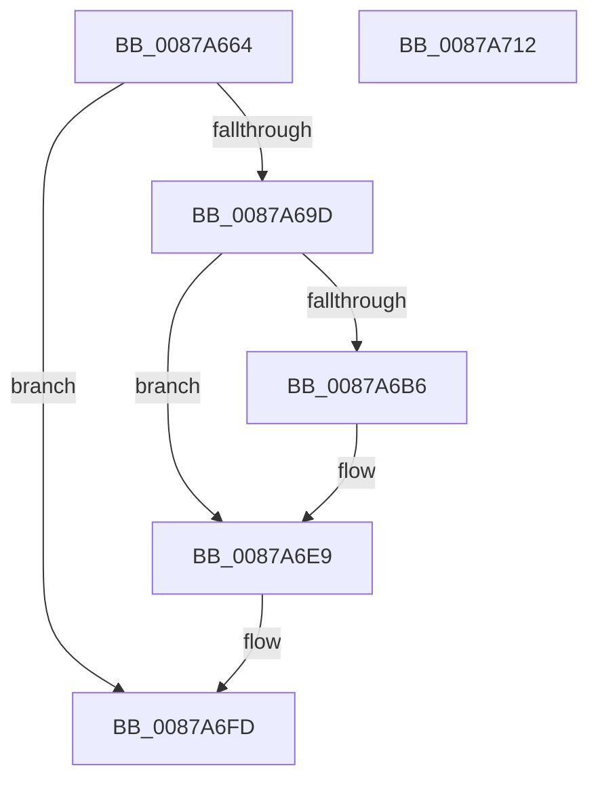

# CmpLogEvent

- RVA: `0x0087A664`–`0x0087A713` (길이 `175` bytes)
- VA: `0x000000014087A664`
- 실행 섹션: `PAGE`
- PDB 이름 있음: `예`; PDB Function 태그: `아니요`
- unwind 정보 RVA: `0x0006CDB8`
- 디코드: `44`개 명령, `175/175` bytes 표시
- 미해석 바이트: `0` (있으면 어셈블리에 `.byte`로 보존)

> 이 문서는 커널 이미지의 기계어와 PDB 기호를 분석해 생성했습니다. 4번과 5번은 함수 원형과 자료형을 바이너리 사용 방식에서 추정한 C 해석이며 원본 소스 복구 결과는 아닙니다.

## 1. Dependencies

- 직접 호출 지점: **2**; 고유 호출 대상: **2**
- 직접 호출자로 확인된 함수: **2**
- RIP 상대 이미지 참조: **2**

### Outgoing calls
- `0x0087A6F8` → [EtwWrite](../../text/41/EtwWrite_function_0041C720.md) (function, `0x0041C720`)
- `0x0087A704` → [_security_check_cookie](../../text/6A/_security_check_cookie_function_006AC640.md) (function, `0x006AC640`)

### Direct callers
- [CmpInitHiveFromFile](CmpInitHiveFromFile_function_008794D4.md) at `0x00879906`
- [HvpFinishPrimaryWrite](../9B/HvpFinishPrimaryWrite_function_009B2580.md) at `0x009B2638`

### Static image references
- `0x0087A675` → RVA `0x00E0A740` (`.data`; read)
- `0x0087A689` → RVA `0x00EFFA28` (`.data`; read)

## 2. Other-region calls and transfers

- 다른 실행 섹션으로 향하는 call: **2**
  - `0x0087A6F8` → [EtwWrite](../../text/41/EtwWrite_function_0041C720.md) (`PAGE` → `.text`)
  - `0x0087A704` → [_security_check_cookie](../../text/6A/_security_check_cookie_function_006AC640.md) (`PAGE` → `.text`)
- 별도 외부 분기/꼬리 이동을 확인하지 못했습니다.

## 3. Assembly (complete function range)

```asm
0087A664  89 54 24 10                     mov dword ptr [rsp + 0x10], edx
0087A668  55                              push rbp
0087A669  48 8D 6C 24 A9                  lea rbp, [rsp - 0x57]
0087A66E  48 81 EC D0 00 00 00            sub rsp, 0xd0
0087A675  48 8B 05 C4 00 59 00            mov rax, qword ptr [rip + 0x5900c4]
0087A67C  48 33 C4                        xor rax, rsp
0087A67F  48 89 45 47                     mov qword ptr [rbp + 0x47], rax
0087A683  45 33 D2                        xor r10d, r10d
0087A686  48 8B D1                        mov rdx, rcx
0087A689  48 8B 0D 98 53 68 00            mov rcx, qword ptr [rip + 0x685398]
0087A690  4D 8B C8                        mov r9, r8
0087A693  66 44 89 55 B7                  mov word ptr [rbp - 0x49], r10w
0087A698  48 85 C9                        test rcx, rcx
0087A69B  74 60                           je 0x14087a6fd
0087A69D  48 C7 45 CF 04 00 00 00         mov qword ptr [rbp - 0x31], 4
0087A6A5  48 8D 45 6F                     lea rax, [rbp + 0x6f]
0087A6A9  48 89 45 C7                     mov qword ptr [rbp - 0x39], rax
0087A6AD  41 8D 42 01                     lea eax, [r10 + 1]
0087A6B1  4D 85 C0                        test r8, r8
0087A6B4  74 33                           je 0x14087a6e9
0087A6B6  45 0F B7 00                     movzx r8d, word ptr [r8]
0087A6BA  41 0F B7 C0                     movzx eax, r8w
0087A6BE  48 C7 45 DF 02 00 00 00         mov qword ptr [rbp - 0x21], 2
0087A6C6  66 D1 E8                        shr ax, 1
0087A6C9  66 89 45 B7                     mov word ptr [rbp - 0x49], ax
0087A6CD  48 8D 45 B7                     lea rax, [rbp - 0x49]
0087A6D1  48 89 45 D7                     mov qword ptr [rbp - 0x29], rax
0087A6D5  49 8B 41 08                     mov rax, qword ptr [r9 + 8]
0087A6D9  48 89 45 E7                     mov qword ptr [rbp - 0x19], rax
0087A6DD  41 8D 42 03                     lea eax, [r10 + 3]
0087A6E1  44 89 45 EF                     mov dword ptr [rbp - 0x11], r8d
0087A6E5  44 89 55 F3                     mov dword ptr [rbp - 0xd], r10d
0087A6E9  4C 8D 45 C7                     lea r8, [rbp - 0x39]
0087A6ED  44 8B C8                        mov r9d, eax
0087A6F0  4C 89 44 24 20                  mov qword ptr [rsp + 0x20], r8
0087A6F5  45 33 C0                        xor r8d, r8d
0087A6F8  E8 23 20 BA FF                  call 0x14041c720
0087A6FD  48 8B 4D 47                     mov rcx, qword ptr [rbp + 0x47]
0087A701  48 33 CC                        xor rcx, rsp
0087A704  E8 37 1F E3 FF                  call 0x1406ac640
0087A709  48 81 C4 D0 00 00 00            add rsp, 0xd0
0087A710  5D                              pop rbp
0087A711  C3                              ret
0087A712  CC                              int3
```

## 4. C-style interpretation (structured pseudocode)

```c
__int64 __fastcall CmpLogEvent(__int64 a1, int a2, __int64 a3)
{
    __int64 result;
    __int64 v_r10;
    __int64 v_rsp;
    unsigned __int64 v_stack_m18;
    unsigned __int64 v_stack_m5F;
    unsigned int v_stack_m6C;
    unsigned int v_stack_m70;
    unsigned __int64 v_stack_m78;
    unsigned __int64 v_stack_m80;
    unsigned __int64 v_stack_m88;
    unsigned __int64 v_stack_m90;
    unsigned __int64 v_stack_m98;
    unsigned __int16 v_stack_mA8;
    unsigned __int64 v_stack_mB8;
    unsigned int v_stack_p10;

    v_stack_p10 = a2;
    v_rsp = (v_rsp) - (208);
    result = (*(unsigned __int64 *)(v_rip + 5832900)) ^ (v_rsp);
    v_stack_m18 = result;
    v_r10 = 0;
    v_stack_mA8 = 0;
    if (*(unsigned __int64 *)(v_rip + 6837144) == 0) goto loc_0087A6FD;
    v_stack_m90 = 4;
    v_stack_m98 = v_stack_p10;
    result = v_r10 + 1;
    if (a3 != 0) {
        a3 = *(unsigned __int16 *)(a3);
        result = (unsigned __int16)(a3);
        v_stack_m80 = 2;
        result = (unsigned __int16)((result) >> (1));
        v_stack_mA8 = (unsigned __int16)(result);
        result = v_stack_mA8;
        v_stack_m88 = result;
        result = *(unsigned __int64 *)(a3 + 8);
        v_stack_m78 = result;
        result = v_r10 + 3;
        v_stack_m70 = (unsigned int)(a3);
        v_stack_m6C = 0;
    }
    v_stack_mB8 = v_stack_m98;
    a3 = 0;
    result = EtwWrite(*(unsigned __int64 *)(v_rip + 6837144), a1, a3, (unsigned int)((unsigned int)(result)));
loc_0087A6FD:
    a1 = (v_stack_m18) ^ (v_rsp);
    result = _security_check_cookie(a1, a1, a3, (unsigned int)((unsigned int)(result)));
    v_rsp = (v_rsp) + (208);
    return result;
}
```

## 5. (Beta) C Style

```c
int64_t CmpLogEvent(int64_t Arg1, int32_t Arg2, void *Arg3)
{
    uint8_t *arg3 = (uint8_t *)Arg3;

    int64_t result;
    int64_t local_r10;
    int64_t local_rsp;
    uint64_t v_stack_m18;
    uint64_t v_stack_m5F;
    uint32_t v_stack_m6C;
    uint32_t v_stack_m70;
    uint64_t v_stack_m78;
    uint64_t v_stack_m80;
    uint64_t v_stack_m88;
    uint64_t v_stack_m90;
    uint64_t v_stack_m98;
    uint16_t v_stack_mA8;
    uint64_t v_stack_mB8;
    uint32_t v_stack_p10;

    v_stack_p10 = Arg2;
    local_rsp = (local_rsp) - (208);
    result = (*(uint64_t *)(v_rip + 0x5900C4)) ^ (local_rsp);
    v_stack_m18 = result;
    local_r10 = 0;
    v_stack_mA8 = 0;
    if (*(uint64_t *)(v_rip + 0x685398) == 0) goto loc_0087A6FD;
    v_stack_m90 = 4;
    v_stack_m98 = v_stack_p10;
    result = local_r10 + 1;
    if (Arg3 != NULL) {
        Arg3 = *(uint16_t *)(arg3);
        result = (uint16_t)(Arg3);
        v_stack_m80 = 2;
        result = (uint16_t)((result) >> (1));
        v_stack_mA8 = (uint16_t)(result);
        result = v_stack_mA8;
        v_stack_m88 = result;
        result = *(uint64_t *)(arg3 + 0x8);
        v_stack_m78 = result;
        result = local_r10 + 3;
        v_stack_m70 = (uint32_t)(Arg3);
        v_stack_m6C = 0;
    }
    v_stack_mB8 = v_stack_m98;
    Arg3 = 0;
    result = EtwWrite(*(uint64_t *)(v_rip + 0x685398), Arg1, Arg3, (uint32_t)((uint32_t)(result)));
loc_0087A6FD:
    Arg1 = (v_stack_m18) ^ (local_rsp);
    result = _security_check_cookie(Arg1, Arg1, Arg3, (uint32_t)((uint32_t)(result)));
    local_rsp = (local_rsp) + (208);
    return result;
}
```

### 관측된 메모리 오프셋

구조체 형식이 확인되지 않은 접근은 인자 기준의 오프셋으로만 기록했습니다.

| 기준 인자 | 오프셋 표현 | 폭 (bit) | 접근 |
|---|---:|---:|---|
| `Arg3` | `+ 0x8` | `64` | `R` |

## 6. Execution-region graph

[열기: 2D/3D 그래프와 함수 탐색 컨트롤 패널](../../../control-panel.html?section=page&rva=0x0087A664&view=graph)

- 2D 그래프는 위에서 아래로 흐르고, 3D 그래프는 빈 공간을 드래그해 회전합니다. Shift+드래그는 이동, 휠은 확대·축소, 함수 노드 선택은 대상 보고서 이동입니다.

### Static fallback


