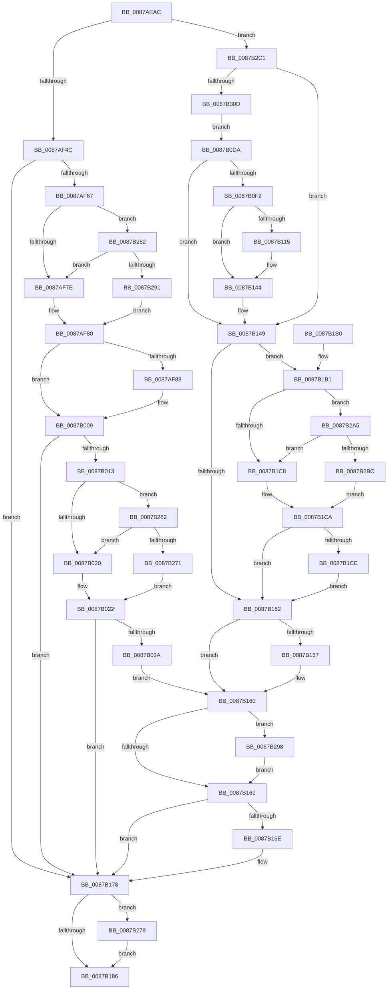

# CmpLogHiveFileInaccessible

- RVA: `0x0087AEAC`–`0x0087B312` (길이 `1,126` bytes)
- VA: `0x000000014087AEAC`
- 실행 섹션: `PAGE`
- PDB 이름 있음: `예`; PDB Function 태그: `아니요`
- unwind 정보 RVA: `0x0006CE20`
- 디코드: `246`개 명령, `1,126/1,126` bytes 표시
- 미해석 바이트: `0` (있으면 어셈블리에 `.byte`로 보존)

> 이 문서는 커널 이미지의 기계어와 PDB 기호를 분석해 생성했습니다. 4번과 5번은 함수 원형과 자료형을 바이너리 사용 방식에서 추정한 C 해석이며 원본 소스 복구 결과는 아닙니다.

## 1. Dependencies

- 직접 호출 지점: **15**; 고유 호출 대상: **15**
- 직접 호출자로 확인된 함수: **1**
- RIP 상대 이미지 참조: **13**

### Outgoing calls
- `0x0087AEF3` → [memset](../../text/6C/memset_function_006C6C40.md) (function, `0x006C6C40`)
- `0x0087AFF1` → [tlgWriteAgg](../../text/2F/tlgWriteAgg_function_002F0F7C.md) (function, `0x002F0F7C`)
- `0x0087B0C6` → [EtwWriteTransfer](../../text/41/EtwWriteTransfer_function_0041C830.md) (function, `0x0041C830`)
- `0x0087B0E4` → [CmpQueryFileSecurityDescriptor](CmpQueryFileSecurityDescriptor_function_0087B318.md) (function, `0x0087B318`)
- `0x0087B10C` → [SeConvertSecurityDescriptorToStringSecurityDescriptor](../../text/4A/SeConvertSecurityDescriptorToStringSecurityDescriptor_function_004A18B0.md) (function, `0x004A18B0`)
- `0x0087B119` → [SeCaptureSubjectContext](../86/SeCaptureSubjectContext_function_0086B820.md) (function, `0x0086B820`)
- `0x0087B13B` → [SeQueryUserSidToken](../99/SeQueryUserSidToken_function_00990950.md) (function, `0x00990950`)
- `0x0087B15B` → [SeReleaseSubjectContext](../86/SeReleaseSubjectContext_function_0086B710.md) (function, `0x0086B710`)
- `0x0087B173` → [ExFreePoolWithTag](../../poolcode/B8/ExFreePoolWithTag_function_00B82870.md) (function, `0x00B82870`)
- `0x0087B190` → [_security_check_cookie](../../text/6A/_security_check_cookie_function_006AC640.md) (function, `0x006AC640`)
- `0x0087B1F1` → [tlgCreate1Sz_wchar_t](../../text/42/tlgCreate1Sz_wchar_t_function_00426198.md) (function, `0x00426198`)
- `0x0087B258` → [tlgWriteTransfer_EtwWriteTransfer](../../text/42/tlgWriteTransfer_EtwWriteTransfer_function_004260E0.md) (function, `0x004260E0`)
- `0x0087B278` → [ZwClose](../../text/6A/ZwClose_function_006AD2B0.md) (function, `0x006AD2B0`)
- `0x0087B29B` → [CmSiFreeMemory](../../text/47/CmSiFreeMemory_function_00475D80.md) (function, `0x00475D80`)
- `0x0087B2FB` → [ZwOpenFile](../../text/6A/ZwOpenFile_function_006AD730.md) (function, `0x006AD730`)

### Direct callers
- [CmpOpenHiveFile](CmpOpenHiveFile_function_0087A71C.md) at `0x0087AB4F`

### Static image references
- `0x0087AECB` → RVA `0x00E0A740` (`.data`; read)
- `0x0087AEFF` → RVA `0x00FD9B78` (`PAGEDATA`; read)
- `0x0087AF4C` → RVA `0x00E09F58` (`.data`; read)
- `0x0087AF56` → RVA `0x00E09F70` (`.data`; read)
- `0x0087AF71` → RVA `0x00E09F68` (`.data`; read)
- `0x0087AF93` → RVA `0x00056C89` (`.rdata`; read)
- `0x0087B036` → RVA `0x00043590` (`.rdata`; read)
- `0x0087B03D` → RVA `0x00056C53` (`.rdata`; read)
- `0x0087B050` → RVA `0x00E09F60` (`.data`; read)
- `0x0087B081` → RVA `0x00056C5D` (`.rdata`; read)
- `0x0087B08C` → RVA `0x0005BCFD` (`.rdata`; read)
- `0x0087B0AE` → RVA `0x00E09F78` (`.data`; read)
- `0x0087B1FB` → RVA `0x00056CE1` (`.rdata`; read)

## 2. Other-region calls and transfers

- 다른 실행 섹션으로 향하는 call: **11**
  - `0x0087AEF3` → [memset](../../text/6C/memset_function_006C6C40.md) (`PAGE` → `.text`)
  - `0x0087AFF1` → [tlgWriteAgg](../../text/2F/tlgWriteAgg_function_002F0F7C.md) (`PAGE` → `.text`)
  - `0x0087B0C6` → [EtwWriteTransfer](../../text/41/EtwWriteTransfer_function_0041C830.md) (`PAGE` → `.text`)
  - `0x0087B10C` → [SeConvertSecurityDescriptorToStringSecurityDescriptor](../../text/4A/SeConvertSecurityDescriptorToStringSecurityDescriptor_function_004A18B0.md) (`PAGE` → `.text`)
  - `0x0087B173` → [ExFreePoolWithTag](../../poolcode/B8/ExFreePoolWithTag_function_00B82870.md) (`PAGE` → `POOLCODE`)
  - `0x0087B190` → [_security_check_cookie](../../text/6A/_security_check_cookie_function_006AC640.md) (`PAGE` → `.text`)
  - `0x0087B1F1` → [tlgCreate1Sz_wchar_t](../../text/42/tlgCreate1Sz_wchar_t_function_00426198.md) (`PAGE` → `.text`)
  - `0x0087B258` → [tlgWriteTransfer_EtwWriteTransfer](../../text/42/tlgWriteTransfer_EtwWriteTransfer_function_004260E0.md) (`PAGE` → `.text`)
  - `0x0087B278` → [ZwClose](../../text/6A/ZwClose_function_006AD2B0.md) (`PAGE` → `.text`)
  - `0x0087B29B` → [CmSiFreeMemory](../../text/47/CmSiFreeMemory_function_00475D80.md) (`PAGE` → `.text`)
  - `0x0087B2FB` → [ZwOpenFile](../../text/6A/ZwOpenFile_function_006AD730.md) (`PAGE` → `.text`)
- 별도 외부 분기/꼬리 이동을 확인하지 못했습니다.

## 3. Assembly (complete function range)

```asm
0087AEAC  48 89 5C 24 10                  mov qword ptr [rsp + 0x10], rbx
0087AEB1  55                              push rbp
0087AEB2  56                              push rsi
0087AEB3  57                              push rdi
0087AEB4  41 54                           push r12
0087AEB6  41 55                           push r13
0087AEB8  41 56                           push r14
0087AEBA  41 57                           push r15
0087AEBC  48 8D AC 24 60 FF FF FF         lea rbp, [rsp - 0xa0]
0087AEC4  48 81 EC A0 01 00 00            sub rsp, 0x1a0
0087AECB  48 8B 05 6E F8 58 00            mov rax, qword ptr [rip + 0x58f86e]
0087AED2  48 33 C4                        xor rax, rsp
0087AED5  48 89 85 90 00 00 00            mov qword ptr [rbp + 0x90], rax
0087AEDC  89 54 24 40                     mov dword ptr [rsp + 0x40], edx
0087AEE0  45 8B E0                        mov r12d, r8d
0087AEE3  33 D2                           xor edx, edx
0087AEE5  48 8B D9                        mov rbx, rcx
0087AEE8  48 8D 4D B0                     lea rcx, [rbp - 0x50]
0087AEEC  45 8B E9                        mov r13d, r9d
0087AEEF  44 8D 42 44                     lea r8d, [rdx + 0x44]
0087AEF3  E8 48 BD E4 FF                  call 0x1406c6c40
0087AEF8  44 8B 4C 24 40                  mov r9d, dword ptr [rsp + 0x40]
0087AEFD  33 C0                           xor eax, eax
0087AEFF  4C 8B 3D 72 EC 75 00            mov r15, qword ptr [rip + 0x75ec72]
0087AF06  0F 57 C0                        xorps xmm0, xmm0
0087AF09  48 89 45 90                     mov qword ptr [rbp - 0x70], rax
0087AF0D  44 8A F0                        mov r14b, al
0087AF10  89 45 98                        mov dword ptr [rbp - 0x68], eax
0087AF13  8B F8                           mov edi, eax
0087AF15  89 44 24 30                     mov dword ptr [rsp + 0x30], eax
0087AF19  8B F0                           mov esi, eax
0087AF1B  48 89 44 24 50                  mov qword ptr [rsp + 0x50], rax
0087AF20  48 89 44 24 48                  mov qword ptr [rsp + 0x48], rax
0087AF25  48 89 44 24 38                  mov qword ptr [rsp + 0x38], rax
0087AF2A  0F 11 45 A0                     movups xmmword ptr [rbp - 0x60], xmm0
0087AF2E  0F 11 44 24 70                  movups xmmword ptr [rsp + 0x70], xmm0
0087AF33  0F 11 45 80                     movups xmmword ptr [rbp - 0x80], xmm0
0087AF37  0F 11 45 00                     movups xmmword ptr [rbp], xmm0
0087AF3B  0F 11 45 10                     movups xmmword ptr [rbp + 0x10], xmm0
0087AF3F  41 81 F9 22 00 00 C0            cmp r9d, 0xc0000022
0087AF46  0F 84 75 03 00 00               je 0x14087b2c1
0087AF4C  44 8B 05 05 F0 58 00            mov r8d, dword ptr [rip + 0x58f005]
0087AF53  8D 58 01                        lea ebx, [rax + 1]
0087AF56  48 8B 0D 13 F0 58 00            mov rcx, qword ptr [rip + 0x58f013]
0087AF5D  41 83 F8 03                     cmp r8d, 3
0087AF61  0F 86 11 02 00 00               jbe 0x14087b178
0087AF67  48 BA 08 00 00 00 00 20 00 00   movabs rdx, 0x200000000008
0087AF71  48 85 15 F0 EF 58 00            test qword ptr [rip + 0x58eff0], rdx
0087AF78  0F 85 04 03 00 00               jne 0x14087b282
0087AF7E  32 C0                           xor al, al
0087AF80  84 C0                           test al, al
0087AF82  0F 84 81 00 00 00               je 0x14087b009
0087AF88  21 75 5C                        and dword ptr [rbp + 0x5c], esi
0087AF8B  48 8D 44 24 68                  lea rax, [rsp + 0x68]
0087AF90  21 75 6C                        and dword ptr [rbp + 0x6c], esi
0087AF93  48 8D 15 EF BC 7D FF            lea rdx, [rip - 0x824311]
0087AF9A  21 75 7C                        and dword ptr [rbp + 0x7c], esi
0087AF9D  48 8D 0D B4 EF 58 00            lea rcx, [rip + 0x58efb4]
0087AFA4  48 89 45 50                     mov qword ptr [rbp + 0x50], rax
0087AFA8  48 8D 44 24 34                  lea rax, [rsp + 0x34]
0087AFAD  48 89 45 60                     mov qword ptr [rbp + 0x60], rax
0087AFB1  48 8D 44 24 58                  lea rax, [rsp + 0x58]
0087AFB6  48 89 45 70                     mov qword ptr [rbp + 0x70], rax
0087AFBA  48 8D 45 30                     lea rax, [rbp + 0x30]
0087AFBE  44 89 4C 24 34                  mov dword ptr [rsp + 0x34], r9d
0087AFC3  41 B9 05 00 00 00               mov r9d, 5
0087AFC9  48 89 44 24 20                  mov qword ptr [rsp + 0x20], rax
0087AFCE  48 89 5C 24 68                  mov qword ptr [rsp + 0x68], rbx
0087AFD3  C7 45 58 08 00 00 00            mov dword ptr [rbp + 0x58], 8
0087AFDA  C7 45 68 04 00 00 00            mov dword ptr [rbp + 0x68], 4
0087AFE1  48 C7 44 24 58 00 00 00 01      mov qword ptr [rsp + 0x58], 0x1000000
0087AFEA  C7 45 78 08 00 00 00            mov dword ptr [rbp + 0x78], 8
0087AFF1  E8 86 5F A7 FF                  call 0x1402f0f7c
0087AFF6  48 8B 0D 73 EF 58 00            mov rcx, qword ptr [rip + 0x58ef73]
0087AFFD  44 8B 05 54 EF 58 00            mov r8d, dword ptr [rip + 0x58ef54]
0087B004  44 8B 4C 24 40                  mov r9d, dword ptr [rsp + 0x40]
0087B009  41 83 F8 03                     cmp r8d, 3
0087B00D  0F 86 65 01 00 00               jbe 0x14087b178
0087B013  F6 05 4E EF 58 00 08            test byte ptr [rip + 0x58ef4e], 8
0087B01A  0F 85 42 02 00 00               jne 0x14087b262
0087B020  32 C0                           xor al, al
0087B022  84 C0                           test al, al
0087B024  0F 84 4E 01 00 00               je 0x14087b178
0087B02A  21 75 2C                        and dword ptr [rbp + 0x2c], esi
0087B02D  48 8D 44 24 34                  lea rax, [rsp + 0x34]
0087B032  48 89 45 20                     mov qword ptr [rbp + 0x20], rax
0087B036  48 8D 0D 53 85 7C FF            lea rcx, [rip - 0x837aad]
0087B03D  0F B7 05 0F BC 7D FF            movzx eax, word ptr [rip - 0x8243f1]
0087B044  48 8D 54 24 58                  lea rdx, [rsp + 0x58]
0087B049  89 44 24 5C                     mov dword ptr [rsp + 0x5c], eax
0087B04D  45 33 C0                        xor r8d, r8d
0087B050  48 8B 05 09 EF 58 00            mov rax, qword ptr [rip + 0x58ef09]
0087B057  48 89 45 00                     mov qword ptr [rbp], rax
0087B05B  44 89 4C 24 34                  mov dword ptr [rsp + 0x34], r9d
0087B060  45 33 C9                        xor r9d, r9d
0087B063  C7 45 28 04 00 00 00            mov dword ptr [rbp + 0x28], 4
0087B06A  C7 44 24 58 00 00 00 0B         mov dword ptr [rsp + 0x58], 0xb000000
0087B072  48 C7 44 24 60 08 00 00 00      mov qword ptr [rsp + 0x60], 8
0087B07B  0F B7 00                        movzx eax, word ptr [rax]
0087B07E  89 45 08                        mov dword ptr [rbp + 8], eax
0087B081  48 8D 05 D5 BB 7D FF            lea rax, [rip - 0x82442b]
0087B088  48 89 45 10                     mov qword ptr [rbp + 0x10], rax
0087B08C  48 8D 05 6A 0C 7E FF            lea rax, [rip - 0x81f396]
0087B093  2B C1                           sub eax, ecx
0087B095  C7 45 0C 02 00 00 00            mov dword ptr [rbp + 0xc], 2
0087B09C  C7 45 18 2B 00 00 00            mov dword ptr [rbp + 0x18], 0x2b
0087B0A3  89 5D 1C                        mov dword ptr [rbp + 0x1c], ebx
0087B0A6  89 44 24 30                     mov dword ptr [rsp + 0x30], eax
0087B0AA  8B 44 24 30                     mov eax, dword ptr [rsp + 0x30]
0087B0AE  48 8B 0D C3 EE 58 00            mov rcx, qword ptr [rip + 0x58eec3]
0087B0B5  48 8D 45 00                     lea rax, [rbp]
0087B0B9  48 89 44 24 28                  mov qword ptr [rsp + 0x28], rax
0087B0BE  C7 44 24 20 03 00 00 00         mov dword ptr [rsp + 0x20], 3
0087B0C6  E8 65 17 BA FF                  call 0x14041c830
0087B0CB  48 8B 7C 24 48                  mov rdi, qword ptr [rsp + 0x48]
0087B0D0  48 8B 74 24 38                  mov rsi, qword ptr [rsp + 0x38]
0087B0D5  E9 86 00 00 00                  jmp 0x14087b160
0087B0DA  48 8B 4C 24 50                  mov rcx, qword ptr [rsp + 0x50]
0087B0DF  48 8D 54 24 48                  lea rdx, [rsp + 0x48]
0087B0E4  E8 2F 02 00 00                  call 0x14087b318
0087B0E9  48 8B 7C 24 48                  mov rdi, qword ptr [rsp + 0x48]
0087B0EE  85 C0                           test eax, eax
0087B0F0  78 57                           js 0x14087b149
0087B0F2  48 8D 44 24 30                  lea rax, [rsp + 0x30]
0087B0F7  41 B8 0C 00 00 00               mov r8d, 0xc
0087B0FD  4C 8D 4C 24 38                  lea r9, [rsp + 0x38]
0087B102  48 89 44 24 20                  mov qword ptr [rsp + 0x20], rax
0087B107  8B D3                           mov edx, ebx
0087B109  48 8B CF                        mov rcx, rdi
0087B10C  E8 9F 67 C2 FF                  call 0x1404a18b0
0087B111  85 C0                           test eax, eax
0087B113  78 2F                           js 0x14087b144
0087B115  48 8D 4D 00                     lea rcx, [rbp]
0087B119  E8 02 07 FF FF                  call 0x14086b820
0087B11E  48 8B 45 00                     mov rax, qword ptr [rbp]
0087B122  48 8D 55 B0                     lea rdx, [rbp - 0x50]
0087B126  48 8B 4D 10                     mov rcx, qword ptr [rbp + 0x10]
0087B12A  48 85 C0                        test rax, rax
0087B12D  44 8A F3                        mov r14b, bl
0087B130  48 0F 45 C8                     cmovne rcx, rax
0087B134  45 33 C9                        xor r9d, r9d
0087B137  45 8D 41 44                     lea r8d, [r9 + 0x44]
0087B13B  E8 10 58 11 00                  call 0x140990950
0087B140  4C 8D 7D B0                     lea r15, [rbp - 0x50]
0087B144  48 8B 74 24 38                  mov rsi, qword ptr [rsp + 0x38]
0087B149  83 3D 08 EE 58 00 03            cmp dword ptr [rip + 0x58ee08], 3
0087B150  77 5F                           ja 0x14087b1b1
0087B152  45 84 F6                        test r14b, r14b
0087B155  74 09                           je 0x14087b160
0087B157  48 8D 4D 00                     lea rcx, [rbp]
0087B15B  E8 B0 05 FF FF                  call 0x14086b710
0087B160  48 85 FF                        test rdi, rdi
0087B163  0F 85 2F 01 00 00               jne 0x14087b298
0087B169  48 85 F6                        test rsi, rsi
0087B16C  74 0A                           je 0x14087b178
0087B16E  33 D2                           xor edx, edx
0087B170  48 8B CE                        mov rcx, rsi
0087B173  E8 F8 76 30 00                  call 0x140b82870
0087B178  48 8B 4C 24 50                  mov rcx, qword ptr [rsp + 0x50]
0087B17D  48 85 C9                        test rcx, rcx
0087B180  0F 85 F2 00 00 00               jne 0x14087b278
0087B186  48 8B 8D 90 00 00 00            mov rcx, qword ptr [rbp + 0x90]
0087B18D  48 33 CC                        xor rcx, rsp
0087B190  E8 AB 14 E3 FF                  call 0x1406ac640
0087B195  48 8B 9C 24 E8 01 00 00         mov rbx, qword ptr [rsp + 0x1e8]
0087B19D  48 81 C4 A0 01 00 00            add rsp, 0x1a0
0087B1A4  41 5F                           pop r15
0087B1A6  41 5E                           pop r14
0087B1A8  41 5D                           pop r13
0087B1AA  41 5C                           pop r12
0087B1AC  5F                              pop rdi
0087B1AD  5E                              pop rsi
0087B1AE  5D                              pop rbp
0087B1AF  C3                              ret
0087B1B0  CC                              int3
0087B1B1  48 BA 08 00 00 00 00 20 00 00   movabs rdx, 0x200000000008
0087B1BB  48 85 15 A6 ED 58 00            test qword ptr [rip + 0x58eda6], rdx
0087B1C2  0F 85 DD 00 00 00               jne 0x14087b2a5
0087B1C8  32 DB                           xor bl, bl
0087B1CA  84 DB                           test bl, bl
0087B1CC  74 84                           je 0x14087b152
0087B1CE  83 65 5C 00                     and dword ptr [rbp + 0x5c], 0
0087B1D2  48 8D 44 24 30                  lea rax, [rsp + 0x30]
0087B1D7  48 8B D6                        mov rdx, rsi
0087B1DA  48 89 45 50                     mov qword ptr [rbp + 0x50], rax
0087B1DE  48 8D 4D 60                     lea rcx, [rbp + 0x60]
0087B1E2  C7 44 24 30 22 00 00 C0         mov dword ptr [rsp + 0x30], 0xc0000022
0087B1EA  C7 45 58 04 00 00 00            mov dword ptr [rbp + 0x58], 4
0087B1F1  E8 A2 AF BA FF                  call 0x140426198
0087B1F6  41 0F B6 47 01                  movzx eax, byte ptr [r15 + 1]
0087B1FB  48 8D 15 DF BA 7D FF            lea rdx, [rip - 0x824521]
0087B202  83 65 7C 00                     and dword ptr [rbp + 0x7c], 0
0087B206  48 8D 0D 4B ED 58 00            lea rcx, [rip + 0x58ed4b]
0087B20D  83 A5 8C 00 00 00 00            and dword ptr [rbp + 0x8c], 0
0087B214  45 33 C9                        xor r9d, r9d
0087B217  45 33 C0                        xor r8d, r8d
0087B21A  4C 89 7D 70                     mov qword ptr [rbp + 0x70], r15
0087B21E  8D 04 85 08 00 00 00            lea eax, [rax*4 + 8]
0087B225  48 C7 44 24 38 00 00 00 01      mov qword ptr [rsp + 0x38], 0x1000000
0087B22E  89 45 78                        mov dword ptr [rbp + 0x78], eax
0087B231  48 8D 44 24 38                  lea rax, [rsp + 0x38]
0087B236  48 89 85 80 00 00 00            mov qword ptr [rbp + 0x80], rax
0087B23D  48 8D 45 30                     lea rax, [rbp + 0x30]
0087B241  48 89 44 24 28                  mov qword ptr [rsp + 0x28], rax
0087B246  C7 44 24 20 06 00 00 00         mov dword ptr [rsp + 0x20], 6
0087B24E  C7 85 88 00 00 00 08 00 00 00   mov dword ptr [rbp + 0x88], 8
0087B258  E8 83 AE BA FF                  call 0x1404260e0
0087B25D  E9 F0 FE FF FF                  jmp 0x14087b152
0087B262  48 8B C1                        mov rax, rcx
0087B265  83 E0 08                        and eax, 8
0087B268  48 3B C1                        cmp rax, rcx
0087B26B  0F 85 AF FD FF FF               jne 0x14087b020
0087B271  8A C3                           mov al, bl
0087B273  E9 AA FD FF FF                  jmp 0x14087b022
0087B278  E8 33 20 E3 FF                  call 0x1406ad2b0
0087B27D  E9 04 FF FF FF                  jmp 0x14087b186
0087B282  48 8B C1                        mov rax, rcx
0087B285  48 23 C2                        and rax, rdx
0087B288  48 3B C1                        cmp rax, rcx
0087B28B  0F 85 ED FC FF FF               jne 0x14087af7e
0087B291  8A C3                           mov al, bl
0087B293  E9 E8 FC FF FF                  jmp 0x14087af80
0087B298  48 8B CF                        mov rcx, rdi
0087B29B  E8 E0 AA BF FF                  call 0x140475d80
0087B2A0  E9 C4 FE FF FF                  jmp 0x14087b169
0087B2A5  48 8B 05 C4 EC 58 00            mov rax, qword ptr [rip + 0x58ecc4]
0087B2AC  48 23 C2                        and rax, rdx
0087B2AF  48 3B 05 BA EC 58 00            cmp rax, qword ptr [rip + 0x58ecba]
0087B2B6  0F 85 0C FF FF FF               jne 0x14087b1c8
0087B2BC  E9 09 FF FF FF                  jmp 0x14087b1ca
0087B2C1  44 89 64 24 28                  mov dword ptr [rsp + 0x28], r12d
0087B2C6  4C 8D 4D A0                     lea r9, [rbp - 0x60]
0087B2CA  4C 8D 44 24 70                  lea r8, [rsp + 0x70]
0087B2CF  44 89 6C 24 20                  mov dword ptr [rsp + 0x20], r13d
0087B2D4  BA 00 00 02 00                  mov edx, 0x20000
0087B2D9  C7 44 24 70 30 00 00 00         mov dword ptr [rsp + 0x70], 0x30
0087B2E1  48 8D 4C 24 50                  lea rcx, [rsp + 0x50]
0087B2E6  48 89 44 24 78                  mov qword ptr [rsp + 0x78], rax
0087B2EB  C7 45 88 40 02 00 00            mov dword ptr [rbp - 0x78], 0x240
0087B2F2  48 89 5D 80                     mov qword ptr [rbp - 0x80], rbx
0087B2F6  F3 0F 7F 45 90                  movdqu xmmword ptr [rbp - 0x70], xmm0
0087B2FB  E8 30 24 E3 FF                  call 0x1406ad730
0087B300  BB 01 00 00 00                  mov ebx, 1
0087B305  85 C0                           test eax, eax
0087B307  0F 88 3C FE FF FF               js 0x14087b149
0087B30D  E9 C8 FD FF FF                  jmp 0x14087b0da
```

## 4. C-style interpretation (structured pseudocode)

```c
__int64 __fastcall CmpLogHiveFileInaccessible(__int64 a1, int a2, int a3, int a4)
{
    __int64 result;
    __int64 v_r14;
    __int64 v_r15;
    __int64 v_rbx;
    __int64 v_rsp;
    unsigned __int64 v_stack_m128;
    unsigned __int64 v_stack_m138;
    unsigned int v_stack_m140;
    unsigned __int64 v_stack_m148;
    unsigned int v_stack_m150;
    unsigned __int64 v_stack_m158;
    unsigned __int64 v_stack_m168;
    unsigned __int64 v_stack_m170;
    unsigned __int64 v_stack_m178;
    unsigned int v_stack_m17C;
    unsigned __int64 v_stack_m180;
    unsigned __int64 v_stack_m188;
    unsigned __int64 v_stack_m190;
    unsigned int v_stack_m198;
    unsigned __int64 v_stack_m1A0;
    unsigned __int64 v_stack_m1A4;
    unsigned int v_stack_m1A8;
    unsigned __int64 v_stack_m1B0;
    unsigned __int64 v_stack_m1B8;
    unsigned __int64 v_stack_m48;
    unsigned int v_stack_m4C;
    unsigned int v_stack_m50;
    unsigned __int64 v_stack_m58;
    unsigned int v_stack_m5C;
    unsigned int v_stack_m60;
    unsigned __int64 v_stack_m68;
    unsigned int v_stack_m6C;
    unsigned int v_stack_m70;
    unsigned __int64 v_stack_m78;
    unsigned int v_stack_m7C;
    unsigned int v_stack_m80;
    unsigned __int64 v_stack_m88;
    unsigned __int64 v_stack_mA8;
    unsigned int v_stack_mAC;
    unsigned int v_stack_mB0;
    unsigned __int64 v_stack_mB8;
    unsigned int v_stack_mBC;
    unsigned int v_stack_mC0;
    unsigned __int64 v_stack_mC8;
    unsigned int v_stack_mCC;
    unsigned int v_stack_mD0;
    unsigned __int64 v_stack_mD8;
    unsigned __int64 v_stack_p10;
    unsigned int v_stack_p20;
    unsigned __int64 v_stack_p28;
    unsigned __int64 v_stack_p30;
    unsigned __int64 v_stack_p38;
    unsigned __int64 v_stack_p50;
    unsigned __int64 v_stack_p70;
    unsigned __int64 v_stack_p78;

    v_stack_p10 = v_rbx;
    v_rsp = (v_rsp) - (416);
    result = (*(unsigned __int64 *)(v_rip + 5830766)) ^ (v_rsp);
    v_stack_m48 = result;
    v_stack_m198 = a2;
    a2 = 0;
    result = memset(v_stack_m128, a2, a2 + 68, a4);
    result = 0;
    v_stack_m148 = 0;
    v_stack_m140 = 0;
    v_stack_m1A8 = 0;
    v_stack_m188 = 0;
    v_stack_m190 = 0;
    v_stack_m1A0 = 0;
    v_stack_m138 = v_xmm0;
    v_stack_m168 = v_xmm0;
    v_stack_m158 = v_xmm0;
    v_stack_mD8 = v_xmm0;
    v_stack_mC8 = v_xmm0;
    if (((unsigned int)((unsigned int)(v_stack_m198))) == 0xC0000022ULL) goto loc_0087B2C1;
    if (((unsigned int)((unsigned int)(*(unsigned int *)(v_rip + 5828613)))) <= 3) goto loc_0087B178;
    if (((*(unsigned __int64 *)(v_rip + 5828592)) & (0)) != 0) goto loc_0087B282;
loc_0087AF7E:
    result = 0;
loc_0087AF80:
    if (0 != 0) {
        result = v_stack_m170;
        a2 = v_rip - 8536849;
        a1 = v_rip + 5828532;
        v_stack_m88 = result;
        result = v_stack_m1A4;
        v_stack_m78 = result;
        result = v_stack_m180;
        v_stack_m68 = result;
        result = v_stack_mA8;
        v_stack_m1A4 = (unsigned int)((unsigned int)(v_stack_m198));
        a4 = 5;
        v_stack_m1B8 = result;
        v_stack_m170 = result + 1;
        v_stack_m80 = 8;
        v_stack_m70 = 4;
        v_stack_m180 = 0x1000000ULL;
        v_stack_m60 = 8;
        result = tlgWriteAgg(a1, a2, (unsigned int)(*(unsigned int *)(v_rip + 5828613)), a4);
        a1 = *(unsigned __int64 *)(v_rip + 5828467);
        a3 = *(unsigned int *)(v_rip + 5828436);
        a4 = v_stack_m198;
    }
    if (a3 <= 3) goto loc_0087B178;
    if (((*(unsigned __int8 *)(v_rip + 5828430)) & (8)) != 0) goto loc_0087B262;
loc_0087B020:
    result = 0;
loc_0087B022:
    if (0 == 0) goto loc_0087B178;
    v_stack_mB8 = v_stack_m1A4;
    v_stack_m17C = (unsigned int)(*(unsigned __int16 *)(v_rip - 8537073));
    a3 = 0;
    v_stack_mD8 = *(unsigned __int64 *)(v_rip + 5828361);
    v_stack_m1A4 = a4;
    a4 = 0;
    v_stack_mB0 = 4;
    v_stack_m180 = 0xB000000ULL;
    v_stack_m178 = 8;
    v_stack_mD0 = (unsigned int)(*(unsigned __int16 *)(*(unsigned __int64 *)(v_rip + 5828361)));
    v_stack_mC8 = v_rip - 8537131;
    result = (unsigned int)((v_rip - 8516502) - ((unsigned int)(v_rip - 8616621)));
    v_stack_mCC = 2;
    v_stack_mC0 = 43;
    v_stack_mBC = (unsigned int)(result + 1);
    v_stack_m1A8 = (unsigned int)(result);
    v_stack_m1B0 = v_stack_mD8;
    v_stack_m1B8 = 3;
    result = EtwWriteTransfer(*(unsigned __int64 *)(v_rip + 5828291), v_stack_m180, a3, a4);
    goto loc_0087B160;
loc_0087B0DA:
    result = CmpQueryFileSecurityDescriptor(v_stack_m188, v_stack_m190, a3, a4);
    if (sign_flag) goto loc_0087B149;
    v_stack_m1B8 = v_stack_m1A8;
    result = SeConvertSecurityDescriptorToStringSecurityDescriptor(v_stack_m190, (unsigned int)((unsigned int)(result + 1)), 12, v_stack_m1A0);
    v_r14 = 0;
    v_r15 = *(unsigned __int64 *)(v_rip + 7728242);
    if (!(sign_flag)) {
        a1 = v_stack_mD8;
        result = SeCaptureSubjectContext(a1, (unsigned int)((unsigned int)(result + 1)), 12, v_stack_m1A0);
        result = v_stack_mD8;
        a2 = v_stack_m128;
        a1 = v_stack_mC8;
        v_r14 = (unsigned __int8)(result + 1);
        if (result != 0) { a1 = result; }
        a4 = 0;
        a3 = a4 + 68;
        result = SeQueryUserSidToken(a1, a2, a3, a4);
        v_r15 = v_stack_m128;
    }
loc_0087B149:
    if ((*(unsigned int *)(v_rip + 5828104)) > 3) goto loc_0087B1B1;
loc_0087B152:
    if ((unsigned __int8)(v_r14) != 0) {
        a1 = v_stack_mD8;
        result = SeReleaseSubjectContext(a1, a2, a3, a4);
    }
    if (v_stack_m190 != 0) goto loc_0087B298;
loc_0087B169:
    if (v_stack_m1A0 != 0) {
        a2 = 0;
        a1 = v_stack_m1A0;
        result = ExFreePoolWithTag(a1, a2, a3, a4);
    }
    if (v_stack_m188 != 0) goto loc_0087B278;
loc_0087B186:
    a1 = (v_stack_m48) ^ (v_rsp);
    result = _security_check_cookie(a1, a2, a3, a4);
    v_rsp = (v_rsp) + (416);
    return result;
loc_0087B1B1:
    if (((*(unsigned __int64 *)(v_rip + 5828006)) & (0)) != 0) goto loc_0087B2A5;
loc_0087B1C8:
    v_rbx = 0;
loc_0087B1CA:
    if (0 == 0) goto loc_0087B152;
    v_stack_m88 = v_stack_p30;
    v_stack_p30 = 0xC0000022ULL;
    v_stack_m80 = 4;
    result = tlgCreate1Sz_wchar_t(v_stack_m78, v_stack_m1A0, a3, a4);
    a4 = 0;
    a3 = 0;
    v_stack_m68 = v_r15;
    v_stack_p38 = 0x1000000ULL;
    v_stack_m60 = (unsigned int)(*(unsigned __int8 *)(v_r15 + 1) * 4 + 8);
    v_stack_m58 = v_stack_p38;
    v_stack_p28 = v_stack_mA8;
    v_stack_p20 = 6;
    v_stack_m50 = 8;
    result = tlgWriteTransfer_EtwWriteTransfer(v_rip + 5827915, v_rip - 8537377, a3, a4);
    goto loc_0087B152;
loc_0087B262:
    result = (unsigned int)((v_rip + 5827915) & (8));
    if (result != (v_rip + 5827915)) goto loc_0087B020;
    goto loc_0087B022;
loc_0087B278:
    result = ZwClose(v_rip + 5827915, v_rip - 8537377, a3, a4);
    goto loc_0087B186;
loc_0087B282:
    result = (v_rip + 5827915) & (v_rip - 8537377);
    if (result != (v_rip + 5827915)) goto loc_0087AF7E;
    goto loc_0087AF80;
loc_0087B298:
    result = CmSiFreeMemory(v_stack_m190, v_rip - 8537377, a3, a4);
    goto loc_0087B169;
loc_0087B2A5:
    result = (*(unsigned __int64 *)(v_rip + 5827780)) & (v_rip - 8537377);
    if (result != (*(unsigned __int64 *)(v_rip + 5827770))) goto loc_0087B1C8;
    goto loc_0087B1CA;
loc_0087B2C1:
    v_stack_p28 = (unsigned int)((unsigned int)(a3));
    v_stack_p20 = (unsigned int)((unsigned int)(a4));
    v_stack_p70 = 48;
    v_stack_p78 = result;
    v_stack_m150 = 576;
    v_stack_m158 = 0;
    v_stack_m148 = v_xmm0;
    result = ZwOpenFile(v_stack_p50, (unsigned int)(0x20000ULL), v_stack_p70, v_stack_m138);
    if (sign_flag) goto loc_0087B149;
    goto loc_0087B0DA;
}
```

## 5. (Beta) C Style

```c
int64_t CmpLogHiveFileInaccessible(int64_t Arg1, int32_t Arg2, int32_t Arg3, int32_t Arg4)
{
    int64_t result;
    int64_t local_r14;
    int64_t local_r15;
    int64_t local_rbx;
    int64_t local_rsp;
    uint64_t v_stack_m128;
    uint64_t v_stack_m138;
    uint32_t v_stack_m140;
    uint64_t v_stack_m148;
    uint32_t v_stack_m150;
    uint64_t v_stack_m158;
    uint64_t v_stack_m168;
    uint64_t v_stack_m170;
    uint64_t v_stack_m178;
    uint32_t v_stack_m17C;
    uint64_t v_stack_m180;
    uint64_t v_stack_m188;
    uint64_t v_stack_m190;
    uint32_t v_stack_m198;
    uint64_t v_stack_m1A0;
    uint64_t v_stack_m1A4;
    uint32_t v_stack_m1A8;
    uint64_t v_stack_m1B0;
    uint64_t v_stack_m1B8;
    uint64_t v_stack_m48;
    uint32_t v_stack_m4C;
    uint32_t v_stack_m50;
    uint64_t v_stack_m58;
    uint32_t v_stack_m5C;
    uint32_t v_stack_m60;
    uint64_t v_stack_m68;
    uint32_t v_stack_m6C;
    uint32_t v_stack_m70;
    uint64_t v_stack_m78;
    uint32_t v_stack_m7C;
    uint32_t v_stack_m80;
    uint64_t v_stack_m88;
    uint64_t v_stack_mA8;
    uint32_t v_stack_mAC;
    uint32_t v_stack_mB0;
    uint64_t v_stack_mB8;
    uint32_t v_stack_mBC;
    uint32_t v_stack_mC0;
    uint64_t v_stack_mC8;
    uint32_t v_stack_mCC;
    uint32_t v_stack_mD0;
    uint64_t v_stack_mD8;
    uint64_t v_stack_p10;
    uint32_t v_stack_p20;
    uint64_t v_stack_p28;
    uint64_t v_stack_p30;
    uint64_t v_stack_p38;
    uint64_t v_stack_p50;
    uint64_t v_stack_p70;
    uint64_t v_stack_p78;

    v_stack_p10 = local_rbx;
    local_rsp = (local_rsp) - (416);
    result = (*(uint64_t *)(v_rip + 0x58F86E)) ^ (local_rsp);
    v_stack_m48 = result;
    v_stack_m198 = Arg2;
    Arg2 = 0;
    result = memset(v_stack_m128, Arg2, Arg2 + 68, Arg4);
    result = 0;
    v_stack_m148 = 0;
    v_stack_m140 = 0;
    v_stack_m1A8 = 0;
    v_stack_m188 = 0;
    v_stack_m190 = 0;
    v_stack_m1A0 = 0;
    v_stack_m138 = v_xmm0;
    v_stack_m168 = v_xmm0;
    v_stack_m158 = v_xmm0;
    v_stack_mD8 = v_xmm0;
    v_stack_mC8 = v_xmm0;
    if (((uint32_t)((uint32_t)(v_stack_m198))) == 0xC0000022ULL) goto loc_0087B2C1;
    if (((uint32_t)((uint32_t)(*(uint32_t *)(v_rip + 0x58F005)))) <= 3) goto loc_0087B178;
    if (((*(uint64_t *)(v_rip + 0x58EFF0)) & (0)) != 0) goto loc_0087B282;
loc_0087AF7E:
    result = 0;
loc_0087AF80:
    if (0 != 0) {
        result = v_stack_m170;
        Arg2 = v_rip - 8536849;
        Arg1 = v_rip + 5828532;
        v_stack_m88 = result;
        result = v_stack_m1A4;
        v_stack_m78 = result;
        result = v_stack_m180;
        v_stack_m68 = result;
        result = v_stack_mA8;
        v_stack_m1A4 = (uint32_t)((uint32_t)(v_stack_m198));
        Arg4 = 5;
        v_stack_m1B8 = result;
        v_stack_m170 = result + 1;
        v_stack_m80 = 8;
        v_stack_m70 = 4;
        v_stack_m180 = 0x1000000ULL;
        v_stack_m60 = 8;
        result = tlgWriteAgg(Arg1, Arg2, (uint32_t)(*(uint32_t *)(v_rip + 0x58F005)), Arg4);
        Arg1 = *(uint64_t *)(v_rip + 0x58EF73);
        Arg3 = *(uint32_t *)(v_rip + 0x58EF54);
        Arg4 = v_stack_m198;
    }
    if (Arg3 <= 3) goto loc_0087B178;
    if (((*(uint8_t *)(v_rip + 0x58EF4E)) & (8)) != 0) goto loc_0087B262;
loc_0087B020:
    result = 0;
loc_0087B022:
    if (0 == 0) goto loc_0087B178;
    v_stack_mB8 = v_stack_m1A4;
    v_stack_m17C = (uint32_t)(*(uint16_t *)(v_rip - 0x8243F1));
    Arg3 = 0;
    v_stack_mD8 = *(uint64_t *)(v_rip + 0x58EF09);
    v_stack_m1A4 = Arg4;
    Arg4 = 0;
    v_stack_mB0 = 4;
    v_stack_m180 = 0xB000000ULL;
    v_stack_m178 = 8;
    v_stack_mD0 = (uint32_t)(*(uint16_t *)(*(uint64_t *)(v_rip + 0x58EF09)));
    v_stack_mC8 = v_rip - 8537131;
    result = (uint32_t)((v_rip - 8516502) - ((uint32_t)(v_rip - 8616621)));
    v_stack_mCC = 2;
    v_stack_mC0 = 43;
    v_stack_mBC = (uint32_t)(result + 1);
    v_stack_m1A8 = (uint32_t)(result);
    v_stack_m1B0 = v_stack_mD8;
    v_stack_m1B8 = 3;
    result = EtwWriteTransfer(*(uint64_t *)(v_rip + 0x58EEC3), v_stack_m180, Arg3, Arg4);
    goto loc_0087B160;
loc_0087B0DA:
    result = CmpQueryFileSecurityDescriptor(v_stack_m188, v_stack_m190, Arg3, Arg4);
    if (sign_flag) goto loc_0087B149;
    v_stack_m1B8 = v_stack_m1A8;
    result = SeConvertSecurityDescriptorToStringSecurityDescriptor(v_stack_m190, (uint32_t)((uint32_t)(result + 1)), 12, v_stack_m1A0);
    local_r14 = 0;
    local_r15 = *(uint64_t *)(v_rip + 0x75EC72);
    if (!(sign_flag)) {
        Arg1 = v_stack_mD8;
        result = SeCaptureSubjectContext(Arg1, (uint32_t)((uint32_t)(result + 1)), 12, v_stack_m1A0);
        result = v_stack_mD8;
        Arg2 = v_stack_m128;
        Arg1 = v_stack_mC8;
        local_r14 = (uint8_t)(result + 1);
        if (result != 0) { Arg1 = result; }
        Arg4 = 0;
        Arg3 = Arg4 + 68;
        result = SeQueryUserSidToken(Arg1, Arg2, Arg3, Arg4);
        local_r15 = v_stack_m128;
    }
loc_0087B149:
    if ((*(uint32_t *)(v_rip + 0x58EE08)) > 3) goto loc_0087B1B1;
loc_0087B152:
    if ((uint8_t)(local_r14) != 0) {
        Arg1 = v_stack_mD8;
        result = SeReleaseSubjectContext(Arg1, Arg2, Arg3, Arg4);
    }
    if (v_stack_m190 != 0) goto loc_0087B298;
loc_0087B169:
    if (v_stack_m1A0 != 0) {
        Arg2 = 0;
        Arg1 = v_stack_m1A0;
        result = ExFreePoolWithTag(Arg1, Arg2, Arg3, Arg4);
    }
    if (v_stack_m188 != 0) goto loc_0087B278;
loc_0087B186:
    Arg1 = (v_stack_m48) ^ (local_rsp);
    result = _security_check_cookie(Arg1, Arg2, Arg3, Arg4);
    local_rsp = (local_rsp) + (416);
    return result;
loc_0087B1B1:
    if (((*(uint64_t *)(v_rip + 0x58EDA6)) & (0)) != 0) goto loc_0087B2A5;
loc_0087B1C8:
    local_rbx = 0;
loc_0087B1CA:
    if (0 == 0) goto loc_0087B152;
    v_stack_m88 = v_stack_p30;
    v_stack_p30 = 0xC0000022ULL;
    v_stack_m80 = 4;
    result = tlgCreate1Sz_wchar_t(v_stack_m78, v_stack_m1A0, Arg3, Arg4);
    Arg4 = 0;
    Arg3 = 0;
    v_stack_m68 = local_r15;
    v_stack_p38 = 0x1000000ULL;
    v_stack_m60 = (uint32_t)(*(uint8_t *)(local_r15 + 0x1) * 4 + 8);
    v_stack_m58 = v_stack_p38;
    v_stack_p28 = v_stack_mA8;
    v_stack_p20 = 6;
    v_stack_m50 = 8;
    result = tlgWriteTransfer_EtwWriteTransfer(v_rip + 5827915, v_rip - 8537377, Arg3, Arg4);
    goto loc_0087B152;
loc_0087B262:
    result = (uint32_t)((v_rip + 5827915) & (8));
    if (result != (v_rip + 5827915)) goto loc_0087B020;
    goto loc_0087B022;
loc_0087B278:
    result = ZwClose(v_rip + 5827915, v_rip - 8537377, Arg3, Arg4);
    goto loc_0087B186;
loc_0087B282:
    result = (v_rip + 5827915) & (v_rip - 8537377);
    if (result != (v_rip + 5827915)) goto loc_0087AF7E;
    goto loc_0087AF80;
loc_0087B298:
    result = CmSiFreeMemory(v_stack_m190, v_rip - 8537377, Arg3, Arg4);
    goto loc_0087B169;
loc_0087B2A5:
    result = (*(uint64_t *)(v_rip + 0x58ECC4)) & (v_rip - 8537377);
    if (result != (*(uint64_t *)(v_rip + 0x58ECBA))) goto loc_0087B1C8;
    goto loc_0087B1CA;
loc_0087B2C1:
    v_stack_p28 = (uint32_t)((uint32_t)(Arg3));
    v_stack_p20 = (uint32_t)((uint32_t)(Arg4));
    v_stack_p70 = 48;
    v_stack_p78 = result;
    v_stack_m150 = 576;
    v_stack_m158 = 0;
    v_stack_m148 = v_xmm0;
    result = ZwOpenFile(v_stack_p50, (uint32_t)(0x20000ULL), v_stack_p70, v_stack_m138);
    if (sign_flag) goto loc_0087B149;
    goto loc_0087B0DA;
}
```

## 6. Execution-region graph

[열기: 2D/3D 그래프와 함수 탐색 컨트롤 패널](../../../control-panel.html?section=page&rva=0x0087AEAC&view=graph)

- 2D 그래프는 위에서 아래로 흐르고, 3D 그래프는 빈 공간을 드래그해 회전합니다. Shift+드래그는 이동, 휠은 확대·축소, 함수 노드 선택은 대상 보고서 이동입니다.

### Static fallback


