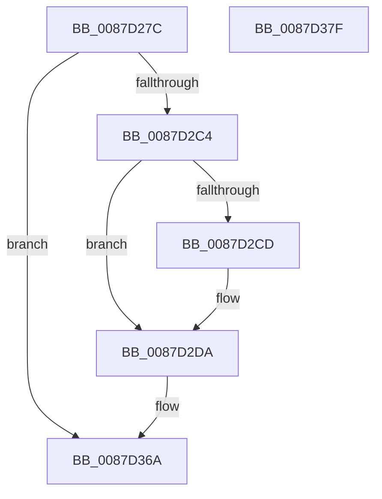

# CmpLogTxrInitEvent

- RVA: `0x0087D27C`–`0x0087D380` (길이 `260` bytes)
- VA: `0x000000014087D27C`
- 실행 섹션: `PAGE`
- PDB 이름 있음: `예`; PDB Function 태그: `아니요`
- unwind 정보 RVA: `0x0006CFB4`
- 디코드: `56`개 명령, `260/260` bytes 표시
- 미해석 바이트: `0` (있으면 어셈블리에 `.byte`로 보존)

> 이 문서는 커널 이미지의 기계어와 PDB 기호를 분석해 생성했습니다. 4번과 5번은 함수 원형과 자료형을 바이너리 사용 방식에서 추정한 C 해석이며 원본 소스 복구 결과는 아닙니다.

## 1. Dependencies

- 직접 호출 지점: **2**; 고유 호출 대상: **2**
- 직접 호출자로 확인된 함수: **1**
- RIP 상대 이미지 참조: **5**

### Outgoing calls
- `0x0087D365` → [EtwWrite](../../text/41/EtwWrite_function_0041C720.md) (function, `0x0041C720`)
- `0x0087D371` → [_security_check_cookie](../../text/6A/_security_check_cookie_function_006AC640.md) (function, `0x006AC640`)

### Direct callers
- [CmpInitCmRM](CmpInitCmRM_function_0087C700.md) at `0x0087C83A`
- [CmpInitCmRM](CmpInitCmRM_function_0087C700.md) at `0x0087CC71`
- [CmpInitCmRM](CmpInitCmRM_function_0087C700.md) at `0x0087D1BD`

### Static image references
- `0x0087D28E` → RVA `0x00E0A740` (`.data`; read)
- `0x0087D29C` → RVA `0x00EFFA28` (`.data`; read)
- `0x0087D2A3` → RVA `0x00B09AD0` (` ?? ::NNGAKEGL::`string'`; read)
- `0x0087D2C4` → RVA `0x00E09AE0` (`.data`; read)
- `0x0087D2FA` → RVA `0x00022248` (`.rdata`; read)

## 2. Other-region calls and transfers

- 다른 실행 섹션으로 향하는 call: **2**
  - `0x0087D365` → [EtwWrite](../../text/41/EtwWrite_function_0041C720.md) (`PAGE` → `.text`)
  - `0x0087D371` → [_security_check_cookie](../../text/6A/_security_check_cookie_function_006AC640.md) (`PAGE` → `.text`)
- 별도 외부 분기/꼬리 이동을 확인하지 못했습니다.

## 3. Assembly (complete function range)

```asm
0087D27C  44 89 44 24 18                  mov dword ptr [rsp + 0x18], r8d
0087D281  55                              push rbp
0087D282  48 8D 6C 24 A9                  lea rbp, [rsp - 0x57]
0087D287  48 81 EC C0 00 00 00            sub rsp, 0xc0
0087D28E  48 8B 05 AB D4 58 00            mov rax, qword ptr [rip + 0x58d4ab]
0087D295  48 33 C4                        xor rax, rsp
0087D298  48 89 45 47                     mov qword ptr [rbp + 0x47], rax
0087D29C  4C 8B 15 85 27 68 00            mov r10, qword ptr [rip + 0x682785]
0087D2A3  4C 8D 05 26 C8 28 00            lea r8, [rip + 0x28c826]
0087D2AA  8B 82 40 10 00 00               mov eax, dword ptr [rdx + 0x1040]
0087D2B0  45 33 C9                        xor r9d, r9d
0087D2B3  89 45 CB                        mov dword ptr [rbp - 0x35], eax
0087D2B6  B9 44 00 00 00                  mov ecx, 0x44
0087D2BB  4D 85 D2                        test r10, r10
0087D2BE  0F 84 A6 00 00 00               je 0x14087d36a
0087D2C4  48 39 15 15 C8 58 00            cmp qword ptr [rip + 0x58c815], rdx
0087D2CB  74 0D                           je 0x14087d2da
0087D2CD  4C 8B 82 38 07 00 00            mov r8, qword ptr [rdx + 0x738]
0087D2D4  8B 8A 30 07 00 00               mov ecx, dword ptr [rdx + 0x730]
0087D2DA  0F B7 C1                        movzx eax, cx
0087D2DD  4C 89 45 F7                     mov qword ptr [rbp - 9], r8
0087D2E1  66 D1 E8                        shr ax, 1
0087D2E4  45 33 C0                        xor r8d, r8d
0087D2E7  66 89 45 C7                     mov word ptr [rbp - 0x39], ax
0087D2EB  48 8D 45 C7                     lea rax, [rbp - 0x39]
0087D2EF  48 89 45 E7                     mov qword ptr [rbp - 0x19], rax
0087D2F3  0F B7 C1                        movzx eax, cx
0087D2F6  48 8B 4A 40                     mov rcx, qword ptr [rdx + 0x40]
0087D2FA  48 8D 15 47 4F 7A FF            lea rdx, [rip - 0x85b0b9]
0087D301  89 45 FF                        mov dword ptr [rbp - 1], eax
0087D304  44 89 4D 03                     mov dword ptr [rbp + 3], r9d
0087D308  41 B9 06 00 00 00               mov r9d, 6
0087D30E  48 C7 45 EF 02 00 00 00         mov qword ptr [rbp - 0x11], 2
0087D316  48 8D 81 94 00 00 00            lea rax, [rcx + 0x94]
0087D31D  48 C7 45 0F 10 00 00 00         mov qword ptr [rbp + 0xf], 0x10
0087D325  48 89 45 07                     mov qword ptr [rbp + 7], rax
0087D329  48 8D 41 70                     lea rax, [rcx + 0x70]
0087D32D  48 89 45 17                     mov qword ptr [rbp + 0x17], rax
0087D331  49 8B CA                        mov rcx, r10
0087D334  48 8D 45 77                     lea rax, [rbp + 0x77]
0087D338  48 C7 45 1F 10 00 00 00         mov qword ptr [rbp + 0x1f], 0x10
0087D340  48 89 45 27                     mov qword ptr [rbp + 0x27], rax
0087D344  48 8D 45 CB                     lea rax, [rbp - 0x35]
0087D348  48 89 45 37                     mov qword ptr [rbp + 0x37], rax
0087D34C  48 8D 45 E7                     lea rax, [rbp - 0x19]
0087D350  48 89 44 24 20                  mov qword ptr [rsp + 0x20], rax
0087D355  48 C7 45 2F 04 00 00 00         mov qword ptr [rbp + 0x2f], 4
0087D35D  48 C7 45 3F 04 00 00 00         mov qword ptr [rbp + 0x3f], 4
0087D365  E8 B6 F3 B9 FF                  call 0x14041c720
0087D36A  48 8B 4D 47                     mov rcx, qword ptr [rbp + 0x47]
0087D36E  48 33 CC                        xor rcx, rsp
0087D371  E8 CA F2 E2 FF                  call 0x1406ac640
0087D376  48 81 C4 C0 00 00 00            add rsp, 0xc0
0087D37D  5D                              pop rbp
0087D37E  C3                              ret
0087D37F  CC                              int3
```

## 4. C-style interpretation (structured pseudocode)

```c
__int64 __fastcall CmpLogTxrInitEvent(__int64 a1, __int64 a2, int a3, int a4)
{
    __int64 result;
    __int64 v_rsp;
    unsigned __int64 v_stack_m18;
    unsigned __int64 v_stack_m20;
    unsigned __int64 v_stack_m28;
    unsigned __int64 v_stack_m30;
    unsigned __int64 v_stack_m38;
    unsigned __int64 v_stack_m40;
    unsigned __int64 v_stack_m48;
    unsigned __int64 v_stack_m50;
    unsigned __int64 v_stack_m58;
    unsigned int v_stack_m5C;
    unsigned __int64 v_stack_m5F;
    unsigned int v_stack_m60;
    unsigned __int64 v_stack_m68;
    unsigned __int64 v_stack_m70;
    unsigned __int64 v_stack_m78;
    unsigned int v_stack_m94;
    unsigned __int16 v_stack_m98;
    unsigned __int64 v_stack_mA8;
    unsigned int v_stack_p18;

    v_stack_p18 = a3;
    v_rsp = (v_rsp) - (192);
    result = (*(unsigned __int64 *)(v_rip + 5821611)) ^ (v_rsp);
    v_stack_m18 = result;
    a4 = 0;
    v_stack_m94 = (unsigned int)((unsigned int)(*(unsigned int *)(a2 + 4160)));
    if (*(unsigned __int64 *)(v_rip + 6825861) == 0) goto loc_0087D36A;
    if ((*(unsigned __int64 *)(v_rip + 5818389)) != a2) {
        a3 = *(unsigned __int64 *)(a2 + 1848);
        a1 = *(unsigned int *)(a2 + 1840);
    }
    v_stack_m68 = a3;
    result = (unsigned __int16)(((unsigned __int16)(a1)) >> (1));
    a3 = 0;
    v_stack_m98 = (unsigned __int16)(result);
    v_stack_m78 = v_stack_m98;
    v_stack_m60 = (unsigned int)((unsigned __int16)(a1));
    v_stack_m5C = 0;
    v_stack_m70 = 2;
    v_stack_m50 = 16;
    v_stack_m58 = *(unsigned __int64 *)(a2 + 64) + 148;
    v_stack_m48 = *(unsigned __int64 *)(a2 + 64) + 112;
    v_stack_m40 = 16;
    v_stack_m38 = v_stack_p18;
    v_stack_m28 = v_stack_m94;
    v_stack_mA8 = v_stack_m78;
    v_stack_m30 = 4;
    v_stack_m20 = 4;
    result = EtwWrite(*(unsigned __int64 *)(v_rip + 6825861), v_rip - 8761529, a3, 6);
loc_0087D36A:
    a1 = (v_stack_m18) ^ (v_rsp);
    result = _security_check_cookie(a1, v_rip - 8761529, a3, 6);
    v_rsp = (v_rsp) + (192);
    return result;
}
```

## 5. (Beta) C Style

```c
int64_t CmpLogTxrInitEvent(int64_t Arg1, void *Arg2, int32_t Arg3, int32_t Arg4)
{
    uint8_t *arg2 = (uint8_t *)Arg2;

    int64_t result;
    int64_t local_rsp;
    uint64_t v_stack_m18;
    uint64_t v_stack_m20;
    uint64_t v_stack_m28;
    uint64_t v_stack_m30;
    uint64_t v_stack_m38;
    uint64_t v_stack_m40;
    uint64_t v_stack_m48;
    uint64_t v_stack_m50;
    uint64_t v_stack_m58;
    uint32_t v_stack_m5C;
    uint64_t v_stack_m5F;
    uint32_t v_stack_m60;
    uint64_t v_stack_m68;
    uint64_t v_stack_m70;
    uint64_t v_stack_m78;
    uint32_t v_stack_m94;
    uint16_t v_stack_m98;
    uint64_t v_stack_mA8;
    uint32_t v_stack_p18;

    v_stack_p18 = Arg3;
    local_rsp = (local_rsp) - (192);
    result = (*(uint64_t *)(v_rip + 0x58D4AB)) ^ (local_rsp);
    v_stack_m18 = result;
    Arg4 = 0;
    v_stack_m94 = (uint32_t)((uint32_t)(*(uint32_t *)(arg2 + 0x1040)));
    if (*(uint64_t *)(v_rip + 0x682785) == 0) goto loc_0087D36A;
    if ((*(uint64_t *)(v_rip + 0x58C815)) != Arg2) {
        Arg3 = *(uint64_t *)(arg2 + 0x738);
        Arg1 = *(uint32_t *)(arg2 + 0x730);
    }
    v_stack_m68 = Arg3;
    result = (uint16_t)(((uint16_t)(Arg1)) >> (1));
    Arg3 = 0;
    v_stack_m98 = (uint16_t)(result);
    v_stack_m78 = v_stack_m98;
    v_stack_m60 = (uint32_t)((uint16_t)(Arg1));
    v_stack_m5C = 0;
    v_stack_m70 = 2;
    v_stack_m50 = 16;
    v_stack_m58 = *(uint64_t *)(arg2 + 0x40) + 148;
    v_stack_m48 = *(uint64_t *)(arg2 + 0x40) + 112;
    v_stack_m40 = 16;
    v_stack_m38 = v_stack_p18;
    v_stack_m28 = v_stack_m94;
    v_stack_mA8 = v_stack_m78;
    v_stack_m30 = 4;
    v_stack_m20 = 4;
    result = EtwWrite(*(uint64_t *)(v_rip + 0x682785), v_rip - 8761529, Arg3, 6);
loc_0087D36A:
    Arg1 = (v_stack_m18) ^ (local_rsp);
    result = _security_check_cookie(Arg1, v_rip - 8761529, Arg3, 6);
    local_rsp = (local_rsp) + (192);
    return result;
}
```

### 관측된 메모리 오프셋

구조체 형식이 확인되지 않은 접근은 인자 기준의 오프셋으로만 기록했습니다.

| 기준 인자 | 오프셋 표현 | 폭 (bit) | 접근 |
|---|---:|---:|---|
| `Arg2` | `+ 0x40` | `64` | `R` |
| `Arg2` | `+ 0x730` | `32` | `R` |
| `Arg2` | `+ 0x738` | `64` | `R` |
| `Arg2` | `+ 0x1040` | `32` | `R` |

## 6. Execution-region graph

[열기: 2D/3D 그래프와 함수 탐색 컨트롤 패널](../../../control-panel.html?section=page&rva=0x0087D27C&view=graph)

- 2D 그래프는 위에서 아래로 흐르고, 3D 그래프는 빈 공간을 드래그해 회전합니다. Shift+드래그는 이동, 휠은 확대·축소, 함수 노드 선택은 대상 보고서 이동입니다.

### Static fallback


