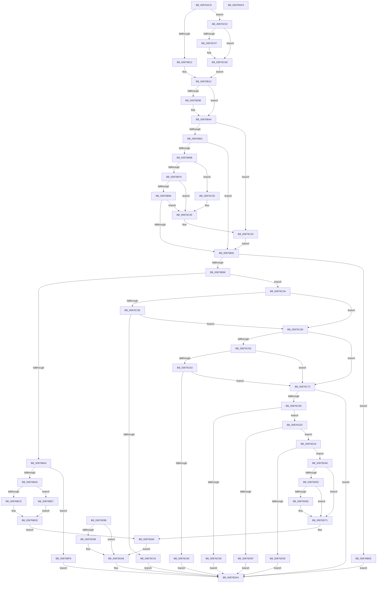

# CmpNameFromAttributes

- RVA: `0x00876AC8`–`0x00876DD4` (길이 `780` bytes)
- VA: `0x0000000140876AC8`
- 실행 섹션: `PAGE`
- PDB 이름 있음: `예`; PDB Function 태그: `아니요`
- unwind 정보 RVA: `0x0006CAD0`
- 디코드: `196`개 명령, `780/780` bytes 표시
- 미해석 바이트: `0` (있으면 어셈블리에 `.byte`로 보존)

> 이 문서는 커널 이미지의 기계어와 PDB 기호를 분석해 생성했습니다. 4번과 5번은 함수 원형과 자료형을 바이너리 사용 방식에서 추정한 C 해석이며 원본 소스 복구 결과는 아닙니다.

## 1. Dependencies

- 직접 호출 지점: **12**; 고유 호출 대상: **9**
- 직접 호출자로 확인된 함수: **2**
- RIP 상대 이미지 참조: **1**

### Outgoing calls
- `0x00876BC0` → [ExAllocatePool2](../../poolcode/B8/ExAllocatePool2_function_00B820F0.md) (function, `0x00B820F0`)
- `0x00876BD9` → [memcpy](../../text/6C/memcpy_function_006C6840.md) (function, `0x006C6840`)
- `0x00876C07` → [ExRaiseDatatypeMisalignment](../89/ExRaiseDatatypeMisalignment_function_00899FD0.md) (function, `0x00899FD0`)
- `0x00876C29` → [ExRaiseDatatypeMisalignment](../89/ExRaiseDatatypeMisalignment_function_00899FD0.md) (function, `0x00899FD0`)
- `0x00876C8C` → [IoConvertFileHandleToKernelHandle](../A8/IoConvertFileHandleToKernelHandle_function_00A85680.md) (function, `0x00A85680`)
- `0x00876CBD` → [ZwQueryObject](../../text/6A/ZwQueryObject_function_006AD2D0.md) (function, `0x006AD2D0`)
- `0x00876CCE` → [ZwClose](../../text/6A/ZwClose_function_006AD2B0.md) (function, `0x006AD2B0`)
- `0x00876D2B` → [ExAllocatePool2](../../poolcode/B8/ExAllocatePool2_function_00B820F0.md) (function, `0x00B820F0`)
- `0x00876D4B` → [RtlAppendUnicodeStringToString](../../text/40/RtlAppendUnicodeStringToString_function_0040FA50.md) (function, `0x0040FA50`)
- `0x00876D79` → [RtlAppendUnicodeStringToString](../../text/40/RtlAppendUnicodeStringToString_function_0040FA50.md) (function, `0x0040FA50`)
- `0x00876D9E` → [ExFreePoolWithTag](../../poolcode/B8/ExFreePoolWithTag_function_00B82870.md) (function, `0x00B82870`)
- `0x00876DB5` → [_security_check_cookie](../../text/6A/_security_check_cookie_function_006AC640.md) (function, `0x006AC640`)

### Direct callers
- [NtReplaceKey](../7E/NtReplaceKey_function_007E0970.md) at `0x007E0A5F`
- [NtReplaceKey](../7E/NtReplaceKey_function_007E0970.md) at `0x007E0A7C`
- [CmLoadDifferencingKey](CmLoadDifferencingKey_function_00875670.md) at `0x008758AD`

### Static image references
- `0x00876ADE` → RVA `0x00E0A740` (`.data`; read)

## 2. Other-region calls and transfers

- 다른 실행 섹션으로 향하는 call: **9**
  - `0x00876BC0` → [ExAllocatePool2](../../poolcode/B8/ExAllocatePool2_function_00B820F0.md) (`PAGE` → `POOLCODE`)
  - `0x00876BD9` → [memcpy](../../text/6C/memcpy_function_006C6840.md) (`PAGE` → `.text`)
  - `0x00876CBD` → [ZwQueryObject](../../text/6A/ZwQueryObject_function_006AD2D0.md) (`PAGE` → `.text`)
  - `0x00876CCE` → [ZwClose](../../text/6A/ZwClose_function_006AD2B0.md) (`PAGE` → `.text`)
  - `0x00876D2B` → [ExAllocatePool2](../../poolcode/B8/ExAllocatePool2_function_00B820F0.md) (`PAGE` → `POOLCODE`)
  - `0x00876D4B` → [RtlAppendUnicodeStringToString](../../text/40/RtlAppendUnicodeStringToString_function_0040FA50.md) (`PAGE` → `.text`)
  - `0x00876D79` → [RtlAppendUnicodeStringToString](../../text/40/RtlAppendUnicodeStringToString_function_0040FA50.md) (`PAGE` → `.text`)
  - `0x00876D9E` → [ExFreePoolWithTag](../../poolcode/B8/ExFreePoolWithTag_function_00B82870.md) (`PAGE` → `POOLCODE`)
  - `0x00876DB5` → [_security_check_cookie](../../text/6A/_security_check_cookie_function_006AC640.md) (`PAGE` → `.text`)
- 별도 외부 분기/꼬리 이동을 확인하지 못했습니다.

## 3. Assembly (complete function range)

```asm
00876AC8  48 89 5C 24 10                  mov qword ptr [rsp + 0x10], rbx
00876ACD  48 89 74 24 20                  mov qword ptr [rsp + 0x20], rsi
00876AD2  57                              push rdi
00876AD3  41 56                           push r14
00876AD5  41 57                           push r15
00876AD7  48 81 EC B0 02 00 00            sub rsp, 0x2b0
00876ADE  48 8B 05 5B 3C 59 00            mov rax, qword ptr [rip + 0x593c5b]
00876AE5  48 33 C4                        xor rax, rsp
00876AE8  48 89 84 24 A0 02 00 00         mov qword ptr [rsp + 0x2a0], rax
00876AF0  49 8B F0                        mov rsi, r8
00876AF3  44 8A D2                        mov r10b, dl
00876AF6  4C 89 44 24 50                  mov qword ptr [rsp + 0x50], r8
00876AFB  33 DB                           xor ebx, ebx
00876AFD  89 5C 24 48                     mov dword ptr [rsp + 0x48], ebx
00876B01  49 89 58 08                     mov qword ptr [r8 + 8], rbx
00876B05  44 8D 7B 01                     lea r15d, [rbx + 1]
00876B09  41 3A D7                        cmp dl, r15b
00876B0C  0F 84 F0 00 00 00               je 0x140876c02
00876B12  48 BA 00 00 FF FF FF 7F 00 00   movabs rdx, 0x7fffffff0000
00876B1C  0F 10 01                        movups xmm0, xmmword ptr [rcx]
00876B1F  0F 11 44 24 58                  movups xmmword ptr [rsp + 0x58], xmm0
00876B24  0F 10 49 10                     movups xmm1, xmmword ptr [rcx + 0x10]
00876B28  0F 11 4C 24 68                  movups xmmword ptr [rsp + 0x68], xmm1
00876B2D  0F 10 41 20                     movups xmm0, xmmword ptr [rcx + 0x20]
00876B31  0F 11 44 24 78                  movups xmmword ptr [rsp + 0x78], xmm0
00876B36  45 3A D7                        cmp r10b, r15b
00876B39  75 0F                           jne 0x140876b4a
00876B3B  48 8B 44 24 68                  mov rax, qword ptr [rsp + 0x68]
00876B40  48 3B C2                        cmp rax, rdx
00876B43  48 0F 43 C2                     cmovae rax, rdx
00876B47  90                              nop
00876B48  8A 00                           mov al, byte ptr [rax]
00876B4A  48 8B 44 24 68                  mov rax, qword ptr [rsp + 0x68]
00876B4F  0F 10 00                        movups xmm0, xmmword ptr [rax]
00876B52  F3 0F 7F 44 24 38               movdqu xmmword ptr [rsp + 0x38], xmm0
00876B58  45 3A D7                        cmp r10b, r15b
00876B5B  0F 85 CF 00 00 00               jne 0x140876c30
00876B61  0F B7 7C 24 38                  movzx edi, word ptr [rsp + 0x38]
00876B66  66 85 FF                        test di, di
00876B69  74 26                           je 0x140876b91
00876B6B  44 84 7C 24 40                  test byte ptr [rsp + 0x40], r15b
00876B70  0F 85 B3 00 00 00               jne 0x140876c29
00876B76  48 8B 4C 24 40                  mov rcx, qword ptr [rsp + 0x40]
00876B7B  4C 8D 04 39                     lea r8, [rcx + rdi]
00876B7F  4C 3B C2                        cmp r8, rdx
00876B82  0F 87 A6 00 00 00               ja 0x140876c2e
00876B88  4C 3B C1                        cmp r8, rcx
00876B8B  0F 82 9D 00 00 00               jb 0x140876c2e
00876B91  41 84 FF                        test r15b, dil
00876B94  75 58                           jne 0x140876bee
00876B96  48 8B 44 24 60                  mov rax, qword ptr [rsp + 0x60]
00876B9B  48 85 C0                        test rax, rax
00876B9E  0F 85 96 00 00 00               jne 0x140876c3a
00876BA4  66 85 FF                        test di, di
00876BA7  74 4F                           je 0x140876bf8
00876BA9  66 89 3E                        mov word ptr [rsi], di
00876BAC  66 89 7E 02                     mov word ptr [rsi + 2], di
00876BB0  0F B7 FF                        movzx edi, di
00876BB3  41 B8 43 4D 66 6E               mov r8d, 0x6e664d43
00876BB9  8B D7                           mov edx, edi
00876BBB  B9 01 01 00 00                  mov ecx, 0x101
00876BC0  E8 2B B5 30 00                  call 0x140b820f0
00876BC5  48 89 46 08                     mov qword ptr [rsi + 8], rax
00876BC9  48 85 C0                        test rax, rax
00876BCC  74 19                           je 0x140876be7
00876BCE  44 8B C7                        mov r8d, edi
00876BD1  48 8B 54 24 40                  mov rdx, qword ptr [rsp + 0x40]
00876BD6  48 8B C8                        mov rcx, rax
00876BD9  E8 62 FC E4 FF                  call 0x1406c6840
00876BDE  89 5C 24 30                     mov dword ptr [rsp + 0x30], ebx
00876BE2  E9 9D 01 00 00                  jmp 0x140876d84
00876BE7  BB 9A 00 00 C0                  mov ebx, 0xc000009a
00876BEC  EB F0                           jmp 0x140876bde
00876BEE  B8 3B 00 00 C0                  mov eax, 0xc000003b
00876BF3  E9 B2 01 00 00                  jmp 0x140876daa
00876BF8  B8 3B 00 00 C0                  mov eax, 0xc000003b
00876BFD  E9 A8 01 00 00                  jmp 0x140876daa
00876C02  F6 C1 03                        test cl, 3
00876C05  74 06                           je 0x140876c0d
00876C07  E8 C4 33 02 00                  call 0x140899fd0
00876C0C  CC                              int3
00876C0D  48 BA 00 00 FF FF FF 7F 00 00   movabs rdx, 0x7fffffff0000
00876C17  48 8B C2                        mov rax, rdx
00876C1A  48 3B CA                        cmp rcx, rdx
00876C1D  48 0F 42 C1                     cmovb rax, rcx
00876C21  90                              nop
00876C22  8A 00                           mov al, byte ptr [rax]
00876C24  E9 F3 FE FF FF                  jmp 0x140876b1c
00876C29  E8 A2 33 02 00                  call 0x140899fd0
00876C2E  8A 02                           mov al, byte ptr [rdx]
00876C30  0F B7 7C 24 38                  movzx edi, word ptr [rsp + 0x38]
00876C35  E9 57 FF FF FF                  jmp 0x140876b91
00876C3A  85 C0                           test eax, eax
00876C3C  79 0F                           jns 0x140876c4d
00876C3E  45 3A D7                        cmp r10b, r15b
00876C41  75 0A                           jne 0x140876c4d
00876C43  B8 08 00 00 C0                  mov eax, 0xc0000008
00876C48  E9 5D 01 00 00                  jmp 0x140876daa
00876C4D  48 8B 4C 24 40                  mov rcx, qword ptr [rsp + 0x40]
00876C52  41 BE 5C 00 00 00               mov r14d, 0x5c
00876C58  48 85 C9                        test rcx, rcx
00876C5B  74 16                           je 0x140876c73
00876C5D  66 83 FF 02                     cmp di, 2
00876C61  72 10                           jb 0x140876c73
00876C63  66 44 39 31                     cmp word ptr [rcx], r14w
00876C67  75 0A                           jne 0x140876c73
00876C69  B8 3B 00 00 C0                  mov eax, 0xc000003b
00876C6E  E9 37 01 00 00                  jmp 0x140876daa
00876C73  48 8D 4C 24 60                  lea rcx, [rsp + 0x60]
00876C78  48 89 4C 24 20                  mov qword ptr [rsp + 0x20], rcx
00876C7D  45 8A CF                        mov r9b, r15b
00876C80  41 B8 20 00 00 00               mov r8d, 0x20
00876C86  41 8A D2                        mov dl, r10b
00876C89  48 8B C8                        mov rcx, rax
00876C8C  E8 EF E9 20 00                  call 0x140a85680
00876C91  89 44 24 30                     mov dword ptr [rsp + 0x30], eax
00876C95  85 C0                           test eax, eax
00876C97  0F 88 0D 01 00 00               js 0x140876daa
00876C9D  48 8D 44 24 48                  lea rax, [rsp + 0x48]
00876CA2  48 89 44 24 20                  mov qword ptr [rsp + 0x20], rax
00876CA7  41 B9 00 02 00 00               mov r9d, 0x200
00876CAD  4C 8D 84 24 A0 00 00 00         lea r8, [rsp + 0xa0]
00876CB5  41 8B D7                        mov edx, r15d
00876CB8  48 8B 4C 24 60                  mov rcx, qword ptr [rsp + 0x60]
00876CBD  E8 0E 66 E3 FF                  call 0x1406ad2d0
00876CC2  44 8B F8                        mov r15d, eax
00876CC5  89 44 24 30                     mov dword ptr [rsp + 0x30], eax
00876CC9  48 8B 4C 24 60                  mov rcx, qword ptr [rsp + 0x60]
00876CCE  E8 DD 65 E3 FF                  call 0x1406ad2b0
00876CD3  45 85 FF                        test r15d, r15d
00876CD6  79 08                           jns 0x140876ce0
00876CD8  41 8B C7                        mov eax, r15d
00876CDB  E9 CA 00 00 00                  jmp 0x140876daa
00876CE0  0F 28 84 24 A0 00 00 00         movaps xmm0, xmmword ptr [rsp + 0xa0]
00876CE8  F3 0F 7F 84 24 88 00 00 00      movdqu xmmword ptr [rsp + 0x88], xmm0
00876CF1  66 89 1E                        mov word ptr [rsi], bx
00876CF4  66 0F 7E C0                     movd eax, xmm0
00876CF8  0F B7 C8                        movzx ecx, ax
00876CFB  0F B7 D7                        movzx edx, di
00876CFE  83 C1 02                        add ecx, 2
00876D01  03 D1                           add edx, ecx
00876D03  89 54 24 4C                     mov dword ptr [rsp + 0x4c], edx
00876D07  81 FA FF FF 00 00               cmp edx, 0xffff
00876D0D  76 0A                           jbe 0x140876d19
00876D0F  B8 39 00 00 C0                  mov eax, 0xc0000039
00876D14  E9 91 00 00 00                  jmp 0x140876daa
00876D19  66 89 56 02                     mov word ptr [rsi + 2], dx
00876D1D  0F B7 D2                        movzx edx, dx
00876D20  B9 01 01 00 00                  mov ecx, 0x101
00876D25  41 B8 43 4D 66 6E               mov r8d, 0x6e664d43
00876D2B  E8 C0 B3 30 00                  call 0x140b820f0
00876D30  48 89 46 08                     mov qword ptr [rsi + 8], rax
00876D34  48 85 C0                        test rax, rax
00876D37  75 07                           jne 0x140876d40
00876D39  B8 9A 00 00 C0                  mov eax, 0xc000009a
00876D3E  EB 6A                           jmp 0x140876daa
00876D40  48 8D 94 24 88 00 00 00         lea rdx, [rsp + 0x88]
00876D48  48 8B CE                        mov rcx, rsi
00876D4B  E8 00 8D B9 FF                  call 0x14040fa50
00876D50  89 44 24 30                     mov dword ptr [rsp + 0x30], eax
00876D54  0F B7 06                        movzx eax, word ptr [rsi]
00876D57  66 85 C0                        test ax, ax
00876D5A  74 15                           je 0x140876d71
00876D5C  48 8B 4E 08                     mov rcx, qword ptr [rsi + 8]
00876D60  66 44 39 74 08 FE               cmp word ptr [rax + rcx - 2], r14w
00876D66  74 09                           je 0x140876d71
00876D68  66 44 89 34 08                  mov word ptr [rax + rcx], r14w
00876D6D  66 83 06 02                     add word ptr [rsi], 2
00876D71  48 8D 54 24 38                  lea rdx, [rsp + 0x38]
00876D76  48 8B CE                        mov rcx, rsi
00876D79  E8 D2 8C B9 FF                  call 0x14040fa50
00876D7E  8B D8                           mov ebx, eax
00876D80  89 44 24 30                     mov dword ptr [rsp + 0x30], eax
00876D84  EB 22                           jmp 0x140876da8
00876D86  8B D8                           mov ebx, eax
00876D88  89 44 24 30                     mov dword ptr [rsp + 0x30], eax
00876D8C  48 8B 7C 24 50                  mov rdi, qword ptr [rsp + 0x50]
00876D91  48 83 7F 08 00                  cmp qword ptr [rdi + 8], 0
00876D96  74 10                           je 0x140876da8
00876D98  33 D2                           xor edx, edx
00876D9A  48 8B 4F 08                     mov rcx, qword ptr [rdi + 8]
00876D9E  E8 CD BA 30 00                  call 0x140b82870
00876DA3  48 83 67 08 00                  and qword ptr [rdi + 8], 0
00876DA8  8B C3                           mov eax, ebx
00876DAA  48 8B 8C 24 A0 02 00 00         mov rcx, qword ptr [rsp + 0x2a0]
00876DB2  48 33 CC                        xor rcx, rsp
00876DB5  E8 86 58 E3 FF                  call 0x1406ac640
00876DBA  4C 8D 9C 24 B0 02 00 00         lea r11, [rsp + 0x2b0]
00876DC2  49 8B 5B 28                     mov rbx, qword ptr [r11 + 0x28]
00876DC6  49 8B 73 38                     mov rsi, qword ptr [r11 + 0x38]
00876DCA  49 8B E3                        mov rsp, r11
00876DCD  41 5F                           pop r15
00876DCF  41 5E                           pop r14
00876DD1  5F                              pop rdi
00876DD2  C3                              ret
00876DD3  CC                              int3
```

## 4. C-style interpretation (structured pseudocode)

```c
__int64 __fastcall CmpNameFromAttributes(__int64 a1, unsigned __int8 a2, __int64 a3)
{
    __int64 result;
    __int64 v_rbx;
    __int64 v_rsp;
    unsigned __int64 v_stack_m18;
    unsigned __int64 v_stack_m228;
    unsigned __int64 v_stack_m240;
    unsigned __int64 v_stack_m250;
    unsigned __int64 v_stack_m260;
    unsigned __int64 v_stack_m268;
    unsigned __int64 v_stack_m270;
    unsigned __int64 v_stack_m278;
    unsigned int v_stack_m27C;
    unsigned __int64 v_stack_m28;
    unsigned int v_stack_m280;
    unsigned __int8 v_stack_m288;
    unsigned __int64 v_stack_m290;
    unsigned int v_stack_m298;
    unsigned __int64 v_stack_m2A8;
    unsigned __int64 v_stack_p10;
    unsigned __int64 v_stack_p20;

    v_stack_p10 = v_rbx;
    v_stack_p20 = v_rsi;
    v_rsp = (v_rsp) - (688);
    result = (*(unsigned __int64 *)(v_rip + 5848155)) ^ (v_rsp);
    v_stack_m28 = result;
    v_stack_m278 = a3;
    v_rbx = 0;
    v_stack_m280 = 0;
    *(unsigned __int64 *)(a3 + 8) = 0;
    if (a2 == ((unsigned __int8)(v_rbx + 1))) goto loc_00876C02;
loc_00876B1C:
    v_stack_m270 = v_xmm0;
    v_stack_m260 = v_xmm1;
    v_stack_m250 = v_xmm0;
    if (a2 == ((unsigned __int8)(v_rbx + 1))) {
        result = v_stack_m260;
        if (result >= a2) { result = a2; }
        result = *(unsigned __int8 *)(result);
    }
    v_stack_m290 = v_xmm0;
    if (a2 != ((unsigned __int8)(v_rbx + 1))) goto loc_00876C30;
    if ((unsigned __int16)(v_stack_m290) == 0) goto loc_00876B91;
    if (((v_stack_m288) & ((unsigned __int8)(v_rbx + 1))) != 0) goto loc_00876C29;
    if ((v_stack_m288 + v_stack_m290 * 1) > a2) goto loc_00876C2E;
    if ((v_stack_m288 + v_stack_m290 * 1) < v_stack_m288) goto loc_00876C2E;
loc_00876B91:
    if ((((unsigned __int8)(v_rbx + 1)) & ((unsigned __int8)(v_stack_m290))) != 0) goto loc_00876BEE;
    if (v_stack_m268 != 0) goto loc_00876C3A;
    if ((unsigned __int16)(v_stack_m290) == 0) goto loc_00876BF8;
    *(unsigned __int16 *)(a3) = (unsigned __int16)(v_stack_m290);
    *(unsigned __int16 *)(a3 + 2) = (unsigned __int16)(v_stack_m290);
    result = ExAllocatePool2(257, (unsigned int)((unsigned int)((unsigned __int16)(v_stack_m290))), (unsigned int)(0x6E664D43ULL), a4);
    *(unsigned __int64 *)(a3 + 8) = result;
    if (result == 0) goto loc_00876BE7;
    result = memcpy(result, v_stack_m288, (unsigned int)((unsigned int)((unsigned __int16)(v_stack_m290))), a4);
loc_00876BDE:
    v_stack_m298 = 0;
    goto loc_00876D84;
loc_00876BE7:
    goto loc_00876BDE;
loc_00876BEE:
    goto loc_00876DAA;
loc_00876BF8:
    goto loc_00876DAA;
loc_00876C02:
    result = (unsigned int)(0xC000003BULL);
    if ((((unsigned __int8)(result)) & (3)) != 0) {
        result = ExRaiseDatatypeMisalignment(result, v_stack_m288, (unsigned int)((unsigned int)((unsigned __int16)(v_stack_m290))), a4);
    }
    result = v_stack_m288;
    if (result < v_stack_m288) { result = result; }
    goto loc_00876B1C;
loc_00876C29:
    result = ExRaiseDatatypeMisalignment(result, v_stack_m288, (unsigned int)((unsigned int)((unsigned __int16)(v_stack_m290))), a4);
loc_00876C2E:
loc_00876C30:
    goto loc_00876B91;
loc_00876C3A:
    if (!sign_flag) goto loc_00876C4D;
    if (a2 != ((unsigned __int8)(v_rbx + 1))) goto loc_00876C4D;
    goto loc_00876DAA;
loc_00876C4D:
    if (v_stack_m288 == 0) goto loc_00876C73;
    if (((unsigned __int16)(v_stack_m290)) < 2) goto loc_00876C73;
    if ((*(unsigned __int16 *)(v_stack_m288)) != 92) goto loc_00876C73;
    goto loc_00876DAA;
loc_00876C73:
    v_stack_m2A8 = v_stack_m268;
    result = IoConvertFileHandleToKernelHandle((unsigned int)(0xC000003BULL), a2, 32, (unsigned __int8)(v_rbx + 1));
    v_stack_m298 = (unsigned int)(result);
    if (sign_flag) goto loc_00876DAA;
    v_stack_m2A8 = v_stack_m280;
    result = ZwQueryObject(v_stack_m268, (unsigned int)((unsigned int)(v_rbx + 1)), v_stack_m228, 512);
    v_stack_m298 = (unsigned int)(result);
    result = ZwClose(v_stack_m268, (unsigned int)((unsigned int)(v_rbx + 1)), v_stack_m228, 512);
    if (!sign_flag) goto loc_00876CE0;
    goto loc_00876DAA;
loc_00876CE0:
    v_stack_m240 = v_xmm0;
    *(unsigned __int16 *)(a3) = (unsigned __int16)((unsigned int)(0xC000009AULL));
    a1 = (unsigned int)(((unsigned __int16)((unsigned int)((unsigned int)((unsigned int)((unsigned int)(result)))))) + (2));
    a2 = (unsigned int)(((unsigned __int16)(v_stack_m290)) + ((unsigned int)(a1)));
    v_stack_m27C = a2;
    if (a2 <= 0xFFFFULL) goto loc_00876D19;
    goto loc_00876DAA;
loc_00876D19:
    *(unsigned __int16 *)(a3 + 2) = a2;
    result = ExAllocatePool2(257, a2, (unsigned int)(0x6E664D43ULL), 512);
    *(unsigned __int64 *)(a3 + 8) = result;
    if (result != 0) goto loc_00876D40;
    goto loc_00876DAA;
loc_00876D40:
    result = RtlAppendUnicodeStringToString(a3, v_stack_m240, (unsigned int)(0x6E664D43ULL), 512);
    v_stack_m298 = (unsigned int)(result);
    if ((unsigned __int16)(*(unsigned __int16 *)(a3)) == 0) goto loc_00876D71;
    if ((*(unsigned __int16 *)(*(unsigned __int16 *)(a3) + *(unsigned __int64 *)(a3 + 8) * 1 - 2)) != 92) {
        *(unsigned __int16 *)(*(unsigned __int16 *)(a3) + *(unsigned __int64 *)(a3 + 8) * 1) = 92;
    }
    result = RtlAppendUnicodeStringToString(a3, v_stack_m290, (unsigned int)(0x6E664D43ULL), 512);
    v_stack_m298 = (unsigned int)(result);
loc_00876D84:
    goto loc_00876DA8;
loc_00876DA8:
loc_00876DAA:
    a1 = (v_stack_m28) ^ (v_rsp);
    result = _security_check_cookie(a1, v_stack_m290, (unsigned int)(0x6E664D43ULL), 512);
    return result;
}
```

## 5. (Beta) C Style

```c
int64_t CmpNameFromAttributes(int64_t Arg1, uint8_t Arg2, void *Arg3)
{
    uint8_t *arg3 = (uint8_t *)Arg3;

    int64_t result;
    int64_t local_rbx;
    int64_t local_rsp;
    uint64_t v_stack_m18;
    uint64_t v_stack_m228;
    uint64_t v_stack_m240;
    uint64_t v_stack_m250;
    uint64_t v_stack_m260;
    uint64_t v_stack_m268;
    uint64_t v_stack_m270;
    uint64_t v_stack_m278;
    uint32_t v_stack_m27C;
    uint64_t v_stack_m28;
    uint32_t v_stack_m280;
    uint8_t v_stack_m288;
    uint64_t v_stack_m290;
    uint32_t v_stack_m298;
    uint64_t v_stack_m2A8;
    uint64_t v_stack_p10;
    uint64_t v_stack_p20;

    v_stack_p10 = local_rbx;
    v_stack_p20 = local_rsi;
    local_rsp = (local_rsp) - (688);
    result = (*(uint64_t *)(v_rip + 0x593C5B)) ^ (local_rsp);
    v_stack_m28 = result;
    v_stack_m278 = Arg3;
    local_rbx = 0;
    v_stack_m280 = 0;
    *(uint64_t *)(arg3 + 0x8) = 0;
    if (Arg2 == ((uint8_t)(local_rbx + 1))) goto loc_00876C02;
loc_00876B1C:
    v_stack_m270 = v_xmm0;
    v_stack_m260 = v_xmm1;
    v_stack_m250 = v_xmm0;
    if (Arg2 == ((uint8_t)(local_rbx + 1))) {
        result = v_stack_m260;
        if (result >= Arg2) { result = Arg2; }
        result = *(uint8_t *)(result);
    }
    v_stack_m290 = v_xmm0;
    if (Arg2 != ((uint8_t)(local_rbx + 1))) goto loc_00876C30;
    if ((uint16_t)(v_stack_m290) == 0) goto loc_00876B91;
    if (((v_stack_m288) & ((uint8_t)(local_rbx + 1))) != 0) goto loc_00876C29;
    if ((v_stack_m288 + v_stack_m290 * 1) > Arg2) goto loc_00876C2E;
    if ((v_stack_m288 + v_stack_m290 * 1) < v_stack_m288) goto loc_00876C2E;
loc_00876B91:
    if ((((uint8_t)(local_rbx + 1)) & ((uint8_t)(v_stack_m290))) != 0) goto loc_00876BEE;
    if (v_stack_m268 != 0) goto loc_00876C3A;
    if ((uint16_t)(v_stack_m290) == 0) goto loc_00876BF8;
    *(uint16_t *)(arg3) = (uint16_t)(v_stack_m290);
    *(uint16_t *)(arg3 + 0x2) = (uint16_t)(v_stack_m290);
    result = ExAllocatePool2(257, (uint32_t)((uint32_t)((uint16_t)(v_stack_m290))), (uint32_t)(0x6E664D43ULL), a4);
    *(uint64_t *)(arg3 + 0x8) = result;
    if (result == 0) goto loc_00876BE7;
    result = memcpy(result, v_stack_m288, (uint32_t)((uint32_t)((uint16_t)(v_stack_m290))), a4);
loc_00876BDE:
    v_stack_m298 = 0;
    goto loc_00876D84;
loc_00876BE7:
    goto loc_00876BDE;
loc_00876BEE:
    goto loc_00876DAA;
loc_00876BF8:
    goto loc_00876DAA;
loc_00876C02:
    result = (uint32_t)(0xC000003BULL);
    if ((((uint8_t)(result)) & (3)) != 0) {
        result = ExRaiseDatatypeMisalignment(result, v_stack_m288, (uint32_t)((uint32_t)((uint16_t)(v_stack_m290))), a4);
    }
    result = v_stack_m288;
    if (result < v_stack_m288) { result = result; }
    goto loc_00876B1C;
loc_00876C29:
    result = ExRaiseDatatypeMisalignment(result, v_stack_m288, (uint32_t)((uint32_t)((uint16_t)(v_stack_m290))), a4);
loc_00876C2E:
loc_00876C30:
    goto loc_00876B91;
loc_00876C3A:
    if (!sign_flag) goto loc_00876C4D;
    if (Arg2 != ((uint8_t)(local_rbx + 1))) goto loc_00876C4D;
    goto loc_00876DAA;
loc_00876C4D:
    if (v_stack_m288 == 0) goto loc_00876C73;
    if (((uint16_t)(v_stack_m290)) < 2) goto loc_00876C73;
    if ((*(uint16_t *)(v_stack_m288)) != 92) goto loc_00876C73;
    goto loc_00876DAA;
loc_00876C73:
    v_stack_m2A8 = v_stack_m268;
    result = IoConvertFileHandleToKernelHandle((uint32_t)(0xC000003BULL), Arg2, 32, (uint8_t)(local_rbx + 1));
    v_stack_m298 = (uint32_t)(result);
    if (sign_flag) goto loc_00876DAA;
    v_stack_m2A8 = v_stack_m280;
    result = ZwQueryObject(v_stack_m268, (uint32_t)((uint32_t)(local_rbx + 1)), v_stack_m228, 512);
    v_stack_m298 = (uint32_t)(result);
    result = ZwClose(v_stack_m268, (uint32_t)((uint32_t)(local_rbx + 1)), v_stack_m228, 512);
    if (!sign_flag) goto loc_00876CE0;
    goto loc_00876DAA;
loc_00876CE0:
    v_stack_m240 = v_xmm0;
    *(uint16_t *)(arg3) = (uint16_t)((uint32_t)(0xC000009AULL));
    Arg1 = (uint32_t)(((uint16_t)((uint32_t)((uint32_t)((uint32_t)((uint32_t)(result)))))) + (2));
    Arg2 = (uint32_t)(((uint16_t)(v_stack_m290)) + ((uint32_t)(Arg1)));
    v_stack_m27C = Arg2;
    if (Arg2 <= 0xFFFFULL) goto loc_00876D19;
    goto loc_00876DAA;
loc_00876D19:
    *(uint16_t *)(arg3 + 0x2) = Arg2;
    result = ExAllocatePool2(257, Arg2, (uint32_t)(0x6E664D43ULL), 512);
    *(uint64_t *)(arg3 + 0x8) = result;
    if (result != 0) goto loc_00876D40;
    goto loc_00876DAA;
loc_00876D40:
    result = RtlAppendUnicodeStringToString(Arg3, v_stack_m240, (uint32_t)(0x6E664D43ULL), 512);
    v_stack_m298 = (uint32_t)(result);
    if ((uint16_t)(*(uint16_t *)(arg3)) == 0) goto loc_00876D71;
    if ((*(uint16_t *)(*(uint16_t *)(arg3) + *(uint64_t *)(arg3 + 0x8) * 1 - 0x2)) != 92) {
        *(uint16_t *)(*(uint16_t *)(arg3) + *(uint64_t *)(arg3 + 0x8) * 1) = 92;
    }
    result = RtlAppendUnicodeStringToString(Arg3, v_stack_m290, (uint32_t)(0x6E664D43ULL), 512);
    v_stack_m298 = (uint32_t)(result);
loc_00876D84:
    goto loc_00876DA8;
loc_00876DA8:
loc_00876DAA:
    Arg1 = (v_stack_m28) ^ (local_rsp);
    result = _security_check_cookie(Arg1, v_stack_m290, (uint32_t)(0x6E664D43ULL), 512);
    return result;
}
```

### 관측된 메모리 오프셋

구조체 형식이 확인되지 않은 접근은 인자 기준의 오프셋으로만 기록했습니다.

| 기준 인자 | 오프셋 표현 | 폭 (bit) | 접근 |
|---|---:|---:|---|
| `Arg3` | `+ 0x0` | `16` | `R` |
| `Arg3` | `+ 0x0` | `16` | `R/W` |
| `Arg3` | `+ 0x0` | `16` | `W` |
| `Arg3` | `+ 0x2` | `16` | `W` |
| `Arg3` | `+ 0x8` | `64` | `R` |
| `Arg3` | `+ 0x8` | `64` | `W` |

## 6. Execution-region graph

[열기: 2D/3D 그래프와 함수 탐색 컨트롤 패널](../../../control-panel.html?section=page&rva=0x00876AC8&view=graph)

- 2D 그래프는 위에서 아래로 흐르고, 3D 그래프는 빈 공간을 드래그해 회전합니다. Shift+드래그는 이동, 휠은 확대·축소, 함수 노드 선택은 대상 보고서 이동입니다.

### Static fallback


